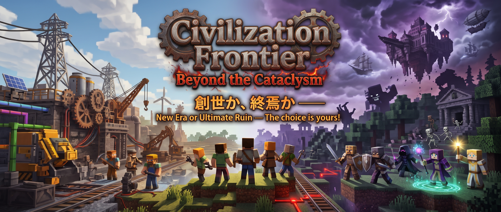

# Civilization Frontier: Beyond the Cataclysm

> _創世か、終焉か ――_ 
> _開拓、産業、経済、そして迫りくる強大な災厄 ―― 歯車を回せ! 剣を抜け!_ 
> _新たな文明を創造するか、破滅の露と消えるか、すべてはあなたの選択と手腕に委ねられている!_

ようこそ! このプロジェクトは、Build Craft、Industrial Craft 2、Better Dungeons、Project Red などの、往年の名作 MOD を現代に再現したものです. 工業、経済、RPG、ボス、生活などの要素を内包しています.

## 世界

_空を切り裂く浮遊宮殿の影が落ち、外海には巨大な幽霊船と要塞艦隊がひしめく. 地下深くに目を凝らせば、何層にも重なる古代坑道とドワーフの地下都市、そして生者を拒む果てなきカタコンベが大地を蝕んでいる._

_この世界において、もはや "安全な平原" など存在しない._

_かつて幾重にも折り重なるように栄えた無数の超古代文明は、ある日突如として訪れた "大災厄" により、その壮大な遺構ごと地上から叩き落とされ、あるいは地底深くへと埋没した._
_残されたのは、風化した監視塔、鬱蒼とした森に呑まれた巨大神殿、そして呪われた教会と納骨堂に巣食うアンデッドたちの咆哮だけだった._

_だが、荒野に降り立った開拓者たちは立ち止まらない._
_険しい山岳や沿岸に築かれた立体都市で独自の経済と交易路を切り拓き、点在する酒場や前哨基地を中継点として、未踏の領域へと歩みを進める._

_手つかずの自然を切り倒して工場を建て、蒸気と歯車の咆哮で古代の静寂を破るのか. それとも、地底の要塞や天空の城塞に眠る失われた遺産を求めて、迷宮の奥底へと挑むのか._

_鉄壁の盾で災厄の爪牙を弾く守護者._

_影に紛れ、遺跡の巨獣を刺し穿つ暗殺者._

_古代魔導の残滓を解き放つ魔道士._

_死地で倒れゆく味方を繋ぎ止める聖職者._

_頭上には浮遊城塞、足元には無限の迷宮. 密集する文明の残骸と強大な脅威の真ん中で、開拓者たちはいま、新たな時代の槌音を鳴らし始める._

_―― 創世か、終焉か._

## 1. 職業

ワールド参加時、プレイヤーは職業を選択します. 職業は、`守護者`、`暗殺者`、`魔道士`、`聖職者`、のうちいずれかを選択できます.

* 守護者 / 高い防御力で仲間を守る防壁
* 暗殺者 / 俊敏な動きと急所攻撃で標的を瞬殺する影の刃
* 魔道士 / 強力な術で広範囲を焼き払う砲台
* 聖職者 / 回復と強化で戦線を支える聖なる母

各職業の概要について > [プレイガイド](./docs/GUIDE.md)

## 2. 工業

プレイヤーは、自動化設備を駆使して資源を掌握し、インフラを構築します.

### 2.1. エネルギー

このワールドには、`Minecraft Joules`、通称 `MJ` と呼ばれる、工業の基本動力があります. これをエンジンなどで生成することで、マシンを動かすことができます. 大きなマシンを動かすため、早く動かすためにはより多くのエネルギーが必要です. しかし大規模な発電には相応のリスクが伴います. しかし、この世界の攻略を進めていくためには工業力が不可欠となります.

## 3. 経済

### 3.1. 通貨

`Minecraft Dollar`、通用 `MD` と呼ばれる、ワールド内で使用可能な通貨単位です. モノの価値を等価交換することができます. 銅、鉄、金、エメラルド、ダイヤモンド、ネザライト規格の硬貨が流通しています. クエスト達成、ダンジョンボスの討伐、工業中間素材の納品などによって獲得できます.

### 3.2. 土地保護と維持費

露天掘り機などで環境を削る科学拠点は、定期的に維持管理費を納める必要があります.

## 4. 環境負荷指数

`Environmental Foot Print`、通称 `EFP` と呼ばれる、環境負荷指数です. これは、重工業の稼働などによって世界全体に蓄積される汚染指数で、これが閾値を超えると、後述の "災害" が発生します.

## 5. 災害

環境負荷指数が閾値を超えると、オーバーワールドで災害イベントがトリガーされます.

* 黄昏: 世界は黄昏につつまれます.
* 脅威: 世界に強力なモンスターが普段より多く発生します.
* 襲撃: 大量のモンスターが拠点に押し寄せます.

## 6. 生活

作業のルーチンワークを減らし、建築や冒険に集中するためのアシスト機能を標準搭載しています.

- 原木ブロックの破壊で樹木全体を一括伐採.
- 同種鉱脈を一括で採掘.
- 土、砂、砂利を一括掘削.
- 料理と農業の拡張による食料兵站の多様化.

## 7. 参照

より詳しい説明は、[プレイガイド](./docs/GUIDE.md) を参照してください.
