> [ガイド](./GUIDE.md) > [科学技術ガイド](./GUIDE_TECH.md) > 科学技術の発電・蓄電

# 科学技術の発電・蓄電

エンジン、発電機、蓄電装置、送電線、エネルギー源.

### Redstone Engine / 木エンジン / BC

* 実装状態: [ ]
* 名称: Redstone Engine / 日本語: 木エンジン / Origin: `buildcraftcore:engine#0` / New: `bcn:redstone_engine`
* レシピ: `Wooden Planks` x3 + `Glass` x1 + `Wooden Gear` x2 + `Piston` x1 -> `Redstone Engine` x1
* レシピ配置図: `AAA` / `0B0` / `CDC`
* 概要: 燃料が不要、レッドストーン入力だけで動くが、出力が極めて弱いエンジン. 燃料コスト0なので、パイプへの半永久的な入力役としては非常に優秀. 撤去時はつるはしが必須.
* 専用GUI: 無 — レバーで起動するのみ
* 実装方法: 木エンジン …… 燃料が不要だが、最も出力の弱いエンジン。単機では木パイプ・黒曜石パイプぐらいしか動かせない。 [engine] / 鉄エンジン(金油)1台に対しては、石の液体パイプ1本道＋木エンジン(橙⇔赤)2台で冷却水の供給が追いつく。鉄エンジン(金油)2台に対しては、金の液体パイプ2分岐＋木エンジン(橙⇔赤)3台で冷却水の供給が追いつく。鉄エンジン(金油)3台に対しては、金の液体パイプ3分岐＋木エンジン(橙⇔赤)4台で冷却水の供給がギリギリ追い [engine]

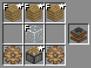

### Stirling Engine / 石エンジン / BC

* 実装状態: [ ]
* 名称: Stirling Engine / 日本語: 石エンジン / Origin: `buildcraftcore:engine#1` / New: `bcn:stirling_engine`
* レシピ: `Cobblestone` x3 + `Glass` x1 + `Stone Gear` x2 + `Piston` x1 -> `Stirling Engine` x1
* レシピ配置図: `AAA` / `0B0` / `CDC`
* 概要: 初心者向けエンジン(マシン用) 扱いやすい. レッドストーン入力に加えて、精錬用の燃料を消費するが、 中程度の出力を持ち、単機でマシンを動かせるエンジン. 木炭を燃料に使える関係で、持ち運び、設置、撤去が非常に楽なのが嬉しい. ただ、クァーリー等の高燃費マシンを1機で動かすのは色々とキツい. 撤去時はつるはしが必須.
* 専用GUI: 有 — 燃料投入と燃焼進行の表示
* 実装方法: :石エンジンは木炭1個につき1,600tick(80秒)燃焼、その間1tickに1MJのペースでしめて1,600MJ。 [engine] / :石エンジン(木炭)は、青色だと52tick毎にピストン1回52MJ放出、赤色だと8tick毎にピストン1回8MJ放出 [engine]

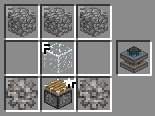

### Combustion Engine / 鉄エンジン / BC

* 実装状態: [ ]
* 名称: Combustion Engine / 日本語: 鉄エンジン / Origin: `buildcraftcore:engine#2` / New: `bcn:combustion_engine`
* レシピ: `Iron Ingot` x3 + `Glass` x1 + `Iron Gear` x2 + `Piston` x1 -> `Combustion Engine` x1
* レシピ配置図: `AAA` / `0B0` / `CDC`
* 概要: 上級者向けのエンジン. 高性能だが扱いにくい. レッドストーン入力に加えて、"黒オイル"か"金オイル"が必要. 液体しか燃料に使えない関係で、気軽な設置や撤去ができない. また、更に追加で冷却用の"水"も注入し続けてやらないと、 長時間に渡って連続稼動させ続けた場合、必ず爆発するようになっている. 撤去時はつるはしが必須.
* 専用GUI: 有 — 燃料と冷却材の投入、稼働状態の表示
* 実装方法: :鉄エンジンは金オイル1杯につき101,000tick(5050秒)燃焼、その間1tickに60RFのペースでしめて606,000MJ。 [engine] / :鉄エンジン(金オイル)は、青色だと26tick毎にピストン1回130MJ放出、赤色だと15tick毎にピストン1回75MJ放出 [engine]

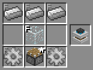

### Creative Engine / クリエイティブエンジン / BC

* 実装状態: [ ]
* 名称: Creative Engine / 日本語: クリエイティブエンジン / Origin: `-` / New: `bcn:creative_engine`
* レシピ: なし
* レシピ配置図: `[000]` / `[000]` / `[000]`
* 概要: 
* 専用GUI: 有 — 出力レベルの選択
* 実装方法: 

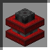

### Generator / 火力発電機 / IC2

* 実装状態: [ ]
* 名称: Generator / 日本語: 火力発電機 / Origin: `ic2:generator` / New: `bcn:generator`
* レシピ: `RE Battery` x1 + `Machine Block` x1 + `Furnace` x1 -> `Generator` x1
* レシピ配置図: `0A0` / `0B0` / `0C0`
* 概要: 最もポピュラーな発電機. 他の発電機の作成にも必要. 使用できる燃料が最も多く、発電量は燃料によって異なる. 石かまどで使える燃料は、溶岩バケツを除いてこちらでも燃料として使える.
* 専用GUI: 有 — 燃料投入と発電状態の表示
* 実装方法: 発電量(発電速度): 石炭1個当たり 4,000EU (10EU/t)

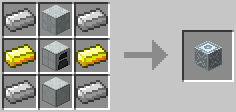

### Geothermal Generator / 地熱発電機 / IC2

* 実装状態: [ ]
* 名称: Geothermal Generator / 日本語: 地熱発電機 / Origin: `ic2:geothermal_generator` / New: `bcn:geothermal_generator`
* レシピ: `Glass` x4 + `Empty Cell` x2 + `Refined Iron Ingot` x2 + `Generator` x1 -> `Geothermal Generator` x1
* レシピ配置図: `ABA` / `ABA` / `CDC`
* 概要: 溶岩の熱で発電する発電機. 発電速度が火力よりも早い. 溶岩バケツ又は溶岩セルを燃料として発電ができる. 溶岩セルはスタックが可能で序盤の発電機としてはなかなか優秀. ポンプを隣接させることで溶岩を汲み上げ自動で燃料の補給も可能 (ポンプに空セルを入れておくことでセルを消費せずに発電機へ溶岩を送り込める) また、Buildcraftを導入していれば液体用パイプから溶岩を注入することができる. Jenkinsビルドの1.6.2対応版では、Buildcraftのパイプが繋がらない. 他MODを活用すれば自動バケツリレーができないこともない.
* 専用GUI: 有 — 燃料投入と発電状態の表示
* 実装方法: 発電量(発電速度): 溶岩バケツ1杯 溶岩セル1個 20,000EU (20EU/t)

<!-- 画像なし -->

### Water Mill / 水力発電機 / IC2

* 実装状態: [ ]
* 名称: Water Mill / 日本語: 水力発電機 / Origin: `ic2:water_mill` / New: `bcn:water_mill`
* レシピ: `Stick` x4 + `Wooden Planks` x4 + `Generator` x1 -> `Water Mill` x2
* レシピ配置図: `ABA` / `BCB` / `ABA`
* 概要: 水入りバケツを燃料として使用できるほか、水と隣接することでも発電ができる発電機. 製作コストが最も安いが発電量も抑え目となっている. 水流発電の場合、発電機を中心とした3*3*3の空間の水ブロックの数に比例して発電力が増加. 水1ブロックにつき0.01、本体とケーブルを除いて最大25ブロックなので0.25EU/tとなる. また、Buildcraftを導入していても液体用パイプから水を注入することは出来ない.
* 専用GUI: 有 — 燃料(水)と発電状態
* 実装方法: 発電量(発電速度): 水入りバケツ: 1,000EU(1EU/t) 水流発電: 6,000EU/day (0.25 EU/t) ; 水力発電機は一回の製作で2個生産出来るので実質的には 0.5 EU/t と考えて良い [machines]

<!-- 画像なし -->

### Wind Mill / 風力発電機 / IC2

* 実装状態: [ ]
* 名称: Wind Mill / 日本語: 風力発電機 / Origin: `ic2:windmill` / New: `bcn:wind_mill`
* レシピ: `Complex Circuit` x1 + `HV Transformer` x1 + `Wind Turbine` x1 + `Iron Fence` x1 + `Advanced Machine Block` x1 -> `Wind Mill` x1
* レシピ配置図: `0A0` / `BCD` / `0E0`
* 概要: リソース不要な発電機の中では高出力を誇り生産コストも非常に安い. 発電するにはある程度のスペースが必要かつ高さに応じて発電量がかなり変わる. 発電力が非常に不安定でまったく発電しないこともある. 設置高度が高すぎると発電量が5EU/tを超えてしまい風力発電機が壊れる可能性がある. (Y=147がギリギリで壊れない高さ. この高さで発電量最大値が4.98EU/t. ただしこれはケーブル設置を考慮していない理論値なので、実運用ではY=149が壊れないギリギリの高さとなる) かといって、5EU/tさえ超えなければ高い方がいいというものでもないようで、 計算上の発電量が3EU/tを超えると逆に実際の発電力が減少しはじめ、4EU/tを超えると0になってしまう模様. （簡略的な実験結果は各機械についてを参照） （4EU/tで発電が停止するとして）雷雨でも確実に発電を行いたい場合、Y=130(ケーブルを考慮するとY=132)が3.96EU/tでギリギリの高さとなる. 余談だが、発電量に関係してくるのは高度と周囲のスペースのみなので、 （スペースさえ確保できれば）屋内風力発電所などというわけのわからないものが作れたりもするというか作れる.
* 専用GUI: 有 — 発電状態の確認
* 実装方法: 発電量(発電速度): ???EU/day (0-3EU/t) ; "y"は風力発電機の高さ。つまりはY座標のこと [machines] / 風力発電機を中心とした 9*9*7 (下図参照)の範囲を判定する [machines]

<!-- 画像なし -->

### Solar Panel / ソーラーパネル / IC2

* 実装状態: [ ]
* 名称: Solar Panel / 日本語: ソーラーパネル / Origin: `ic2:solar_panel` / New: `bcn:solar_panel`
* レシピ: `Coal And Charcoal` x3 + `Glass` x3 + `Circuit` x2 + `Generator` x1 -> `Solar Panel` x1
* レシピ配置図: `ABA` / `BAB` / `CDC`
* 概要: 日光を使っての発電が可能なリソース不要の発電機. 個々の発電量は低いが数さえ揃えば強力な電力源となる. 発電には日光が必要で夜間は発電が出来ない. また、パネルの上に不透明なブロックを置くことでも発電は止まる.
* 専用GUI: 有 — 発電状態の確認
* 実装方法: 発電量(発電速度): 13,050EU/day (1EU/t)

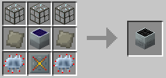

### Nuclear Reactor / 原子炉 / IC2

* 実装状態: [ ]
* 名称: Nuclear Reactor / 日本語: 原子炉 / Origin: `ic2:nuclear_reactor` / New: `bcn:nuclear_reactor`
* レシピ: `Advanced Circuit` x1 + `Reactor Chamber` x3 + `Generator` x1 -> `Nuclear Reactor` x1
* レシピ配置図: `0A0` / `BBB` / `0C0`
* 概要: ウランを使うことで莫大な発電量を得ることが出来る原子炉. ウランセル1個当たり1,000,000EU(10EU/t)発電する. 熱量を管理することで安全な運用が可能. レッドストーン入力で発電を停止することができる.
* 専用GUI: 有 — 燃料セル/冷却部品の配置と稼働管理
* 実装方法: 発電量(発電速度): ウランセル1個当たり 1,000,000EU(5EU/t)

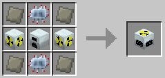

### Uninsulated Cable / 被覆なし銅ケーブル / IC2

* 実装状態: [ ]
* 名称: Uninsulated Cable / 日本語: 被覆なし銅ケーブル / Origin: `-` / New: `bcn:uninsulated_cable`
* レシピ: `Copper Ingot` x3 / `Gold Ingot` x3 / `Refined Iron` x3 -> `Uninsulated Cable` x1
* レシピ配置図: `[000]` / `[000]` / `[000]`
* 概要: ラバーによる被覆がないケーブル. 周囲が絶縁されていないので稼動中に触ると感電する. 被覆付きのケーブルよりEU損失量が多い. ラバーの節約がしたい場合に使うといい.
* 専用GUI: 無
* 実装方法: 損失量(EU/Block): 銅 0.3EU/B 金 0.5EU/B HV 1EU/B

<!-- 画像なし -->

### Copper Cable / 銅のケーブル / IC2

* 実装状態: [ ]
* 名称: Copper Cable / 日本語: 銅のケーブル / Origin: `ic2:copper_cable_item` / New: `bcn:copper_cable`
* レシピ: `Copper Ingot` x3 -> `Copper Cable` x6
* レシピ配置図: `AAA`
* 概要: 低圧(32EU/t)まで耐えられる最もポピュラーな電線. レシピ素材、配線の両方で使う. 被覆されているので感電を防げる.
* 専用GUI: 無
* 実装方法: 損失量(EU/Block): 0.2EU/B

<!-- 画像なし -->

### Gold Cable / 金のケーブル / IC2

* 実装状態: [ ]
* 名称: Gold Cable / 日本語: 金のケーブル / Origin: `ic2:gold_cable_item` / New: `bcn:gold_cable`
* レシピ: `Gold` x3 -> `Gold Cable` x12
* レシピ配置図: `AAA`
* 概要: 中圧(128EU/t)まで耐えられる. 損失量が銅のケーブルより大きい. このままでは感電するので注意.
* 専用GUI: 無
* 実装方法: 損失量(EU/Block): 0.45EU/B

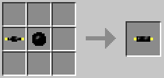

### Gold Cable Insulated 2x / 金の2倍絶縁ケーブル / IC2

* 実装状態: [ ]
* 名称: Gold Cable Insulated 2x / 日本語: 金の2倍絶縁ケーブル / Origin: `ic2:gold_double_insulated_cable_item` / New: `bcn:gold_cable_insulated_2x`
* レシピ: `Rubber` x8 + `Gold` x1 -> `Gold Cable Insulated 2x` x4
* レシピ配置図: `AAA` / `ABA` / `AAA`
* 概要: 通常の金のケーブルよりも損失量の低いケーブル. こちらでは感電しなくなる.
* 専用GUI: 無
* 実装方法: 損失量(EU/Block): 0.4EU/B

### HV Cable / 高圧用のケーブル / IC2

* 実装状態: [ ]
* 名称: HV Cable / 日本語: 高圧用のケーブル / Origin: `-` / New: `bcn:hv_cable`
* レシピ: `Refined Iron` x1 + `Rubber` x4 / `Refined Iron` x1 + `Rubber` x1 -> `HV Cable` x1
* レシピ配置図: `[000]` / `[000]` / `[000]`
* 概要: 精錬鉄製のケーブル. 高電圧(512EU/t)や超高電圧(2048EU/t)を扱う際に使う. このままでは感電するので注意
* 専用GUI: 無
* 実装方法: 損失量(EU/Block): 0.95EU/B

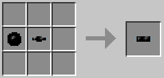

### HV Cable Insulated 2x / 高圧用の2倍絶縁ケーブル / IC2

* 実装状態: [ ]
* 名称: HV Cable Insulated 2x / 日本語: 高圧用の2倍絶縁ケーブル / Origin: `-` / New: `bcn:hv_cable_insulated_2x`
* レシピ: `Refined Iron` x1 + `Rubber` x2 / `HV Cable` x1 + `Rubber` x1 -> `HV Cable Insulated 2x` x1
* レシピ配置図: `[000]` / `[000]` / `[000]`
* 概要: 通常の高圧用のケーブルよりも損失量の低いケーブル. このままでは感電する.
* 専用GUI: 無
* 実装方法: 損失量(EU/Block): 0.9EU/B

### HV Cable Insulated 4x / 高圧用の4倍絶縁ケーブル / IC2

* 実装状態: [ ]
* 名称: HV Cable Insulated 4x / 日本語: 高圧用の4倍絶縁ケーブル / Origin: `-` / New: `bcn:hv_cable_insulated_4x`
* レシピ: `Refined Iron` x1 + `Rubber` x3 / `HV Cable Insulated 2x` x1 + `Rubber` x1 -> `HV Cable Insulated 4x` x1
* レシピ配置図: `[000]` / `[000]` / `[000]`
* 概要: 高圧用の2倍絶縁ケーブルよりも損失量の低いケーブル. こちらでは感電しなくなる
* 専用GUI: 無
* 実装方法: 損失量(EU/Block): 0.8EU/B

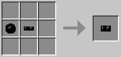

### Glass Fibre / グラスファイバー / IC2

* 実装状態: [ ]
* 名称: Glass Fibre / 日本語: グラスファイバー / Origin: `-` / New: `bcn:glass_fibre`
* レシピ: `Glass` x6 + `Redstone` x2 + `Diamond` x1 -> `Glass Fibre` x1
* レシピ配置図: `[000]` / `[000]` / `[000]`
* 概要: 高圧(512EU/t)まで耐えられる. 生産コストが高く、その分損失量は0.025EU/Bと極小. このままでも感電はしない RP2又はTEを導入しているならばレッドストーンの代わりに銀インゴットを使ってもできる. その場合、生産量は6つとなる.
* 専用GUI: 無
* 実装方法: 損失量(EU/Block): 0.025EU/B

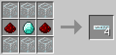

### Ultra-low-Current Cable / 超低圧用のケーブル / IC2

* 実装状態: [ ]
* 名称: Ultra-low-Current Cable / 日本語: 超低圧用のケーブル / Origin: `-` / New: `bcn:ultra_low_current_cable`
* レシピ: `Tin Ingot` x3 -> `Ultra-low-Current Cable` x1
* レシピ配置図: `[000]` / `[000]` / `[000]`
* 概要: v1.15で新たに追加されたスズ製のケーブル. 耐圧は超低圧(5EU/t)、損失量は0.025EU/Bと極端に低い. ペイントは不可能. 感電はしない. 風力発電などの発電力が弱い発電機はこちらを使わないと、短い距離でEU損失してしまうため、 蓄電器までに発電したEUがなくなってしまうことがある.
* 専用GUI: 無
* 実装方法: 損失量(EU/Block): 0.025EU/B

<!-- 画像なし -->

### Detector Cable / 検出ケーブル / IC2

* 実装状態: [ ]
* 名称: Detector Cable / 日本語: 検出ケーブル / Origin: `ic2:detector_cable_item` / New: `bcn:detector_cable`
* レシピ: `Circuit` x1 + `Redstone` x3 + `Iron Triple Insulated Cable Item` x1 -> `Detector Cable` x1
* レシピ配置図: `0A0` / `BCB` / `0B0`
* 概要: 検出ケーブルはEUが流れているときにレッドストーンの動力を出力する. また、蓄電器などのオーバーフローも検出できる？
* 専用GUI: 無 — 信号出力のみ
* 実装方法: 損失量(EU/Block): 0.5EU/B

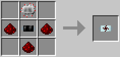

### Splitter Cable / 分割ケーブル / IC2

* 実装状態: [ ]
* 名称: Splitter Cable / 日本語: 分割ケーブル / Origin: `ic2:splitter_cable_item` / New: `bcn:splitter_cable`
* レシピ: `Redstone` x2 + `Iron Triple Insulated Cable Item` x2 + `Lever` x1 -> `Splitter Cable` x1
* レシピ配置図: `0A0` / `BCB` / `0A0`
* 概要: 分割ケーブルはレッドストーンの動力が入るとEUの送電をせき止める.
* 専用GUI: 無 — 信号分岐のみ
* 実装方法: 損失量(EU/Block): 0.5EU/B

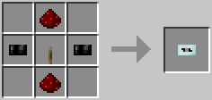

### LV Transformer / 低圧変換装置 / IC2

* 実装状態: [ ]
* 名称: LV Transformer / 日本語: 低圧変換装置 / Origin: `ic2:transformer_lv` / New: `bcn:lv_transformer`
* レシピ: `Wooden Planks` x4 + `Copper Insulated Cable Item` x2 + `Copper Ingot` x3 -> `LV Transformer` x1
* レシピ配置図: `ABA` / `CCC` / `ABA`
* 概要: 中圧以下を低圧に、低圧以下を中圧に変換出来る変圧装置.
* 専用GUI: 無
* 実装方法: 

<!-- 画像なし -->

### MV Transformer / 中圧変換装置 / IC2

* 実装状態: [ ]
* 名称: MV Transformer / 日本語: 中圧変換装置 / Origin: `ic2:transformer_mv` / New: `bcn:mv_transformer`
* レシピ: `Bronze Double Insulated Cable Item` x2 + `Machine Block` x1 -> `MV Transformer` x1
* レシピ配置図: `0A0` / `0B0` / `0A0`
* 概要: ver1.97より銅ケーブルから金の2倍絶縁ケーブルに変更 高圧以下を中圧に、中圧以下を高圧に変換出来る変圧装置.
* 専用GUI: 無
* 実装方法: 

<!-- 画像なし -->

### HV Transformer / 高圧変換装置 / IC2

* 実装状態: [ ]
* 名称: HV Transformer / 日本語: 高圧変換装置 / Origin: `ic2:transformer_hv` / New: `bcn:hv_transformer`
* レシピ: `Iron Triple Insulated Cable Item` x2 + `Circuit` x1 + `MV Transformer` x1 + `Energy Crystal` x1 -> `HV Transformer` x1
* レシピ配置図: `0A0` / `BCD` / `0A0`
* 概要: ver1.97より銅ケーブルから高圧用の4倍絶縁ケーブルに変更 超高圧以下を高圧に、高圧以下を超高圧に変換出来る変圧装置. ここでミソなのが超高圧以上を扱える点である. 2048EU/t以上の電圧を原発で発電した場合、ケーブルは蒸発するので使えないがこれを直付けすれば電気を高圧にして取り出すことができる. 追加アドオン等の超高圧以上の発電機にも言えることである.
* 専用GUI: 無
* 実装方法: 

<!-- 画像なし -->

### BatBox / バットボックス / IC2

* 実装状態: [ ]
* 名称: BatBox / 日本語: バットボックス / Origin: `ic2:batbox` / New: `bcn:batbox`
* レシピ: `Wooden Planks` x5 + `Copper Insulated Cable Item` x1 + `RE Battery` x3 -> `BatBox` x1
* レシピ配置図: `ABA` / `CCC` / `AAA`
* 概要: 最も低出力、低容量、低コストな蓄電器. 低圧の入出力に対応している.
* 専用GUI: 有 — 蓄電量と入出力面の確認
* 実装方法: 蓄電容量: 40,000EU ; BatBoxで充電可能な道具は各種発電機でも充電可。 [machines]

<!-- 画像なし -->

### MFE Unit / MFEユニット / IC2

* 実装状態: [ ]
* 名称: MFE Unit / 日本語: MFEユニット / Origin: `-` / New: `bcn:mfe_unit`
* レシピ: `Machine` x1 + `Energy Crystal` x4 + `Gold Cable Insulated 2x` x4 -> `MFE Unit` x1
* レシピ配置図: `[000]` / `[000]` / `[000]`
* 概要: ver1.97より銅ケーブルから金の2倍絶縁ケーブルに変更 蓄電量と出力が大幅に強化された上級蓄電器. 中圧までの入力に対応している. 出力は中圧なので、うっかり機械装置を直接繋がないよう注意.
* 専用GUI: 有 — 蓄電量の確認
* 実装方法: 蓄電容量: 600,000EU

<!-- 画像なし -->

### RE Battery / 充電式電池 / IC2

* 実装状態: [ ]
* 名称: RE Battery / 日本語: 充電式電池 / Origin: `ic2:re_battery` / New: `bcn:re_battery`
* レシピ: `Industrial Belt` x1 -> `RE Battery` x3
* レシピ配置図: `[不定形]`
* 概要: 充電することで何度でも使える電池. 充電状態ではスタックすることが出来ない代わりに10,000EUほどの保持が可能. 手に持ってマウスの右ボタンを押し続けると、アイテムスロットに置かれたバットボックスで充電できる電動ツールに充電する.
* 専用GUI: 無
* 実装方法: 

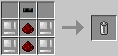

### SU Battery / 使い捨て電池 / IC2

* 実装状態: [ ]
* 名称: SU Battery / 日本語: 使い捨て電池 / Origin: `ic2:su_battery` / New: `bcn:su_battery`
* レシピ: `Copper Insulated Cable Item` x1 + `Dust Hydrated Charcoal` x1 + `Redstone` x1 -> `SU Battery` x6
* レシピ配置図: `A` / `B` / `C`
* 概要: 文字通り一回限りの使い捨て電池. 1個あたり1,000EUしか保持することが出来ないが少ない素材で量産できる. 手に持って右クリックで使用すると、アイテムスロットに置かれたバットボックスで充電できる電動ツールに充電する.
* 専用GUI: 無
* 実装方法: 

<!-- 画像なし -->

### Refined Uranium / 精製ウラン / IC2

* 実装状態: [ ]
* 名称: Refined Uranium / 日本語: 精製ウラン / Origin: `-` / New: `bcn:refined_uranium`
* レシピ: なし
* レシピ配置図: `[000]` / `[000]` / `[000]`
* 概要: ウラニウムを圧縮したもの. セルと組み合わせることで燃料になる. ブロック状態の鉱石でも圧縮でこれが作れるが、そんな機会はほとんど無いだろう.
* 専用GUI: 無
* 実装方法: 

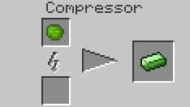

### Solar Helmet / ソーラーヘルメット / IC2

* 実装状態: [ ]
* 名称: Solar Helmet / 日本語: ソーラーヘルメット / Origin: `ic2:solar_helmet` / New: `bcn:solar_helmet`
* レシピ: `Iron Helmet` x1 + `Solar Panel` x1 + `Copper Insulated Cable Item` x3 -> `Solar Helmet` x1
* レシピ配置図: `0A0` / `0B0` / `CCC`
* 概要: 頭に装備していると、晴天下にいる間1EU/tのペースで胴装備に充電する. （夜でも発電することができる）
* 専用GUI: 無
* 実装方法: 

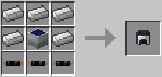

### Empty Cell / 空のセル / IC2

* 実装状態: [ ]
* 名称: Empty Cell / 日本語: 空のセル / Origin: `ic2:cell_empty` / New: `bcn:empty_cell`
* レシピ: `Tin Ingot` x4 -> `Empty Cell` x16
* レシピ配置図: `0A0` / `A0A` / `0A0`
* 概要: 様々な液体や燃料を入れられる容器. 基本的に使い捨てだが低コストで量産が容易. 手に持った状態から右クリックで水や溶岩を直接汲み取ることができる.
* 専用GUI: 無
* 実装方法: 

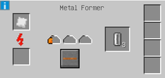

### Compressd Air Cell / 圧縮空気セル / IC2

* 実装状態: [ ]
* 名称: Compressd Air Cell / 日本語: 圧縮空気セル / Origin: `-` / New: `bcn:compressd_air_cell`
* レシピ: なし
* レシピ配置図: `[000]` / `[000]` / `[000]`
* 概要: 空のセルの中に圧縮した酸素を詰め込んだセル. 何らかの原因で空気を使ってもセルが戻ってくる.
* 専用GUI: 無
* 実装方法: 

<!-- 画像なし -->

### Bio Cell / バイオセル / IC2

* 実装状態: [ ]
* 名称: Bio Cell / 日本語: バイオセル / Origin: `ic2:cell_bio` / New: `bcn:bio_cell`
* レシピ: `Empty Cell` x1 + `Compressed Plant Ball` x1 -> `Bio Cell` x1
* レシピ配置図: `[不定形]`
* 概要: セルに植物の塊を入れたもの. 燃料としては使えない.
* 専用GUI: 無
* 実装方法: 

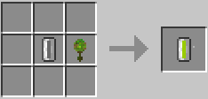

### H. Coal Cell / 液化石炭セル / IC2

* 実装状態: [ ]
* 名称: H. Coal Cell / 日本語: 液化石炭セル / Origin: `-` / New: `bcn:h_coal_cell`
* レシピ: `Empty Cell` x1 + `H.Coal` x1 -> `H. Coal Cell` x1
* レシピ配置図: `[000]` / `[000]` / `[000]`
* 概要: 液状化石炭を入れたセル. 燃料としては使えない.
* 専用GUI: 無
* 実装方法: 

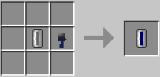

### Biofuel Cell / バイオ燃料セル / IC2

* 実装状態: [ ]
* 名称: Biofuel Cell / 日本語: バイオ燃料セル / Origin: `-` / New: `bcn:biofuel_cell`
* レシピ: なし
* レシピ配置図: `[000]` / `[000]` / `[000]`
* 概要: バイオセルを抽出機にかけたもの. 缶詰製造機で空の燃料缶やジェットパックに充填して使う.
* 専用GUI: 無
* 実装方法: 

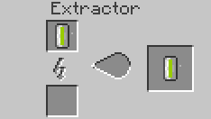

### Coalfuel Cell / 石炭燃料セル / IC2

* 実装状態: [ ]
* 名称: Coalfuel Cell / 日本語: 石炭燃料セル / Origin: `-` / New: `bcn:coalfuel_cell`
* レシピ: なし
* レシピ配置図: `[000]` / `[000]` / `[000]`
* 概要: 液化石炭セルを抽出機にかけたもの. 缶詰製造機で空の燃料缶やジェットパックに充填して使う.
* 専用GUI: 無
* 実装方法: 

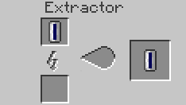

### Lava Cell / 溶岩セル / IC2

* 実装状態: [ ]
* 名称: Lava Cell / 日本語: 溶岩セル / Origin: `-` / New: `bcn:lava_cell`
* レシピ: `Empty Cell` x1 + `Lava Bucket` x1 -> `Lava Cell` x1
* レシピ配置図: `[000]` / `[000]` / `[000]`
* 概要: 溶岩の入ったセル. セルは使い捨てだが大量スタックが可能. 地熱発電機の燃料として使うことが出来る.
* 専用GUI: 無
* 実装方法: 

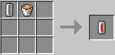

### Water Cell / 水セル / IC2

* 実装状態: [ ]
* 名称: Water Cell / 日本語: 水セル / Origin: `-` / New: `bcn:water_cell`
* レシピ: `Empty Cell` x1 + `Water Bucket` x1 -> `Water Cell` x1
* レシピ配置図: `[000]` / `[000]` / `[000]`
* 概要: 水の入ったセル.
* 専用GUI: 無
* 実装方法: 

### Electrolyzed Water Cell / 電解水セル / IC2

* 実装状態: [ ]
* 名称: Electrolyzed Water Cell / 日本語: 電解水セル / Origin: `-` / New: `bcn:electrolyzed_water_cell`
* レシピ: なし
* レシピ配置図: `[000]` / `[000]` / `[000]`
* 概要: 電解水生成装置で精製することが可能. 電解水セルは15,000EUの保持が可能だが復元過程で1500EUほど損失する.
* 専用GUI: 無
* 実装方法: 

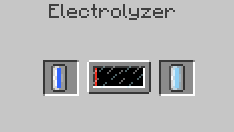

### 10K Coolant Cell / K冷却セル / IC2

* 実装状態: [ ]
* 名称: 10K Coolant Cell / 日本語: K冷却セル / Origin: `ic2:heat_storage_single` / New: `bcn:10k_coolant_cell`
* レシピ: `Tin Ingot` x4 + `Water` x1 -> `10K Coolant Cell` x1
* レシピ配置図: `0A0` / `ABA` / `0A0`
* 概要: 
* 専用GUI: 無
* 実装方法: 

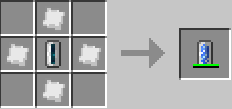

### Transformer upgrade / トランスフォーマー / IC2

* 実装状態: [ ]
* 名称: Transformer upgrade / 日本語: トランスフォーマー / Origin: `ic2:transformer_upgrade` / New: `bcn:transformer_upgrade`
* レシピ: `Glass` x7 + `MV Transformer` x1 + `Upgrade Base` x1 -> `Transformer upgrade` x1
* レシピ配置図: `AAA` / `ABA` / `ACA`
* 概要: 機械の対応電圧を向上させるモジュール. 1つ増える度に対応電圧が1段階上がる. とはいえ、IC2単体では低圧対応の機械にしか設置できないため、 1つで中電圧（128EU）に、2つで高電圧（512EU）に、3つで超高圧（2048EU）まで受け取れるようになるという認識で概ね問題ない. 一般機械にオーバークロッカーを積みすぎて、消費電力が32EU/tを超えてしまいMFEから直接供給しないと間に合わない！なんて時に便利. ただし、作業中に外してしまうとその途端に電圧非対応で爆発を起こすので誤クリックに注意.
* 専用GUI: 無
* 実装方法: 

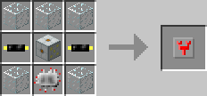

### Energy storage upgrade / エナジーストレージ / IC2

* 実装状態: [ ]
* 名称: Energy storage upgrade / 日本語: エナジーストレージ / Origin: `ic2:energy_storage_upgrade` / New: `bcn:energy_storage_upgrade`
* レシピ: `Wooden Planks` x7 + `RE Battery` x1 + `Upgrade Base` x1 -> `Energy storage upgrade` x1
* レシピ配置図: `AAA` / `ABA` / `ACA`
* 概要: 機械の蓄電性能を向上させるモジュール. 1つにつき蓄電可能容量が10,000EU上昇する. こちらもオーバークロッカーを積むときに便利.
* 専用GUI: 無
* 実装方法: 

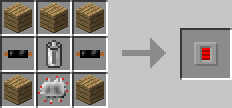

### Uranium / ウラニウム / IC2

* 実装状態: [ ]
* 名称: Uranium / 日本語: ウラニウム / Origin: `-` / New: `bcn:uranium`
* レシピ: なし
* レシピ配置図: `[000]` / `[000]` / `[000]`
* 概要: 新たに追加されたウラニウム鉱石. 鉱石はY0-63で見つかる. 単体で見つかることが多い. 鉄以上のつるはしで採取可能. 幸運エンチャントは無効.
* 専用GUI: 無
* 実装方法: 

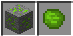

### Refined Uranium / 精製ウラン / IC2

* 実装状態: [ ]
* 名称: Refined Uranium / 日本語: 精製ウラン / Origin: `-` / New: `bcn:refined_uranium`
* レシピ: なし
* レシピ配置図: `[000]` / `[000]` / `[000]`
* 概要: ウラニウムを圧縮したもの. セルと組み合わせることで燃料になる. ブロック状態の鉱石でも圧縮でこれが作れるが、そんな機会はほとんど無いだろう.
* 専用GUI: 無
* 実装方法: 

### Solar Helmet / ソーラーヘルメット / IC2

* 実装状態: [ ]
* 名称: Solar Helmet / 日本語: ソーラーヘルメット / Origin: `ic2:solar_helmet` / New: `bcn:solar_helmet`
* レシピ: `Iron Helmet` x1 + `Solar Panel` x1 + `Copper Insulated Cable Item` x3 -> `Solar Helmet` x1
* レシピ配置図: `0A0` / `0B0` / `CCC`
* 概要: 頭に装備していると、晴天下にいる間1EU/tのペースで胴装備に充電する. （夜でも発電することができる）
* 専用GUI: 無
* 実装方法: 

### Empty Cell / 空のセル / IC2

* 実装状態: [ ]
* 名称: Empty Cell / 日本語: 空のセル / Origin: `ic2:cell_empty` / New: `bcn:empty_cell`
* レシピ: `Tin Ingot` x4 -> `Empty Cell` x16
* レシピ配置図: `0A0` / `A0A` / `0A0`
* 概要: 様々な液体や燃料を入れられる容器. 基本的に使い捨てだが低コストで量産が容易. 手に持った状態から右クリックで水や溶岩を直接汲み取ることができる.
* 専用GUI: 無
* 実装方法: 

### Compressd Air Cell / 圧縮空気セル / IC2

* 実装状態: [ ]
* 名称: Compressd Air Cell / 日本語: 圧縮空気セル / Origin: `-` / New: `bcn:compressd_air_cell`
* レシピ: なし
* レシピ配置図: `[000]` / `[000]` / `[000]`
* 概要: 空のセルの中に圧縮した酸素を詰め込んだセル. 何らかの原因で空気を使ってもセルが戻ってくる.
* 専用GUI: 無
* 実装方法: 

<!-- 画像なし -->

### Bio Cell / バイオセル / IC2

* 実装状態: [ ]
* 名称: Bio Cell / 日本語: バイオセル / Origin: `ic2:cell_bio` / New: `bcn:bio_cell`
* レシピ: `Empty Cell` x1 + `Compressed Plant Ball` x1 -> `Bio Cell` x1
* レシピ配置図: `[不定形]`
* 概要: セルに植物の塊を入れたもの. 燃料としては使えない.
* 専用GUI: 無
* 実装方法: 

### H. Coal Cell / 液化石炭セル / IC2

* 実装状態: [ ]
* 名称: H. Coal Cell / 日本語: 液化石炭セル / Origin: `-` / New: `bcn:h_coal_cell`
* レシピ: `Empty Cell` x1 + `H.Coal` x1 -> `H. Coal Cell` x1
* レシピ配置図: `[000]` / `[000]` / `[000]`
* 概要: 液状化石炭を入れたセル. 燃料としては使えない.
* 専用GUI: 無
* 実装方法: 

### Biofuel Cell / バイオ燃料セル / IC2

* 実装状態: [ ]
* 名称: Biofuel Cell / 日本語: バイオ燃料セル / Origin: `-` / New: `bcn:biofuel_cell`
* レシピ: なし
* レシピ配置図: `[000]` / `[000]` / `[000]`
* 概要: バイオセルを抽出機にかけたもの. 缶詰製造機で空の燃料缶やジェットパックに充填して使う.
* 専用GUI: 無
* 実装方法: 

### Coalfuel Cell / 石炭燃料セル / IC2

* 実装状態: [ ]
* 名称: Coalfuel Cell / 日本語: 石炭燃料セル / Origin: `-` / New: `bcn:coalfuel_cell`
* レシピ: なし
* レシピ配置図: `[000]` / `[000]` / `[000]`
* 概要: 液化石炭セルを抽出機にかけたもの. 缶詰製造機で空の燃料缶やジェットパックに充填して使う.
* 専用GUI: 無
* 実装方法: 

### Lava Cell / 溶岩セル / IC2

* 実装状態: [ ]
* 名称: Lava Cell / 日本語: 溶岩セル / Origin: `-` / New: `bcn:lava_cell`
* レシピ: `Empty Cell` x1 + `Lava Bucket` x1 -> `Lava Cell` x1
* レシピ配置図: `[000]` / `[000]` / `[000]`
* 概要: 溶岩の入ったセル. セルは使い捨てだが大量スタックが可能. 地熱発電機の燃料として使うことが出来る.
* 専用GUI: 無
* 実装方法: 

### Water Cell / 水セル / IC2

* 実装状態: [ ]
* 名称: Water Cell / 日本語: 水セル / Origin: `-` / New: `bcn:water_cell`
* レシピ: `Empty Cell` x1 + `Water Bucket` x1 -> `Water Cell` x1
* レシピ配置図: `[000]` / `[000]` / `[000]`
* 概要: 水の入ったセル.
* 専用GUI: 無
* 実装方法: 

### Electrolyzed Water Cell / 電解水セル / IC2

* 実装状態: [ ]
* 名称: Electrolyzed Water Cell / 日本語: 電解水セル / Origin: `-` / New: `bcn:electrolyzed_water_cell`
* レシピ: なし
* レシピ配置図: `[000]` / `[000]` / `[000]`
* 概要: 電解水生成装置で精製することが可能. 電解水セルは15,000EUの保持が可能だが復元過程で1500EUほど損失する.
* 専用GUI: 無
* 実装方法: 

### 10K Coolant Cell / K冷却セル / IC2

* 実装状態: [ ]
* 名称: 10K Coolant Cell / 日本語: K冷却セル / Origin: `ic2:heat_storage_single` / New: `bcn:10k_coolant_cell`
* レシピ: `Tin Ingot` x4 + `Water` x1 -> `10K Coolant Cell` x1
* レシピ配置図: `0A0` / `ABA` / `0A0`
* 概要: 
* 専用GUI: 無
* 実装方法: 

### Transformer upgrade / トランスフォーマー / IC2

* 実装状態: [ ]
* 名称: Transformer upgrade / 日本語: トランスフォーマー / Origin: `ic2:transformer_upgrade` / New: `bcn:transformer_upgrade`
* レシピ: `Glass` x7 + `MV Transformer` x1 + `Upgrade Base` x1 -> `Transformer upgrade` x1
* レシピ配置図: `AAA` / `ABA` / `ACA`
* 概要: 機械の対応電圧を向上させるモジュール. 1つ増える度に対応電圧が1段階上がる. とはいえ、IC2単体では低圧対応の機械にしか設置できないため、 1つで中電圧（128EU）に、2つで高電圧（512EU）に、3つで超高圧（2048EU）まで受け取れるようになるという認識で概ね問題ない. 一般機械にオーバークロッカーを積みすぎて、消費電力が32EU/tを超えてしまいMFEから直接供給しないと間に合わない！なんて時に便利. ただし、作業中に外してしまうとその途端に電圧非対応で爆発を起こすので誤クリックに注意.
* 専用GUI: 無
* 実装方法: 

### Energy storage upgrade / エナジーストレージ / IC2

* 実装状態: [ ]
* 名称: Energy storage upgrade / 日本語: エナジーストレージ / Origin: `ic2:energy_storage_upgrade` / New: `bcn:energy_storage_upgrade`
* レシピ: `Wooden Planks` x7 + `RE Battery` x1 + `Upgrade Base` x1 -> `Energy storage upgrade` x1
* レシピ配置図: `AAA` / `ABA` / `ACA`
* 概要: 機械の蓄電性能を向上させるモジュール. 1つにつき蓄電可能容量が10,000EU上昇する. こちらもオーバークロッカーを積むときに便利.
* 専用GUI: 無
* 実装方法: 

### Nuclear Reactor / 原子炉 / IC2

* 実装状態: [ ]
* 名称: Nuclear Reactor / 日本語: 原子炉 / Origin: `ic2:nuclear_reactor` / New: `bcn:nuclear_reactor`
* レシピ: `Advanced Circuit` x1 + `Reactor Chamber` x3 + `Generator` x1 -> `Nuclear Reactor` x1
* レシピ配置図: `0A0` / `BBB` / `0C0`
* 概要: ウランを使うことで莫大な発電量を得ることが出来る原子炉. ウランセル1個当たり1,000,000EU(10EU/t)発電する. 熱量を管理することで安全な運用が可能. レッドストーン入力で発電を停止することができる.
* 専用GUI: 有 — 燃料セル/冷却部品の配置と稼働管理
* 実装方法: 発電量(発電速度): ウランセル1個当たり 1,000,000EU(5EU/t)

### Reactor Chamber / チャンバー / IC2

* 実装状態: [ ]
* 名称: Reactor Chamber / 日本語: チャンバー / Origin: `ic2:reactor_chamber` / New: `bcn:reactor_chamber`
* レシピ: `Dense Copper Plate` x4 + `Machine Block` x1 -> `Reactor Chamber` x1
* レシピ配置図: `0A0` / `ABA` / `0A0`
* 概要: 原子炉のスロットを増量するための追加拡張炉. 単体では使用不可能で原子炉に隣接して設置する. 最大6基まで増設が可能. また、冷却能力や耐熱値を向上させる効果を持っている.
* 専用GUI: 無
* 実装方法: 

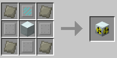

### Uranium Cell / ウランセル / IC2

* 実装状態: [ ]
* 名称: Uranium Cell / 日本語: ウランセル / Origin: `-` / New: `bcn:uranium_cell`
* レシピ: `Empty Cell` x1 + `Refined Uranium` x1 -> `Uranium Cell` x1
* レシピ配置図: `[000]` / `[000]` / `[000]`
* 概要: 精製ウランの入ったセル. 原子炉に入れることで発電が出来る. ウランセル同士を隣接させる事で発電力を最高で5倍に高める事が出来る.
* 専用GUI: 無
* 実装方法: 

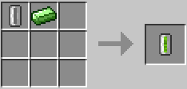

### Near-Depleted Uranium Cell / 準劣化ウランセル / IC2

* 実装状態: [ ]
* 名称: Near-Depleted Uranium Cell / 日本語: 準劣化ウランセル / Origin: `-` / New: `bcn:near_depleted_uranium_cell`
* レシピ: `Empty Cell` x8 + `Refined Uranium` x1 -> `Near-Depleted Uranium Cell` x1
* レシピ配置図: `[000]` / `[000]` / `[000]`
* 概要: 精製ウランとセルを組み合わせることで製作可能. 発電力はなく単体での使用方法もない、劣化ウラン同位体セルを作るためだけのアイテム. ウランセルを使い切った時にこれが残る場合がある.
* 専用GUI: 無
* 実装方法: 

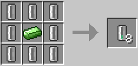

### Depleted Isotope Cell / 劣化ウラン同位体セル / IC2

* 実装状態: [ ]
* 名称: Depleted Isotope Cell / 日本語: 劣化ウラン同位体セル / Origin: `-` / New: `bcn:depleted_isotope_cell`
* レシピ: `Near-Depleted Uranium Cell` x1 + `Coal Dust` x1 -> `Depleted Isotope Cell` x1
* レシピ配置図: `[000]` / `[000]` / `[000]`
* 概要: ウランセルではないが原子炉で出た熱を利用する事で濃縮する事が可能. 濃縮法を極めれば低コストで原子炉を運用することが出来るが濃縮の難易度は非常に高い.
* 専用GUI: 無
* 実装方法: 

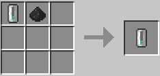

### Re-Enriched Uranium Cell / 再濃縮ウランセル / IC2

* 実装状態: [ ]
* 名称: Re-Enriched Uranium Cell / 日本語: 再濃縮ウランセル / Origin: `-` / New: `bcn:re_enriched_uranium_cell`
* レシピ: `Uranium Cell` x1 + `Coal Dust` x1 -> `Re-Enriched Uranium Cell` x1
* レシピ配置図: `[000]` / `[000]` / `[000]`
* 概要: 左にあるセルが再濃縮ウランセル. 石炭の粉と組み合わせる事でウランセルになる.
* 専用GUI: 無
* 実装方法: 

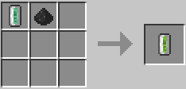

### Cooling Cell / 冷却セル / IC2

* 実装状態: [ ]
* 名称: Cooling Cell / 日本語: 冷却セル / Origin: `-` / New: `bcn:cooling_cell`
* レシピ: なし
* レシピ配置図: `[000]` / `[000]` / `[000]`
* 概要: 水のセルを抽出機にかけることで製作可能で原子炉の熱量を下げる時に使う. 主な使い方としては各種原発用アイテムの左右上下に隣接して設置する事で熱量を吸収する.
* 専用GUI: 無
* 実装方法: 

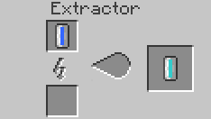

### Integrated Reactor Plating / リアクタープレート / IC2

* 実装状態: [ ]
* 名称: Integrated Reactor Plating / 日本語: リアクタープレート / Origin: `-` / New: `bcn:integrated_reactor_plating`
* レシピ: `Advanced Alloy` x1 + `Copper Ingot` x4 -> `Integrated Reactor Plating` x1
* レシピ配置図: `[000]` / `[000]` / `[000]`
* 概要: 特殊な放熱板でウランセルやヒートディスペンサーにかかる熱を吸収、蓄積する事が出来る.
* 専用GUI: 無
* 実装方法: 

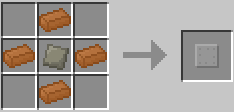

### Integrated Heat Disperser / ヒートディスペンサー / IC2

* 実装状態: [ ]
* 名称: Integrated Heat Disperser / 日本語: ヒートディスペンサー / Origin: `-` / New: `bcn:integrated_heat_disperser`
* レシピ: `Integrated Reactor Plating` x1 + `Advanced Circuit` x1 + `Copper Ingot` x2 + `Cooling Cell` x2 -> `Integrated Heat Disperser` x1
* レシピ配置図: `[000]` / `[000]` / `[000]`
* 概要: 周囲の冷却セルやプレートの熱量を吸収し再分配する事が可能だが冷却機能や蓄積容量はない. 冷却セルに溜まる熱を移すにはこのアイテムが必須となる.
* 専用GUI: 無
* 実装方法: 

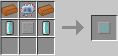

### Hydration Cell / 保水剤セル / IC2

* 実装状態: [ ]
* 名称: Hydration Cell / 日本語: 保水剤セル / Origin: `-` / New: `bcn:hydration_cell`
* レシピ: 1.103以前:水セルを2回抽出機にかける 1.106以降:水セルを1回抽出機にかける
* レシピ配置図: `[000]` / `[000]` / `[000]`
* 概要: 土壌の水持ちを良くする事で支柱作物の成長を促進する. 骨粉のような即効性はない. スタック不可だが、耐久度があり1個が10000保水値分使える（保水値0の耕地に対して50回使用可能）
* 専用GUI: 無
* 実装方法: スペック: 234px]]

<!-- 画像なし -->

### Stone Wire / 導線基板 / PR

* 実装状態: [ ]
* 名称: Stone Wire / 日本語: 導線基板 / Origin: `-` / New: `bcn:stone_wire`
* レシピ: `Redstone` + `Stone Wafer` -> `Stone Wire` x1
* レシピ配置図: `[000]` / `[000]` / `[000]`
* 概要: 各種レッドストーン集積回路を作成する為の部品. 中間素材. ワイヤー基板とよく似ているので注意.
* 専用GUI: 無
* 実装方法: 

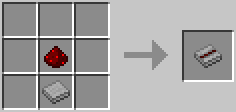

### Stone Redwire / ワイヤー基板 / PR

* 実装状態: [ ]
* 名称: Stone Redwire / 日本語: ワイヤー基板 / Origin: `-` / New: `bcn:stone_redwire`
* レシピ: `Red Alloy Wire` + `Stone Wafer` -> `Stone Redwire` x1
* レシピ配置図: `[000]` / `[000]` / `[000]`
* 概要: 中間素材. ストーンウェハーに赤合金ワイヤーを埋め込んだもの. 配列素子の作成に使用する. 導線基板とよく似ているので注意. Coreのみの導入ではワイヤーが追加されていないため作成不可.
* 専用GUI: 無
* 実装方法: 

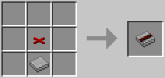

### Red Alloy Wire / 赤合金ワイヤー / PR

* 実装状態: [ ]
* 名称: Red Alloy Wire / 日本語: 赤合金ワイヤー / Origin: `projectred_transmission:red_alloy_wire` / New: `bcn:red_alloy_wire`
* レシピ: `Red Alloy Ingot` x3 -> `Red Alloy Wire` x12
* レシピ配置図: `0A0` / `0A0` / `0A0`
* 概要: 皮膜で覆われていない剥き出しのワイヤー. 下記の絶縁ワイヤー(Insulated Wire)各色のどれとでも連結できるので、 複数のレッドストーン動力流を合流、分派させたい時に便利. また、絶縁されていない分敷設マスの周囲に野放図に動力を伝達する. 一度に12個作成され、1個あたりのコストは鉄0.25＋赤粉1.
* 専用GUI: 無
* 実装方法: 

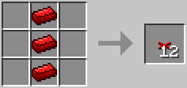

### Insulated Wire / 絶縁ワイヤー / PR

* 実装状態: [ ]
* 名称: Insulated Wire / 日本語: 絶縁ワイヤー / Origin: `-` / New: `bcn:insulated_wire`
* レシピ: `Red Alloy Ingot` x3 + `Wool` x6 -> `Insulated Wire` x1
* レシピ配置図: `[000]` / `[000]` / `[000]`
* 概要: 羊毛により包まれて絶縁保護された赤合金ワイヤー. 作成時に絶縁素材として使用した羊毛の色により、全16色を作成できる. 同色の絶縁ワイヤー同士としか連結しない性質を持つので、 違う色のワイヤー同士なら狭い空間に並列設置しても混線させずに配線できる. （赤合金ワイヤーおよびケーブル束とは、全ての色が連結する） 一度に12個作成され、1個あたりのコストは鉄0.25＋赤粉1＋羊毛0.5.
* 専用GUI: 無
* 実装方法: 

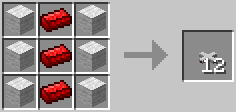

### Framed Red Alloy Wire / ジャケットワイヤー / PR

* 実装状態: [ ]
* 名称: Framed Red Alloy Wire / 日本語: ジャケットワイヤー / Origin: `projectred_transmission:framed_red_alloy_wire` / New: `bcn:framed_red_alloy_wire`
* レシピ: `Wooden` x8 + `Red Alloy Wire` x1 -> `Framed Red Alloy Wire` x1
* レシピ配置図: `AAA` / `ABA` / `AAA`
* 概要: 赤合金ワイヤーをブロックの覆いで囲ったもの. 赤合金ワイヤーとしか連結しない. ワイヤーを敷設するための床、壁面、天井が無いような空間で、 中空へとワイヤーを延長、敷設したい時に使用する. (1/8)板で右クリックすることで、その板に対応したカバーをすることができる.
* 専用GUI: 無
* 実装方法: 

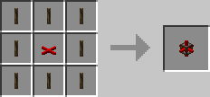

### Framed Insulated Wire / ジャケット絶縁ワイヤー / PR

* 実装状態: [ ]
* 名称: Framed Insulated Wire / 日本語: ジャケット絶縁ワイヤー / Origin: `-` / New: `bcn:framed_insulated_wire`
* レシピ: `Insulated Wire` + `Stripped Oak Log` x8 -> `Framed Insulated Wire` x1
* レシピ配置図: `[000]` / `[000]` / `[000]`
* 概要: 絶縁ワイヤーを覆いで囲ったもの. 同じ色の絶縁ワイヤーとしか連結しない. 絶縁ワイヤーを敷設するための床、壁面、天井が無いような空間で、 中空へと絶縁ワイヤーを延長、敷設したい時に使用する.
* 専用GUI: 無
* 実装方法: 

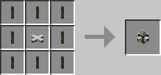

### Framed Bundled Cable / ジャケットケーブル / PR

* 実装状態: [ ]
* 名称: Framed Bundled Cable / 日本語: ジャケットケーブル / Origin: `projectred_transmission:neutral_framed_bundled_wire` / New: `bcn:framed_bundled_cable`
* レシピ: `Wooden` x8 + `Neutral Bundled Wire` x1 -> `Framed Bundled Cable` x1
* レシピ配置図: `AAA` / `ABA` / `AAA`
* 概要: 丸石に限らず、ほとんど全ての種類のカバープレートで作成可能. ケーブル束(無色)を覆いで囲ったもの. ケーブル束(無色)としか連結しない. ケーブル束を敷設するための床、壁面、天井が無いような空間で、 中空へとケーブル束を延長、敷設したい時に使用する.
* 専用GUI: 無
* 実装方法: 

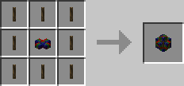

### Blue Alloy Wire / 青合金ワイヤー / PR

* 実装状態: [ ]
* 名称: Blue Alloy Wire / 日本語: 青合金ワイヤー / Origin: `-` / New: `bcn:blue_alloy_wire`
* レシピ: `Electrotine Alloy Ingot` x3 + `Wool` x6 -> `Blue Alloy Wire` x1
* レシピ配置図: `[000]` / `[000]` / `[000]`
* 概要: 青電力伝達専用のワイヤー. レッドストーン動力は伝えない. 作成時にどの色の羊毛を使用しても、同じ種類のワイヤーが出来上がる. レッドストーンストーン用のワイヤー同様に、壁や天井にも敷設できる. 距離によって電圧が減衰する.
* 専用GUI: 無
* 実装方法: 

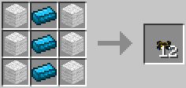

### 10kV Wire / 高圧ワイヤー / PR

* 実装状態: [ ]
* 名称: 10kV Wire / 日本語: 高圧ワイヤー / Origin: `-` / New: `bcn:10kv_wire`
* レシピ: `Blue Alloy Wire` + `Wool` -> `10kV Wire` x1
* レシピ配置図: `[000]` / `[000]` / `[000]`
* 概要: 不定形レシピ 普通の青合金ワイヤーだと100Vまでしか電圧をかけられないが、これは100倍の10kVまで耐えられる. 電圧を上げることで長距離電力輸送におけるロスを少なくできる. ただし、直接青合金ワイヤーや装置類に接続することはできず、間に変圧器を挟む必要がある.
* 専用GUI: 無
* 実装方法: 

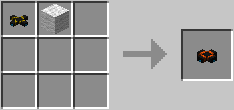

### Jacketed Bluewire / ジャケット青合金ワイヤー / PR

* 実装状態: [ ]
* 名称: Jacketed Bluewire / 日本語: ジャケット青合金ワイヤー / Origin: `-` / New: `bcn:jacketed_bluewire`
* レシピ: `Electrotine Alloy Ingot` + `Stripped Oak Log` x8 -> `Jacketed Bluewire` x1
* レシピ配置図: `[000]` / `[000]` / `[000]`
* 概要: 丸石に限らず、ほとんど全ての種類のカバープレートで作成可能. 青合金ワイヤーを覆いで囲ったもの. 青合金ワイヤーと接続する. 青合金ワイヤーを敷設するための床、壁面、天井が無いような空間で、 中空へと青合金ワイヤーを延長、敷設したい時に使用する.
* 専用GUI: 無
* 実装方法: 

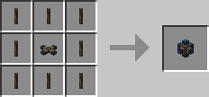

### Fine Copper Wire / 銅細線 / PR

* 実装状態: [ ]
* 名称: Fine Copper Wire / 日本語: 銅細線 / Origin: `-` / New: `bcn:fine_copper_wire`
* レシピ: `Copper Ingot` + `Draw Plate` -> `Fine Copper Wire` x1
* レシピ配置図: `[000]` / `[000]` / `[000]`
* 概要: 不定形レシピ 絞り板は耐久値を消費するだけで、素材としては消費されない. 中間素材. 銅線コイルと電磁チューブのほか、【Mechanical】のいくつかのアイテムに必要. 合金かまどで元の銅インゴットに戻すこともできる.
* 専用GUI: 無
* 実装方法: 

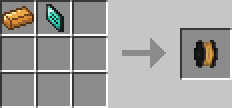

### Fine Iron Wire / 鉄細線 / PR

* 実装状態: [ ]
* 名称: Fine Iron Wire / 日本語: 鉄細線 / Origin: `-` / New: `bcn:fine_iron_wire`
* レシピ: `Iron Ingot` + `Draw Plate` -> `Fine Iron Wire` x1
* レシピ配置図: `[000]` / `[000]` / `[000]`
* 概要: 不定形レシピ 絞り板は耐久値を消費するだけで、素材としては消費されない. 中間素材. pre5b2現在、紡毛カードの作成にのみ必要. 合金かまどで元の鉄インゴットに戻すこともできる.
* 専用GUI: 無
* 実装方法: 

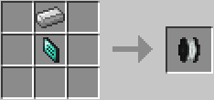

### Blulectric Motor / 青電力モーター / PR

* 実装状態: [ ]
* 名称: Blulectric Motor / 日本語: 青電力モーター / Origin: `-` / New: `bcn:blulectric_motor`
* レシピ: `Copper Coil` x2 + `Iron Ingot` x6 + `Electrotine Alloy Ingot` -> `Blulectric Motor` x1
* レシピ配置図: `[000]` / `[000]` / `[000]`
* 概要: 中間素材. "ポンプ"、"モーター"、"ディスクドライブ"、"青電力エンジン"に使用.
* 専用GUI: 無
* 実装方法: 

<!-- 画像なし -->

### Blulectric Furnace / 青電力かまど / PR

* 実装状態: [ ]
* 名称: Blulectric Furnace / 日本語: 青電力かまど / Origin: `-` / New: `bcn:blulectric_furnace`
* レシピ: `Clay Block` x5 + `Iron Ingot` x2 + `Electrotine Alloy Ingot` -> `Blulectric Furnace` x1
* レシピ配置図: `[000]` / `[000]` / `[000]`
* 概要: ◆青電力消費 青電力で動くかまど. 実質燃料なしで通常かまどの2倍の精錬速度と、そこだけ見れば高性能だが、安定稼動するにはそれなりの供給が必要. また、蓄積された青電力がゲージ全体の5/8(62.5%)以上に達していないと動作できない. 勘違いしやすいが、粘土ブロック5つ必要.
* 専用GUI: 無
* 実装方法: 

<!-- 画像なし -->

### Blulectric Alloy Furnace / 青電力合金かまど / PR

* 実装状態: [ ]
* 名称: Blulectric Alloy Furnace / 日本語: 青電力合金かまど / Origin: `-` / New: `bcn:blulectric_alloy_furnace`
* レシピ: `Bricks` x5 + `Iron Ingot` x2 + `Electrotine Alloy Ingot` -> `Blulectric Alloy Furnace` x1
* レシピ配置図: `[000]` / `[000]` / `[000]`
* 概要: ◆青電力消費 青電力で動く合金かまど. かまどが合金かまどになっただけで、仕様は青電力かまどと同じ.
* 専用GUI: 無
* 実装方法: 

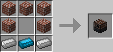

### BT Battery / 青電力電池、BTバッテリー / PR

* 実装状態: [ ]
* 名称: BT Battery / 日本語: 青電力電池、BTバッテリー / Origin: `-` / New: `bcn:bt_battery`
* レシピ: `Tin Ingot` + `Copper Ingot` x2 + `Nikolite` x6 -> `BT Battery` x1
* レシピ配置図: `[000]` / `[000]` / `[000]`
* 概要: ◆青電力貯蓄 青電力の電池. 蓄電器から青電力を充電して持ち運んだり、逆に蓄電器に青電力を戻すこともできる. 完全に空の時だけスタック出来る.
* 専用GUI: 無
* 実装方法: 

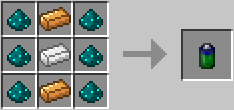

### BatteryBox / 蓄電器、バッテリーボックス / PR

* 実装状態: [ ]
* 名称: BatteryBox / 日本語: 蓄電器、バッテリーボックス / Origin: `projectred_expansion:battery_box` / New: `bcn:batterybox`
* レシピ: `Battery` x4 + `Wooden Planks` x1 + `Iron Ingot` x3 + `Electrotine Alloy Ingot` x1 -> `BatteryBox` x1
* レシピ配置図: `ABA` / `ACA` / `CDC`
* 概要: ◆青電力貯蓄 発電した青電力を貯めておく蓄電器. BTバッテリーと相互に充電できる. 破壊しアイテム化しても中の蓄電量は保持される. ただし電圧は保持されないので多少のロスが生じる.
* 専用GUI: 無
* 実装方法: 

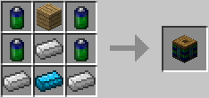

### Blulectric Transformer / 変圧器、トランスフォーマー / PR

* 実装状態: [ ]
* 名称: Blulectric Transformer / 日本語: 変圧器、トランスフォーマー / Origin: `-` / New: `bcn:blulectric_transformer`
* レシピ: `Iron Ingot` x5 + `Electrotine Alloy Ingot` x2 + `Copper Coil` x2 -> `Blulectric Transformer` x1
* レシピ配置図: `[000]` / `[000]` / `[000]`
* 概要: ◆青電力輸送 より送電ロスの少ない高圧ケーブルで電力輸送するために変圧する装置. これによって通常の青電力ワイヤーと高圧用ワイヤーを接続する. 向きによって高圧サイド、低圧サイドが決まっている.
* 専用GUI: 無
* 実装方法: 

### Solar Panel / ソーラーパネル / PR

* 実装状態: [ ]
* 名称: Solar Panel / 日本語: ソーラーパネル / Origin: `-` / New: `bcn:solar_panel`
* レシピ: `Coal And Charcoal` x3 + `Glass` x3 + `Circuit` x2 + `Generator` x1 -> `Solar Panel` x1
* レシピ配置図: `ABA` / `BAB` / `CDC`
* 概要: ◆青電力生産 太陽光を青電力に変えるパネル. 青電力のメイン生産源. 真上から遮蔽物なしに降り注ぐ太陽光以外の光源では動作しない （ガラス等の透明ブロックは可）ので、夜間は動作させられない. IC2の太陽光発電機同様、1枚1枚の単位時間あたりの生産効率は低いので、 大量の青電力を確保するためには敷地が必要. ちなみに、これ1個作るのにニコライトパウダーが36個も必要.
* 専用GUI: 無
* 実装方法: 発電量(発電速度): 13,050EU/day (1EU/t)

### Thermopile / 温度差発電器、サーモパイル / PR

* 実装状態: [ ]
* 名称: Thermopile / 日本語: 温度差発電器、サーモパイル / Origin: `-` / New: `bcn:thermopile`
* レシピ: `Electrotine Alloy Ingot` x3 + `Iron Ingot` x2 + `Copper Ingot` x4 + `Electro Silicon` x2 -> `Thermopile` x1
* レシピ配置図: `[000]` / `[000]` / `[000]`
* 概要: ◆青電力生産 隣接するブロックとの温度差から青電力を取りだす発電器. 発電力はかなり弱いが、昼夜関係なく発電できる. 隣接する熱源、低温源の種類と数によって発電量が増減する. ただしランダムに熱源の溶岩源が黒曜石化したり氷や雪が溶けて水源化したりする. 熱源になるもの：火、溶岩 低温源になるもの：水、氷、雪
* 専用GUI: 無
* 実装方法: 

### Kinetic Generator / 動力発電機、キネティックジェネレータ / PR

* 実装状態: [ ]
* 名称: Kinetic Generator / 日本語: 動力発電機、キネティックジェネレータ / Origin: `-` / New: `bcn:kinetic_generator`
* レシピ: `Iron Ingot` x6 + `Brass Ingot` + `Blulectric Motor` + `Electrotine Alloy Ingot` -> `Kinetic Generator` x1
* レシピ配置図: `[000]` / `[000]` / `[000]`
* 概要: ◆青電力生産 風力発電機. これだけには役に立たず風力タービンか風車をセットする必要がある. セットする羽根の種類によって設置すべき向きが変わるので注意が必要. 発電効率はそこそこ高めで、雨の日は発電量が増える.
* 専用GUI: 無
* 実装方法: 

### Wooden Windmill / 風車 / PR

* 実装状態: [ ]
* 名称: Wooden Windmill / 日本語: 風車 / Origin: `-` / New: `bcn:wooden_windmill`
* レシピ: `Sail` x4 + `Iron Block` x1 / `Post` x4 -> `Wooden Windmill` x1
* レシピ配置図: `[000]` / `[000]` / `[000]`
* 概要: 風力発電の羽根そのニ. おなじみの風車. コストが風力タービンより安いだけあって発電効率でやや劣る. 横向きに設置した動力発電機にセットすることで使用する. 高さ13×横13×奥行き1ブロックを占有し、羽が無いように見える空間でも通り抜けできない.
* 専用GUI: 無
* 実装方法: 

