> [ガイド](./GUIDE.md) > [科学技術ガイド](./GUIDE_TECH.md) > 科学技術アイテムカタログ

# 科学技術アイテムカタログ

`Build Craft Neo` 実装に伴い、鉱石、アイテム、機械、パイプ類とそのレシピを整理した一覧. レシピの正本は各 `resources/*/ITEMS.md` (wiki 仕様) であり、`公式レシピ` 行は現行公式データ(IC2C 1.19.2 / BC 7.99 / PR 1.21.1 / LP 1.12.2)からの近似参照.

## アイテムリスト

<!-- これは凡例です -->
### [ ] #[連番(3桁、0埋め)] [アイテム英語名] / [アイテム日本語名] / [源流MOD名, BCとかIC2とか略称でいい]

* 名称: [アイテム英語名] / 日本語: [アイテム日本語名] / Origin: `[源流MODでのID]` / New: `[新しいID（仮）]`
* レシピ: `[要求アイテム1(名称、IDではない)]` x [要求アイテム1個数] + `[要求アイテム2]` x [要求アイテム2個数] [...] -> `[アイテム英語名]` x [完成アイテムの個数]
* レシピ配置図: `[ABA]` / `[0C0]` / `[CCC]` <!-- 上段のレシピの順番で A ~ Z まで. 何もなしは0を使用 -->
* 概要: [概要]
* 実装方法: [実装方法]

<!-- 凡例終了 -->

## BuildCraft (7.99 / MC1.12.2)

### [ ] #001 Wrench / レンチ / BC

* 名称: Wrench / 日本語: レンチ / Origin: `buildcraftcore:wrench` / New: `bcn:wrench`
* レシピ: `Iron Ingot` x3 + `Stone Gear` x1 -> `Wrench` x1
* レシピ配置図: `A0A` / `0B0` / `0A0`
* 概要: BuildCraftで追加されるアイテム専用の工具. エンジンの他、製図机、ビルダー、リファイナリーの向き変更に使用する. また、木パイプ、鉄パイプの搬出口切り替えにも使用する. レンチではエンジンやマシンの撤去を行うことが出来ないので注意が必要（撤去はつるはしを用いること） IndustrialCraft2のレンチと違い、マシンの高速撤去能力は無い. BC6.2.0以降、更にエンジンのオーバーヒート解除の役割を担うようになった.
* 専用GUI: 無
* 実装方法:

### [ ] #002 Wooden Gear / 木の歯車 / BC

* 名称: Wooden Gear / 日本語: 木の歯車 / Origin: `buildcraftcore:gear_wood` / New: `bcn:wooden_gear`
* レシピ: `Stick` x4 -> `Wooden Gear` x1
* レシピ配置図: `0A0` / `A0A` / `0A0`
* 概要: 機械作成用の部品. これ自体には何の効果もない. 石の歯車、木エンジンの作成に使用する.
* 専用GUI: 無
* 実装方法:

### [ ] #003 Stone Gear / 石の歯車 / BC

* 名称: Stone Gear / 日本語: 石の歯車 / Origin: `buildcraftcore:gear_stone` / New: `bcn:stone_gear`
* レシピ: `Cobblestone` x4 + `Wooden Gear` x1 -> `Stone Gear` x1
* レシピ配置図: `0A0` / `ABA` / `0A0`
* 概要: 機械作成用の部品. これ自体には何の効果もない. 石エンジン、レンチ、全自動作業台の作成に使用する.
* 専用GUI: 無
* 実装方法:

### [ ] #004 Iron Gear / 鉄の歯車 / BC

* 名称: Iron Gear / 日本語: 鉄の歯車 / Origin: `buildcraftcore:gear_iron` / New: `bcn:iron_gear`
* レシピ: `Iron Ingot` x4 + `Stone Gear` x1 -> `Iron Gear` x1
* レシピ配置図: `0A0` / `ABA` / `0A0`
* 概要: 機械作成用の部品. これ自体には何の効果もない. ボーリングマシン、クァーリー、鉄エンジンの作成に使用する.
* 専用GUI: 無
* 実装方法:

### [ ] #005 Gold Gear / 金の歯車 / BC

* 名称: Gold Gear / 日本語: 金の歯車 / Origin: `buildcraftcore:gear_gold` / New: `bcn:gold_gear`
* レシピ: `Gold Ingot` x4 + `Iron Gear` x1 -> `Gold Gear` x1
* レシピ配置図: `0A0` / `ABA` / `0A0`
* 概要: 機械作成用の部品. これ自体には何の効果もない. クァーリー、フィラーの作成に使用する.
* 専用GUI: 無
* 実装方法:

### [ ] #006 Diamond Gear / ダイヤの歯車 / BC

* 名称: Diamond Gear / 日本語: ダイヤの歯車 / Origin: `buildcraftcore:gear_diamond` / New: `bcn:diamond_gear`
* レシピ: `Diamond` x4 + `Gold Gear` x1 -> `Diamond Gear` x1
* レシピ配置図: `0A0` / `ABA` / `0A0`
* 概要: 機械作成用の部品. これ自体には何の効果もない. クァーリー、ビルダー、リファイナリー、製図机、精密作業台の作成に使用する.
* 専用GUI: 無
* 実装方法:

### [ ] #007 Paintbrush / 無色の絵筆 / BC

* 名称: Paintbrush / 日本語: 無色の絵筆 / Origin: `-` / New: `bcn:paintbrush`
* レシピ: `Wooden Gear` x1 + `Stick` x1 + `Wool` x1 + `String` x2 -> `Paintbrush` x1
* レシピ配置図: `[000]` / `[000]` / `[000]`
* 概要: これを持って羊毛やパイプに向かって右クリックすることで、 その羊毛やパイプを手に持っている絵筆の色で染めることが出来る. 耐久値は63で、一回使うごとに1消費する. 一回も使用していない(耐久値が最大の)染色済みの絵筆は、他の染料とクラフトしなおすことで、色を変更可能.
* 専用GUI: 無
* 実装方法:

### [ ] #008 Paintbrush / 染色済みの絵筆 / BC

* 名称: Paintbrush / 日本語: 染色済みの絵筆 / Origin: `-` / New: `bcn:paintbrush`
* レシピ: `Paintbrush` x1 + `Any Dye` x1 -> `Paintbrush` x1
* レシピ配置図: `[000]` / `[000]` / `[000]`
* 概要: これを持って羊毛やパイプに向かって右クリックすることで、 その羊毛やパイプを手に持っている絵筆の色で染めることが出来る. 耐久値は63で、一回使うごとに1消費する. 一回も使用していない(耐久値が最大の)染色済みの絵筆は、他の染料とクラフトしなおすことで、色を変更可能.
* 専用GUI: 無
* 実装方法:

### [ ] #009 Redstone Engine / 木エンジン / BC

* 名称: Redstone Engine / 日本語: 木エンジン / Origin: `buildcraftcore:engine#0` / New: `bcn:redstone_engine`
* レシピ: `Wooden Planks` x3 + `Glass` x1 + `Wooden Gear` x2 + `Piston` x1 -> `Redstone Engine` x1
* レシピ配置図: `AAA` / `0B0` / `CDC`
* 概要: 初心者向けエンジン(パイプ用) 扱いやすい. 燃料が不要、レッドストーン入力だけで動くが、出力が極めて弱いエンジン. 出力不足からほとんどのマシンが動かせず、 このため木パイプや黒曜石パイプなど、パイプへの入力役として使われる. 燃料コスト0なので、パイプへの半永久的な入力役としては非常に優秀. 撤去時はつるはしが必須.
* 専用GUI: 無 — レバーで起動するのみ
* 実装方法:

### [ ] #010 Stirling Engine / 石エンジン / BC

* 名称: Stirling Engine / 日本語: 石エンジン / Origin: `buildcraftcore:engine#1` / New: `bcn:stirling_engine`
* レシピ: `Cobblestone` x3 + `Glass` x1 + `Stone Gear` x2 + `Piston` x1 -> `Stirling Engine` x1
* レシピ配置図: `AAA` / `0B0` / `CDC`
* 概要: 初心者向けエンジン(マシン用) 扱いやすい. レッドストーン入力に加えて、精錬用の燃料を消費するが、 中程度の出力を持ち、単機でマシンを動かせるエンジン. 木炭を燃料に使える関係で、持ち運び、設置、撤去が非常に楽なのが嬉しい. ただ、クァーリー等の高燃費マシンを1機で動かすのは色々とキツい. 撤去時はつるはしが必須.
* 専用GUI: 有 — 燃料投入と燃焼進行の表示
* 実装方法:

### [ ] #011 Combustion Engine / 鉄エンジン / BC

* 名称: Combustion Engine / 日本語: 鉄エンジン / Origin: `buildcraftcore:engine#2` / New: `bcn:combustion_engine`
* レシピ: `Iron Ingot` x3 + `Glass` x1 + `Iron Gear` x2 + `Piston` x1 -> `Combustion Engine` x1
* レシピ配置図: `AAA` / `0B0` / `CDC`
* 概要: 上級者向けのエンジン. 高性能だが扱いにくい. レッドストーン入力に加えて、"黒オイル"か"金オイル"が必要. 液体しか燃料に使えない関係で、気軽な設置や撤去ができない. また、更に追加で冷却用の"水"も注入し続けてやらないと、 長時間に渡って連続稼動させ続けた場合、必ず爆発するようになっている. 撤去時はつるはしが必須.
* 専用GUI: 有 — 燃料と冷却材の投入、稼働状態の表示
* 実装方法:

### [ ] #012 Creative Engine / クリエイティブエンジン / BC

* 名称: Creative Engine / 日本語: クリエイティブエンジン / Origin: `-` / New: `bcn:creative_engine`
* レシピ: なし
* レシピ配置図: `[000]` / `[000]` / `[000]`
* 概要: 
* 専用GUI: 有 — 出力レベルの選択
* 実装方法:

### [ ] #013 Oil / 黒オイル / BC

* 名称: Oil / 日本語: 黒オイル / Origin: `-` / New: `bcn:oil`
* レシピ: なし
* レシピ配置図: `[000]` / `[000]` / `[000]`
* 概要: 
* 専用GUI: 無
* 実装方法:

### [ ] #014 Oil Bucket / 黒オイルバケツ / BC

* 名称: Oil Bucket / 日本語: 黒オイルバケツ / Origin: `-` / New: `bcn:oil_bucket`
* レシピ: なし
* レシピ配置図: `[000]` / `[000]` / `[000]`
* 概要: 
* 専用GUI: 無
* 実装方法:

### [ ] #015 Fuel Bucket / 金オイルバケツ / BC

* 名称: Fuel Bucket / 日本語: 金オイルバケツ / Origin: `-` / New: `bcn:fuel_bucket`
* レシピ: なし
* レシピ配置図: `[000]` / `[000]` / `[000]`
* 概要: 
* 専用GUI: 無
* 実装方法:

### [ ] #016 Wooden Transport Pipe / 木の輸送パイプ / BC

* 名称: Wooden Transport Pipe / 日本語: 木の輸送パイプ / Origin: `-` / New: `bcn:wooden_transport_pipe`
* レシピ: `Glass` x1 + `Wooden Planks` x2 -> `Wooden Transport Pipe` x1
* レシピ配置図: `[000]` / `[000]` / `[000]`
* 概要: 搬出パイプ. 使用時には木エンジン必須. 入力がある度に、隣接した"内部にアイテム置き場を有するブロック"から アイテムを1個吸い出して、パイプラインに乗せる作用を持つ. レンチで右クリックすると、搬出口の切り替えが可能.
* 専用GUI: 無 — 輸送のみ(一部は接続フィルタ設定あり)
* 実装方法:

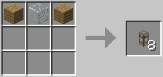

### [ ] #017 Cobblestone Transport Pipe / 丸石の輸送パイプ / BC

* 名称: Cobblestone Transport Pipe / 日本語: 丸石の輸送パイプ / Origin: `-` / New: `bcn:cobblestone_transport_pipe`
* レシピ: `Glass` x1 + `Cobblestone` x2 -> `Cobblestone Transport Pipe` x1
* レシピ配置図: `[000]` / `[000]` / `[000]`
* 概要: ノーマルパイプその1. これといって特別な効果を持たない. 焼石パイプとは互いに連結せず、使い分けると複雑な配管が可能.
* 専用GUI: 無 — 輸送のみ(一部は接続フィルタ設定あり)
* 実装方法:

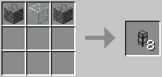

### [ ] #018 Stone Transport Pipe / 焼石の輸送パイプ / BC

* 名称: Stone Transport Pipe / 日本語: 焼石の輸送パイプ / Origin: `-` / New: `bcn:stone_transport_pipe`
* レシピ: `Glass` x1 + `Stone` x2 -> `Stone Transport Pipe` x1
* レシピ配置図: `[000]` / `[000]` / `[000]`
* 概要: ノーマルパイプその2. 少しだけ速度保持効果が上. 金パイプで加速されたアイテムの速度を、丸石パイプの2倍の距離保つ. が、それでも金パイプから16ブロック進んだ所で減速が開始、 徐々に速度が落ちていき、60ブロック進んだ所で完全に元の速度に戻る.
* 専用GUI: 無 — 輸送のみ(一部は接続フィルタ設定あり)
* 実装方法:

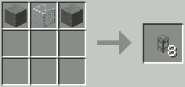

### [ ] #019 Sandstone Transport Pipe / 砂岩の輸送パイプ / BC

* 名称: Sandstone Transport Pipe / 日本語: 砂岩の輸送パイプ / Origin: `-` / New: `bcn:sandstone_transport_pipe`
* レシピ: `Glass` x1 + `Sandstone` x2 -> `Sandstone Transport Pipe` x1
* レシピ配置図: `[000]` / `[000]` / `[000]`
* 概要: ノーマルパイプその3. 加速保持性能は丸石パイプと同等. アイテムパイプとだけ連結し、それ以外とは一切連結しないパイプ. 隣のチェストやかまどにパイプを繋げたくない時に使用するが、 アイテムパイプ全種と結合してしまうため、複雑な配管には向かない.
* 専用GUI: 無 — 輸送のみ(一部は接続フィルタ設定あり)
* 実装方法:

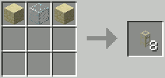

### [ ] #020 Iron Transport Pipe / 鉄の輸送パイプ / BC

* 名称: Iron Transport Pipe / 日本語: 鉄の輸送パイプ / Origin: `-` / New: `bcn:iron_transport_pipe`
* レシピ: `Glass` x1 + `Iron Ingot` x2 -> `Iron Transport Pipe` x1
* レシピ配置図: `[000]` / `[000]` / `[000]`
* 概要: 一方通行パイプ. 搬送ラインの分岐点ないし合流点で、多方向から入ってきたアイテムを 一つの方向にだけ送り出す作用を持つ. 設置時に覆いが無いのが出口側で、覆いの掛かった残り全てが入口側. レンチで右クリックする毎に、覆いの掛かっていない側の向きを変わる. また、レッドストーン入力すると搬出方向が切り替わる. これによって複雑なパイプラインが構築できる.
* 専用GUI: 無 — 輸送のみ(一部は接続フィルタ設定あり)
* 実装方法:

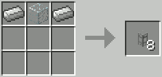

### [ ] #021 Golden Transport Pipe / 金の輸送パイプ / BC

* 名称: Golden Transport Pipe / 日本語: 金の輸送パイプ / Origin: `-` / New: `bcn:golden_transport_pipe`
* レシピ: `Glass` x1 + `Gold Ingot` x2 -> `Golden Transport Pipe` x1
* レシピ配置図: `[000]` / `[000]` / `[000]`
* 概要: 加速パイプ. 通過アイテムの搬送速度を加速する. ただしある程度進むと徐々に減速、やがて元に戻ってしまうので、 高速を維持させたい場合は一定間隔で金パイプを設置する必要がある. v3.2.0以降はレッドストーン入力不要、通過アイテムを常に加速させる. また最遅から最速まで加速させるには3個並べたのを通す必要がある.
* 専用GUI: 無 — 輸送のみ(一部は接続フィルタ設定あり)
* 実装方法:

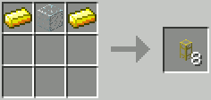

### [ ] #022 Obsidian Transport Pipe / 黒曜石の輸送パイプ / BC

* 名称: Obsidian Transport Pipe / 日本語: 黒曜石の輸送パイプ / Origin: `-` / New: `bcn:obsidian_transport_pipe`
* レシピ: `Glass` x1 + `Obsidian` x2 -> `Obsidian Transport Pipe` x1
* レシピ配置図: `[000]` / `[000]` / `[000]`
* 概要: 吸引パイプ. 地面に落ちているアイテムを吸引し、搬送ラインに乗せる作用を持つ. 通常状態でも、設置マスに落ちてきたドロップアイテムは吸引する. 木エンジンの入力を受ける毎、僅かに吸引効果がアップ(範囲+1) 石＆鉄エンジンから入力を受けると、大幅に吸引効果アップ(範囲+4)
* 専用GUI: 無 — 輸送のみ(一部は接続フィルタ設定あり)
* 実装方法:

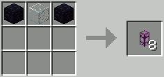

### [ ] #023 Emerald Transport Pipe / エメラルドの輸送パイプ / BC

* 名称: Emerald Transport Pipe / 日本語: エメラルドの輸送パイプ / Origin: `-` / New: `bcn:emerald_transport_pipe`
* レシピ: `Glass` x1 + `Emerald` x2 -> `Emerald Transport Pipe` x1
* レシピ配置図: `[000]` / `[000]` / `[000]`
* 概要: 通常の木パイプにダイヤパイプのフィルター機能を足したようなパイプ. 右クリックで専用のGUIを開く事ができ、Filter欄に置いたアイテムのみを、 通常木パイプ同様、対象チェストの左上から順に搬出していく. Filter欄には9種類までアイテムを置く事が可能.
* 専用GUI: 有 — 搬出フィルタ設定
* 実装方法:

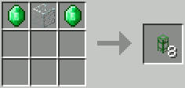

### [ ] #024 Diamond Transport Pipe / ダイヤモンドの輸送パイプ / BC

* 名称: Diamond Transport Pipe / 日本語: ダイヤモンドの輸送パイプ / Origin: `-` / New: `bcn:diamond_transport_pipe`
* レシピ: `Glass` x1 + `Diamond` x2 -> `Diamond Transport Pipe` x1
* レシピ配置図: `[000]` / `[000]` / `[000]`
* 概要: 仕分けパイプ. 他のパイプに接して置くと、接合部位の色が全六色のどれかに変わる. 設置後のパイプを右クリックすると、色分けされた特殊なGUIが開く. あらかじめここで仕分けしたいブロックを指定して置くと、 通過アイテムが対応する色側出口へとそれぞれ自動で仕分けされる. アイテム未指定の色側出口には、指定外の全アイテムが流される.
* 専用GUI: 有 — 色別仕分けフィルタ
* 実装方法:

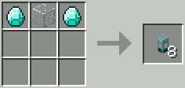

### [ ] #025 Void Transport Pipe / 虚空の輸送パイプ / BC

* 名称: Void Transport Pipe / 日本語: 虚空の輸送パイプ / Origin: `-` / New: `bcn:void_transport_pipe`
* レシピ: `Glass` x1 + `Ink Sac` x1 + `Redstone` x1 -> `Void Transport Pipe` x1
* レシピ配置図: `[000]` / `[000]` / `[000]`
* 概要: ゴミ箱パイプ. このパイプの中央に入ったアイテムは全てデリートされる. 捌き切れない余剰アイテムの処分用に使う.
* 専用GUI: 無 — 輸送のみ(一部は接続フィルタ設定あり)
* 実装方法:

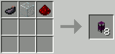

### [ ] #026 Stripes Transport Pipe / ストライプの輸送パイプ / BC

* 名称: Stripes Transport Pipe / 日本語: ストライプの輸送パイプ / Origin: `-` / New: `bcn:stripes_transport_pipe`
* レシピ: `Glass` x1 + `Ink Sac` x1 + `Yellow Dye` x1 / `Glass` x1 + `Gold Gear` x2 -> `Stripes Transport Pipe` x1
* レシピ配置図: `[000]` / `[000]` / `[000]`
* 概要: 設置 or 撤去回収パイプ. ブロックやアイテムが流れてくると、目の前の空間に設置や使用を試みる. 使用後のアイテムや、設置できないブロックはラインアウト. また、エンジン入力があると、自身の正面1マスにあるブロックを破壊し、 ドロップしたアイテムを搬送ラインに乗せる作用も持つ.
* 専用GUI: 無 — 輸送のみ(一部は接続フィルタ設定あり)
* 実装方法:

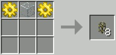

### [ ] #027 Quartz Transport Pipe / 水晶の輸送パイプ / BC

* 名称: Quartz Transport Pipe / 日本語: 水晶の輸送パイプ / Origin: `-` / New: `bcn:quartz_transport_pipe`
* レシピ: `Glass` x1 + `Nether Quartz Block` -> `Quartz Transport Pipe` x1
* レシピ配置図: `[000]` / `[000]` / `[000]`
* 概要: ノーマルパイプその4. 石パイプより速度保持が上. 丸石、石パイプと接続できない.
* 専用GUI: 無 — 輸送のみ(一部は接続フィルタ設定あり)
* 実装方法:

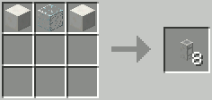

### [ ] #028 Lazuli Transport Pipe / ラピスラズリの輸送パイプ / BC

* 名称: Lazuli Transport Pipe / 日本語: ラピスラズリの輸送パイプ / Origin: `-` / New: `bcn:lazuli_transport_pipe`
* レシピ: `Glass` x1 + `Lapis Lazuli Block` x2 -> `Lazuli Transport Pipe` x1
* レシピ配置図: `[000]` / `[000]` / `[000]`
* 概要: このパイプを通過したアイテムに色を付ける. レンチ右クリック（Shift+右クリック）で付けられる色が変わる. 全16色
* 専用GUI: 有 — 色指定の振り分け
* 実装方法:

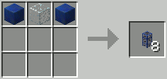

### [ ] #029 Daizuli Transport Pipe / ダイズリの輸送パイプ / BC

* 名称: Daizuli Transport Pipe / 日本語: ダイズリの輸送パイプ / Origin: `-` / New: `bcn:daizuli_transport_pipe`
* レシピ: `Glass` x1 + `Lapis Lazuli Block` x1 + `Diamond` x1 -> `Daizuli Transport Pipe` x1
* レシピ配置図: `[000]` / `[000]` / `[000]`
* 概要: 設定した色のアイテムを通す. レンチ右クリックでパイプの向き変更、Shift+右クリックで色変更
* 専用GUI: 有 — 色指定の振り分け
* 実装方法:

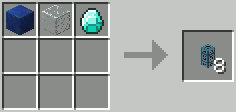

### [ ] #030 Emzuli Transport Pipe / エメズリの輸送パイプ / BC

* 名称: Emzuli Transport Pipe / 日本語: エメズリの輸送パイプ / Origin: `-` / New: `bcn:emzuli_transport_pipe`
* レシピ: `Glass` x1 + `Lapis Lazuli Block` x1 + `Emerald` x1 -> `Emzuli Transport Pipe` x1
* レシピ配置図: `[000]` / `[000]` / `[000]`
* 概要: アイテムに色を付けつつインベントリから搬出する. インベントリへ設置後のパイプを右クリックするとGUIが開き、4種類の設定が可能. 設定後、パイプに設定した色と同じ色をゲート出力しながらエンジン出力を受けると、対応するアイテムに色を付けつつ搬出する. エンジンでの搬出はできない.
* 専用GUI: 有 — 搬出フィルタ設定
* 実装方法:

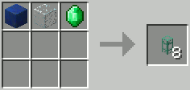

### [ ] #031 Clay Transport Pipe / 粘土の輸送パイプ / BC

* 名称: Clay Transport Pipe / 日本語: 粘土の輸送パイプ / Origin: `-` / New: `bcn:clay_transport_pipe`
* レシピ: `Glass` x1 + `Clay Block` x2 -> `Clay Transport Pipe` x1
* レシピ配置図: `[000]` / `[000]` / `[000]`
* 概要: 隣接した空きのあるインベントリを持ったブロックに優先的に挿入するパイプ. インベントリが埋まっている場合は通過する.
* 専用GUI: 無 — 輸送のみ(一部は接続フィルタ設定あり)
* 実装方法:

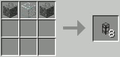

### [ ] #032 Pipe Sealant / パイプの防水材 / BC

* 名称: Pipe Sealant / 日本語: パイプの防水材 / Origin: `buildcrafttransport:waterproof` / New: `bcn:pipe_sealant`
* レシピ: `Sealant` x1 -> `Pipe Sealant` x1
* レシピ配置図: `[不定形]`
* 概要: 作成に必要な緑の染料はサボテンを精製することで得られる. ただ従来のレシピでは砂漠バイオームが遠くにある人にとってキツいものだったのか、 BC6.4.0からコンフィグでスライムボールレシピを追加することが可能になった(ただしBC6.4.4まで正常に動作しない模様) 通常パイプから液体専用の各種パイプを作るのに必要.
* 専用GUI: 無 — 輸送のみ(一部は接続フィルタ設定あり)
* 実装方法:

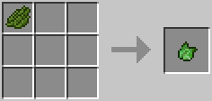

### [ ] #033 Wooden Fluid Pipe / 木の防水パイプ / BC

* 名称: Wooden Fluid Pipe / 日本語: 木の防水パイプ / Origin: `-` / New: `bcn:wooden_fluid_pipe`
* レシピ: `Pipe Sealant` x1 + `Wooden Transport Pipe` x1 -> `Wooden Fluid Pipe` x1
* レシピ配置図: `[000]` / `[000]` / `[000]`
* 概要: 基本的な使い方はアイテム用と同じで、木エンジン必須. もっぱら内部に液体貯蔵領域を持つブロックに対して使用する. （例：液体タンク、リファイナリー、鉄エンジン） ただしポンプには液体が自動搬出される関係で必要ない. 輸送速度:10mB/t
* 専用GUI: 無 — 輸送のみ(一部は接続フィルタ設定あり)
* 実装方法:

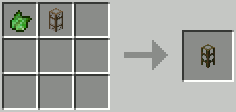

### [ ] #034 Cobblestone Fluid Pipe / 丸石の防水パイプ / BC

* 名称: Cobblestone Fluid Pipe / 日本語: 丸石の防水パイプ / Origin: `-` / New: `bcn:cobblestone_fluid_pipe`
* レシピ: `Pipe Sealant` x1 + `Cobblestone Transport Pipe` x1 -> `Cobblestone Fluid Pipe` x1
* レシピ配置図: `[000]` / `[000]` / `[000]`
* 概要: 液体用のノーマルパイプその1. 輸送速度:10mB/t
* 専用GUI: 無 — 輸送のみ(一部は接続フィルタ設定あり)
* 実装方法:

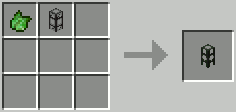

### [ ] #035 Stone Fluid Pipe / 焼石の防水パイプ / BC

* 名称: Stone Fluid Pipe / 日本語: 焼石の防水パイプ / Origin: `-` / New: `bcn:stone_fluid_pipe`
* レシピ: `Pipe Sealant` x1 + `Stone Transport Pipe` x1 -> `Stone Fluid Pipe` x1
* レシピ配置図: `[000]` / `[000]` / `[000]`
* 概要: 液体用のノーマルパイプその2. 丸石パイプの倍輸送が可能. 輸送速度:20mB/t
* 専用GUI: 無 — 輸送のみ(一部は接続フィルタ設定あり)
* 実装方法:

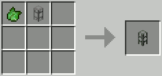

### [ ] #036 Sandstone Fluid Pipe / 砂岩の防水パイプ / BC

* 名称: Sandstone Fluid Pipe / 日本語: 砂岩の防水パイプ / Origin: `-` / New: `bcn:sandstone_fluid_pipe`
* レシピ: `Pipe Sealant` x1 + `Sandstone Transport Pipe` x1 -> `Sandstone Fluid Pipe` x1
* レシピ配置図: `[000]` / `[000]` / `[000]`
* 概要: アイテム用の砂岩パイプと全く同じ特性＆使い方. 輸送速度:20mB/t
* 専用GUI: 無 — 輸送のみ(一部は接続フィルタ設定あり)
* 実装方法:

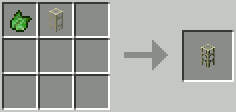

### [ ] #037 Iron Fluid Pipe / 鉄の防水パイプ / BC

* 名称: Iron Fluid Pipe / 日本語: 鉄の防水パイプ / Origin: `-` / New: `bcn:iron_fluid_pipe`
* レシピ: `Pipe Sealant` x1 + `Iron Transport Pipe` x1 -> `Iron Fluid Pipe` x1
* レシピ配置図: `[000]` / `[000]` / `[000]`
* 概要: アイテム用の鉄パイプと全く同じ特性＆使い方. 輸送性能も丸石パイプと何ら変わらない. 輸送速度:40mB/t
* 専用GUI: 無 — 輸送のみ(一部は接続フィルタ設定あり)
* 実装方法:

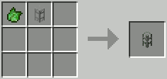

### [ ] #038 Golden Fluid Pipe / 金の防水パイプ / BC

* 名称: Golden Fluid Pipe / 日本語: 金の防水パイプ / Origin: `-` / New: `bcn:golden_fluid_pipe`
* レシピ: `Pipe Sealant` x1 + `Golden Transport Pipe` x1 -> `Golden Fluid Pipe` x1
* レシピ配置図: `[000]` / `[000]` / `[000]`
* 概要: 輸送速度が速いパイプ. 使う場合は全区間金パイプにする必要があり、 途中に一箇所でも木パイプや鉄パイプや砂岩パイプを使うと、 そこで液体が渋滞するので、結局液体を加速させた意味がなくなる. 輸送速度:80mB/t
* 専用GUI: 無 — 輸送のみ(一部は接続フィルタ設定あり)
* 実装方法:

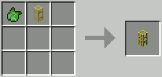

### [ ] #039 Emerald Fluid Pipe / エメラルドの防水パイプ / BC

* 名称: Emerald Fluid Pipe / 日本語: エメラルドの防水パイプ / Origin: `-` / New: `bcn:emerald_fluid_pipe`
* レシピ: `Pipe Sealant` x1 + `Emerald Transport Pipe` x1 -> `Emerald Fluid Pipe` x1
* レシピ配置図: `[000]` / `[000]` / `[000]`
* 概要: 使い方は木パイプと同じだが、液体の輸送速度が速い. 輸送速度:40mB/t
* 専用GUI: 無 — 輸送のみ(一部は接続フィルタ設定あり)
* 実装方法:

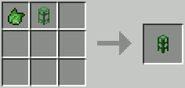

### [ ] #040 Void Fluid Pipe / 虚空の防水パイプ / BC

* 名称: Void Fluid Pipe / 日本語: 虚空の防水パイプ / Origin: `-` / New: `bcn:void_fluid_pipe`
* レシピ: `Pipe Sealant` x1 + `Void Transport Pipe` x1 -> `Void Fluid Pipe` x1
* レシピ配置図: `[000]` / `[000]` / `[000]`
* 概要: アイテム用の虚空パイプと全く同じ特性＆使い方. この中に運び込まれた液体は全て除去される. 輸送速度:10mB/t
* 専用GUI: 無 — 輸送のみ(一部は接続フィルタ設定あり)
* 実装方法:

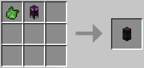

### [ ] #041 Quartz Fluid Pipe / 水晶の防水パイプ / BC

* 名称: Quartz Fluid Pipe / 日本語: 水晶の防水パイプ / Origin: `-` / New: `bcn:quartz_fluid_pipe`
* レシピ: `Pipe Sealant` x1 + `Quartz Transport Pipe` x1 -> `Quartz Fluid Pipe` x1
* レシピ配置図: `[000]` / `[000]` / `[000]`
* 概要: 基本液体パイプの最上位互換. 輸送速度:40mB/t
* 専用GUI: 無 — 輸送のみ(一部は接続フィルタ設定あり)
* 実装方法:

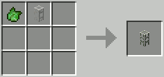

### [ ] #042 Diamond Fluid Pipe / ダイヤモンドの防水パイプ / BC

* 名称: Diamond Fluid Pipe / 日本語: ダイヤモンドの防水パイプ / Origin: `-` / New: `bcn:diamond_fluid_pipe`
* レシピ: `Pipe Sealant` x1 + `Diamond Transport Pipe` x1 -> `Diamond Fluid Pipe` x1
* レシピ配置図: `[000]` / `[000]` / `[000]`
* 概要: アイテム用ダイヤパイプの液体版. 何気に輸送速度が金の液体パイプと同じである. 輸送速度:80mB/t
* 専用GUI: 無 — 輸送のみ(一部は接続フィルタ設定あり)
* 実装方法:

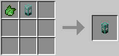

### [ ] #043 Clay Fluid Pipe / 粘土の防水パイプ / BC

* 名称: Clay Fluid Pipe / 日本語: 粘土の防水パイプ / Origin: `-` / New: `bcn:clay_fluid_pipe`
* レシピ: `Pipe Sealant` x1 + `Clay Transport Pipe` x1 -> `Clay Fluid Pipe` x1
* レシピ配置図: `[000]` / `[000]` / `[000]`
* 概要: アイテム用粘土パイプの液体版. 輸送速度:40mB/t
* 専用GUI: 無 — 輸送のみ(一部は接続フィルタ設定あり)
* 実装方法:

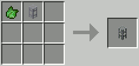

### [ ] #044 Wooden Conductive Pipe / 木の伝導パイプ / BC

* 名称: Wooden Conductive Pipe / 日本語: 木の伝導パイプ / Origin: `-` / New: `bcn:wooden_conductive_pipe`
* レシピ: `Redstone` x1 + `Wooden Transport Pipe` x1 -> `Wooden Conductive Pipe` x1
* レシピ配置図: `[000]` / `[000]` / `[000]`
* 概要: 石、鉄エンジンからエネルギーを受け取ると、 エネルギーをムラなく均分化し、安定した配給をする効果を持つパイプ. ただしこれ単体はエンジンからの受取口、入口としてのみ作用し、 エネルギーラインの始端にしか使えず、道中 or 末端部には使用不可. 320RF/tまで対応
* 専用GUI: 無 — 輸送のみ(一部は接続フィルタ設定あり)
* 実装方法:

<!-- 画像なし -->

### [ ] #045 Cobblestone Kinesis Pipe / 丸石の伝導パイプ / BC

* 名称: Cobblestone Kinesis Pipe / 日本語: 丸石の伝導パイプ / Origin: `-` / New: `bcn:cobblestone_kinesis_pipe`
* レシピ: `Redstone` x1 + `Cobblestone Transport Pipe` x1 -> `Cobblestone Kinesis Pipe` x1
* レシピ配置図: `[000]` / `[000]` / `[000]`
* 概要: 木パイプからのエネルギーを各マシンに送り届ける役目のパイプ. エネルギーパイプラインの道中 or 末端部分に使用する. 80RF/tまで対応
* 専用GUI: 無 — 輸送のみ(一部は接続フィルタ設定あり)
* 実装方法:

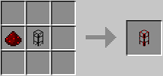

### [ ] #046 Stone Kinesis Pipe / 焼石の伝導パイプ / BC

* 名称: Stone Kinesis Pipe / 日本語: 焼石の伝導パイプ / Origin: `-` / New: `bcn:stone_kinesis_pipe`
* レシピ: `Redstone` x1 + `Stone Transport Pipe` x1 -> `Stone Kinesis Pipe` x1
* レシピ配置図: `[000]` / `[000]` / `[000]`
* 概要: 木パイプからのエネルギーを各マシンに送り届ける役目のパイプ. エネルギーパイプラインの道中 or 末端部分に使用する. 160RF/tまで対応
* 専用GUI: 無 — 輸送のみ(一部は接続フィルタ設定あり)
* 実装方法:

### [ ] #047 Quartz Kinesis Pipe / 水晶の伝導パイプ / BC

* 名称: Quartz Kinesis Pipe / 日本語: 水晶の伝導パイプ / Origin: `-` / New: `bcn:quartz_kinesis_pipe`
* レシピ: `Redstone` x1 + `Quartz Transport Pipe` x1 -> `Quartz Kinesis Pipe` x1
* レシピ配置図: `[000]` / `[000]` / `[000]`
* 概要: エネルギーパイプラインの道中 or 末端部分に使用する. 640RF/tまで対応
* 専用GUI: 無 — 輸送のみ(一部は接続フィルタ設定あり)
* 実装方法:

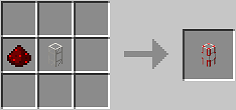

### [ ] #048 Iron Kinesis Pipe / 鉄の伝導パイプ / BC

* 名称: Iron Kinesis Pipe / 日本語: 鉄の伝導パイプ / Origin: `-` / New: `bcn:iron_kinesis_pipe`
* レシピ: `Redstone` x1 + `Iron Transport Pipe` -> `Iron Kinesis Pipe` x1
* レシピ配置図: `[000]` / `[000]` / `[000]`
* 概要: エネルギーパイプラインの分岐 or末端に使用. 流す最大MJ/tを設定出来る. レンチ右クリックで変更 20RF/t～1280RF/tまで対応.
* 専用GUI: 無 — 輸送のみ(一部は接続フィルタ設定あり)
* 実装方法:

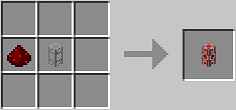

### [ ] #049 Golden Kinesis Pipe / 金の伝導パイプ / BC

* 名称: Golden Kinesis Pipe / 日本語: 金の伝導パイプ / Origin: `-` / New: `bcn:golden_kinesis_pipe`
* レシピ: `Redstone` x1 + `Golden Transport Pipe` x1 -> `Golden Kinesis Pipe` x1
* レシピ配置図: `[000]` / `[000]` / `[000]`
* 概要: 木パイプからのエネルギーを各マシンに送り届ける役目のパイプ. エネルギーパイプラインの道中 or 末端部分に使用する. 2560RF/tまで対応
* 専用GUI: 無 — 輸送のみ(一部は接続フィルタ設定あり)
* 実装方法:

<!-- 画像なし -->

### [ ] #050 Diamond Kinesis Pipe / ダイヤモンドの伝導パイプ / BC

* 名称: Diamond Kinesis Pipe / 日本語: ダイヤモンドの伝導パイプ / Origin: `-` / New: `bcn:diamond_kinesis_pipe`
* レシピ: `Redstone` x1 + `Diamond Transport Pipe` x1 -> `Diamond Kinesis Pipe` x1
* レシピ配置図: `[000]` / `[000]` / `[000]`
* 概要: 木パイプからのエネルギーを各マシンに送り届ける役目のパイプ. エネルギーパイプラインの道中 or 末端部分に使用する. 10240RF/tまで対応
* 専用GUI: 無 — 輸送のみ(一部は接続フィルタ設定あり)
* 実装方法:

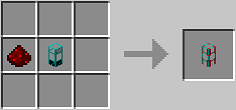

### [ ] #051 Cobblestone Structure Pipe / 丸石の構造パイプ / BC

* 名称: Cobblestone Structure Pipe / 日本語: 丸石の構造パイプ / Origin: `-` / New: `bcn:cobblestone_structure_pipe`
* レシピ: `Cobblestone` x2 + `Gravel` x1 -> `Cobblestone Structure Pipe` x1
* レシピ配置図: `[000]` / `[000]` / `[000]`
* 概要: 各種ゲート設置用のダミーパイプであり、アイテム搬送能力はない. どのパイプとも接続しないが、このパイプに取り付けたパイプワイヤーは、 他のどのパイプのパイプワイヤーとも接続する特性を持つ. また、精密作業台で外装パネルを作成する場合、大量に必要になる.
* 専用GUI: 無 — 輸送のみ(一部は接続フィルタ設定あり)
* 実装方法:

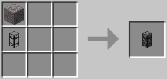

### [ ] #052 Pipe Plug / パイプ栓 / BC

* 名称: Pipe Plug / 日本語: パイプ栓 / Origin: `-` / New: `bcn:pipe_plug`
* レシピ: `Cobblestone Structure Pipe` x1 -> `Pipe Plug` x1
* レシピ配置図: `[000]` / `[000]` / `[000]`
* 概要: 正確にはパイプではなく、外装板のようにパイプに取り付けるアイテム. 外装板と共存可能. この栓が取り付けられた方向へは、どんなパイプ、マシンとも接続しない. 外装板同様、パイプ栓を持った状態でShift+右クリックすれば撤去可能だが、 本来接続可能なものが既に置かれている方向へは設置、撤去共に行えない.
* 専用GUI: 無
* 実装方法:

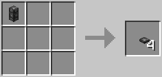

### [ ] #053 Lens / レンズ / BC

* 名称: Lens / 日本語: レンズ / Origin: `-` / New: `bcn:lens`
* レシピ: `Dye` x1 + `Glass` x1 -> `Lens` x1
* レシピ配置図: `[000]` / `[000]` / `[000]`
* 概要: パイプの接続部分に取り付けることによってラピスラズリパイプと同様にアイテムに色を付けることができる. アイテムパイプであれば何にでも取り付けることが可能なため、細かい配管に有利である.
* 専用GUI: 有 — 透過フィルタ設定
* 実装方法:

<!-- 画像なし -->

### [ ] #054 Filter / フィルター / BC

* 名称: Filter / 日本語: フィルター / Origin: `-` / New: `bcn:filter`
* レシピ: `Dye` x1 + `Glass` x1 + `Iron Bars` x1 -> `Filter` x1
* レシピ配置図: `[000]` / `[000]` / `[000]`
* 概要: パイプの接続部分に取り付けることによってダイズリパイプと同様に適応した色のついたアイテムしか通過させなくなる. アイテムパイプであれば何にでも取り付けることが可能なため、細かい配管に有利である.
* 専用GUI: 有 — フィルタ条件設定
* 実装方法:

<!-- 画像なし -->

### [ ] #055 Chute / 漏斗 / BC

* 名称: Chute / 日本語: 漏斗 / Origin: `buildcraftfactory:chute` / New: `bcn:chute`
* レシピ: `Iron Ingot` x5 + `Chest` x1 + `Stone Gear` x1 -> `Chute` x1
* レシピ配置図: `ABA` / `ACA` / `0A0`
* 概要: 厳密に言えばマシンではなく、アイテム搬送ラインにおける中継装置. 内部に4スロット分のインベントリを持ち、そこにアイテムを入れておくと、 真下のチェスト、かまど、マシンetc.のスロットに空きが出来た場合、 手持ちのアイテムを(上面から)順次そこに補充する.
* 専用GUI: 有 — 緩衝スロット
* 実装方法:

### [ ] #056 Auto Workbench / 全自動作業台 / BC

* 名称: Auto Workbench / 日本語: 全自動作業台 / Origin: `-` / New: `bcn:auto_workbench`
* レシピ: `Crafting Table` x1 + `Stone Gear` x2 -> `Auto Workbench` x1
* レシピ配置図: `[000]` / `[000]` / `[000]`
* 概要: 
* 専用GUI: 有 — 見本レシピの登録
* 実装方法:

<!-- 画像なし -->

### [ ] #057 Mining Well / ボーリングマシン / BC

* 名称: Mining Well / 日本語: ボーリングマシン / Origin: `buildcraftfactory:mining_well` / New: `bcn:mining_well`
* レシピ: `Iron Ingot` x6 + `Redstone` x1 + `Iron Gear` x1 + `Iron Pickaxe` x1 -> `Mining Well` x1
* レシピ配置図: `ABA` / `ACA` / `ADA`
* 概要: 稼動にはエンジン動力が必要. 採掘マシンその1. 直下掘り機. クァーリーのマイナーチェンジ版で、自身の真下1列しか掘れないが、 作りやすく、操作も簡単、取り回しに優れ、低燃費. 初心者がとりあえず触ってBuildCraftに慣れるのに最適なマシンでもある.
* 専用GUI: 無 — エンジン直結で動作
* 実装方法:

### [ ] #058 Quarry / クァーリー / BC

* 名称: Quarry / 日本語: クァーリー / Origin: `buildcraftbuilders:quarry` / New: `bcn:quarry`
* レシピ: `Iron Gear` x3 + `Redstone` x1 + `Gold Gear` x2 + `Diamond Gear` x2 + `Diamond Pickaxe` x1 -> `Quarry` x1
* レシピ配置図: `ABA` / `CAC` / `DED`
* 概要: 稼動にはエンジン動力が必要. 採掘マシンその2. 露天掘り機. ボーリングマシンの強化版で、1列だけでなく広い範囲を採掘できる. ただし作成コストが高い、範囲指定などの要素がある、 低出力エンジンでは動かし辛いなど、初心者にはハードルが高い面もある. またBC7よりデザインが変化. 作業状況に応じたランプが点灯するようになっている.
* 専用GUI: 有 — 採掘範囲と回収物の確認
* 実装方法:

### [ ] #059 Tank / 液体タンク / BC

* 名称: Tank / 日本語: 液体タンク / Origin: `buildcraftfactory:tank` / New: `bcn:tank`
* レシピ: `Glass` x8 -> `Tank` x1
* レシピ配置図: `AAA` / `A0A` / `AAA`
* 概要: バケツやポンプで汲んだ液体(水、溶岩、etc.)を溜め込むための液体タンク. これ1ブロックで16ブロック分の液体を貯蓄できる. 撤去しても中身の液体は溢れず、蓄えた液体ごと消滅する. 縦に重ねては結合させられるが、横に並べては連結させられない. 液体用パイプもしくはバケツの手作業で流入、搬出できる.
* 専用GUI: 有 — 貯蔵液体と容量の確認
* 実装方法:

### [ ] #060 Pump / ポンプ / BC

* 名称: Pump / 日本語: ポンプ / Origin: `buildcraftfactory:pump` / New: `bcn:pump`
* レシピ: `Iron Ingot` x4 + `Redstone` x1 + `Iron Gear` x1 + `Tank` x2 + `Bucket` x1 -> `Pump` x1
* レシピ配置図: `ABA` / `ACA` / `DED`
* 概要: 稼動にはエンジン動力が必要. 取水装置. 真下に液体がある場所に設置すると、ホースを伸ばして液体を吸引する. 水以外にも、溶岩、黒オイルなどを汲むのにも使え、 汲み取られた液体は隣の液体パイプや液体タンクへ次々搬出される.
* 専用GUI: 有 — 汲み上げと貯蔵の確認
* 実装方法:

### [ ] #061 Refinery / リファイナリー / BC

* 名称: Refinery / 日本語: リファイナリー / Origin: `-` / New: `bcn:refinery`
* レシピ: `Complex Circuit` x1 + `Nether Bricks` x2 + `Alloy Smelter` x1 + `Machine Tank` x2 + `Advanced Machine Block` x1 -> `Refinery` x1
* レシピ配置図: `0A0` / `BCB` / `DED`
* 概要: 稼動にはエンジン動力が必要. "黒オイル"を濾過蒸留して"金オイル"に変換する、オイル精製マシン. v3.2.0から稼動方式が変わってエネルギー減衰が無くなり、 エンジン直付けでも問題なく動かせるようになった.
* 専用GUI: 有 — 精製フィルタとタンク管理
* 実装方法:

### [ ] #062 Filtered Buffer / 選別緩衝器 / BC

* 名称: Filtered Buffer / 日本語: 選別緩衝器 / Origin: `buildcrafttransport:filtered_buffer` / New: `bcn:filtered_buffer`
* レシピ: `Wooden Planks` x6 + `Pipe Diamond Item` x1 + `Chest` x1 + `Piston` x1 -> `Filtered Buffer` x1
* レシピ配置図: `ABA` / `ACA` / `ADA`
* 概要: v3.7.1から追加 アイテムの一斉搬入をしたい場合に使用する. ゲートが必要.
* 専用GUI: 有 — 通過フィルタの設定
* 実装方法:

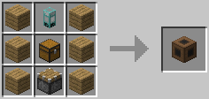

### [ ] #063 Flood Gate / 水門 / BC

* 名称: Flood Gate / 日本語: 水門 / Origin: `buildcraftfactory:flood_gate` / New: `bcn:flood_gate`
* レシピ: `Iron Ingot` x4 + `Iron Gear` x1 + `Iron Bars` x3 + `Tank` x1 -> `Flood Gate` x1
* レシピ配置図: `ABA` / `CDC` / `ACA`
* 概要: 
* 専用GUI: 無 — 動力を繋ぐのみ
* 実装方法:

### [ ] #064 Land Mark / 青マーカー / BC

* 名称: Land Mark / 日本語: 青マーカー / Origin: `-` / New: `bcn:land_mark`
* レシピ: `Lapis Lazuli` x1 + `Redstone Torch` x1 -> `Land Mark` x1
* レシピ配置図: `[000]` / `[000]` / `[000]`
* 概要: "クァーリー"、"フィラー"、"製図机"の3マシンを設置するに当たり、 その前段階として作業範囲を指定するのに使うマーカーロッド. 2本使って直線範囲、3本使って面範囲、4本使って空間範囲を……と、 こればかりは百聞は一見に如かず、図を見た方が早いので、 詳細解説（青マーカーでの範囲指定）の項目を参照の事. 地味に光度8(レッドストーントーチより1高い)の光を発している.
* 専用GUI: 無
* 実装方法:

### [ ] #065 Filler / フィラー / BC

* 名称: Filler / 日本語: フィラー / Origin: `-` / New: `bcn:filler`
* レシピ: `Crafting Table` x1 + `Ink Sac` x2 + `Land Mark` x1 + `Yellow Dye` x2 + `Gold Gear` x2 + `Chest` x1 -> `Filler` x1
* レシピ配置図: `[000]` / `[000]` / `[000]`
* 概要: 稼動にはエンジン動力が必要. 設置前に青マーカーでの作業範囲の指定が必須. 自動建設マシンその1. 整地マシン. 指定範囲に特定のブロックを敷き詰めたり、逆に全ブロックを撤去したり、 広大な範囲を整地したり、建物の外壁だけを作成したりできる. 1.12.2対応版ではまだ未実装の模様.
* 専用GUI: 有 — 充填パターンの指定
* 実装方法:

### [ ] #066 Template / テンプレート / BC

* 名称: Template / 日本語: テンプレート / Origin: `buildcraftbuilders:snapshot#0` / New: `bcn:template`
* レシピ: `Paper` x8 + `Dye Black` x1 -> `Template` x1
* レシピ配置図: `AAA` / `ABA` / `AAA`
* 概要: 下記の製図机で使用する未記入状態の製図. 指定範囲内のブロック情報を0(＝ある)か1(=ない)かだけで記録する. 個々のブロックの種類までは記憶できない代わりに、 記録した再現する時はプレイヤーが任意の建材を使用できる. 1種類のブロックを使った単純な構造物を反復作成する場合に向く.
* 専用GUI: 無
* 実装方法:

### [ ] #067 Blueprint / ブループリント / BC

* 名称: Blueprint / 日本語: ブループリント / Origin: `buildcraftbuilders:snapshot#2` / New: `bcn:blueprint`
* レシピ: `Paper` x8 + `Gem Lapis` x1 -> `Blueprint` x1
* レシピ配置図: `AAA` / `ABA` / `AAA`
* 概要: 製図机で使用する未記入状態の製図. テンプレートのパワーアップ版で、指定範囲内のブロック情報を、 "種類"や"向き"、"状態"まで含めて忠実に記憶する.
* 専用GUI: 無
* 実装方法:

### [ ] #068 Map Location / 範囲指定マップ / BC

* 名称: Map Location / 日本語: 範囲指定マップ / Origin: `-` / New: `bcn:map_location`
* レシピ: `Yellow Dye` x1 + `Paper` x8 -> `Map Location` x1
* レシピ配置図: `[000]` / `[000]` / `[000]`
* 概要: 範囲指定機に入れ、ロボットの稼働する範囲などを指定する範囲を記録することができる.
* 専用GUI: 無
* 実装方法:

<!-- 画像なし -->

### [ ] #069 List / リスト / BC

* 名称: List / 日本語: リスト / Origin: `buildcraftcore:list` / New: `bcn:list`
* レシピ: `Paper` x7 + `Redstone` x1 + `Dye` x1 -> `List` x1
* レシピ配置図: `ABA` / `ACA` / `AAA`
* 概要: ダイヤパイプのフィルター機能をより細かく設定するための道具. 右クリックするとGUIが開きアイテムを指定する欄が2段出てくる. 中にあるボタンは指定したアイテム(一番左側のみ)の詳細を指定することができる. P:不明(要検証) T:メタデータを無視するかどうか. M:類似したアイテムの指定.
* 専用GUI: 有 — リスト編集
* 実装方法:

<!-- 画像なし -->

### [ ] #070 Architect Table / 製図机 / BC

* 名称: Architect Table / 日本語: 製図机 / Origin: `buildcraftbuilders:architect` / New: `bcn:architect_table`
* レシピ: `Dye Black` x2 + `Marker Volume` x1 + `Dye Yellow` x2 + `Crafting Table` x1 + `Diamond Gear` x2 + `Snapshot` x1 -> `Architect Table` x1
* レシピ配置図: `ABA` / `CDC` / `EFE`
* 概要: 設置前に青マーカーでの作業範囲の指定が必須. 青マーカーでコピーする範囲を指定した後に、隣接させてこの機械を設置、 内部にテンプレートまたはブループリントを置くと、 使った製図の種類に応じて指定空間内におけるブロック情報を記録する. ただしあくまで"記録"だけが担当で、再構築は次の"ビルダー"の仕事.
* 専用GUI: 有 — 範囲設定と製図作成
* 実装方法:

### [ ] #071 Electronic Library / 製図棚 / BC

* 名称: Electronic Library / 日本語: 製図棚 / Origin: `-` / New: `bcn:electronic_library`
* レシピ: `Bookshelf` x2 + `Blueprint` x1 + `Iron Ingot` x4 + `Iron Gear` x1 + `Redstone` x1 -> `Electronic Library` x1
* レシピ配置図: `[000]` / `[000]` / `[000]`
* 概要: 作成した製図(黒、青両方)のデータをまとめて保存しておけるアーカイブ. 登録しておけば事故で製図を紛失しても安心、 一度登録したデータは、削除しない限り何度でも再ダウンロード可能. 複数の製図棚が(1ユーザー単位)でデータを共有しているので、 あるWorldの建物を別Worldにコピー、等の芸当も可能(材料は現地負担)
* 専用GUI: 無
* 実装方法:

### [ ] #072 Builder / ビルダー / BC

* 名称: Builder / 日本語: ビルダー / Origin: `-` / New: `bcn:builder`
* レシピ: `Crafting Table` x1 + `Ink Sac` x2 + `Land Mark` x1 + `Yellow Dye` x2 + `Diamond Gear` x2 + `Chest` x1 -> `Builder` x1
* レシピ配置図: `[000]` / `[000]` / `[000]`
* 概要: 稼動にはエンジン動力が必要. 製図机で"コピー"した構造物を"ペースト"するのに使う建築機械. 青マーカーでの範囲指定は必要なく、 記入済みの製図を内部スロットに置くと、建築予定線が自動展開される. 記録した構造物を垂直または水平に連続作成させたい場合は、 事前に"緑マーカー"で経路設定しておく必要がある. 不具合多発のためVer3.4.2にて機能凍結. その後Ver3.6.0にてレシピ及びクリエイティブタブからも削除された（ブロックとしては未だ存在している） なお、Ver.6.0.0で復活し、問題なく動作する模様.
* 専用GUI: 有 — 製図/テンプレートの指定と素材供給
* 実装方法:

### [ ] #073 Path Mark / 緑マーカー / BC

* 名称: Path Mark / 日本語: 緑マーカー / Origin: `-` / New: `bcn:path_mark`
* レシピ: `Green Dye` x1 + `Redstone Torch` x1 -> `Path Mark` x1
* レシピ配置図: `[000]` / `[000]` / `[000]`
* 概要: "ビルダー"でのみ使用する特殊なマーカーロッド. 使い方はほぼ青マーカーと同じだが、 こちらは同じ構造物を金太郎飴のように反復建築するのに使う. 地味に光度8(レッドストーントーチより1高い)の光を発している.
* 専用GUI: 無
* 実装方法:

### [ ] #074 Construction Mark / 建築マーカー / BC

* 名称: Construction Mark / 日本語: 建築マーカー / Origin: `-` / New: `bcn:construction_mark`
* レシピ: `Gold Gear` x1 + `Redstone Torch` x1 -> `Construction Mark` x1
* レシピ配置図: `[000]` / `[000]` / `[000]`
* 概要: 建築ロボット用のマーカー. このマーカーに対してブループリントを右クリックすると、建築指定範囲が表示され、ロボットが建築を行ってくれる.
* 専用GUI: 無
* 実装方法:

<!-- 画像なし -->

### [ ] #075 Requester / アイテム要求機 / BC

* 名称: Requester / 日本語: アイテム要求機 / Origin: `-` / New: `bcn:requester`
* レシピ: `Iron Ingot` x4 + `Iron Gear` x2 + `Piston` x1 + `Chest` x1 + `Redstone` x1 -> `Requester` x1
* レシピ配置図: `[000]` / `[000]` / `[000]`
* 概要: 
* 専用GUI: 有 — 要求アイテムの指定
* 実装方法:

<!-- 画像なし -->

### [ ] #076 Zone Planner / 範囲指定機 / BC

* 名称: Zone Planner / 日本語: 範囲指定機 / Origin: `-` / New: `bcn:zone_planner`
* レシピ: `Iron Ingot` x4 + `Gold Gear` x2 + `Diamond Gear` x1 + `Map` x1 + `Redstone` x1 -> `Zone Planner` x1
* レシピ配置図: `[000]` / `[000]` / `[000]`
* 概要: 
* 専用GUI: 有 — 範囲のマップ描画
* 実装方法:

<!-- 画像なし -->

### [ ] #077 Gate Copier / ゲートコピー機 / BC

* 名称: Gate Copier / 日本語: ゲートコピー機 / Origin: `-` / New: `bcn:gate_copier`
* レシピ: `Wrench` x1 + `Redstone Chipset` x1 -> `Gate Copier` x1
* レシピ配置図: `[000]` / `[000]` / `[000]`
* 概要: ゲートに右クリックで設定をコピー、Shift+右クリックで貼り付け
* 専用GUI: 有 — ゲート設定の写し
* 実装方法:

### [ ] #078 Laser / レーザー / BC

* 名称: Laser / 日本語: レーザー / Origin: `buildcraftsilicon:laser` / New: `bcn:laser`
* レシピ: `Redstone` x5 + `Obsidian` x2 + `Gem Diamond` x2 -> `Laser` x1
* レシピ配置図: `AAB` / `ACC` / `AAB`
* 概要: 稼動にはエンジン動力が必要 下記精密作業台を稼動させる為の、専用のレーザー照射装置. リファイナリー同様、エネルギーパイプを使用しないと動作が不安定. レーザーの色は、赤→黄→緑→青の順で、青が最も強力(40RF/t) が、青のレーザーにそれ以上エンジン入力しても効率は上がらないので、 効率を上げたい場合、青色のレーザーを2本、3本と複数用意する事.
* 専用GUI: 無
* 実装方法:

### [ ] #079 Assembly Table / 精密作業台 / BC

* 名称: Assembly Table / 日本語: 精密作業台 / Origin: `buildcraftsilicon:assembly_table` / New: `bcn:assembly_table`
* レシピ: `Obsidian` x6 + `Gem Diamond` x1 + `Redstone` x1 + `Diamond Gear` x1 -> `Assembly Table` x1
* レシピ配置図: `ABA` / `ACA` / `ADA`
* 概要: ワイヤー、チップセット、ゲートなどを作成する為の専用作業台. 上記アイテムはこの作業台でしか作成できず、 更にこの作業台自体、レーザーの照射によってしか稼動しない. あらかじめ材料を置き、更にそれを使って何を作るか選択しておかないと、 範囲内にレーザー照射機があっても認識してもらえない点に注意.
* 専用GUI: 有 — レシピ選択と素材投入
* 実装方法:

### [ ] #080 Advanced Crafting Table / 全自動作業台、改 / BC

* 名称: Advanced Crafting Table / 日本語: 全自動作業台、改 / Origin: `buildcraftsilicon:advanced_crafting_table` / New: `bcn:advanced_crafting_table`
* レシピ: `Obsidian` x6 + `Crafting Table Wood` x1 + `Chest Wood` x1 + `Redstone Chipset` x1 -> `Advanced Crafting Table` x1
* レシピ配置図: `ABA` / `ACA` / `ADA`
* 概要: レーザー照射によってのみ動作する、全自動作業台. "全自動作業台(通常)"、"隣接チェスト"、"搬出用の木パイプ"の3つが 1ブロックに統合されているのと同じ作用を持っているが、 一方で加工1回に必要なエネルギー量は5000RF/tであり、 作成コストも全自動作業台(通常)に比べ遥かに高くなっている. その分レーザーを大量に設置すれば加工は一瞬で終わる.
* 専用GUI: 有 — レシピ登録と素材収納
* 実装方法:

### [ ] #081 Integration Table / レーザー合成台 / BC

* 名称: Integration Table / 日本語: レーザー合成台 / Origin: `buildcraftsilicon:integration_table` / New: `bcn:integration_table`
* レシピ: `Obsidian` x6 + `Gold Ingot` x1 + `Redstone Chipset` x1 + `Diamond Gear` x1 -> `Integration Table` x1
* レシピ配置図: `ABA` / `ACA` / `ADA`
* 概要: 精密作業台と似ているが、こちらはゲートやロボットにチップを合成するためだけの作業台.
* 専用GUI: 有 — ゲートへの改造合成
* 実装方法:

### [ ] #082 Charging Table / スタンピングテーブル / BC

* 名称: Charging Table / 日本語: スタンピングテーブル / Origin: `-` / New: `bcn:charging_table`
* レシピ: `Obsidian` x6 + `Crafting Table` x1 + `Redstone Chipset` x1 + `Gold Gear` x1 -> `Charging Table` x1
* レシピ配置図: `[000]` / `[000]` / `[000]`
* 概要: レーザー駆動. ロボット、RFを使うアイテムに充電可能(TEのEnergy Cellで確認）
* 専用GUI: 有 — 対象アイテムの充電
* 実装方法:

### [ ] #083 Red Pipe Wire / 赤ワイヤー / BC

* 名称: Red Pipe Wire / 日本語: 赤ワイヤー / Origin: `-` / New: `bcn:red_pipe_wire`
* レシピ: `Red Pipe Wire` x8 + `Iron Ingot` x1 + `Red Dye` x1 -> `Red Pipe Wire` x1
* レシピ配置図: `[000]` / `[000]` / `[000]`
* 概要: 1つのパイプに4種類取り付けられるワイヤー. パイプの四隅に敷設する形で、ゲートと併用しての信号伝達に使用する. これら4色のワイヤー信号は対ゲート限定の信号であり、 ドア、ピストン、マシンのような、ゲート以外の装置への動力には使えない. 赤のワイヤーは鉄ゲート以上、青のワイヤーは金ゲート以上、 緑＆黄のワイヤーはダイヤゲート以上でないと送受信を取り扱えない.
* 専用GUI: 無 — 輸送のみ(一部は接続フィルタ設定あり)
* 実装方法:

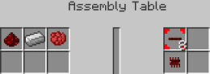

### [ ] #084 Blue Pipe Wire / 青ワイヤー / BC

* 名称: Blue Pipe Wire / 日本語: 青ワイヤー / Origin: `-` / New: `bcn:blue_pipe_wire`
* レシピ: `Blue Pipe Wire` x8 + `Iron Ingot` x1 + `Lapis Lazuli` x1 -> `Blue Pipe Wire` x1
* レシピ配置図: `[000]` / `[000]` / `[000]`
* 概要: 1つのパイプに4種類取り付けられるワイヤー. パイプの四隅に敷設する形で、ゲートと併用しての信号伝達に使用する. これら4色のワイヤー信号は対ゲート限定の信号であり、 ドア、ピストン、マシンのような、ゲート以外の装置への動力には使えない. 赤のワイヤーは鉄ゲート以上、青のワイヤーは金ゲート以上、 緑＆黄のワイヤーはダイヤゲート以上でないと送受信を取り扱えない.
* 専用GUI: 無 — 輸送のみ(一部は接続フィルタ設定あり)
* 実装方法:

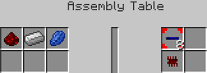

### [ ] #085 Green Pipe Wire / 緑ワイヤー / BC

* 名称: Green Pipe Wire / 日本語: 緑ワイヤー / Origin: `-` / New: `bcn:green_pipe_wire`
* レシピ: `Green Pipe Wire` x8 + `Iron Ingot` x1 + `Green Dye` x1 -> `Green Pipe Wire` x1
* レシピ配置図: `[000]` / `[000]` / `[000]`
* 概要: 1つのパイプに4種類取り付けられるワイヤー. パイプの四隅に敷設する形で、ゲートと併用しての信号伝達に使用する. これら4色のワイヤー信号は対ゲート限定の信号であり、 ドア、ピストン、マシンのような、ゲート以外の装置への動力には使えない. 赤のワイヤーは鉄ゲート以上、青のワイヤーは金ゲート以上、 緑＆黄のワイヤーはダイヤゲート以上でないと送受信を取り扱えない.
* 専用GUI: 無 — 輸送のみ(一部は接続フィルタ設定あり)
* 実装方法:

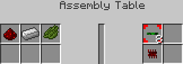

### [ ] #086 Yellow Pipe Wire / 黄ワイヤー / BC

* 名称: Yellow Pipe Wire / 日本語: 黄ワイヤー / Origin: `-` / New: `bcn:yellow_pipe_wire`
* レシピ: `Yellow Pipe Wire` x8 + `Iron Ingot` x1 + `Yellow Dye` x1 -> `Yellow Pipe Wire` x1
* レシピ配置図: `[000]` / `[000]` / `[000]`
* 概要: 1つのパイプに4種類取り付けられるワイヤー. パイプの四隅に敷設する形で、ゲートと併用しての信号伝達に使用する. これら4色のワイヤー信号は対ゲート限定の信号であり、 ドア、ピストン、マシンのような、ゲート以外の装置への動力には使えない. 赤のワイヤーは鉄ゲート以上、青のワイヤーは金ゲート以上、 緑＆黄のワイヤーはダイヤゲート以上でないと送受信を取り扱えない.
* 専用GUI: 無 — 輸送のみ(一部は接続フィルタ設定あり)
* 実装方法:

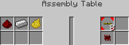

### [ ] #087 Redstone Chipset / 赤石チップ / BC

* 名称: Redstone Chipset / 日本語: 赤石チップ / Origin: `buildcraftsilicon:redstone_chipset#0` / New: `bcn:redstone_chipset`
* レシピ: `Redstone Chipset` x1 -> `Redstone Chipset` x1
* レシピ配置図: `[000]` / `[000]` / `[000]`
* 概要: 各ゲートの作成材料となる中間素材. これ単体では何にも使えない.
* 専用GUI: 無
* 実装方法:

<!-- 画像なし -->

### [ ] #088 Iron Chipset / 鉄チップ / BC

* 名称: Iron Chipset / 日本語: 鉄チップ / Origin: `buildcraftsilicon:redstone_chipset#1` / New: `bcn:iron_chipset`
* レシピ: `Iron Chipset` x1 + `Iron Ingot` x1 -> `Iron Chipset` x1
* レシピ配置図: `[000]` / `[000]` / `[000]`
* 概要: 各ゲートの作成材料となる中間素材. これ単体では何にも使えない.
* 専用GUI: 無
* 実装方法:

### [ ] #089 Golden Chipset / 金チップ / BC

* 名称: Golden Chipset / 日本語: 金チップ / Origin: `buildcraftsilicon:redstone_chipset#2` / New: `bcn:golden_chipset`
* レシピ: `Golden Chipset` x1 + `Gold Ingot` x1 -> `Golden Chipset` x1
* レシピ配置図: `[000]` / `[000]` / `[000]`
* 概要: 各ゲートの作成材料となる中間素材. これ単体では何にも使えない.
* 専用GUI: 無
* 実装方法:

<!-- 画像なし -->

### [ ] #090 Diamond Chipset / ダイヤチップ / BC

* 名称: Diamond Chipset / 日本語: ダイヤチップ / Origin: `buildcraftsilicon:redstone_chipset#4` / New: `bcn:diamond_chipset`
* レシピ: `Diamond Chipset` x1 + `Diamond` x1 -> `Diamond Chipset` x1
* レシピ配置図: `[000]` / `[000]` / `[000]`
* 概要: 各ゲートの作成材料となる中間素材. これ単体では何にも使えない.
* 専用GUI: 無
* 実装方法:

<!-- 画像なし -->

### [ ] #091 Pulsating Chipset / パルサー / BC

* 名称: Pulsating Chipset / 日本語: パルサー / Origin: `-` / New: `bcn:pulsating_chipset`
* レシピ: `Pulsating Chipset` x2 + `Ender Pearl` x1 -> `Pulsating Chipset` x1
* レシピ配置図: `[000]` / `[000]` / `[000]`
* 概要: 各ゲートの作成材料となる中間素材. これ単体では何にも使えない.
* 専用GUI: 無
* 実装方法:

### [ ] #092 Quartz Chipset / 水晶チップ / BC

* 名称: Quartz Chipset / 日本語: 水晶チップ / Origin: `buildcraftsilicon:redstone_chipset#3` / New: `bcn:quartz_chipset`
* レシピ: `Quartz Chipset` x1 + `Nether Quartz` x1 -> `Quartz Chipset` x1
* レシピ配置図: `[000]` / `[000]` / `[000]`
* 概要: 各ゲートの作成材料となる中間素材. これ単体では何にも使えない.
* 専用GUI: 無
* 実装方法:

<!-- 画像なし -->

### [ ] #093 Redstone Comp Chipset / コンパレータチップ / BC

* 名称: Redstone Comp Chipset / 日本語: コンパレータチップ / Origin: `-` / New: `bcn:redstone_comp_chipset`
* レシピ: `Redstone Comp Chipset` x1 + `Diamond` x1 -> `Redstone Comp Chipset` x1
* レシピ配置図: `[000]` / `[000]` / `[000]`
* 概要: 各ゲートの作成材料となる中間素材. これ単体では何にも使えない.
* 専用GUI: 無
* 実装方法:

<!-- 画像なし -->

### [ ] #094 Emerald Chipset / エメラルドチップ / BC

* 名称: Emerald Chipset / 日本語: エメラルドチップ / Origin: `-` / New: `bcn:emerald_chipset`
* レシピ: `Emerald Chipset` x1 + `Emerald` x1 -> `Emerald Chipset` x1
* レシピ配置図: `[000]` / `[000]` / `[000]`
* 概要: 各ゲートの作成材料となる中間素材. これ単体では何にも使えない.
* 専用GUI: 無
* 実装方法:

<!-- 画像なし -->

### [ ] #095 Gate / 赤石ゲート / BC

* 名称: Gate / 日本語: 赤石ゲート / Origin: `-` / New: `bcn:gate`
* レシピ: `Gate` x1 + `Red Pipe Wire` x1 -> `Gate` x1
* レシピ配置図: `[000]` / `[000]` / `[000]`
* 概要: 特定条件が満たされた場合のトリガー機構として機能する検知ゲート. パイプを設置した後、更にそれに被せるようにして取り付ける. アイテム用、液体用、エネルギー用、全てのパイプに対して取り付け可能. レッドストーン動力のみ扱え、パイプワイヤー信号は扱えない.
* 専用GUI: 有 — トリガーとアクションの設定
* 実装方法:

### [ ] #096 Iron AND Gate / Iron OR Gate / 鉄ゲート（AND/OR） / BC

* 名称: Iron AND Gate / Iron OR Gate / 日本語: 鉄ゲート（AND/OR） / Origin: `-` / New: `bcn:iron_and_gate`
* レシピ: `Iron Gate` x1 + `Red Pipe Wire` x1 + `Blue Pipe Wire` x1 -> `Iron AND Gate` x1
* レシピ配置図: `[000]` / `[000]` / `[000]`
* 概要: 
* 専用GUI: 有 — トリガーとアクションの設定
* 実装方法:

### [ ] #097 Gold AND Gate / Gold OR Gate / 金ゲート（AND/OR） / BC

* 名称: Gold AND Gate / Gold OR Gate / 日本語: 金ゲート（AND/OR） / Origin: `-` / New: `bcn:gold_and_gate`
* レシピ: `Golden Gate` x1 + `Red Pipe Wire` x1 + `Blue Pipe Wire` x1 + `Green Pipe Wire` x1 -> `Gold AND Gate` x1
* レシピ配置図: `[000]` / `[000]` / `[000]`
* 概要: 
* 専用GUI: 有 — トリガーとアクションの設定
* 実装方法:

### [ ] #098 Diamond AND Gate / Diamond OR Gate / ダイヤゲート（AND/OR） / BC

* 名称: Diamond AND Gate / Diamond OR Gate / 日本語: ダイヤゲート（AND/OR） / Origin: `-` / New: `bcn:diamond_and_gate`
* レシピ: `Diamond Gate` x1 + `Pipe Wires (all colors)` x1 -> `Diamond AND Gate` x1
* レシピ配置図: `[000]` / `[000]` / `[000]`
* 概要: 
* 専用GUI: 有 — トリガーとアクションの設定
* 実装方法:

### [ ] #099 Emerald AND Gate / Emerald OR Gate / エメラルドゲート（AND/OR） / BC

* 名称: Emerald AND Gate / Emerald OR Gate / 日本語: エメラルドゲート（AND/OR） / Origin: `-` / New: `bcn:emerald_and_gate`
* レシピ: `Emerald Gate` x1 + `Pipe Wires (all colors)` x1 -> `Emerald AND Gate` x1
* レシピ配置図: `[000]` / `[000]` / `[000]`
* 概要: 
* 専用GUI: 有 — トリガーとアクションの設定
* 実装方法:

### [ ] #100 Quartz AND Gate / Quartz OR Gate / 水晶ゲート（AND/OR） / BC

* 名称: Quartz AND Gate / Quartz OR Gate / 日本語: 水晶ゲート（AND/OR） / Origin: `-` / New: `bcn:quartz_and_gate`
* レシピ: `Quartz Gate` x1 + `Red Pipe Wire` x1 + `Blue Pipe Wire` x1 + `Green Pipe Wire` x1 -> `Quartz AND Gate` x1
* レシピ配置図: `[000]` / `[000]` / `[000]`
* 概要: 
* 専用GUI: 有 — トリガーとアクションの設定
* 実装方法:

### [ ] #101 Clock Timer / クロックタイマー / BC

* 名称: Clock Timer / 日本語: クロックタイマー / Origin: `-` / New: `bcn:clock_timer`
* レシピ: `Clock Timer` x1 + `Quartz Chipset` x1 -> `Clock Timer` x1
* レシピ配置図: `[000]` / `[000]` / `[000]`
* 概要: ゲートの条件設定の追加項目としてタイマーを使うことのできるゲート.
* 専用GUI: 無
* 実装方法:

<!-- 画像なし -->

### [ ] #102 Redstone Fader / レッドストーンフェーダー / BC

* 名称: Redstone Fader / 日本語: レッドストーンフェーダー / Origin: `-` / New: `bcn:redstone_fader`
* レシピ: `Redstone Fader` x1 + `Redstone Comparator` x1 -> `Redstone Fader` x1
* レシピ配置図: `[000]` / `[000]` / `[000]`
* 概要: ゲートの条件設定の追加項目としてレッドストーンの強度を自由に検知、出力が可能になるゲート.
* 専用GUI: 無
* 実装方法:

<!-- 画像なし -->

### [ ] #103 Autarchic Pulsar / オートチックパルサー / BC

* 名称: Autarchic Pulsar / 日本語: オートチックパルサー / Origin: `-` / New: `bcn:autarchic_pulsar`
* レシピ: `Autarchic Pulsar` x1 + `Pulsating Chipset` x1 -> `Autarchic Pulsar` x1
* レシピ配置図: `[000]` / `[000]` / `[000]`
* 概要: ゲートの条件設定の追加項目として木エンジンと同様のパルスを出力できるゲート.
* 専用GUI: 無
* 実装方法:

<!-- 画像なし -->

### [ ] #104 Light Sensor / ライトセンサー / BC

* 名称: Light Sensor / 日本語: ライトセンサー / Origin: `-` / New: `bcn:light_sensor`
* レシピ: `Light Sensor` x1 + `Daylight Sensor` x1 -> `Light Sensor` x1
* レシピ配置図: `[000]` / `[000]` / `[000]`
* 概要: ゲートの条件設定の追加項目として日照センサーが使用できるゲート.
* 専用GUI: 無
* 実装方法:

<!-- 画像なし -->

### [ ] #105 Facade: xxxx / 外装パネル / BC

* 名称: Facade: xxxx / 日本語: 外装パネル / Origin: `-` / New: `bcn:facade_xxxx`
* レシピ: `Facade: xxxx` x6 + `Cobblestone Structure Pipe` x3 -> `Facade: xxxx` x1
* レシピ配置図: `[000]` / `[000]` / `[000]`
* 概要: パイプを覆い隠す為のハリボテパネル. 様々なブロックで作成可能. 厚さが1/16だがパイプの各面にしか取り付けられない. v3.2.0pre9で本物のブロックと同じ実体＆当たり判定も獲得. Shiftキーを押しながら同じパネルを持ってパイプをクリックすると、パネルだけを外せる.
* 専用GUI: 無
* 実装方法:

<!-- 画像なし -->

### [ ] #106 Redstone Board / レッドストーンボード / BC

* 名称: Redstone Board / 日本語: レッドストーンボード / Origin: `-` / New: `bcn:redstone_board`
* レシピ: `Redstone` x1 + `Paper` x8 -> `Redstone Board` x1
* レシピ配置図: `[000]` / `[000]` / `[000]`
* 概要: 中間素材. Programming Tableで各種レッドストーンボード作成に使用.
* 専用GUI: 無
* 実装方法:

### [ ] #107 Redstone Crystal / レッドストーンクリスタル / BC

* 名称: Redstone Crystal / 日本語: レッドストーンクリスタル / Origin: `-` / New: `bcn:redstone_crystal`
* レシピ: `Redstone Block` x1 -> `Redstone Crystal` x1
* レシピ配置図: `[000]` / `[000]` / `[000]`
* 概要: 中間素材. 精密作業台で作成.
* 専用GUI: 無
* 実装方法:

<!-- 画像なし -->

### [ ] #108 Robot / ロボット / BC

* 名称: Robot / 日本語: ロボット / Origin: `-` / New: `bcn:robot`
* レシピ: `Iron Ingot` x5 + `Redstone Crystal` x1 + `Diamond Chipset` x2 -> `Robot` x1
* レシピ配置図: `[000]` / `[000]` / `[000]`
* 概要: 中間素材.
* 専用GUI: 無
* 実装方法:

### [ ] #109 Docking Station / ドック / BC

* 名称: Docking Station / 日本語: ドック / Origin: `-` / New: `bcn:docking_station`
* レシピ: `Iron Ingot` x3 + `Golden Chipset` -> `Docking Station` x1
* レシピ配置図: `[000]` / `[000]` / `[000]`
* 概要: ロボットとパイプを接続するためのアイテム. レーザー駆動. （白紙の）レッドストーンボードを材料に各種レッドストーンボード作成
* 専用GUI: 無 — ドック経由でロボットへ接続
* 実装方法:

### [ ] #110 Charging Table / レーザー充電台 / BC

* 名称: Charging Table / 日本語: レーザー充電台 / Origin: `-` / New: `bcn:charging_table`
* レシピ: `Obsidian` x6 + `Redstone` x1 + `Redstone Chipset` x1 + `Gold Gear` x1 -> `Charging Table` x1
* レシピ配置図: `[000]` / `[000]` / `[000]`
* 概要: レーザー駆動. ロボット、RFを使うアイテムに充電可能(TEのEnergy Cellで確認）
* 専用GUI: 有 — 対象アイテムの充電
* 実装方法:

(110 項目)

## IndustrialCraft² (wiki=Experimental 準拠, 公式=IC2 Classic 1.19.2)

### [ ] #111 Generator / 火力発電機 / IC2

* 名称: Generator / 日本語: 火力発電機 / Origin: `ic2:generator` / New: `bcn:generator`
* レシピ: `RE Battery` x1 + `Machine Block` x1 + `Furnace` x1 -> `Generator` x1
* レシピ配置図: `0A0` / `0B0` / `0C0`
* 概要: 最もポピュラーな発電機. 他の発電機の作成にも必要. 使用できる燃料が最も多く、発電量は燃料によって異なる. 石かまどで使える燃料は、溶岩バケツを除いてこちらでも燃料として使える.
* 専用GUI: 有 — 燃料投入と発電状態の表示
* 実装方法:

### [ ] #112 Geothermal Generator / 地熱発電機 / IC2

* 名称: Geothermal Generator / 日本語: 地熱発電機 / Origin: `ic2:geothermal_generator` / New: `bcn:geothermal_generator`
* レシピ: `Glass` x4 + `Empty Cell` x2 + `Refined Iron Ingot` x2 + `Generator` x1 -> `Geothermal Generator` x1
* レシピ配置図: `ABA` / `ABA` / `CDC`
* 概要: 溶岩の熱で発電する発電機. 発電速度が火力よりも早い. 溶岩バケツ又は溶岩セルを燃料として発電ができる. 溶岩セルはスタックが可能で序盤の発電機としてはなかなか優秀. ポンプを隣接させることで溶岩を汲み上げ自動で燃料の補給も可能 (ポンプに空セルを入れておくことでセルを消費せずに発電機へ溶岩を送り込める) また、Buildcraftを導入していれば液体用パイプから溶岩を注入することができる. Jenkinsビルドの1.6.2対応版では、Buildcraftのパイプが繋がらない. 他MODを活用すれば自動バケツリレーができないこともない.
* 専用GUI: 有 — 燃料投入と発電状態の表示
* 実装方法:

<!-- 画像なし -->

### [ ] #113 Water Mill / 水力発電機 / IC2

* 名称: Water Mill / 日本語: 水力発電機 / Origin: `ic2:water_mill` / New: `bcn:water_mill`
* レシピ: `Stick` x4 + `Wooden Planks` x4 + `Generator` x1 -> `Water Mill` x2
* レシピ配置図: `ABA` / `BCB` / `ABA`
* 概要: 水入りバケツを燃料として使用できるほか、水と隣接することでも発電ができる発電機. 製作コストが最も安いが発電量も抑え目となっている. 水流発電の場合、発電機を中心とした3*3*3の空間の水ブロックの数に比例して発電力が増加. 水1ブロックにつき0.01、本体とケーブルを除いて最大25ブロックなので0.25EU/tとなる. また、Buildcraftを導入していても液体用パイプから水を注入することは出来ない.
* 専用GUI: 有 — 燃料(水)と発電状態
* 実装方法:

<!-- 画像なし -->

### [ ] #114 Wind Mill / 風力発電機 / IC2

* 名称: Wind Mill / 日本語: 風力発電機 / Origin: `ic2:windmill` / New: `bcn:wind_mill`
* レシピ: `Complex Circuit` x1 + `HV Transformer` x1 + `Wind Turbine` x1 + `Iron Fence` x1 + `Advanced Machine Block` x1 -> `Wind Mill` x1
* レシピ配置図: `0A0` / `BCD` / `0E0`
* 概要: リソース不要な発電機の中では高出力を誇り生産コストも非常に安い. 発電するにはある程度のスペースが必要かつ高さに応じて発電量がかなり変わる. 発電力が非常に不安定でまったく発電しないこともある. 設置高度が高すぎると発電量が5EU/tを超えてしまい風力発電機が壊れる可能性がある. (Y=147がギリギリで壊れない高さ. この高さで発電量最大値が4.98EU/t. ただしこれはケーブル設置を考慮していない理論値なので、実運用ではY=149が壊れないギリギリの高さとなる) かといって、5EU/tさえ超えなければ高い方がいいというものでもないようで、 計算上の発電量が3EU/tを超えると逆に実際の発電力が減少しはじめ、4EU/tを超えると0になってしまう模様. （簡略的な実験結果は各機械についてを参照） （4EU/tで発電が停止するとして）雷雨でも確実に発電を行いたい場合、Y=130(ケーブルを考慮するとY=132)が3.96EU/tでギリギリの高さとなる. 余談だが、発電量に関係してくるのは高度と周囲のスペースのみなので、 （スペースさえ確保できれば）屋内風力発電所などというわけのわからないものが作れたりもするというか作れる.
* 専用GUI: 有 — 発電状態の確認
* 実装方法:

<!-- 画像なし -->

### [ ] #115 Solar Panel / ソーラーパネル / IC2

* 名称: Solar Panel / 日本語: ソーラーパネル / Origin: `ic2:solar_panel` / New: `bcn:solar_panel`
* レシピ: `Coal And Charcoal` x3 + `Glass` x3 + `Circuit` x2 + `Generator` x1 -> `Solar Panel` x1
* レシピ配置図: `ABA` / `BAB` / `CDC`
* 概要: 日光を使っての発電が可能なリソース不要の発電機. 個々の発電量は低いが数さえ揃えば強力な電力源となる. 発電には日光が必要で夜間は発電が出来ない. また、パネルの上に不透明なブロックを置くことでも発電は止まる.
* 専用GUI: 有 — 発電状態の確認
* 実装方法:

### [ ] #116 Nuclear Reactor / 原子炉 / IC2

* 名称: Nuclear Reactor / 日本語: 原子炉 / Origin: `ic2:nuclear_reactor` / New: `bcn:nuclear_reactor`
* レシピ: `Advanced Circuit` x1 + `Reactor Chamber` x3 + `Generator` x1 -> `Nuclear Reactor` x1
* レシピ配置図: `0A0` / `BBB` / `0C0`
* 概要: ウランを使うことで莫大な発電量を得ることが出来る原子炉. ウランセル1個当たり1,000,000EU(10EU/t)発電する. 熱量を管理することで安全な運用が可能. レッドストーン入力で発電を停止することができる.
* 専用GUI: 有 — 燃料セル/冷却部品の配置と稼働管理
* 実装方法:

### [ ] #117 Uninsulated Cable / 被覆なし銅ケーブル / IC2

* 名称: Uninsulated Cable / 日本語: 被覆なし銅ケーブル / Origin: `-` / New: `bcn:uninsulated_cable`
* レシピ: `Copper Ingot` x3 / `Gold Ingot` x3 / `Refined Iron` x3 -> `Uninsulated Cable` x1
* レシピ配置図: `[000]` / `[000]` / `[000]`
* 概要: ラバーによる被覆がないケーブル. 周囲が絶縁されていないので稼動中に触ると感電する. 被覆付きのケーブルよりEU損失量が多い. ラバーの節約がしたい場合に使うといい.
* 専用GUI: 無
* 実装方法:

<!-- 画像なし -->

### [ ] #118 Copper Cable / 銅のケーブル / IC2

* 名称: Copper Cable / 日本語: 銅のケーブル / Origin: `ic2:copper_cable_item` / New: `bcn:copper_cable`
* レシピ: `Copper Ingot` x3 -> `Copper Cable` x6
* レシピ配置図: `AAA`
* 概要: 低圧(32EU/t)まで耐えられる最もポピュラーな電線. レシピ素材、配線の両方で使う. 被覆されているので感電を防げる.
* 専用GUI: 無
* 実装方法:

<!-- 画像なし -->

### [ ] #119 Gold Cable / 金のケーブル / IC2

* 名称: Gold Cable / 日本語: 金のケーブル / Origin: `ic2:gold_cable_item` / New: `bcn:gold_cable`
* レシピ: `Gold` x3 -> `Gold Cable` x12
* レシピ配置図: `AAA`
* 概要: 中圧(128EU/t)まで耐えられる. 損失量が銅のケーブルより大きい. このままでは感電するので注意.
* 専用GUI: 無
* 実装方法:

### [ ] #120 Gold Cable Insulated 2x / 金の2倍絶縁ケーブル / IC2

* 名称: Gold Cable Insulated 2x / 日本語: 金の2倍絶縁ケーブル / Origin: `ic2:gold_double_insulated_cable_item` / New: `bcn:gold_cable_insulated_2x`
* レシピ: `Rubber` x8 + `Gold` x1 -> `Gold Cable Insulated 2x` x4
* レシピ配置図: `AAA` / `ABA` / `AAA`
* 概要: 通常の金のケーブルよりも損失量の低いケーブル. こちらでは感電しなくなる.
* 専用GUI: 無
* 実装方法:

### [ ] #121 HV Cable / 高圧用のケーブル / IC2

* 名称: HV Cable / 日本語: 高圧用のケーブル / Origin: `-` / New: `bcn:hv_cable`
* レシピ: `Refined Iron` x1 + `Rubber` x4 / `Refined Iron` x1 + `Rubber` x1 -> `HV Cable` x1
* レシピ配置図: `[000]` / `[000]` / `[000]`
* 概要: 精錬鉄製のケーブル. 高電圧(512EU/t)や超高電圧(2048EU/t)を扱う際に使う. このままでは感電するので注意
* 専用GUI: 無
* 実装方法:

### [ ] #122 HV Cable Insulated 2x / 高圧用の2倍絶縁ケーブル / IC2

* 名称: HV Cable Insulated 2x / 日本語: 高圧用の2倍絶縁ケーブル / Origin: `-` / New: `bcn:hv_cable_insulated_2x`
* レシピ: `Refined Iron` x1 + `Rubber` x2 / `HV Cable` x1 + `Rubber` x1 -> `HV Cable Insulated 2x` x1
* レシピ配置図: `[000]` / `[000]` / `[000]`
* 概要: 通常の高圧用のケーブルよりも損失量の低いケーブル. このままでは感電する.
* 専用GUI: 無
* 実装方法:

### [ ] #123 HV Cable Insulated 4x / 高圧用の4倍絶縁ケーブル / IC2

* 名称: HV Cable Insulated 4x / 日本語: 高圧用の4倍絶縁ケーブル / Origin: `-` / New: `bcn:hv_cable_insulated_4x`
* レシピ: `Refined Iron` x1 + `Rubber` x3 / `HV Cable Insulated 2x` x1 + `Rubber` x1 -> `HV Cable Insulated 4x` x1
* レシピ配置図: `[000]` / `[000]` / `[000]`
* 概要: 高圧用の2倍絶縁ケーブルよりも損失量の低いケーブル. こちらでは感電しなくなる
* 専用GUI: 無
* 実装方法:

### [ ] #124 Glass Fibre / グラスファイバー / IC2

* 名称: Glass Fibre / 日本語: グラスファイバー / Origin: `-` / New: `bcn:glass_fibre`
* レシピ: `Glass` x6 + `Redstone` x2 + `Diamond` x1 -> `Glass Fibre` x1
* レシピ配置図: `[000]` / `[000]` / `[000]`
* 概要: 高圧(512EU/t)まで耐えられる. 生産コストが高く、その分損失量は0.025EU/Bと極小. このままでも感電はしない RP2又はTEを導入しているならばレッドストーンの代わりに銀インゴットを使ってもできる. その場合、生産量は6つとなる.
* 専用GUI: 無
* 実装方法:

### [ ] #125 Ultra-low-Current Cable / 超低圧用のケーブル / IC2

* 名称: Ultra-low-Current Cable / 日本語: 超低圧用のケーブル / Origin: `-` / New: `bcn:ultra_low_current_cable`
* レシピ: `Tin Ingot` x3 -> `Ultra-low-Current Cable` x1
* レシピ配置図: `[000]` / `[000]` / `[000]`
* 概要: v1.15で新たに追加されたスズ製のケーブル. 耐圧は超低圧(5EU/t)、損失量は0.025EU/Bと極端に低い. ペイントは不可能. 感電はしない. 風力発電などの発電力が弱い発電機はこちらを使わないと、短い距離でEU損失してしまうため、 蓄電器までに発電したEUがなくなってしまうことがある.
* 専用GUI: 無
* 実装方法:

<!-- 画像なし -->

### [ ] #126 Detector Cable / 検出ケーブル / IC2

* 名称: Detector Cable / 日本語: 検出ケーブル / Origin: `ic2:detector_cable_item` / New: `bcn:detector_cable`
* レシピ: `Circuit` x1 + `Redstone` x3 + `Iron Triple Insulated Cable Item` x1 -> `Detector Cable` x1
* レシピ配置図: `0A0` / `BCB` / `0B0`
* 概要: 検出ケーブルはEUが流れているときにレッドストーンの動力を出力する. また、蓄電器などのオーバーフローも検出できる？
* 専用GUI: 無 — 信号出力のみ
* 実装方法:

### [ ] #127 Splitter Cable / 分割ケーブル / IC2

* 名称: Splitter Cable / 日本語: 分割ケーブル / Origin: `ic2:splitter_cable_item` / New: `bcn:splitter_cable`
* レシピ: `Redstone` x2 + `Iron Triple Insulated Cable Item` x2 + `Lever` x1 -> `Splitter Cable` x1
* レシピ配置図: `0A0` / `BCB` / `0A0`
* 概要: 分割ケーブルはレッドストーンの動力が入るとEUの送電をせき止める.
* 専用GUI: 無 — 信号分岐のみ
* 実装方法:

### [ ] #128 LV Transformer / 低圧変換装置 / IC2

* 名称: LV Transformer / 日本語: 低圧変換装置 / Origin: `ic2:transformer_lv` / New: `bcn:lv_transformer`
* レシピ: `Wooden Planks` x4 + `Copper Insulated Cable Item` x2 + `Copper Ingot` x3 -> `LV Transformer` x1
* レシピ配置図: `ABA` / `CCC` / `ABA`
* 概要: 中圧以下を低圧に、低圧以下を中圧に変換出来る変圧装置.
* 専用GUI: 無
* 実装方法:

<!-- 画像なし -->

### [ ] #129 MV Transformer / 中圧変換装置 / IC2

* 名称: MV Transformer / 日本語: 中圧変換装置 / Origin: `ic2:transformer_mv` / New: `bcn:mv_transformer`
* レシピ: `Bronze Double Insulated Cable Item` x2 + `Machine Block` x1 -> `MV Transformer` x1
* レシピ配置図: `0A0` / `0B0` / `0A0`
* 概要: ver1.97より銅ケーブルから金の2倍絶縁ケーブルに変更 高圧以下を中圧に、中圧以下を高圧に変換出来る変圧装置.
* 専用GUI: 無
* 実装方法:

<!-- 画像なし -->

### [ ] #130 HV Transformer / 高圧変換装置 / IC2

* 名称: HV Transformer / 日本語: 高圧変換装置 / Origin: `ic2:transformer_hv` / New: `bcn:hv_transformer`
* レシピ: `Iron Triple Insulated Cable Item` x2 + `Circuit` x1 + `MV Transformer` x1 + `Energy Crystal` x1 -> `HV Transformer` x1
* レシピ配置図: `0A0` / `BCD` / `0A0`
* 概要: ver1.97より銅ケーブルから高圧用の4倍絶縁ケーブルに変更 超高圧以下を高圧に、高圧以下を超高圧に変換出来る変圧装置. ここでミソなのが超高圧以上を扱える点である. 2048EU/t以上の電圧を原発で発電した場合、ケーブルは蒸発するので使えないがこれを直付けすれば電気を高圧にして取り出すことができる. 追加アドオン等の超高圧以上の発電機にも言えることである.
* 専用GUI: 無
* 実装方法:

<!-- 画像なし -->

### [ ] #131 BatBox / バットボックス / IC2

* 名称: BatBox / 日本語: バットボックス / Origin: `ic2:batbox` / New: `bcn:batbox`
* レシピ: `Wooden Planks` x5 + `Copper Insulated Cable Item` x1 + `RE Battery` x3 -> `BatBox` x1
* レシピ配置図: `ABA` / `CCC` / `AAA`
* 概要: 最も低出力、低容量、低コストな蓄電器. 低圧の入出力に対応している.
* 専用GUI: 有 — 蓄電量と入出力面の確認
* 実装方法:

<!-- 画像なし -->

### [ ] #132 MFE Unit / MFEユニット / IC2

* 名称: MFE Unit / 日本語: MFEユニット / Origin: `-` / New: `bcn:mfe_unit`
* レシピ: `Machine` x1 + `Energy Crystal` x4 + `Gold Cable Insulated 2x` x4 -> `MFE Unit` x1
* レシピ配置図: `[000]` / `[000]` / `[000]`
* 概要: ver1.97より銅ケーブルから金の2倍絶縁ケーブルに変更 蓄電量と出力が大幅に強化された上級蓄電器. 中圧までの入力に対応している. 出力は中圧なので、うっかり機械装置を直接繋がないよう注意.
* 専用GUI: 有 — 蓄電量の確認
* 実装方法:

<!-- 画像なし -->

### [ ] #133 MFS Unit / MFSユニット / IC2

* 名称: MFS Unit / 日本語: MFSユニット / Origin: `-` / New: `bcn:mfs_unit`
* レシピ: `MFE Unit` x1 + `Lapotron Crystal` x6 + `Advanced Circuit` x1 + `Advanced Machine` x1 -> `MFS Unit` x1
* レシピ配置図: `[000]` / `[000]` / `[000]`
* 概要: 現状で最高の性能を誇る最上級蓄電器. 高圧までの入力に対応している. 出力は高圧なので、変圧機を挟む際は向きに気をつけて設置すること. 爆発した場合、周囲の機械などに甚大な被害を与えかねない.
* 専用GUI: 無
* 実装方法:

<!-- 画像なし -->

### [ ] #134 RE Battery / 充電式電池 / IC2

* 名称: RE Battery / 日本語: 充電式電池 / Origin: `ic2:re_battery` / New: `bcn:re_battery`
* レシピ: `Industrial Belt` x1 -> `RE Battery` x3
* レシピ配置図: `[不定形]`
* 概要: 充電することで何度でも使える電池. 充電状態ではスタックすることが出来ない代わりに10,000EUほどの保持が可能. 手に持ってマウスの右ボタンを押し続けると、アイテムスロットに置かれたバットボックスで充電できる電動ツールに充電する.
* 専用GUI: 無
* 実装方法:

### [ ] #135 SU Battery / 使い捨て電池 / IC2

* 名称: SU Battery / 日本語: 使い捨て電池 / Origin: `ic2:su_battery` / New: `bcn:su_battery`
* レシピ: `Copper Insulated Cable Item` x1 + `Dust Hydrated Charcoal` x1 + `Redstone` x1 -> `SU Battery` x6
* レシピ配置図: `A` / `B` / `C`
* 概要: 文字通り一回限りの使い捨て電池. 1個あたり1,000EUしか保持することが出来ないが少ない素材で量産できる. 手に持って右クリックで使用すると、アイテムスロットに置かれたバットボックスで充電できる電動ツールに充電する.
* 専用GUI: 無
* 実装方法:

<!-- 画像なし -->

### [ ] #136 Energy Crystal / エナジークリスタル / IC2

* 名称: Energy Crystal / 日本語: エナジークリスタル / Origin: `ic2:energy_crystal` / New: `bcn:energy_crystal`
* レシピ: `Redstone` x8 + `Diamond` x1 -> `Energy Crystal` x1
* レシピ配置図: `AAA` / `ABA` / `AAA`
* 概要: 絶縁性のダイヤモンドに半導性を付与し蓄電可能にしたもの. 10万EUほど保持が可能でMFEトランスミッタおよびMFSユニットで充電、放電が可能. 機械装置では、誘導加熱炉でのみ使用可能.
* 専用GUI: 無
* 実装方法:

### [ ] #137 BatPack / バットパック / IC2

* 名称: BatPack / 日本語: バットパック / Origin: `ic2:batpack` / New: `bcn:batpack`
* レシピ: `RE Battery` x6 + `Circuit` x1 + `Tin Ingot` x1 -> `BatPack` x1
* レシピ配置図: `ABA` / `ACA` / `A0A`
* 概要: 60,000EUほどの電力が保持出来る携帯蓄電器. 充電することで何度でも使える. 胴体に装備して電動工具を使うとバットパックが消費を肩代わりする. 防具としての性能は皆無である.
* 専用GUI: 無
* 実装方法:

### [ ] #138 LapPack / ラップパック / IC2

* 名称: LapPack / 日本語: ラップパック / Origin: `ic2:lappack` / New: `bcn:lappack`
* レシピ: `Lapis Block` x6 + `Advanced Circuit` x1 + `BatPack` x1 -> `LapPack` x1
* レシピ配置図: `ABA` / `ACA` / `A0A`
* 概要: バットパックの上位版で300,000EUほど保持することが可能. MFEもしくはMFSユニットで充電できる.
* 専用GUI: 無
* 実装方法:

### [ ] #139 Lapotron Crystal / ラポトロンクリスタル / IC2

* 名称: Lapotron Crystal / 日本語: ラポトロンクリスタル / Origin: `ic2:lapatron_crystal` / New: `bcn:lapotron_crystal`
* レシピ: `Lapis Lazuli` x6 + `Circuit` x2 + `Energy Crystal` x1 -> `Lapotron Crystal` x1
* レシピ配置図: `ABA` / `ACA` / `ABA`
* 概要: エナジークリスタルの上位版で100万EUほど保持が可能. MFSユニットでのみ充電、放電が可能.
* 専用GUI: 無
* 実装方法:

### [ ] #140 Iron Furnace / 鉄のかまど / IC2

* 名称: Iron Furnace / 日本語: 鉄のかまど / Origin: `ic2:iron_furnace` / New: `bcn:iron_furnace`
* レシピ: `Iron Ingot` x5 + `Furnace` x1 -> `Iron Furnace` x1
* レシピ配置図: `0A0` / `A0A` / `ABA`
* 概要: 
* 専用GUI: 有 — 機械操作画面
* 実装方法:

### [ ] #141 Electric Furnace / 電気炉 / IC2

* 名称: Electric Furnace / 日本語: 電気炉 / Origin: `ic2:electric_furnace` / New: `bcn:electric_furnace`
* レシピ: `Circuit` x1 + `Redstone` x2 + `Furnace` x1 + `Machine Block` x1 -> `Electric Furnace` x1
* レシピ配置図: `0A0` / `BCB` / `0D0`
* 概要: 序盤に作っておきたい機械の一つ. 電気で動くかまどで精錬速度はさらに1.125倍. リソース不要な発電機と組み合わせれば燃料要らず.
* 専用GUI: 有 — 電気精錬
* 実装方法:

<!-- 画像なし -->

### [ ] #142 Induction Furnace / 誘導加熱炉 / IC2

* 名称: Induction Furnace / 日本語: 誘導加熱炉 / Origin: `ic2:induction_furnace` / New: `bcn:induction_furnace`
* レシピ: `Copper Ingot` x7 + `Electric Furnace` x1 + `Advanced Machine Block` x1 -> `Induction Furnace` x1
* レシピ配置図: `AAA` / `ABA` / `ACA`
* 概要: IC2で追加された超高性能炉. 精錬スロットが2つある. 非常にスロースターターで時間が経つと精錬速度がかなり速くなり、同時に効率もあがる. 火を落とすとゆっくり冷えていき、冷えてる状態から暖めるのは時間が掛かる. 一度に大量の精錬がしたい時に非常に役に立つ. また、レッドストーンの動力を入力しておけば1EU/tで空焚きし、炉が温まった状態を作成、維持出来る. 中圧まで対応. アップグレードモジュールはセットできない.
* 専用GUI: 有 — 機械操作画面
* 実装方法:

<!-- 画像なし -->

### [ ] #143 Compressor / 圧縮機 / IC2

* 名称: Compressor / 日本語: 圧縮機 / Origin: `ic2:compressor` / New: `bcn:compressor`
* レシピ: `Stone` x6 + `Machine Block` x1 + `Circuit` x1 -> `Compressor` x1
* レシピ配置図: `A0A` / `ABA` / `ACA`
* 概要: 色々な物を圧縮出来る装置. 原発を作るなら必須となる.
* 専用GUI: 有 — 圧縮処理
* 実装方法:

### [ ] #144 Extractor / 抽出機 / IC2

* 名称: Extractor / 日本語: 抽出機 / Origin: `ic2:extractor` / New: `bcn:extractor`
* レシピ: `Treetap` x4 + `Machine Block` x1 + `Circuit` x1 -> `Extractor` x1
* レシピ配置図: `ABA` / `ACA`
* 概要: 序盤に作っておきたい機械の一つ. ゴムの木からゴムを抽出する時や燃料セルなどで使う.
* 専用GUI: 有 — 抽出処理
* 実装方法:

### [ ] #145 Macerator / 粉砕機 / IC2

* 名称: Macerator / 日本語: 粉砕機 / Origin: `ic2:macerator` / New: `bcn:macerator`
* レシピ: `Flint` x3 + `Cobblestone` x2 + `Machine Block` x1 + `Circuit` x1 -> `Macerator` x1
* レシピ配置図: `AAA` / `BCB` / `0D0`
* 概要: 序盤に作っておきたい機械の一つ. 鉱物1個を粉末2つに変換する. 粉末は精錬することでインゴットになるので、実質的に鉱物の取得量を二倍に出来る装置. また、インゴットを1つの粉末にすることや、丸石を粉砕機にかけることで砂にすることもできる.
* 専用GUI: 有 — 粉砕処理
* 実装方法:

### [ ] #146 Miner / 掘削機 / IC2

* 名称: Miner / 日本語: 掘削機 / Origin: `ic2:miner` / New: `bcn:miner`
* レシピ: `Circuit` x2 + `Machine Block` x1 + `Mining Pipe Shaft` x2 -> `Miner` x1
* レシピ配置図: `ABA` / `0C0` / `0C0`
* 概要: ドリル、スキャナ、採掘用パイプを入れると、 直下掘りをしつつ周辺の鉱石も採取する装置. 鉱石部分をくり抜くため真っ暗な空間が多数できてしまう. ドリルを取り出すと自動でパイプを引き上げてくれる. 隣にポンプ装置があると、液体を汲み上げることができる. ドリルやスキャナーは掘削開始前に充電される.
* 専用GUI: 有 — 自動採掘の管理
* 実装方法:

<!-- 画像なし -->

### [ ] #147 Electrolyzer / 電解水精製装置 / IC2

* 名称: Electrolyzer / 日本語: 電解水精製装置 / Origin: `ic2:electrolyzer` / New: `bcn:electrolyzer`
* レシピ: `Copper Insulated Cable Item` x4 + `Circuit` x1 + `Empty Cell` x2 + `Machine Block` x1 -> `Electrolyzer` x1
* レシピ配置図: `A0A` / `ABA` / `CDC`
* 概要: 水セルにEUを充填し、電解水セルに変える装置. 蓄電器の付属装置として入力面に隣接して設置する. 蓄電器の蓄電量が最大容量の30%未満だと放電、75％以上だと充填を開始する. 充填、放電速度は蓄電器の性能により変わる. 水セルは左スロットに、電解水セルは右スロットにセットする事で機能する. セルが大量運搬可能な事を利用し、拠点外での簡易発電施設として運用が可能.
* 専用GUI: 有 — 電気分解
* 実装方法:

### [ ] #148 Pump / ポンプ装置 / IC2

* 名称: Pump / 日本語: ポンプ装置 / Origin: `ic2:pump` / New: `bcn:pump`
* レシピ: `Empty Cell` x4 + `Circuit` x1 + `Machine Block` x1 + `Mining Pipe Shaft` x2 + `Treetap` x1 -> `Pump` x1
* レシピ配置図: `ABA` / `ACA` / `DED`
* 概要: 水や溶岩を汲み取れる装置. セルを入れておくと下にある液体を汲み取る. 隣にチェストがあると、そちらに水の入ったセルを入れる. また、チェスト内に空のバケツがあればそれに汲み取ってくれる. 掘削機と地熱発電機を隣接させると溶岩を汲み上げ自動で燃料の補給も可能 (ポンプに空セルを入れておくことでセルを消費せずに発電機へ溶岩を送り込める) 溶岩源でなく溶岩流でも汲み上げられるので、実質的に永久機関となる. また、チェストと発電機が隣接していた場合は発電機が優先される.
* 専用GUI: 有 — 汲み上げ管理
* 実装方法:

<!-- 画像なし -->

### [ ] #149 Magnetizer / 磁気発生装置 / IC2

* 名称: Magnetizer / 日本語: 磁気発生装置 / Origin: `ic2:magnetizer` / New: `bcn:magnetizer`
* レシピ: `Redstone` x6 + `Iron Fence` x2 + `Machine Block` x1 -> `Magnetizer` x1
* レシピ配置図: `ABA` / `ACA` / `ABA`
* 概要: 電気を通すと磁力が発生する装置. 装置の真下に鉄の柵を垂直に積み上げてから、クアンタムブーツ、ナノブーツ、スタティックブーツ、 青銅、金、鉄製ブーツ、チェインブーツを装備して触れると高速で上昇可能. ただし最大18ブロックまで.
* 専用GUI: 有
* 実装方法:

### [ ] #150 Recycler / リサイクル装置 / IC2

* 名称: Recycler / 日本語: リサイクル装置 / Origin: `ic2:recycler` / New: `bcn:recycler`
* レシピ: `Glowstone Dust` x1 + `Dirt` x3 + `Compressor` x1 + `Refined Iron Ingot` x2 -> `Recycler` x1
* レシピ配置図: `0A0` / `BCB` / `DBD`
* 概要: 不要物を投入することで、約1/8の確率でスクラップが生成出来る. ただし、棒、板ガラス、雪玉、足場ブロックは投入してもスクラップが生成されない. （v1.71現在） 生成の可否はconfigファイルで設定変更できる.
* 専用GUI: 有 — スクラップ化
* 実装方法:

### [ ] #151 Canning Machine / 缶詰製造機 / IC2

* 名称: Canning Machine / 日本語: 缶詰製造機 / Origin: `ic2:canner` / New: `bcn:canning_machine`
* レシピ: `Tin Ingot` x7 + `Circuit` x1 + `Stone Canner` x1 -> `Canning Machine` x1
* レシピ配置図: `ABA` / `ACA` / `AAA`
* 概要: 食べ物を缶詰にしたり燃料缶やジェットパックに燃料を注入したり出来る装置. 缶詰を作るにはその食べ物の空腹回復量と同数だけ缶が必要になる. マイナス効果を持つ食べ物を缶詰にした場合、マイナス効果を引き継ぐので注意.
* 専用GUI: 有 — 缶詰/封入処理
* 実装方法:

<!-- 画像なし -->

### [ ] #152 Mass Fabricator / 物質製造機 / IC2

* 名称: Mass Fabricator / 日本語: 物質製造機 / Origin: `ic2:mass_fabricator` / New: `bcn:mass_fabricator`
* レシピ: `Glowstone Dust` x4 + `Advanced Circuit` x2 + `Stabilized Machine Block` x2 + `Lapatron Crystal` x1 -> `Mass Fabricator` x1
* レシピ配置図: `ABA` / `CDC` / `ABA`
* 概要: 万能の物質マターを精製する装置. 安定した稼働には莫大な電力と大量の素材を必要とする. スクラップやスクラップボックスを素材に使えば必要EUと制作時間を削減できる. レッドストーンの動力が入力されている間は精製を中断する. 超高電圧には耐えられないが作業量自体は電力量に比例する為、高電圧を複数送る事で高効率化が可能.
* 専用GUI: 有 — UU物質生成
* 実装方法:

<!-- 画像なし -->

### [ ] #153 Luminator / ルミネータ / IC2

* 名称: Luminator / 日本語: ルミネータ / Origin: `ic2:luminator` / New: `bcn:luminator`
* レシピ: `Refined Iron Ingot` x2 + `Copper Insulated Cable Item` x1 + `Glass` x5 + `Tin Cable Item` x1 -> `Luminator` x8
* レシピ配置図: `ABA` / `CDC` / `CCC`
* 概要: 
* 専用GUI: 無
* 実装方法:

### [ ] #154 Terraformer / テラフォーマー / IC2

* 名称: Terraformer / 日本語: テラフォーマー / Origin: `ic2:terraformer` / New: `bcn:terraformer`
* レシピ: `Glowstone Dust` x4 + `Tfbp` x1 + `Dirt` x3 + `Stabilized Machine Block` x1 -> `Terraformer` x1
* レシピ配置図: `ABA` / `CDC` / `ACA`
* 概要: 環境を変異させる装置. 草原を寒冷地や砂漠地帯に出来たりなど自由自在. 大量のEUと、TFBPという地形情報が記録されたカートリッジを読み込ませる必要がある. 左の表は最低動作電圧で、電圧をあげればあげるほど速度が上がる. 中圧まで対応.
* 専用GUI: 有 — テラフォーム設定
* 実装方法:

<!-- 画像なし -->

### [ ] #155 Crop-Matron / 農薬散布機 / IC2

* 名称: Crop-Matron / 日本語: 農薬散布機 / Origin: `ic2:crop_matron` / New: `bcn:crop_matron`
* レシピ: `Circuit` x2 + `Chest` x1 + `Crop Sticks` x5 + `Machine Block` x1 -> `Crop-Matron` x1
* レシピ配置図: `ABA` / `CDC` / `CCC`
* 概要: 
* 専用GUI: 有 — 農薬/肥料の散布管理
* 実装方法:

### [ ] #156 Machine / マシン / IC2

* 名称: Machine / 日本語: マシン / Origin: `-` / New: `bcn:machine`
* レシピ: `Refined Iron` x8 -> `Machine` x1
* レシピ配置図: `[000]` / `[000]` / `[000]`
* 概要: 機械を作るための基礎素材. 精錬鉄8個に戻せるのでまとめて保管する時にも便利.
* 専用GUI: 無
* 実装方法:

### [ ] #157 Advanced Machine / アドバンスドマシン / IC2

* 名称: Advanced Machine / 日本語: アドバンスドマシン / Origin: `-` / New: `bcn:advanced_machine`
* レシピ: `Advanced Alloy` x2 + `Carbon Plate` x2 + `Machine` x1 -> `Advanced Machine` x1
* レシピ配置図: `[000]` / `[000]` / `[000]`
* 概要: 機械を作るための基礎素材. 上位の機械を作る際にはこれが必要となる. 各種インゴットのブロック. クラフトで元のインゴット9個に戻せる.
* 専用GUI: 無
* 実装方法:

<!-- 画像なし -->

### [ ] #158 Construction Foam / 建築用建材 / IC2

* 名称: Construction Foam / 日本語: 建築用建材 / Origin: `-` / New: `bcn:construction_foam`
* レシピ: `Clay Dust` x1 + `Coal Dust` x1 + `Redstone` x1 + `Water Cell` x1 -> `Construction Foam` x1
* レシピ配置図: `[000]` / `[000]` / `[000]`
* 概要: 設置後しばらくすると硬化するセメントのようなブロック. 硬化前は乗ることは出来ない. 砂を持って右クリックすると即座に硬化する. ペインターを使うと硬化したブロックの色を自由に塗り替えることが可能. 頑丈だが破壊した際にアイテムにならない. 圧縮機にかけてCFスプレーで射出させると26倍に増える(ペレット一個で二回射出) しかしシルクタッチで回収できなくなり、石炭の粉とレッドストーンダストは様々なものに使われるため、使用にあたってのコストパフォーマンスは悪い. 送電線を埋め込む場合、この建材には絶縁効果はないため、絶縁していない電線を埋め込むと見えないダメージ床ができてしまうので注意. 壁に埋めると、一見どこに送電線が埋まってるか分からなくなるが、EUメーターの反応で位置を把握する事は可能. 1.2.3対応から硬化するのが早くなった.
* 専用GUI: 無
* 実装方法:

### [ ] #159 Scaffold / 足場ブロック / IC2

* 名称: Scaffold / 日本語: 足場ブロック / Origin: `-` / New: `bcn:scaffold`
* レシピ: `Wooden Planks` x3 + `Stick` x3 -> `Scaffold` x1
* レシピ配置図: `[000]` / `[000]` / `[000]`
* 概要: 低コストで作成可能な一時的な足場用ブロック. ただし酒造においては酒樽を設置するための骨組みとして使用する.
* 専用GUI: 無
* 実装方法:

### [ ] #160 Iron Scaffold / 鉄製の足場ブロック / IC2

* 名称: Iron Scaffold / 日本語: 鉄製の足場ブロック / Origin: `ic2:scaffold_iron` / New: `bcn:iron_scaffold`
* レシピ: `Refined Iron Ingot` x3 + `Iron Fence` x3 -> `Iron Scaffold` x16
* レシピ配置図: `AAA` / `0B0` / `B0B`
* 概要: 鉄製の強化版足場ブロック. 足場ブロックと同じように使用でき、はじめから左右に5ブロック分までつけることができる. 鉄の柵で強化すると、左右に12ブロック分までつけられるようになる. CFスプレーを使用しても置き換わらない. 支えがなくなるとアイテム化するのは足場ブロックと同じだが、つるはしで壊さないと壊した分の足場1個はアイテム化しないので気を付けよう.
* 専用GUI: 無
* 実装方法:

### [ ] #161 Tesla Coil / テスラコイル / IC2

* 名称: Tesla Coil / 日本語: テスラコイル / Origin: `ic2:tesla_coil` / New: `bcn:tesla_coil`
* レシピ: `Redstone` x5 + `MV Transformer` x1 + `Refined Iron Ingot` x2 + `Circuit` x1 -> `Tesla Coil` x1
* レシピ配置図: `AAA` / `ABA` / `CDC`
* 概要: 攻撃型の防衛装置. 内部に10000EUのストレージを持ち、 蓄電量に応じたダメージを範囲内のキャラクター全てに与える（分散なし） 建造物やドロップアイテムにまったく被害を出さすに敵を始末出来る. が、いかなるキャラクターでも射程内ならダメージを受けるため扱いには注意が必要. 防具で軽減できるとはいえ、最大電力ではハート12.5個分もの威力になるため即死しかねない. 中電圧まで対応. 攻撃範囲はコイルを中心に９×９×９. １回の放電で全電力を消費する. レッドストーン入力が必要で、入力されている間は2秒毎に（最低稼働電力が溜まっていれば）放電を行う.
* 専用GUI: 無
* 実装方法:

<!-- 画像なし -->

### [ ] #162 IndustrialTNT / 工業用TNT / IC2

* 名称: IndustrialTNT / 日本語: 工業用TNT / Origin: `ic2:itnt` / New: `bcn:industrialtnt`
* レシピ: `Flint` x6 + `Tnt` x3 -> `IndustrialTNT` x4
* レシピ配置図: `ABA` / `ABA` / `ABA`
* 概要: 名前の通り爆破採掘用のTNTで、爆破した範囲のブロックを消失させること無くアイテム化できる（範囲内に落ちていたアイテムは消滅する） 火薬量が調整されており、通常TNTより少し爆発範囲が小さい. 素手では回収できず、着火してしまうので要注意. 現在、後者のレシピで作ろうとすると遠隔起爆装置ができます.
* 専用GUI: 無
* 実装方法:

<!-- 画像なし -->

### [ ] #163 Nuke / 核爆弾 / IC2

* 名称: Nuke / 日本語: 核爆弾 / Origin: `ic2:nuke` / New: `bcn:nuke`
* レシピ: `Gunpowder` x5 + `Uranium` x4 -> `Nuke` x1
* レシピ配置図: `ABA` / `BAB` / `ABA`
* 概要: 
* 専用GUI: 無
* 実装方法:

<!-- 画像なし -->

### [ ] #164 Iron Fence / 鉄の柵 / IC2

* 名称: Iron Fence / 日本語: 鉄の柵 / Origin: `ic2:iron_fence` / New: `bcn:iron_fence`
* レシピ: `Refined Iron Ingot` x6 -> `Iron Fence` x12
* レシピ配置図: `AAA` / `AAA`
* 概要: 鉄の柵. 縦に積んだものにスニーク状態で掴まると、落下速度が遅くなる.
* 専用GUI: 無
* 実装方法:

<!-- 画像なし -->

### [ ] #165 Mining Pipe / 採掘用パイプ / IC2

* 名称: Mining Pipe / 日本語: 採掘用パイプ / Origin: `-` / New: `bcn:mining_pipe`
* レシピ: `Refined Iron` x6 + `Treetap` x1 -> `Mining Pipe` x1
* レシピ配置図: `[000]` / `[000]` / `[000]`
* 概要: 掘削機に入れて使う. 再回収も可能.
* 専用GUI: 無
* 実装方法:

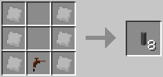

### [ ] #166 Reinforced Glass / 強化ガラス / IC2

* 名称: Reinforced Glass / 日本語: 強化ガラス / Origin: `ic2:reinforced_glass` / New: `bcn:reinforced_glass`
* レシピ: `Glass` x7 + `Plate Advanced Alloy` x2 -> `Reinforced Glass` x7
* レシピ配置図: `AAA` / `BAB` / `AAA`
* 概要: 強化ガラス. TNT程度では壊れないが原子炉の融解では壊れる. 融解時には溶岩化せず溶ける.
* 専用GUI: 無
* 実装方法:

<!-- 画像なし -->

### [ ] #167 Reinforced Stone / 強化石材 / IC2

* 名称: Reinforced Stone / 日本語: 強化石材 / Origin: `ic2:reinforced_stone` / New: `bcn:reinforced_stone`
* レシピ: `Stone` x8 + `Plate Advanced Alloy` x1 -> `Reinforced Stone` x8
* レシピ配置図: `AAA` / `ABA` / `AAA`
* 概要: 黒曜石よりも堅い石. 原子炉を建造する際に推奨される建材だがコスト高.
* 専用GUI: 無
* 実装方法:

<!-- 画像なし -->

### [ ] #168 Reinforced Door / 強化ドア / IC2

* 名称: Reinforced Door / 日本語: 強化ドア / Origin: `ic2:reinforced_door` / New: `bcn:reinforced_door`
* レシピ: `Reinforced Stone` x6 -> `Reinforced Door` x1
* レシピ配置図: `AA` / `AA` / `AA`
* 概要: 原子炉用の強化扉.
* 専用GUI: 無
* 実装方法:

<!-- 画像なし -->

### [ ] #169 Rubber Sheet / ラバーシート / IC2

* 名称: Rubber Sheet / 日本語: ラバーシート / Origin: `ic2:rubber_sheet` / New: `bcn:rubber_sheet`
* レシピ: `Rubber` x6 -> `Rubber Sheet` x3
* レシピ配置図: `AAA` / `AAA`
* 概要: ラバートランポリンとも. 組み合わせるとトランポリンのようになる. 左右にシートの支えとなる適当なブロックを設置しシートの下部を空白にする事で機能する. なおトランポリンは一定の高さまでのダメージを軽減する効果がある.
* 専用GUI: 無
* 実装方法:

<!-- 画像なし -->

### [ ] #170 Teleporter / テレポーター / IC2

* 名称: Teleporter / 日本語: テレポーター / Origin: `ic2:teleporter` / New: `bcn:teleporter`
* レシピ: `Advanced Circuit` x4 + `Frequency Transmitter` x1 + `Glassfiber Cable Item` x2 + `Stabilized Machine Block` x1 + `Diamond` x1 -> `Teleporter` x1
* レシピ配置図: `ABA` / `CDC` / `AEA`
* 概要: 長距離移動に使えるテレポート装置. 使い勝手は悪いが1km以上もの距離を一瞬で移動可能.
* 専用GUI: 有 — テレポート設定
* 実装方法:

### [ ] #171 Personal Safe / 個人チェスト / IC2

* 名称: Personal Safe / 日本語: 個人チェスト / Origin: `-` / New: `bcn:personal_safe`
* レシピ: `Electronic Circuit` x1 + `Machine` x1 + `Chest` x1 -> `Personal Safe` x1
* レシピ配置図: `[000]` / `[000]` / `[000]`
* 概要: マルチ用アイテムで個人専用のチェストになる. 大きさはラージチェストと同じ. 設置した本人と管理者権限を持った人でないと開くことも壊すことも出来ない. 撤去するには中身をすべて取り出し、レンチを使う必要がある.
* 専用GUI: 有 — 個人ロッカー
* 実装方法:

<!-- 画像なし -->

### [ ] #172 Trade-O-Mat / トレード-O-Mat / IC2

* 名称: Trade-O-Mat / 日本語: トレード-O-Mat / Origin: `ic2:trade_o_mat` / New: `bcn:trade_o_mat`
* レシピ: `Redstone` x3 + `Chest` x2 + `Machine Block` x1 -> `Trade-O-Mat` x1
* レシピ配置図: `AAA` / `BCB`
* 概要: マルチ用アイテム. Coinやアイテムを使ってのアイテム取引に使う. 撤去方法は個人チェストと同様. 詳しい使い方は別ページにて. 余談だが名前の由来は恐らくAutomated Tradingだと思われる.
* 専用GUI: 有 — 自動販売設定
* 実装方法:

<!-- 画像なし -->

### [ ] #176 Refined Iron / 精錬鉄 / IC2

* 名称: Refined Iron / 日本語: 精錬鉄 / Origin: `-` / New: `bcn:refined_iron`
* レシピ: なし
* レシピ配置図: `[000]` / `[000]` / `[000]`
* 概要: 鉄インゴットを更に精錬するとことで精製出来る上質な鉄. IC2ではこれを主体として機械や道具を作ることになる. 粉砕すると普通の鉄の粉になるので、普通の鉄に戻すことが可能.
* 専用GUI: 無
* 実装方法:

### [ ] #178 Refined Uranium / 精製ウラン / IC2

* 名称: Refined Uranium / 日本語: 精製ウラン / Origin: `-` / New: `bcn:refined_uranium`
* レシピ: なし
* レシピ配置図: `[000]` / `[000]` / `[000]`
* 概要: ウラニウムを圧縮したもの. セルと組み合わせることで燃料になる. ブロック状態の鉱石でも圧縮でこれが作れるが、そんな機会はほとんど無いだろう.
* 専用GUI: 無
* 実装方法:

### [ ] #179 Mixed Metal Ingot / 合金インゴット / IC2

* 名称: Mixed Metal Ingot / 日本語: 合金インゴット / Origin: `ic2:ingot_advanced_alloy` / New: `bcn:mixed_metal_ingot`
* レシピ: `Refined Iron Ingot` x3 + `Bronze Ingot` x3 + `Aluminium` x3 -> `Mixed Metal Ingot` x2
* レシピ配置図: `AAA` / `BBB` / `CCC`
* 概要: 三種類の金属を組み合わせて作れる. このままでは何にも使えない. なお、中段は銅ではなくブロンズなので注意.
* 専用GUI: 無
* 実装方法:

### [ ] #180 Advanced Alloy / 合金板 / IC2

* 名称: Advanced Alloy / 日本語: 合金板 / Origin: `-` / New: `bcn:advanced_alloy`
* レシピ: なし
* レシピ配置図: `[000]` / `[000]` / `[000]`
* 概要: 上の合金インゴットを圧縮機にかけたもの.
* 専用GUI: 無
* 実装方法:

### [ ] #181 Dense Copper Plate / 銅板 / IC2

* 名称: Dense Copper Plate / 日本語: 銅板 / Origin: `-` / New: `bcn:dense_copper_plate`
* レシピ: `Copper Ingot` x8 -> `Dense Copper Plate` x1
* レシピ配置図: `[000]` / `[000]` / `[000]`
* 概要: 銅インゴット8枚を圧縮機にかけると出来る中間素材.
* 専用GUI: 無
* 実装方法:

<!-- 画像なし -->

### [ ] #182 Iridium Ore / イリジウム鉱石 / IC2

* 名称: Iridium Ore / 日本語: イリジウム鉱石 / Origin: `-` / New: `bcn:iridium_ore`
* レシピ: `Iridium Ore` x4 + `Advanced Alloy` x4 + `Diamond` x1 -> `Iridium Ore` x1
* レシピ配置図: `[000]` / `[000]` / `[000]`
* 概要: マターを組み合わせることでイリジウム鉱石が製作可能. イリジウム鉱石を組み合わせることでイリジウム板が製作可能.
* 専用GUI: 無
* 実装方法:

### [ ] #183 Iridium Plate / イリジウムプレート / IC2

* 名称: Iridium Plate / 日本語: イリジウムプレート / Origin: `ic2:plate_iridium` / New: `bcn:iridium_plate`
* レシピ: `Iridium Ore` x4 + `Plate Advanced Alloy` x4 + `Diamond` x1 -> `Iridium Plate` x1
* レシピ配置図: `ABA` / `BCB` / `ABA`
* 概要: マターを組み合わせることでイリジウム鉱石が製作可能. イリジウム鉱石を組み合わせることでイリジウム板が製作可能. 銅、錫、金、鉄などの鉱石を粉砕機で砕いたもの. 鉱石一つに対し二つ作られ、粉一つ精錬することでインゴット一つになる. つまり、実質2倍の鉱石を入手出来る. インゴットは鉱石同様に粉砕することで粉一つに戻すことができる.
* 専用GUI: 無
* 実装方法:

### [ ] #184 Small Pile of Iron Dust / 小さな鉄の粉 / IC2

* 名称: Small Pile of Iron Dust / 日本語: 小さな鉄の粉 / Origin: `-` / New: `bcn:small_pile_of_iron_dust`
* レシピ: `Small Pile of Iron Dust` x5 + `Tin Dust` x4 / `Copper Dust` x4 + `スズの粉5 鉄の粉小さな鉄の粉` x2 -> `Small Pile of Iron Dust` x1
* レシピ配置図: `[000]` / `[000]` / `[000]`
* 概要: 鉄の粉を別の方法で作るためのレシピ. 2つ組み合わせることで鉄の粉になる.
* 専用GUI: 無
* 実装方法:

<!-- 画像なし -->

### [ ] #185 Coal Dust / 石炭の粉 / IC2

* 名称: Coal Dust / 日本語: 石炭の粉 / Origin: `-` / New: `bcn:coal_dust`
* レシピ: なし
* レシピ配置図: `[000]` / `[000]` / `[000]`
* 概要: 石炭を粉砕機で砕いたもの. 木炭で作ることは出来ない.
* 専用GUI: 無
* 実装方法:

### [ ] #186 Bronze Dust / ブロンズの粉 / IC2

* 名称: Bronze Dust / 日本語: ブロンズの粉 / Origin: `ic2:dust_bronze` / New: `bcn:bronze_dust`
* レシピ: `Bronze Dust Block` x1 -> `Bronze Dust` x9
* レシピ配置図: `[不定形]`
* 概要: 銅の粉とスズの粉を混ぜたもの. 精錬することでインゴットになる.
* 専用GUI: 無
* 実装方法:

### [ ] #187 Clay Dust / 粘土の粉 / IC2

* 名称: Clay Dust / 日本語: 粘土の粉 / Origin: `-` / New: `bcn:clay_dust`
* レシピ: なし
* レシピ配置図: `[000]` / `[000]` / `[000]`
* 概要: 粘土を粉砕機で砕いたもの.
* 専用GUI: 無
* 実装方法:

<!-- 画像なし -->

### [ ] #188 Coffee Powder / コーヒーの粉 / IC2

* 名称: Coffee Powder / 日本語: コーヒーの粉 / Origin: `ic2:coffee_powder` / New: `bcn:coffee_powder`
* レシピ: `Coffee Beans` x1 -> `Coffee Powder` x1
* レシピ配置図: `[不定形]`
* 概要: コーヒー豆を砕いたもの. コーヒー豆を直接クラフトしても1つ作成できる.
* 専用GUI: 無
* 実装方法:

### [ ] #189 Grin Powder / グリンパウダー / IC2

* 名称: Grin Powder / 日本語: グリンパウダー / Origin: `-` / New: `bcn:grin_powder`
* レシピ: なし
* レシピ配置図: `[000]` / `[000]` / `[000]`
* 概要: 微弱な毒性を持つ粉. 除草スプレーの材料になる.
* 専用GUI: 無
* 実装方法:

### [ ] #190 Raw Carbon Fible / Raw Carbon Mesh / 炭素繊維、炭素メッシュ / IC2

* 名称: Raw Carbon Fible / Raw Carbon Mesh / 日本語: 炭素繊維、炭素メッシュ / Origin: `-` / New: `bcn:raw_carbon_fible`
* レシピ: `炭素繊維石炭の粉` x4 / `炭素メッシュ炭素繊維` x2 -> `Raw Carbon Fible` x1
* レシピ配置図: `[000]` / `[000]` / `[000]`
* 概要: 
* 専用GUI: 無
* 実装方法:

### [ ] #191 Carbon Plate / カーボンプレート / IC2

* 名称: Carbon Plate / 日本語: カーボンプレート / Origin: `-` / New: `bcn:carbon_plate`
* レシピ: なし
* レシピ配置図: `[000]` / `[000]` / `[000]`
* 概要: ナノスーツなどの材料になる.
* 専用GUI: 無
* 実装方法:

### [ ] #192 Coal Ball / 石炭の玉 / IC2

* 名称: Coal Ball / 日本語: 石炭の玉 / Origin: `ic2:coal_ball` / New: `bcn:coal_ball`
* レシピ: `Coal Dust` x8 + `Flint` x1 -> `Coal Ball` x1
* レシピ配置図: `AAA` / `ABA` / `AAA`
* 概要: 石炭の粉(石炭粉末)とフリントをかけあわせたもの. このままでは使えない.
* 専用GUI: 無
* 実装方法:

<!-- 画像なし -->

### [ ] #193 Compressed Coal Ball / 圧縮した石炭玉 / IC2

* 名称: Compressed Coal Ball / 日本語: 圧縮した石炭玉 / Origin: `-` / New: `bcn:compressed_coal_ball`
* レシピ: なし
* レシピ配置図: `[000]` / `[000]` / `[000]`
* 概要: 石炭の玉を圧縮したもの.
* 専用GUI: 無
* 実装方法:

<!-- 画像なし -->

### [ ] #194 Coal Chunk / 石炭の塊 / IC2

* 名称: Coal Chunk / 日本語: 石炭の塊 / Origin: `ic2:coal_chunk` / New: `bcn:coal_chunk`
* レシピ: `Bio Chunk` x1 -> `Coal Chunk` x1
* レシピ配置図: `[不定形]`
* 概要: 石炭の塊.
* 専用GUI: 無
* 実装方法:

<!-- 画像なし -->

### [ ] #195 Diamond / ダイヤモンド / IC2

* 名称: Diamond / 日本語: ダイヤモンド / Origin: `-` / New: `bcn:diamond`
* レシピ: なし
* レシピ配置図: `[000]` / `[000]` / `[000]`
* 概要: 石炭の塊を圧縮して作ったダイヤモンド. 天然ダイヤのように使うことが出来る. 1.6x以前では工業用ダイヤモンド(Industrial Diamond)として普通のダイヤモンドとは別の扱いのダイヤモンドが生成されていた.
* 専用GUI: 無
* 実装方法:

### [ ] #196 Hydrated Coal Dust / 液状化石炭 / IC2

* 名称: Hydrated Coal Dust / 日本語: 液状化石炭 / Origin: `ic2:dust_hydrated_coal` / New: `bcn:hydrated_coal_dust`
* レシピ: `Coal Dust` x8 + `Water` x1 -> `Hydrated Coal Dust` x8
* レシピ配置図: `AAA` / `ABA` / `AAA`
* 概要: 石炭の粉と水を混ぜたもの. 精錬すると石炭の粉に戻る.
* 専用GUI: 無
* 実装方法:

### [ ] #197 Plantball / 植物の玉 / IC2

* 名称: Plantball / 日本語: 植物の玉 / Origin: `ic2:plant_ball` / New: `bcn:plantball`
* レシピ: `Saplings` x8 -> `Plantball` x2
* レシピ配置図: `AAA` / `A0A` / `AAA`
* 概要: 植物を丸めた塊. 各種苗木、サトウキビ、種から作れる.
* 専用GUI: 無
* 実装方法:

### [ ] #198 H.Coal / 圧縮した液化石炭 / IC2

* 名称: H.Coal / 日本語: 圧縮した液化石炭 / Origin: `-` / New: `bcn:h_coal`
* レシピ: なし
* レシピ配置図: `[000]` / `[000]` / `[000]`
* 概要: 液状化石炭を圧縮したもの.
* 専用GUI: 無
* 実装方法:

<!-- 画像なし -->

### [ ] #199 Compressed Plants / 圧縮した植物の玉 / IC2

* 名称: Compressed Plants / 日本語: 圧縮した植物の玉 / Origin: `-` / New: `bcn:compressed_plants`
* レシピ: なし
* レシピ配置図: `[000]` / `[000]` / `[000]`
* 概要: 植物の塊を圧縮したもの.
* 専用GUI: 無
* 実装方法:

<!-- 画像なし -->

### [ ] #200 Fuel Can / 空の燃料缶 / IC2

* 名称: Fuel Can / 日本語: 空の燃料缶 / Origin: `ic2:fuel_can` / New: `bcn:fuel_can`
* レシピ: `Tin Ingot` x7 -> `Fuel Can` x1
* レシピ配置図: `0AA` / `A0A` / `AAA`
* 概要: 燃料が詰まっていない状態の燃料缶.
* 専用GUI: 無
* 実装方法:

### [ ] #201 Fuel Can_Filled / 燃料缶 / IC2

* 名称: Fuel Can_Filled / 日本語: 燃料缶 / Origin: `-` / New: `bcn:fuel_can_filled`
* レシピ: なし
* レシピ配置図: `[000]` / `[000]` / `[000]`
* 概要: 燃料を詰めた状態の燃料缶で鉄のかまどや火力発電の燃料に使う. 缶詰製造機を使うことで燃料を補充出来る. 燃料を詰め込むにはバイオ燃料セルもしくは石炭燃料セルが6個必要.
* 専用GUI: 無
* 実装方法:

### [ ] #202 Rubbertree Wood / ゴムの木 / IC2

* 名称: Rubbertree Wood / 日本語: ゴムの木 / Origin: `-` / New: `bcn:rubbertree_wood`
* レシピ: なし
* レシピ配置図: `[000]` / `[000]` / `[000]`
* 概要: ゴムの木は湿地帯のバイオームに多く見られ、寒冷地では群生量が少ない. ゴムの木の葉を壊すとゴムの木の苗木が手に入る. ゴムの木を伐採、もしくは樹液が出ている部分にツリータップを使うと樹液が手に入る. 樹液を採取した後、時間が経つと再び採取できるようになる. 樹液が復活する前に再度ツリータップを使っても樹液が追加で手に入る可能性があるが、穴が潰れて樹液が出てこなくなる可能性もあるので注意. 樹液は粘着ピストンや松明のレシピ代わりとして使うことも出来る. また、ブロックの上に配置することができ、その上を歩くと移動速度が遅くなり、ジャンプも低くなる. ゴムの木の原木は、作業台で加工するとジャングルの木からできるものと同じ木材が3個に、 精錬するとジャングルの木の原木になる.
* 専用GUI: 無
* 実装方法:

### [ ] #203 Rubber / ゴム / IC2

* 名称: Rubber / 日本語: ゴム / Origin: `ic2:rubber` / New: `bcn:rubber`
* レシピ: `Sticky Resin` x1 -> `Rubber` x1
* レシピ配置図: `[不定形]`
* 概要: ゴムの木から得られる素材を加工したもので主に各種ケーブルを作るときに使う. 樹液→精錬：1個 樹液→抽出機：3個 ゴムの原木→抽出機：1個 ゴムの苗木→抽出機：1個
* 専用GUI: 無
* 実装方法:

### [ ] #204 Electronic Circuit / 電子回路 / IC2

* 名称: Electronic Circuit / 日本語: 電子回路 / Origin: `ic2:circuit` / New: `bcn:electronic_circuit`
* レシピ: `Copper Insulated Cable Item` x6 + `Redstone` x2 + `Refined Iron Ingot` x1 -> `Electronic Circuit` x1
* レシピ配置図: `ABA` / `ACA` / `ABA`
* 概要: 機械を作るための基礎素材. レシピ素材としてかなり要求頻度が高い.
* 専用GUI: 無
* 実装方法:

### [ ] #205 Advanced Circuit / 発展回路 / IC2

* 名称: Advanced Circuit / 日本語: 発展回路 / Origin: `ic2:advanced_circuit` / New: `bcn:advanced_circuit`
* レシピ: `Redstone` x4 + `Lapis Lazuli` x2 + `Glowstone Dust` x2 + `Circuit` x1 -> `Advanced Circuit` x1
* レシピ配置図: `ABA` / `CDC` / `ABA`
* 概要: 電子回路の上位版でより高度な機械を作るときに使う.
* 専用GUI: 無
* 実装方法:

### [ ] #206 Scrap / スクラップ / IC2

* 名称: Scrap / 日本語: スクラップ / Origin: `-` / New: `bcn:scrap`
* レシピ: なし
* レシピ配置図: `[000]` / `[000]` / `[000]`
* 概要: リサイクラーから生成したゴミ. スクラップ箱の素材や、物質製造機でマターを作る際の材料に使用する. 地味にかまどや火力発電機の燃料にもなる.
* 専用GUI: 無
* 実装方法:

### [ ] #207 Scrap Box / スクラップ箱 / IC2

* 名称: Scrap Box / 日本語: スクラップ箱 / Origin: `ic2:scrapbox` / New: `bcn:scrap_box`
* レシピ: `Scrap` x9 -> `Scrap Box` x1
* レシピ配置図: `AAA` / `AAA` / `AAA`
* 概要: スクラップを並べて作ったゴミ箱. 蓋を開けてみると…？ ちなみにスクラップ箱も物質製造機に投入する事ができしっかりスクラップ9個分の働きをする. 取得可能なアイテム
* 専用GUI: 無
* 実装方法:

### [ ] #208 Matter / マター / IC2

* 名称: Matter / 日本語: マター / Origin: `-` / New: `bcn:matter`
* レシピ: なし
* レシピ配置図: `[000]` / `[000]` / `[000]`
* 概要: 物質製造機で作られる正体不明の物質. 作業台で組み合わせると、様々なアイテムを作り出すことができる. なお、クアンタム防具を全身揃えるにはこれが280個必要. enableSecretRecipeHiding=trueをfalseにしないと、核爆弾と同じくクラフトガイドでレシピが表示されないので、マターを使ったレシピは隠しレシピの様子. マターを使ったレシピ一覧はこちら
* 専用GUI: 有 — 機械操作画面
* 実装方法:

<!-- 画像なし -->

### [ ] #209 BatPack / バットパック / IC2

* 名称: BatPack / 日本語: バットパック / Origin: `ic2:batpack` / New: `bcn:batpack`
* レシピ: `RE Battery` x6 + `Circuit` x1 + `Tin Ingot` x1 -> `BatPack` x1
* レシピ配置図: `ABA` / `ACA` / `A0A`
* 概要: 60,000EUほどの電力が保持出来る携帯蓄電器. 充電することで何度でも使える. 胴体に装備して電動工具を使うとバットパックが消費を肩代わりする. 防具としての性能は皆無である.
* 専用GUI: 無
* 実装方法:

### [ ] #210 LapPack / ラップパック / IC2

* 名称: LapPack / 日本語: ラップパック / Origin: `ic2:lappack` / New: `bcn:lappack`
* レシピ: `Lapis Block` x6 + `Advanced Circuit` x1 + `BatPack` x1 -> `LapPack` x1
* レシピ配置図: `ABA` / `ACA` / `A0A`
* 概要: バットパックの上位版で300,000EUほど保持することが可能. MFEもしくはMFSユニットで充電できる.
* 専用GUI: 無
* 実装方法:

### [ ] #211 CF-Pack / CFパック / IC2

* 名称: CF-Pack / 日本語: CFパック / Origin: `-` / New: `bcn:cf_pack`
* レシピ: `Tin Ingot` x1 + `Electronic Circuit` x1 + `CF Sprayer` x2 + `Fuel Can` x4 -> `CF-Pack` x1
* レシピ配置図: `[000]` / `[000]` / `[000]`
* 概要: 128個のCFペレットを保持しておくことが出来るバックパック. CFスプレーを使うと自動で保持しているCFペレットを消費する. CFペレットを補充するには缶詰製造機を使う.
* 専用GUI: 無
* 実装方法:

### [ ] #212 Jetpack / ジェットパック / IC2

* 名称: Jetpack / 日本語: ジェットパック / Origin: `-` / New: `bcn:jetpack`
* レシピ: `Refined Iron` x4 + `Electronic Circuit` x1 + `Fuel Can` x1 + `Redstone` x2 -> `Jetpack` x1
* レシピ配置図: `[000]` / `[000]` / `[000]`
* 概要: 液体燃料を使った推進装置. 胴体に装備してスペースで飛翔. スペースキーとMキーを押すと滞空モードに切り替わる. 缶詰製造機で燃料を補充すれば何度でも使える. 燃料満タンから90秒間飛行できる.
* 専用GUI: 無
* 実装方法:

### [ ] #213 Electric Jetpack / 電動ジェットパック / IC2

* 名称: Electric Jetpack / 日本語: 電動ジェットパック / Origin: `ic2:jetpack_electric` / New: `bcn:electric_jetpack`
* レシピ: `Electric Jetpack` x1 + `Magnet` x1 + `New Flag Modifier(ic2 Items.jetpack Electric, "special Mode", False).set Uses Input()` x1 + `Recipe Mods.hidden Recipe` x1 -> `Electric Jetpack` x1
* レシピ配置図: `[不定形]`
* 概要: バッテリー駆動のジェットパック. EUを充電することで何度でも使うことが出来る. スペースキーとMキーを押すと滞空モードに切り替わる. 通常のジェットパックより飛行可能な高度が低い. 最大充電(30,000EU)から80秒間飛行できる.
* 専用GUI: 無
* 実装方法:

### [ ] #214 Rubber Boots / ゴムブーツ / IC2

* 名称: Rubber Boots / 日本語: ゴムブーツ / Origin: `ic2:armor_hazmat_boots` / New: `bcn:rubber_boots`
* レシピ: `Rubber` x6 + `Wool` x1 -> `Rubber Boots` x1
* レシピ配置図: `A0A` / `A0A` / `ABA`
* 概要: ゴム製のブーツで着地ダメージを大幅に軽減する. 羊毛とゴムを組み合わせることで作れる. 羊毛の色は何色でも構わない.
* 専用GUI: 無
* 実装方法:

### [ ] #215 Composite Vest / コンポジットベスト / IC2

* 名称: Composite Vest / 日本語: コンポジットベスト / Origin: `-` / New: `bcn:composite_vest`
* レシピ: `Leather Chestplate` x1 + `Iron Chestplate` x1 + `Advanced Alloy` x6 -> `Composite Vest` x1
* レシピ配置図: `[000]` / `[000]` / `[000]`
* 概要: 複合素材のアーマーで爆発に対して強い耐性を持つ.
* 専用GUI: 無
* 実装方法:

<!-- 画像なし -->

### [ ] #216 Bronze Armor / ブロンズアーマー / IC2

* 名称: Bronze Armor / 日本語: ブロンズアーマー / Origin: `-` / New: `bcn:bronze_armor`
* レシピ: なし
* レシピ配置図: `[000]` / `[000]` / `[000]`
* 概要: 青銅製のアーマー. 耐久値が鉄製のものより1.25倍ほど多い.
* 専用GUI: 無
* 実装方法:

<!-- 画像なし -->

### [ ] #217 Hazmat Suit / HAZMATスーツ / IC2

* 名称: Hazmat Suit / 日本語: HAZMATスーツ / Origin: `ic2:armor_hazmat_chest` / New: `bcn:hazmat_suit`
* レシピ: `Rubber` x6 + `Orange Dye` x2 -> `Hazmat Suit` x1
* レシピ配置図: `A0A` / `ABA` / `ABA`
* 概要: 危険物取り扱い用の防護服一式(スキューバヘルメット、HAZMATチェストプレート、HAZMATレギンス、ゴムブーツで防護服一式とする) 防護服一式を着ていれば溶岩や原子炉融解時の熱を含む燃焼ダメージと感電ダメージと爆発時のダメージを完全に無効化する. ヘルメット単体には酸素マスクとして機能があり、 圧縮酸素セルを持っていれば水中で酸素マークが残り4つになっても自動で消費して酸素を補充してくれる.
* 専用GUI: 無
* 実装方法:

### [ ] #218 Nano Suits / ナノアーマー / IC2

* 名称: Nano Suits / 日本語: ナノアーマー / Origin: `-` / New: `bcn:nano_suits`
* レシピ: なし
* レシピ配置図: `[000]` / `[000]` / `[000]`
* 概要: バッテリー駆動のアーマーで充電によって耐久値を回復させることができる. ~~ナノアーマー一式(一部クアンタムアーマーでも可)で防具を揃えることで 落下、空腹、燃焼を含むあらゆるダメージを無効化することができるが 下記のクアンタムアーマーとは違いそれ以上の特殊機能は付加されない~~ ブーツにはラバーブーツと軽減方法が違うものの、落下ダメージ軽減がある（ラバーブーツが落下ダメージ大幅減なのに対し、ナノブーツは電力を消費して"落ちても無傷な高さ"を増加させる） 電力消費こそ激しいものの、エンダーパールを投げてもノーダメージ（落下ダメージ扱い） MFEトランスミッタまたはMFSユニットでのみ充電可能. ※ver1.9.7でダメージを無効化できなくなり、ver1.103で電力消耗が激しくなるという弱体化を食らった. が、さすがに電力消費を上げすぎたのかver1.110で多少緩和された.
* 専用GUI: 無
* 実装方法:

<!-- 画像なし -->

### [ ] #219 Quantum Suits / クアンタムアーマー / IC2

* 名称: Quantum Suits / 日本語: クアンタムアーマー / Origin: `-` / New: `bcn:quantum_suits`
* レシピ: なし
* レシピ配置図: `[000]` / `[000]` / `[000]`
* 概要: バッテリー駆動の特殊なアーマーでMFSユニットで充電することで耐久値を回復させることができる. 身体機能の補強効果が付随されており、部位によって異なる恩恵が（電力のある限り）得られる. ヘルメットは毒、ウィザー状態を即座に回復し、酸素ゲージが自動で供給され空腹ゲージが自動で回復する. ｖ1.110からはプレイヤーのインベントリにある食物缶詰を消費して空腹度を回復する仕様に. アーマーは殆どのダメージを耐久値によって肩代わりする. ただしver1.110からは奈落、毒、空腹のダメージは受けるように. また魔法ダメージ（負傷ポーション）や落下ダメージも軽減できない. レギンスはスプリント時の移動速度が3.4倍になる（電力を消費しないが、起動するには電力が残っている必要がある. ） ブーツはCtrlキーを押しながらジャンプすることで、ジャンプ力が約10倍に上昇する. またどんな高所から落ちても落下ダメージを受けない（ただし電力は消費する）
* 専用GUI: 無
* 実装方法:

<!-- 画像なし -->

### [ ] #220 Solar Helmet / ソーラーヘルメット / IC2

* 名称: Solar Helmet / 日本語: ソーラーヘルメット / Origin: `ic2:solar_helmet` / New: `bcn:solar_helmet`
* レシピ: `Iron Helmet` x1 + `Solar Panel` x1 + `Copper Insulated Cable Item` x3 -> `Solar Helmet` x1
* レシピ配置図: `0A0` / `0B0` / `CCC`
* 概要: 頭に装備していると、晴天下にいる間1EU/tのペースで胴装備に充電する. （夜でも発電することができる）
* 専用GUI: 無
* 実装方法:

### [ ] #221 Static Boots / スタティックブーツ / IC2

* 名称: Static Boots / 日本語: スタティックブーツ / Origin: `ic2:static_boots` / New: `bcn:static_boots`
* レシピ: `Iron Boots` x1 + `Wool` x1 + `Copper Insulated Cable Item` x3 -> `Static Boots` x1
* レシピ配置図: `0A0` / `0B0` / `CCC`
* 概要: 足に装備していると、歩いている間1EU/5ブロックのペースで胴装備に充電する. 満足に充電するには相当歩かなくてはならない.
* 専用GUI: 無
* 実装方法:

### [ ] #222 Bronze Tools / ブロンズ製工具 / IC2

* 名称: Bronze Tools / 日本語: ブロンズ製工具 / Origin: `-` / New: `bcn:bronze_tools`
* レシピ: なし
* レシピ配置図: `[000]` / `[000]` / `[000]`
* 概要: ブロンズ製のツール. 掘る性能は鉄製ツールと同等. 耐久度は鉄製ツールの1.25倍. 鉄の消費が多いことによる救済措置.
* 専用GUI: 無
* 実装方法:

<!-- 画像なし -->

### [ ] #223 Chain Saw / チェーンソー / IC2

* 名称: Chain Saw / 日本語: チェーンソー / Origin: `ic2:chainsaw` / New: `bcn:chain_saw`
* レシピ: `Refined Iron Ingot` x5 + `Circuit` x1 + `RE Battery` x1 -> `Chain Saw` x1
* レシピ配置図: `0AA` / `ABA` / `CA0`
* 概要: バッテリー駆動のチェーンソーで原木や木材を最速で破壊できる. 絶対に壊れない代わりに充電(1万EU)が必要. 武器として使っても非常に優秀である. ハサミとしての機能も持っており、羊毛の刈り取りや葉ブロックの取得などができる.
* 専用GUI: 無
* 実装方法:

### [ ] #224 Mining Drill / 採掘用ドリル / IC2

* 名称: Mining Drill / 日本語: 採掘用ドリル / Origin: `-` / New: `bcn:mining_drill`
* レシピ: `Electronic Circuit` x1 + `Refined Iron` x5 + `RE Battery` x1 -> `Mining Drill` x1
* レシピ配置図: `[000]` / `[000]` / `[000]`
* 概要: バッテリー駆動のドリル. シャベルとつるはしに対応するブロックを破壊可能. 鉄製ツールを上回る性能で、充電すれば何度でも使える. レッドストーン鉱石も高速で破壊できるが、黒曜石は採取できない. 電池が切れても壊れはしないが、効率がかなり落ちる. フルチャージ(1万EU)で200回採掘可能.
* 専用GUI: 無
* 実装方法:

### [ ] #225 Diamond Drill / ダイヤモンドドリル / IC2

* 名称: Diamond Drill / 日本語: ダイヤモンドドリル / Origin: `ic2:drill_diamond` / New: `bcn:diamond_drill`
* レシピ: `Diamond` x3 + `Drill` x1 -> `Diamond Drill` x1
* レシピ配置図: `0A0` / `ABA`
* 概要: 採掘用ドリルの上位版. ダイヤ製ツールを凌駕する掘削性能を持つ. 黒曜石すら数秒で破壊できるが、その分エネルギー燃費は低下している. フルチャージ(1万EU)で120回採掘可能.
* 専用GUI: 無
* 実装方法:

### [ ] #226 Electric Hoe / 電動クワ / IC2

* 名称: Electric Hoe / 日本語: 電動クワ / Origin: `ic2:electric_hoe` / New: `bcn:electric_hoe`
* レシピ: `Refined Iron Ingot` x2 + `Circuit` x1 + `RE Battery` x1 -> `Electric Hoe` x1
* レシピ配置図: `AA0` / `0B0` / `0C0`
* 概要: バッテリー駆動のクワ. 充電(1万EU)する事で何度でも使える.
* 専用GUI: 無
* 実装方法:

### [ ] #227 Wrench / レンチ / IC2

* 名称: Wrench / 日本語: レンチ / Origin: `ic2:wrench` / New: `bcn:wrench`
* レシピ: `Bronze Ingot` x6 -> `Wrench` x1
* レシピ配置図: `A0A` / `AAA` / `0A0`
* 概要: 設置した機械類を右クリックすることで撤去が可能. 一定確率で撤去した機械が壊れてマシンブロック(上位設備ならアドバンスドマシン、発電機なら火力発電機)になる. 充電器の撤去は、出力面を右クリックか、Shift+右ダブルクリック. うまくいかない場合はAltキーを2回押す. 変圧器なら3ドット面. 充電器、変圧器共に、Shift+右シングルクリックをすると、機械の向きを通常と逆に変更できる.
* 専用GUI: 無
* 実装方法:

### [ ] #228 Electric Wrench / 電動レンチ / IC2

* 名称: Electric Wrench / 日本語: 電動レンチ / Origin: `electricWrench` / New: `bcn:electric_wrench`
* レシピ: `Wrench` x1 + `Circuit` x1 + `RE Battery` x1 -> `Electric Wrench` x1
* レシピ配置図: `00A` / `0B0` / `C00`
* 概要: バッテリー駆動のレンチ. 充電(12000EU)する事で何度でも使える. 充電器の撤去は、出力面を右クリックか、Shift+右ダブルクリック. うまくいかない場合はAltキーを2回押す. 変圧器なら3ドット面. 充電器、変圧器共に、Shift+右シングルクリックをすると、機械の向きを通常と逆に変更できる. ver1.64から大きな電力を消費して機械を確実に撤去できるモードが追加された. 切り替えはMキー+右クリック Lossless wrench mode enable：確実に撤去できるモード Lossless wrench mode disabled：通常モード
* 専用GUI: 無
* 実装方法:

### [ ] #229 EU-Reader / EUリーダー / IC2

* 名称: EU-Reader / 日本語: EUリーダー / Origin: `ic2:eu_reader` / New: `bcn:eu_reader`
* レシピ: `Glowstone Dust` x1 + `Copper Insulated Cable Item` x4 + `Circuit` x1 -> `EU-Reader` x1
* レシピ配置図: `0A0` / `BCB` / `B0B`
* 概要: ケーブルに流れるEUの量を測定出来る検流計のようなもの. 同じケーブルに対して2回以上右クリックで使うと前回のクリックから今回のクリックまでの平均EUを求めることができる.
* 専用GUI: 無
* 実装方法:

<!-- 画像なし -->

### [ ] #230 CF Sprayer / CFスプレー / IC2

* 名称: CF Sprayer / 日本語: CFスプレー / Origin: `-` / New: `bcn:cf_sprayer`
* レシピ: `CF Sprayer` x4 + `Stick` x1 / `補充CFスプレー` x1 + `CF Pellet` x1 / `CF Sprayer` x1 + `CF Pellet` x8 -> `CF Sprayer` x1
* レシピ配置図: `[000]` / `[000]` / `[000]`
* 概要: 右クリックで建築用建材をいくらか設置する. コストパフォーマンスに優れる. 建材のペレットを充填することで繰り返し使うことが出来る. 一度の使用で13ブロック分の建築用建材を射出、射出した方向に建材が広がる. 耐久ゲージが満タンの状態から16回の射出が可能、ペレット一つで二回分回復する. 建材に要求される素材が要求度の高いものばかりなので、建材からペレットを作る過程で26倍の量にはなるが、 使用するにあたっての実際のコストパフォーマンスはかなり悪い. v1.95b 送電線を内包した硬化前の建築用建材がある状態でゲームを終了すると、該当chunkが破壊され再生成されるバグが確認されている. 運が悪いとワールド自体読み込めなくなる.
* 専用GUI: 無
* 実装方法:

### [ ] #231 CF Pellet / CFペレット / IC2

* 名称: CF Pellet / 日本語: CFペレット / Origin: `-` / New: `bcn:cf_pellet`
* レシピ: なし
* レシピ配置図: `[000]` / `[000]` / `[000]`
* 概要: 建設用スプレーの耐久値を回復させるために使うアイテム.
* 専用GUI: 無
* 実装方法:

### [ ] #232 Inslation Cutter / カッター / IC2

* 名称: Inslation Cutter / 日本語: カッター / Origin: `-` / New: `bcn:inslation_cutter`
* レシピ: `Refined Iron` x3 + `Iron Ingot` x2 -> `Inslation Cutter` x1
* レシピ配置図: `[000]` / `[000]` / `[000]`
* 概要: 電線を覆うゴムの厚さを変える道具. 電線を左クリックで一段階薄くでき、右クリックで手持ちのゴムを1つ消費して一段階厚くする.
* 専用GUI: 無
* 実装方法:

### [ ] #233 Dynamite / ダイナマイト / IC2

* 名称: Dynamite / 日本語: ダイナマイト / Origin: `ic2:dynamite` / New: `bcn:dynamite`
* レシピ: `Itnt` x1 + `String` x1 -> `Dynamite` x8
* レシピ配置図: `[不定形]`
* 概要: 3x3x3の小規模な爆発を起こす爆弾. 放り投げたり、地面や壁に設置して起爆する事が可能. 工業用TNTと同じく爆破したブロックを消失させない.
* 専用GUI: 無
* 実装方法:

### [ ] #234 Sticky Dynamite / 粘着ダイナマイト / IC2

* 名称: Sticky Dynamite / 日本語: 粘着ダイナマイト / Origin: `ic2:sticky_dynamite` / New: `bcn:sticky_dynamite`
* レシピ: `Dynamite` x8 + `Sticky Resin` x1 -> `Sticky Dynamite` x8
* レシピ配置図: `AAA` / `ABA` / `AAA`
* 概要: 壁(ブロックの側面)に張り付くダイナマイト. 放り投げて使う. 時限式.
* 専用GUI: 無
* 実装方法:

### [ ] #235 Dynamite-O-Mote / 遠隔起爆装置 / IC2

* 名称: Dynamite-O-Mote / 日本語: 遠隔起爆装置 / Origin: `ic2:dynamite_remote` / New: `bcn:dynamite_o_mote`
* レシピ: `Copper Insulated Cable Item` x1 + `Tin Ingot` x2 + `Lapis Lazuli` x1 + `Frequency Transmitter` x1 -> `Dynamite-O-Mote` x1
* レシピ配置図: `0A0` / `BCB` / `0D0`
* 概要: ダイナマイトを起爆させるための装置. これを持って起爆させたい設置済みのダイナマイトを右クリック後、 ブロックにカーソルを合わせずにもう一度右クリックすることで起爆できる. これを使って起爆させた場合は、ダイナマイトが落下せず即座に爆発する.
* 専用GUI: 無
* 実装方法:

### [ ] #236 OD Scanner / ODスキャナー / IC2

* 名称: OD Scanner / 日本語: ODスキャナー / Origin: `ic2:scanner_od` / New: `bcn:od_scanner`
* レシピ: `Glowstone Dust` x1 + `Circuit` x2 + `RE Battery` x1 + `Copper Insulated Cable Item` x3 -> `OD Scanner` x1
* レシピ配置図: `0A0` / `BCB` / `DDD`
* 概要: バッテリー駆動のスキャンツール. 真下に埋蔵されている鉱石の分布を数値で表す. スキャン範囲は上から見てプレイヤを中心とした5x5の正方形の内側で、プレイヤの足元以下の高度にあるブロック全て（つまりプレイヤが立ってる地面に置かれた鉱石まで含む） 範囲内に鉱石ブロックがある比率を0.1%単位で表す. 例えば範囲内の10%が鉱石ならば100、1%が鉱石ならば10と表示される. 鉱石と判定されるのは通常のminecraftに登場する鉱石とICで追加された鉱石. それ以外は石も水も空気も全て非鉱石. ※RedPowerを導入している場合、RedPower側の銅とスズは判定されないので注意.
* 専用GUI: 無
* 実装方法:

### [ ] #237 OV Scanner / OVスキャナー / IC2

* 名称: OV Scanner / 日本語: OVスキャナー / Origin: `ic2:scanner_ov` / New: `bcn:ov_scanner`
* レシピ: `Glowstone Dust` x3 + `Advanced Circuit` x1 + `Bronze Double Insulated Cable Item` x2 + `RE Battery` x1 -> `OV Scanner` x1
* レシピ配置図: `0A0` / `ABA` / `CDC`
* 概要: 
* 専用GUI: 無
* 実装方法:

### [ ] #238 Mining Laser / 採掘用レーザー / IC2

* 名称: Mining Laser / 日本語: 採掘用レーザー / Origin: `ic2:mining_laser` / New: `bcn:mining_laser`
* レシピ: `Redstone` x1 + `Energy Crystal` x2 + `Plate Advanced Alloy` x4 + `C` x1 -> `Mining Laser` x1
* レシピ配置図: `ABB` / `CCD` / `0CC`
* 概要: バッテリー駆動のレーザーでMキーを押しながら右クリックでモード変更が可能. モードは"採掘、短射程、長射程、水平、過熱、拡散、爆発"の六種類に切り替えられる. MFEトランスミッタまたはMFSユニットでのみ充電(20万EU)可能. LapPackでの電力補充が可能. 過熱モードで精錬可能なブロックを撃つと貫通せずにそのブロックで止まり、精錬先がブロックの場合はそのブロックに置き換わり、アイテムの場合は精錬後のアイテムに置き換わる. ただし原木が木炭になるのは不自然だったのか、原木は対象外となった. MOBにダメージを与えることができ、炎上の効果があり、直線的に飛び、~~何故かエンダーマンが回避できない~~ さすがに爆発以外はテレポートするようになりました. 現在は弓矢ダメージ+炎上効果の模様. なので武器としてもそこそこ優秀. ただし採掘用なだけあって外すと地形をガリガリ抉っていくので、それが気になる人は使いづらいかも.
* 専用GUI: 無
* 実装方法:

### [ ] #239 Tin Can / スズ製の缶 / IC2

* 名称: Tin Can / 日本語: スズ製の缶 / Origin: `ic2:tin_can` / New: `bcn:tin_can`
* レシピ: `Tin Ingot` x1 + `Cutter` x1 -> `Tin Can` x2
* レシピ配置図: `[不定形]`
* 概要: 食べ物を詰めておける錫缶.
* 専用GUI: 無
* 実装方法:

### [ ] #240 Food Can / 食物缶詰 / IC2

* 名称: Food Can / 日本語: 食物缶詰 / Origin: `-` / New: `bcn:food_can`
* レシピ: なし
* レシピ配置図: `[000]` / `[000]` / `[000]`
* 概要: 食べ物を詰めた状態の錫缶. 食べるとライフと満腹度が一つ回復する. 中身を食べれば缶はスズ缶として回収できる. 空腹値を直接回復するアイテムなら、何でも食料缶にできる. ポーションやお酒、コーヒーなどは不可. 蜘蛛の目や毒ジャガイモ、ゾンビ肉も食料缶化が可能だが、毒性はそのまま継承されるので注意. (毒ダメージ版と空腹ステータス付与版の二種類の毒性食料缶がある) なお、(バグか仕様かは不明だが)食料缶自体も缶詰処理することが可能であり、 上記の毒性食料缶を(なぜか)正常な食料缶にすることが可能になっている（スズ缶は減るが）
* 専用GUI: 無
* 実装方法:

<!-- 画像なし -->

### [ ] #241 Treetap / ツリータップ / IC2

* 名称: Treetap / 日本語: ツリータップ / Origin: `ic2:treetap` / New: `bcn:treetap`
* レシピ: `Wooden Planks` x5 -> `Treetap` x1
* レシピ配置図: `0A0` / `AAA` / `A00`
* 概要: ゴムの木から樹液を抽出する道具. ただし酒造においては酒樽から酒を汲む目的で酒樽に取り付ける.
* 専用GUI: 無
* 実装方法:

### [ ] #242 Electric Treetap / 電動ツリータップ / IC2

* 名称: Electric Treetap / 日本語: 電動ツリータップ / Origin: `ic2:electric_treetap` / New: `bcn:electric_treetap`
* レシピ: `Treetap` x1 + `Circuit` x1 + `RE Battery` x1 -> `Electric Treetap` x1
* レシピ配置図: `00A` / `0B0` / `C00`
* 概要: バッテリー駆動のツリータップ. 充電(1万EU)する事で何度でも使える.
* 専用GUI: 無
* 実装方法:

### [ ] #243 Nano Saber / ナノセイバー / IC2

* 名称: Nano Saber / 日本語: ナノセイバー / Origin: `ic2:nano_saber` / New: `bcn:nano_saber`
* レシピ: `Glowstone Dust` x2 + `Plate Advanced Alloy` x2 + `Carbon Plate` x2 + `Energy Crystal` x1 -> `Nano Saber` x1
* レシピ配置図: `AB0` / `AB0` / `CDC`
* 概要: バッテリー駆動の特殊な剣. 4万EUまで充電でき、右クリックする事でオンオフが切り替えられる. オフの状態では木の剣と同等の攻撃力しかないが、EU消費が0であるため、経験値トラップとの相性が良い. オンの状態では攻撃力10なので、殆どの敵を1～2発で倒せる. またPvP要素として、展開中の電動防具への攻撃は通常ダメージの代わりに大きな電力ダメージを与え、更に電力0になった電動防具を唯一破壊することができる. 展開中は時間と共にバッテリー残量が減るので瞬間的に斬るといった使い方が好ましい. MFEトランスミッタまたはMFSユニットでのみ充電可能.
* 専用GUI: 無
* 実装方法:

### [ ] #244 Painter / ペインター / IC2

* 名称: Painter / 日本語: ペインター / Origin: `ic2:painter` / New: `bcn:painter`
* レシピ: `Wool` x3 + `Iron Ingot` x2 -> `Painter` x1
* レシピ配置図: `0AA` / `0BA` / `B00`
* 概要: 設置した電線や羊毛に色をつける道具. 画像は一例で実際には染料の数だけ色付きペインターが作れる. デフォルトのペインターと染色違う色同士の電線は繋がらなくなるため複雑な配線が可能になる. 例外として無色(黒色)の電線と有色の電線は繋がってしまう. Mキー+右クリックで自動補充モードの切り替えが可能.
* 専用GUI: 無
* 実装方法:

### [ ] #245 Frequency Transmitter / 周波数送信機 / IC2

* 名称: Frequency Transmitter / 日本語: 周波数送信機 / Origin: `ic2:frequency_transmitter` / New: `bcn:frequency_transmitter`
* レシピ: `Circuit` x1 + `Copper Insulated Cable Item` x1 -> `Frequency Transmitter` x1
* レシピ配置図: `[不定形]`
* 概要: 自己の周波数の登録や送信が出来る装置でテレポーターなどで使う.
* 専用GUI: 無
* 実装方法:

<!-- 画像なし -->

### [ ] #246 Industrial Credit / コイン / IC2

* 名称: Industrial Credit / 日本語: コイン / Origin: `ic2:coin` / New: `bcn:industrial_credit`
* レシピ: `Coin 8x` x1 -> `Industrial Credit` x8
* レシピ配置図: `[不定形]`
* 概要: 工業貨幣、つまりはお金である. SMPでトレード-O-Matと組み合わせて使うと良い. 9枚組み合わせる事で精製鉄1個に戻すことも可能.
* 専用GUI: 無
* 実装方法:

### [ ] #247 Toolbox / ツールボックス / IC2

* 名称: Toolbox / 日本語: ツールボックス / Origin: `ic2:tool_box` / New: `bcn:toolbox`
* レシピ: `Refined Iron Ingot` x5 + `Chest` x1 -> `Toolbox` x1
* レシピ配置図: `ABA` / `AAA`
* 概要: ツール類の保管箱. 右クリックで使用するとイベントリ内のツールを一括で格納、または取り出す事が出来る.
* 専用GUI: 無
* 実装方法:

### [ ] #248 Stone Mug / マグカップ / IC2

* 名称: Stone Mug / 日本語: マグカップ / Origin: `-` / New: `bcn:stone_mug`
* レシピ: `Stone` x7 -> `Stone Mug` x1
* レシピ配置図: `[000]` / `[000]` / `[000]`
* 概要: スタック不可. 再利用可能. 酒、コーヒーを入れるのに使用する石製のマグカップ.
* 専用GUI: 無
* 実装方法:

### [ ] #249 Booze Barrel / 酒樽 / IC2

* 名称: Booze Barrel / 日本語: 酒樽 / Origin: `-` / New: `bcn:booze_barrel`
* レシピ: `Rubber Log` x1 + `Wooden Planks` x2 -> `Booze Barrel` x1
* レシピ配置図: `[000]` / `[000]` / `[000]`
* 概要: 足場ブロックに被せる形で設置する. 左クリックすると1クリックで足場ブロックから引き剥がせるが、 内容物はアイテム化しても記録されたまま. ただし熟成はマップ上に設置された状態でしか進まない.
* 専用GUI: 無
* 実装方法:

### [ ] #250 Empty Cell / 空のセル / IC2

* 名称: Empty Cell / 日本語: 空のセル / Origin: `ic2:cell_empty` / New: `bcn:empty_cell`
* レシピ: `Tin Ingot` x4 -> `Empty Cell` x16
* レシピ配置図: `0A0` / `A0A` / `0A0`
* 概要: 様々な液体や燃料を入れられる容器. 基本的に使い捨てだが低コストで量産が容易. 手に持った状態から右クリックで水や溶岩を直接汲み取ることができる.
* 専用GUI: 無
* 実装方法:

### [ ] #251 Compressd Air Cell / 圧縮空気セル / IC2

* 名称: Compressd Air Cell / 日本語: 圧縮空気セル / Origin: `-` / New: `bcn:compressd_air_cell`
* レシピ: なし
* レシピ配置図: `[000]` / `[000]` / `[000]`
* 概要: 空のセルの中に圧縮した酸素を詰め込んだセル. 何らかの原因で空気を使ってもセルが戻ってくる.
* 専用GUI: 無
* 実装方法:

<!-- 画像なし -->

### [ ] #252 Bio Cell / バイオセル / IC2

* 名称: Bio Cell / 日本語: バイオセル / Origin: `ic2:cell_bio` / New: `bcn:bio_cell`
* レシピ: `Empty Cell` x1 + `Compressed Plant Ball` x1 -> `Bio Cell` x1
* レシピ配置図: `[不定形]`
* 概要: セルに植物の塊を入れたもの. 燃料としては使えない.
* 専用GUI: 無
* 実装方法:

### [ ] #253 H. Coal Cell / 液化石炭セル / IC2

* 名称: H. Coal Cell / 日本語: 液化石炭セル / Origin: `-` / New: `bcn:h_coal_cell`
* レシピ: `Empty Cell` x1 + `H.Coal` x1 -> `H. Coal Cell` x1
* レシピ配置図: `[000]` / `[000]` / `[000]`
* 概要: 液状化石炭を入れたセル. 燃料としては使えない.
* 専用GUI: 無
* 実装方法:

### [ ] #254 Biofuel Cell / バイオ燃料セル / IC2

* 名称: Biofuel Cell / 日本語: バイオ燃料セル / Origin: `-` / New: `bcn:biofuel_cell`
* レシピ: なし
* レシピ配置図: `[000]` / `[000]` / `[000]`
* 概要: バイオセルを抽出機にかけたもの. 缶詰製造機で空の燃料缶やジェットパックに充填して使う.
* 専用GUI: 無
* 実装方法:

### [ ] #255 Coalfuel Cell / 石炭燃料セル / IC2

* 名称: Coalfuel Cell / 日本語: 石炭燃料セル / Origin: `-` / New: `bcn:coalfuel_cell`
* レシピ: なし
* レシピ配置図: `[000]` / `[000]` / `[000]`
* 概要: 液化石炭セルを抽出機にかけたもの. 缶詰製造機で空の燃料缶やジェットパックに充填して使う.
* 専用GUI: 無
* 実装方法:

### [ ] #256 Lava Cell / 溶岩セル / IC2

* 名称: Lava Cell / 日本語: 溶岩セル / Origin: `-` / New: `bcn:lava_cell`
* レシピ: `Empty Cell` x1 + `Lava Bucket` x1 -> `Lava Cell` x1
* レシピ配置図: `[000]` / `[000]` / `[000]`
* 概要: 溶岩の入ったセル. セルは使い捨てだが大量スタックが可能. 地熱発電機の燃料として使うことが出来る.
* 専用GUI: 無
* 実装方法:

### [ ] #257 Water Cell / 水セル / IC2

* 名称: Water Cell / 日本語: 水セル / Origin: `-` / New: `bcn:water_cell`
* レシピ: `Empty Cell` x1 + `Water Bucket` x1 -> `Water Cell` x1
* レシピ配置図: `[000]` / `[000]` / `[000]`
* 概要: 水の入ったセル.
* 専用GUI: 無
* 実装方法:

### [ ] #258 Electrolyzed Water Cell / 電解水セル / IC2

* 名称: Electrolyzed Water Cell / 日本語: 電解水セル / Origin: `-` / New: `bcn:electrolyzed_water_cell`
* レシピ: なし
* レシピ配置図: `[000]` / `[000]` / `[000]`
* 概要: 電解水生成装置で精製することが可能. 電解水セルは15,000EUの保持が可能だが復元過程で1500EUほど損失する.
* 専用GUI: 無
* 実装方法:

### [ ] #259 10K Coolant Cell / K冷却セル / IC2

* 名称: 10K Coolant Cell / 日本語: K冷却セル / Origin: `ic2:heat_storage_single` / New: `bcn:10k_coolant_cell`
* レシピ: `Tin Ingot` x4 + `Water` x1 -> `10K Coolant Cell` x1
* レシピ配置図: `0A0` / `ABA` / `0A0`
* 概要: 
* 専用GUI: 無
* 実装方法:

### [ ] #260 Empty TFBP / 空のTFBP / IC2

* 名称: Empty TFBP / 日本語: 空のTFBP / Origin: `-` / New: `bcn:empty_tfbp`
* レシピ: `Advanced Circuit` x1 + `Electronic Circuit` x1 + `Redstone` x2 -> `Empty TFBP` x1
* レシピ配置図: `[000]` / `[000]` / `[000]`
* 概要: 何もインプットされていない状態のTFBP. 各TFBPはクラフトし直すことでこの状態に戻せる.
* 専用GUI: 無
* 実装方法:

### [ ] #261 Chilling / 寒冷化 / IC2

* 名称: Chilling / 日本語: 寒冷化 / Origin: `-` / New: `bcn:chilling`
* レシピ: `Empty TFBP` x1 + `Snowball` x4 -> `Chilling` x1
* レシピ配置図: `[000]` / `[000]` / `[000]`
* 概要: 辺りに雪を積もらせ積雪を作り出す. 近くに水源がある場合は水源も凍らせる. 地形条件はないため、ネザー世界などでも降雪状態で雪が積もる.
* 専用GUI: 無
* 実装方法:

<!-- 画像なし -->

### [ ] #262 Desertification / 砂漠化 / IC2

* 名称: Desertification / 日本語: 砂漠化 / Origin: `-` / New: `bcn:desertification`
* レシピ: `Empty TFBP` x1 + `Sand` x4 -> `Desertification` x1
* レシピ配置図: `[000]` / `[000]` / `[000]`
* 概要: 辺りの雪や氷ブロックを溶かし土を砂に変え植物を枯らし砂漠を作り出す.
* 専用GUI: 無
* 実装方法:

<!-- 画像なし -->

### [ ] #263 Flatificator / 平地化 / IC2

* 名称: Flatificator / 日本語: 平地化 / Origin: `-` / New: `bcn:flatificator`
* レシピ: `Empty TFBP` x1 + `Dirt` x4 -> `Flatificator` x1
* レシピ配置図: `[000]` / `[000]` / `[000]`
* 概要: テラフォーマーより低い位置の空白エリアを土で埋め立て、テラフォーマーよりも高い位置に存在する石を除いた天然のブロックを削除する.
* 専用GUI: 無
* 実装方法:

<!-- 画像なし -->

### [ ] #264 Cultivation / 培養 / IC2

* 名称: Cultivation / 日本語: 培養 / Origin: `-` / New: `bcn:cultivation`
* レシピ: `Empty TFBP` x1 + `Seeds` x4 -> `Cultivation` x1
* レシピ配置図: `[000]` / `[000]` / `[000]`
* 概要: 時間をかけて周囲の砂ブロックを草ブロックに変化させる. また、ごく短時間で土ブロックを草ブロックに変化させ、そこに雑草や花、苗木がランダムに生えるようになる. また時々、自動的に耕地に植えられた状態の小麦やかぼちゃの実が発生することも.
* 専用GUI: 無
* 実装方法:

<!-- 画像なし -->

### [ ] #265 Irrigation / 灌漑 / IC2

* 名称: Irrigation / 日本語: 灌漑 / Origin: `-` / New: `bcn:irrigation`
* レシピ: `Empty TFBP` x1 + `Water Bucket` x4 -> `Irrigation` x1
* レシピ配置図: `[000]` / `[000]` / `[000]`
* 概要: 辺りの降雨量が上がり、周囲の砂ブロックを土ブロックに変化させる. また、植物の成長を促進させ、植えたばかりの苗木や小麦などが、一気に収穫可能状態まで成長する. ただし雨乞いツールではないので、実際に雨が降ってきたりするわけではない.
* 専用GUI: 無
* 実装方法:

<!-- 画像なし -->

### [ ] #266 Mushroom / 榎茸 / IC2

* 名称: Mushroom / 日本語: 榎茸 / Origin: `-` / New: `bcn:mushroom`
* レシピ: `Empty TFBP` x1 + `Mushroom` x4 + `Mycelium` x4 -> `Mushroom` x1
* レシピ配置図: `[000]` / `[000]` / `[000]`
* 概要: 辺りを菌糸ブロックやキノコで侵食する. キノコが巨大キノコ化することがある.
* 専用GUI: 無
* 実装方法:

### [ ] #267 Overclocker upgrade / オーバークロッカー / IC2

* 名称: Overclocker upgrade / 日本語: オーバークロッカー / Origin: `ic2:overclocker_upgrade` / New: `bcn:overclocker_upgrade`
* レシピ: `Heat Storage Six` x8 + `Upgrade Base` x1 -> `Overclocker upgrade` x16
* レシピ配置図: `AAA` / `ABA` / `AAA`
* 概要: 機械の稼働速度を向上させるモジュール. 16個ほども重ねると、粉砕機のような仕事の遅い機械でも一瞬で仕事を完了させるようになる優れもの. ただし設置個数に応じて消費電力も増加するため注意が必要. 具体的には設置１つに付き作業時間0.7倍. 消費電力1.6倍. つまり２つ設置すると作業時間は0.7*0.7=0.49倍、消費電力は1.6*1.6=2.56倍となる. （v1.71現在） v1.106では冷却セルを10K冷却セルに置き換えれば製作可能.
* 専用GUI: 無
* 実装方法:

### [ ] #268 Transformer upgrade / トランスフォーマー / IC2

* 名称: Transformer upgrade / 日本語: トランスフォーマー / Origin: `ic2:transformer_upgrade` / New: `bcn:transformer_upgrade`
* レシピ: `Glass` x7 + `MV Transformer` x1 + `Upgrade Base` x1 -> `Transformer upgrade` x1
* レシピ配置図: `AAA` / `ABA` / `ACA`
* 概要: 機械の対応電圧を向上させるモジュール. 1つ増える度に対応電圧が1段階上がる. とはいえ、IC2単体では低圧対応の機械にしか設置できないため、 1つで中電圧（128EU）に、2つで高電圧（512EU）に、3つで超高圧（2048EU）まで受け取れるようになるという認識で概ね問題ない. 一般機械にオーバークロッカーを積みすぎて、消費電力が32EU/tを超えてしまいMFEから直接供給しないと間に合わない！なんて時に便利. ただし、作業中に外してしまうとその途端に電圧非対応で爆発を起こすので誤クリックに注意.
* 専用GUI: 無
* 実装方法:

### [ ] #269 Energy storage upgrade / エナジーストレージ / IC2

* 名称: Energy storage upgrade / 日本語: エナジーストレージ / Origin: `ic2:energy_storage_upgrade` / New: `bcn:energy_storage_upgrade`
* レシピ: `Wooden Planks` x7 + `RE Battery` x1 + `Upgrade Base` x1 -> `Energy storage upgrade` x1
* レシピ配置図: `AAA` / `ABA` / `ACA`
* 概要: 機械の蓄電性能を向上させるモジュール. 1つにつき蓄電可能容量が10,000EU上昇する. こちらもオーバークロッカーを積むときに便利.
* 専用GUI: 無
* 実装方法:

### [ ] #270 Ejecter Upgrade / イジェクター / IC2

* 名称: Ejecter Upgrade / 日本語: イジェクター / Origin: `-` / New: `bcn:ejecter_upgrade`
* レシピ: `Piston` x2 + `Electronic Circuit` x1 + `Copper Cable` x2 + `Hopper` x1 -> `Ejecter Upgrade` x1
* レシピ配置図: `[000]` / `[000]` / `[000]`
* 概要: 
* 専用GUI: 無
* 実装方法:

### [ ] #271 Jungle Wooden Planks / 木材（ジャングル） / IC2

* 名称: Jungle Wooden Planks / 日本語: 木材（ジャングル） / Origin: `-` / New: `bcn:jungle_wooden_planks`
* レシピ: `Rubber Log` x1 -> `Jungle Wooden Planks` x1
* レシピ配置図: `[000]` / `[000]` / `[000]`
* 概要: ゴムの原木をクラフティングすることでジャングルの木材3つになる. 通常の原木から得られるより個数は1つ少ないので、単純に木材が欲しいなら普通の木を伐採する方がよい.
* 専用GUI: 無
* 実装方法:

### [ ] #272 Jungle Wood / 原木（ジャングル） / IC2

* 名称: Jungle Wood / 日本語: 原木（ジャングル） / Origin: `-` / New: `bcn:jungle_wood`
* レシピ: なし
* レシピ配置図: `[000]` / `[000]` / `[000]`
* 概要: ゴムの原木を精錬することでジャングルの原木になる. こちらは原木になるので得られる個数は通常の原木と変わらないものの、精錬という手間が生じるので、 やはり使う機会は少ない.
* 専用GUI: 無
* 実装方法:

### [ ] #273 Bucket / バケツ / IC2

* 名称: Bucket / 日本語: バケツ / Origin: `minecraft:bucket` / New: `bcn:bucket`
* レシピ: `Tin Ingot` x3 -> `Bucket` x1
* レシピ配置図: `A0A` / `0A0`
* 概要: 通称スズバケツ. 鉄の消費が多いことによる救済措置. RedPower2の合金かまどやUnCraft等の還元系MODを使えば、スズインゴットを鉄インゴットに等価交換することができる.
* 専用GUI: 無
* 実装方法:

### [ ] #274 Rail / 線路 / IC2

* 名称: Rail / 日本語: 線路 / Origin: `minecraft:rail` / New: `bcn:rail`
* レシピ: `Bronze Ingot` x6 + `Stick` x1 -> `Rail` x8
* レシピ配置図: `A0A` / `ABA` / `A0A`
* 概要: 鉄の消費が多いことによる救済措置. ただし、作られる数は半分の8個になる. こちらも還元系MODによって、青銅インゴット12個を鉄インゴット6個に交換することができる.
* 専用GUI: 無
* 実装方法:

<!-- 画像なし -->

### [ ] #275 Piston / ピストン / IC2

* 名称: Piston / 日本語: ピストン / Origin: `minecraft:piston` / New: `bcn:piston`
* レシピ: `Wooden Planks` x3 + `Cobblestone` x4 + `Bronze Ingot` x1 + `Redstone` x1 -> `Piston` x1
* レシピ配置図: `AAA` / `BCB` / `BDB`
* 概要: 鉄の消費が多いことによる救済措置. こちらも還元系MODによって、青銅インゴット1個を鉄インゴット1個に交換することができる.
* 専用GUI: 無
* 実装方法:

### [ ] #276 Sticky piston / 粘着ピストン / IC2

* 名称: Sticky piston / 日本語: 粘着ピストン / Origin: `minecraft:sticky_piston` / New: `bcn:sticky_piston`
* レシピ: `Piston` x1 + `Sticky Resin` x1 + `Recipe Mods.hidden Recipe` x1 -> `Sticky piston` x1
* レシピ配置図: `[不定形]`
* 概要: おそらくスライムが見つからないときの救済措置だったのであろう、スライムボールの変わりに樹液が使えるレシピ. 今では湿地帯バイオームでスライムが沸くようになったので、湿地帯バイオームが見つからないなら使うことになるかもしれない程度.
* 専用GUI: 無
* 実装方法:

### [ ] #277 Torch / 松明 / IC2

* 名称: Torch / 日本語: 松明 / Origin: `minecraft:torch` / New: `bcn:torch`
* レシピ: `Sticky Resin` x1 + `Stick` x1 -> `Torch` x4
* レシピ配置図: `A` / `B`
* 概要: 炭で作ったときと変わりは無い. どっちのほうが楽かは人によるだろう.
* 専用GUI: 無
* 実装方法:

<!-- 画像なし -->

### [ ] #278 GrowStone Dusts / グロウストーンの粉 / IC2

* 名称: GrowStone Dusts / 日本語: グロウストーンの粉 / Origin: `-` / New: `bcn:growstone_dusts`
* レシピ: `Redstone` x5 + `Gold Dust` x4 -> `GrowStone Dusts` x1
* レシピ配置図: `[000]` / `[000]` / `[000]`
* 概要: グロウストーンの粉の追加レシピ.
* 専用GUI: 無
* 実装方法:

### [ ] #279 Gunpowder / 火薬 / IC2

* 名称: Gunpowder / 日本語: 火薬 / Origin: `minecraft:gunpowder` / New: `bcn:gunpowder`
* レシピ: `Redstone` x5 + `Coal Dust` x4 -> `Gunpowder` x3
* レシピ配置図: `ABA` / `BAB` / `ABA`
* 概要: 火薬の追加レシピ.
* 専用GUI: 無
* 実装方法:

### [ ] #280 Obsidian / 黒曜石 / IC2

* 名称: Obsidian / 日本語: 黒曜石 / Origin: `minecraft:obsidian` / New: `bcn:obsidian`
* レシピ: `Water Cell` x1 + `Magma Block` x1 -> `Obsidian` x1
* レシピ配置図: `[不定形]`
* 概要: 追加レシピ. 1つ作るのに溶岩セルが2つ必要なので、溶岩源に水をかけて作る方が効率はよい. しかし、回収手段がなくても手持ちに加えられる、クラフティングで作成可能（＝BuildCraftの自動作業台等に対応できる）などの利点もある. 粉砕機による追加レシピ. 圧縮機による追加レシピ. 雪玉は圧縮機にポンプ装置を隣接させることでも生成できる.
* 専用GUI: 無
* 実装方法:

### [ ] #281 Copper / Tin / Bornze / 銅、スズ、ブロンズ / IC2

* 名称: Copper / Tin / Bornze / 日本語: 銅、スズ、ブロンズ / Origin: `-` / New: `bcn:copper_2`
* レシピ: なし
* レシピ配置図: `[000]` / `[000]` / `[000]`
* 概要: 新たに追加された鉱石とインゴット. 銅鉱石はY10-70、スズ鉱石はY0-40の高度で見つかる. ブロンズは合金のため、採掘で入手する事は出来ない.
* 専用GUI: 無
* 実装方法:

### [ ] #282 Refined Iron / 精錬鉄 / IC2

* 名称: Refined Iron / 日本語: 精錬鉄 / Origin: `-` / New: `bcn:refined_iron`
* レシピ: なし
* レシピ配置図: `[000]` / `[000]` / `[000]`
* 概要: 鉄インゴットを更に精錬するとことで精製出来る上質な鉄. IC2ではこれを主体として機械や道具を作ることになる. 粉砕すると普通の鉄の粉になるので、普通の鉄に戻すことが可能.
* 専用GUI: 無
* 実装方法:

### [ ] #283 Uranium / ウラニウム / IC2

* 名称: Uranium / 日本語: ウラニウム / Origin: `-` / New: `bcn:uranium`
* レシピ: なし
* レシピ配置図: `[000]` / `[000]` / `[000]`
* 概要: 新たに追加されたウラニウム鉱石. 鉱石はY0-63で見つかる. 単体で見つかることが多い. 鉄以上のつるはしで採取可能. 幸運エンチャントは無効.
* 専用GUI: 無
* 実装方法:

### [ ] #284 Refined Uranium / 精製ウラン / IC2

* 名称: Refined Uranium / 日本語: 精製ウラン / Origin: `-` / New: `bcn:refined_uranium`
* レシピ: なし
* レシピ配置図: `[000]` / `[000]` / `[000]`
* 概要: ウラニウムを圧縮したもの. セルと組み合わせることで燃料になる. ブロック状態の鉱石でも圧縮でこれが作れるが、そんな機会はほとんど無いだろう.
* 専用GUI: 無
* 実装方法:

### [ ] #285 Mixed Metal Ingot / 合金インゴット / IC2

* 名称: Mixed Metal Ingot / 日本語: 合金インゴット / Origin: `ic2:ingot_advanced_alloy` / New: `bcn:mixed_metal_ingot`
* レシピ: `Refined Iron Ingot` x3 + `Bronze Ingot` x3 + `Aluminium` x3 -> `Mixed Metal Ingot` x2
* レシピ配置図: `AAA` / `BBB` / `CCC`
* 概要: 三種類の金属を組み合わせて作れる. このままでは何にも使えない. なお、中段は銅ではなくブロンズなので注意.
* 専用GUI: 無
* 実装方法:

### [ ] #286 Advanced Alloy / 合金板 / IC2

* 名称: Advanced Alloy / 日本語: 合金板 / Origin: `-` / New: `bcn:advanced_alloy`
* レシピ: なし
* レシピ配置図: `[000]` / `[000]` / `[000]`
* 概要: 上の合金インゴットを圧縮機にかけたもの.
* 専用GUI: 無
* 実装方法:

### [ ] #287 Dense Copper Plate / 銅板 / IC2

* 名称: Dense Copper Plate / 日本語: 銅板 / Origin: `-` / New: `bcn:dense_copper_plate`
* レシピ: `Copper Ingot` x8 -> `Dense Copper Plate` x1
* レシピ配置図: `[000]` / `[000]` / `[000]`
* 概要: 銅インゴット8枚を圧縮機にかけると出来る中間素材.
* 専用GUI: 無
* 実装方法:

<!-- 画像なし -->

### [ ] #288 Iridium Plate / イリジウム鉱石、イリジウムプレート / IC2

* 名称: Iridium Plate / 日本語: イリジウム鉱石、イリジウムプレート / Origin: `ic2:plate_iridium` / New: `bcn:iridium_plate`
* レシピ: `Iridium Ore` x4 + `Plate Advanced Alloy` x4 + `Diamond` x1 -> `Iridium Plate` x1
* レシピ配置図: `ABA` / `BCB` / `ABA`
* 概要: マターを組み合わせることでイリジウム鉱石が製作可能. イリジウム鉱石を組み合わせることでイリジウム板が製作可能. 銅、錫、金、鉄などの鉱石を粉砕機で砕いたもの. 鉱石一つに対し二つ作られ、粉一つ精錬することでインゴット一つになる. つまり、実質2倍の鉱石を入手出来る. インゴットは鉱石同様に粉砕することで粉一つに戻すことができる.
* 専用GUI: 無
* 実装方法:

### [ ] #289 Small Pile of Iron Dust / 小さな鉄の粉 / IC2

* 名称: Small Pile of Iron Dust / 日本語: 小さな鉄の粉 / Origin: `-` / New: `bcn:small_pile_of_iron_dust`
* レシピ: `Small Pile of Iron Dust` x5 + `Tin Dust` x4 / `Copper Dust` x4 + `Tin Dust` x5 / `鉄の粉小さな鉄の粉` x2 -> `Small Pile of Iron Dust` x1
* レシピ配置図: `[000]` / `[000]` / `[000]`
* 概要: 鉄の粉を別の方法で作るためのレシピ. 2つ組み合わせることで鉄の粉になる.
* 専用GUI: 無
* 実装方法:

<!-- 画像なし -->

### [ ] #290 Coal Dust / 石炭の粉 / IC2

* 名称: Coal Dust / 日本語: 石炭の粉 / Origin: `-` / New: `bcn:coal_dust`
* レシピ: なし
* レシピ配置図: `[000]` / `[000]` / `[000]`
* 概要: 石炭を粉砕機で砕いたもの. 木炭で作ることは出来ない.
* 専用GUI: 無
* 実装方法:

### [ ] #291 Bronze Dusts / ブロンズの粉 / IC2

* 名称: Bronze Dusts / 日本語: ブロンズの粉 / Origin: `-` / New: `bcn:bronze_dusts`
* レシピ: `Copper Dust` x3 + `Tin Dust` x1 -> `Bronze Dusts` x1
* レシピ配置図: `[000]` / `[000]` / `[000]`
* 概要: 銅の粉とスズの粉を混ぜたもの. 精錬することでインゴットになる.
* 専用GUI: 無
* 実装方法:

### [ ] #292 Clay Dust / 粘土の粉 / IC2

* 名称: Clay Dust / 日本語: 粘土の粉 / Origin: `-` / New: `bcn:clay_dust`
* レシピ: なし
* レシピ配置図: `[000]` / `[000]` / `[000]`
* 概要: 粘土を粉砕機で砕いたもの.
* 専用GUI: 無
* 実装方法:

<!-- 画像なし -->

### [ ] #293 Coffee Powder / コーヒーの粉 / IC2

* 名称: Coffee Powder / 日本語: コーヒーの粉 / Origin: `ic2:coffee_powder` / New: `bcn:coffee_powder`
* レシピ: `Coffee Beans` x1 -> `Coffee Powder` x1
* レシピ配置図: `[不定形]`
* 概要: コーヒー豆を砕いたもの. コーヒー豆を直接クラフトしても1つ作成できる.
* 専用GUI: 無
* 実装方法:

### [ ] #294 Grin Powder / グリンパウダー / IC2

* 名称: Grin Powder / 日本語: グリンパウダー / Origin: `-` / New: `bcn:grin_powder`
* レシピ: なし
* レシピ配置図: `[000]` / `[000]` / `[000]`
* 概要: 微弱な毒性を持つ粉. 除草スプレーの材料になる.
* 専用GUI: 無
* 実装方法:

### [ ] #295 Raw Carbon Fible / Raw Carbon Mesh / 炭素繊維、炭素メッシュ / IC2

* 名称: Raw Carbon Fible / Raw Carbon Mesh / 日本語: 炭素繊維、炭素メッシュ / Origin: `-` / New: `bcn:raw_carbon_fible`
* レシピ: `炭素繊維石炭の粉` x4 / `炭素メッシュ炭素繊維` x2 -> `Raw Carbon Fible` x1
* レシピ配置図: `[000]` / `[000]` / `[000]`
* 概要: 
* 専用GUI: 無
* 実装方法:

### [ ] #296 Carbon Plate / カーボンプレート / IC2

* 名称: Carbon Plate / 日本語: カーボンプレート / Origin: `-` / New: `bcn:carbon_plate`
* レシピ: なし
* レシピ配置図: `[000]` / `[000]` / `[000]`
* 概要: ナノスーツなどの材料になる.
* 専用GUI: 無
* 実装方法:

### [ ] #297 Coal Ball / 石炭の玉 / IC2

* 名称: Coal Ball / 日本語: 石炭の玉 / Origin: `ic2:coal_ball` / New: `bcn:coal_ball`
* レシピ: `Coal Dust` x8 + `Flint` x1 -> `Coal Ball` x1
* レシピ配置図: `AAA` / `ABA` / `AAA`
* 概要: 石炭の粉(石炭粉末)とフリントをかけあわせたもの. このままでは使えない.
* 専用GUI: 無
* 実装方法:

<!-- 画像なし -->

### [ ] #298 Compressed Coal Ball / 圧縮した石炭玉 / IC2

* 名称: Compressed Coal Ball / 日本語: 圧縮した石炭玉 / Origin: `-` / New: `bcn:compressed_coal_ball`
* レシピ: なし
* レシピ配置図: `[000]` / `[000]` / `[000]`
* 概要: 石炭の玉を圧縮したもの.
* 専用GUI: 無
* 実装方法:

<!-- 画像なし -->

### [ ] #299 Coal Chunk / 石炭の塊 / IC2

* 名称: Coal Chunk / 日本語: 石炭の塊 / Origin: `ic2:coal_chunk` / New: `bcn:coal_chunk`
* レシピ: `Bio Chunk` x1 -> `Coal Chunk` x1
* レシピ配置図: `[不定形]`
* 概要: 石炭の塊.
* 専用GUI: 無
* 実装方法:

<!-- 画像なし -->

### [ ] #300 Diamond / ダイヤモンド / IC2

* 名称: Diamond / 日本語: ダイヤモンド / Origin: `-` / New: `bcn:diamond`
* レシピ: なし
* レシピ配置図: `[000]` / `[000]` / `[000]`
* 概要: 石炭の塊を圧縮して作ったダイヤモンド. 天然ダイヤのように使うことが出来る. 1.6x以前では工業用ダイヤモンド(Industrial Diamond)として普通のダイヤモンドとは別の扱いのダイヤモンドが生成されていた.
* 専用GUI: 無
* 実装方法:

### [ ] #301 Hydrated Coal Dust / 液状化石炭 / IC2

* 名称: Hydrated Coal Dust / 日本語: 液状化石炭 / Origin: `ic2:dust_hydrated_coal` / New: `bcn:hydrated_coal_dust`
* レシピ: `Coal Dust` x8 + `Water` x1 -> `Hydrated Coal Dust` x8
* レシピ配置図: `AAA` / `ABA` / `AAA`
* 概要: 石炭の粉と水を混ぜたもの. 精錬すると石炭の粉に戻る.
* 専用GUI: 無
* 実装方法:

### [ ] #302 Plantball / 植物の玉 / IC2

* 名称: Plantball / 日本語: 植物の玉 / Origin: `ic2:plant_ball` / New: `bcn:plantball`
* レシピ: `Saplings` x8 -> `Plantball` x2
* レシピ配置図: `AAA` / `A0A` / `AAA`
* 概要: 植物を丸めた塊. 各種苗木、サトウキビ、種から作れる.
* 専用GUI: 無
* 実装方法:

### [ ] #303 H.Coal / 圧縮した液化石炭 / IC2

* 名称: H.Coal / 日本語: 圧縮した液化石炭 / Origin: `-` / New: `bcn:h_coal`
* レシピ: なし
* レシピ配置図: `[000]` / `[000]` / `[000]`
* 概要: 液状化石炭を圧縮したもの.
* 専用GUI: 無
* 実装方法:

<!-- 画像なし -->

### [ ] #304 Compressed Plants / 圧縮した植物の玉 / IC2

* 名称: Compressed Plants / 日本語: 圧縮した植物の玉 / Origin: `-` / New: `bcn:compressed_plants`
* レシピ: なし
* レシピ配置図: `[000]` / `[000]` / `[000]`
* 概要: 植物の塊を圧縮したもの.
* 専用GUI: 無
* 実装方法:

<!-- 画像なし -->

### [ ] #305 Fuel Can / 空の燃料缶 / IC2

* 名称: Fuel Can / 日本語: 空の燃料缶 / Origin: `ic2:fuel_can` / New: `bcn:fuel_can`
* レシピ: `Tin Ingot` x7 -> `Fuel Can` x1
* レシピ配置図: `0AA` / `A0A` / `AAA`
* 概要: 燃料が詰まっていない状態の燃料缶.
* 専用GUI: 無
* 実装方法:

### [ ] #306 Fuel Can_Filled / 燃料缶 / IC2

* 名称: Fuel Can_Filled / 日本語: 燃料缶 / Origin: `-` / New: `bcn:fuel_can_filled`
* レシピ: なし
* レシピ配置図: `[000]` / `[000]` / `[000]`
* 概要: 燃料を詰めた状態の燃料缶で鉄のかまどや火力発電の燃料に使う. 缶詰製造機を使うことで燃料を補充出来る. 燃料を詰め込むにはバイオ燃料セルもしくは石炭燃料セルが6個必要.
* 専用GUI: 無
* 実装方法:

### [ ] #307 Rubbertree Wood / ゴムの木 / IC2

* 名称: Rubbertree Wood / 日本語: ゴムの木 / Origin: `-` / New: `bcn:rubbertree_wood`
* レシピ: なし
* レシピ配置図: `[000]` / `[000]` / `[000]`
* 概要: ゴムの木は湿地帯のバイオームに多く見られ、寒冷地では群生量が少ない. ゴムの木の葉を壊すとゴムの木の苗木が手に入る. ゴムの木を伐採、もしくは樹液が出ている部分にツリータップを使うと樹液が手に入る. 樹液を採取した後、時間が経つと再び採取できるようになる. 樹液が復活する前に再度ツリータップを使っても樹液が追加で手に入る可能性があるが、穴が潰れて樹液が出てこなくなる可能性もあるので注意. 樹液は粘着ピストンや松明のレシピ代わりとして使うことも出来る. また、ブロックの上に配置することができ、その上を歩くと移動速度が遅くなり、ジャンプも低くなる. ゴムの木の原木は、作業台で加工するとジャングルの木からできるものと同じ木材が3個に、 精錬するとジャングルの木の原木になる.
* 専用GUI: 無
* 実装方法:

### [ ] #308 Rubber / ゴム / IC2

* 名称: Rubber / 日本語: ゴム / Origin: `ic2:rubber` / New: `bcn:rubber`
* レシピ: `Sticky Resin` x1 -> `Rubber` x1
* レシピ配置図: `[不定形]`
* 概要: ゴムの木から得られる素材を加工したもので主に各種ケーブルを作るときに使う. 樹液→精錬：1個 樹液→抽出機：3個 ゴムの原木→抽出機：1個 ゴムの苗木→抽出機：1個
* 専用GUI: 無
* 実装方法:

### [ ] #309 Electronic Circuit / 電子回路 / IC2

* 名称: Electronic Circuit / 日本語: 電子回路 / Origin: `ic2:circuit` / New: `bcn:electronic_circuit`
* レシピ: `Copper Insulated Cable Item` x6 + `Redstone` x2 + `Refined Iron Ingot` x1 -> `Electronic Circuit` x1
* レシピ配置図: `ABA` / `ACA` / `ABA`
* 概要: 機械を作るための基礎素材. レシピ素材としてかなり要求頻度が高い.
* 専用GUI: 無
* 実装方法:

### [ ] #310 Advanced Circuit / 発展回路 / IC2

* 名称: Advanced Circuit / 日本語: 発展回路 / Origin: `ic2:advanced_circuit` / New: `bcn:advanced_circuit`
* レシピ: `Redstone` x4 + `Lapis Lazuli` x2 + `Glowstone Dust` x2 + `Circuit` x1 -> `Advanced Circuit` x1
* レシピ配置図: `ABA` / `CDC` / `ABA`
* 概要: 電子回路の上位版でより高度な機械を作るときに使う.
* 専用GUI: 無
* 実装方法:

### [ ] #311 Scrap / スクラップ / IC2

* 名称: Scrap / 日本語: スクラップ / Origin: `-` / New: `bcn:scrap`
* レシピ: なし
* レシピ配置図: `[000]` / `[000]` / `[000]`
* 概要: リサイクラーから生成したゴミ. スクラップ箱の素材や、物質製造機でマターを作る際の材料に使用する. 地味にかまどや火力発電機の燃料にもなる.
* 専用GUI: 無
* 実装方法:

### [ ] #312 Scrap Box / スクラップ箱 / IC2

* 名称: Scrap Box / 日本語: スクラップ箱 / Origin: `ic2:scrapbox` / New: `bcn:scrap_box`
* レシピ: `Scrap` x9 -> `Scrap Box` x1
* レシピ配置図: `AAA` / `AAA` / `AAA`
* 概要: スクラップを並べて作ったゴミ箱. 蓋を開けてみると…？ ちなみにスクラップ箱も物質製造機に投入する事ができしっかりスクラップ9個分の働きをする. 取得可能なアイテム
* 専用GUI: 無
* 実装方法:

### [ ] #313 Matter / マター / IC2

* 名称: Matter / 日本語: マター / Origin: `-` / New: `bcn:matter`
* レシピ: なし
* レシピ配置図: `[000]` / `[000]` / `[000]`
* 概要: 物質製造機で作られる正体不明の物質. 作業台で組み合わせると、様々なアイテムを作り出すことができる. なお、クアンタム防具を全身揃えるにはこれが280個必要. enableSecretRecipeHiding=trueをfalseにしないと、核爆弾と同じくクラフトガイドでレシピが表示されないので、マターを使ったレシピは隠しレシピの様子. マターを使ったレシピ一覧はこちら
* 専用GUI: 有 — 機械操作画面
* 実装方法:

<!-- 画像なし -->

### [ ] #314 BatPack / バットパック / IC2

* 名称: BatPack / 日本語: バットパック / Origin: `ic2:batpack` / New: `bcn:batpack`
* レシピ: `RE Battery` x6 + `Circuit` x1 + `Tin Ingot` x1 -> `BatPack` x1
* レシピ配置図: `ABA` / `ACA` / `A0A`
* 概要: 60,000EUほどの電力が保持出来る携帯蓄電器. 充電することで何度でも使える. 胴体に装備して電動工具を使うとバットパックが消費を肩代わりする. 防具としての性能は皆無である.
* 専用GUI: 無
* 実装方法:

### [ ] #315 LapPack / ラップパック / IC2

* 名称: LapPack / 日本語: ラップパック / Origin: `ic2:lappack` / New: `bcn:lappack`
* レシピ: `Lapis Block` x6 + `Advanced Circuit` x1 + `BatPack` x1 -> `LapPack` x1
* レシピ配置図: `ABA` / `ACA` / `A0A`
* 概要: バットパックの上位版で300,000EUほど保持することが可能. MFEもしくはMFSユニットで充電できる.
* 専用GUI: 無
* 実装方法:

### [ ] #316 CF-Pack / CFパック / IC2

* 名称: CF-Pack / 日本語: CFパック / Origin: `-` / New: `bcn:cf_pack`
* レシピ: `Tin Ingot` x1 + `Electronic Circuit` x1 + `CF Sprayer` x2 + `Fuel Can` x4 -> `CF-Pack` x1
* レシピ配置図: `[000]` / `[000]` / `[000]`
* 概要: 128個のCFペレットを保持しておくことが出来るバックパック. CFスプレーを使うと自動で保持しているCFペレットを消費する. CFペレットを補充するには缶詰製造機を使う.
* 専用GUI: 無
* 実装方法:

### [ ] #317 Jetpack / ジェットパック / IC2

* 名称: Jetpack / 日本語: ジェットパック / Origin: `-` / New: `bcn:jetpack`
* レシピ: `Refined Iron` x4 + `Electronic Circuit` x1 + `Fuel Can` x1 + `Redstone` x2 -> `Jetpack` x1
* レシピ配置図: `[000]` / `[000]` / `[000]`
* 概要: 液体燃料を使った推進装置. 胴体に装備してスペースで飛翔. スペースキーとMキーを押すと滞空モードに切り替わる. 缶詰製造機で燃料を補充すれば何度でも使える. 燃料満タンから90秒間飛行できる.
* 専用GUI: 無
* 実装方法:

### [ ] #318 Electric Jetpack / 電動ジェットパック / IC2

* 名称: Electric Jetpack / 日本語: 電動ジェットパック / Origin: `ic2:jetpack_electric` / New: `bcn:electric_jetpack`
* レシピ: `Electric Jetpack` x1 + `Magnet` x1 + `New Flag Modifier(ic2 Items.jetpack Electric, "special Mode", False).set Uses Input()` x1 + `Recipe Mods.hidden Recipe` x1 -> `Electric Jetpack` x1
* レシピ配置図: `[不定形]`
* 概要: バッテリー駆動のジェットパック. EUを充電することで何度でも使うことが出来る. スペースキーとMキーを押すと滞空モードに切り替わる. 通常のジェットパックより飛行可能な高度が低い. 最大充電(30,000EU)から80秒間飛行できる.
* 専用GUI: 無
* 実装方法:

### [ ] #319 Rubber Boots / ゴムブーツ / IC2

* 名称: Rubber Boots / 日本語: ゴムブーツ / Origin: `ic2:armor_hazmat_boots` / New: `bcn:rubber_boots`
* レシピ: `Rubber` x6 + `Wool` x1 -> `Rubber Boots` x1
* レシピ配置図: `A0A` / `A0A` / `ABA`
* 概要: ゴム製のブーツで着地ダメージを大幅に軽減する. 羊毛とゴムを組み合わせることで作れる. 羊毛の色は何色でも構わない.
* 専用GUI: 無
* 実装方法:

### [ ] #320 Composite Vest / コンポジットベスト / IC2

* 名称: Composite Vest / 日本語: コンポジットベスト / Origin: `-` / New: `bcn:composite_vest`
* レシピ: `Leather Chestplate` x1 + `Iron Chestplate` x1 + `Advanced Alloy` x6 -> `Composite Vest` x1
* レシピ配置図: `[000]` / `[000]` / `[000]`
* 概要: 複合素材のアーマーで爆発に対して強い耐性を持つ.
* 専用GUI: 無
* 実装方法:

<!-- 画像なし -->

### [ ] #321 Bronze Armor / ブロンズアーマー / IC2

* 名称: Bronze Armor / 日本語: ブロンズアーマー / Origin: `-` / New: `bcn:bronze_armor`
* レシピ: なし
* レシピ配置図: `[000]` / `[000]` / `[000]`
* 概要: 青銅製のアーマー. 耐久値が鉄製のものより1.25倍ほど多い.
* 専用GUI: 無
* 実装方法:

<!-- 画像なし -->

### [ ] #322 Hazmat Suit / HAZMATスーツ / IC2

* 名称: Hazmat Suit / 日本語: HAZMATスーツ / Origin: `ic2:armor_hazmat_chest` / New: `bcn:hazmat_suit`
* レシピ: `Rubber` x6 + `Orange Dye` x2 -> `Hazmat Suit` x1
* レシピ配置図: `A0A` / `ABA` / `ABA`
* 概要: 危険物取り扱い用の防護服一式(スキューバヘルメット、HAZMATチェストプレート、HAZMATレギンス、ゴムブーツで防護服一式とする) 防護服一式を着ていれば溶岩や原子炉融解時の熱を含む燃焼ダメージと感電ダメージと爆発時のダメージを完全に無効化する. ヘルメット単体には酸素マスクとして機能があり、 圧縮酸素セルを持っていれば水中で酸素マークが残り4つになっても自動で消費して酸素を補充してくれる.
* 専用GUI: 無
* 実装方法:

### [ ] #323 Nano Suits / ナノアーマー / IC2

* 名称: Nano Suits / 日本語: ナノアーマー / Origin: `-` / New: `bcn:nano_suits`
* レシピ: なし
* レシピ配置図: `[000]` / `[000]` / `[000]`
* 概要: バッテリー駆動のアーマーで充電によって耐久値を回復させることができる. ~~ナノアーマー一式(一部クアンタムアーマーでも可)で防具を揃えることで 落下、空腹、燃焼を含むあらゆるダメージを無効化することができるが 下記のクアンタムアーマーとは違いそれ以上の特殊機能は付加されない~~ ブーツにはラバーブーツと軽減方法が違うものの、落下ダメージ軽減がある（ラバーブーツが落下ダメージ大幅減なのに対し、ナノブーツは電力を消費して"落ちても無傷な高さ"を増加させる） 電力消費こそ激しいものの、エンダーパールを投げてもノーダメージ（落下ダメージ扱い） MFEトランスミッタまたはMFSユニットでのみ充電可能. ※ver1.9.7でダメージを無効化できなくなり、ver1.103で電力消耗が激しくなるという弱体化を食らった. が、さすがに電力消費を上げすぎたのかver1.110で多少緩和された.
* 専用GUI: 無
* 実装方法:

<!-- 画像なし -->

### [ ] #324 Quantum Suits / クアンタムアーマー / IC2

* 名称: Quantum Suits / 日本語: クアンタムアーマー / Origin: `-` / New: `bcn:quantum_suits`
* レシピ: なし
* レシピ配置図: `[000]` / `[000]` / `[000]`
* 概要: バッテリー駆動の特殊なアーマーでMFSユニットで充電することで耐久値を回復させることができる. 身体機能の補強効果が付随されており、部位によって異なる恩恵が（電力のある限り）得られる. ヘルメットは毒、ウィザー状態を即座に回復し、酸素ゲージが自動で供給され空腹ゲージが自動で回復する. ｖ1.110からはプレイヤーのインベントリにある食物缶詰を消費して空腹度を回復する仕様に. アーマーは殆どのダメージを耐久値によって肩代わりする. ただしver1.110からは奈落、毒、空腹のダメージは受けるように. また魔法ダメージ（負傷ポーション）や落下ダメージも軽減できない. レギンスはスプリント時の移動速度が3.4倍になる（電力を消費しないが、起動するには電力が残っている必要がある. ） ブーツはCtrlキーを押しながらジャンプすることで、ジャンプ力が約10倍に上昇する. またどんな高所から落ちても落下ダメージを受けない（ただし電力は消費する）
* 専用GUI: 無
* 実装方法:

<!-- 画像なし -->

### [ ] #325 Solar Helmet / ソーラーヘルメット / IC2

* 名称: Solar Helmet / 日本語: ソーラーヘルメット / Origin: `ic2:solar_helmet` / New: `bcn:solar_helmet`
* レシピ: `Iron Helmet` x1 + `Solar Panel` x1 + `Copper Insulated Cable Item` x3 -> `Solar Helmet` x1
* レシピ配置図: `0A0` / `0B0` / `CCC`
* 概要: 頭に装備していると、晴天下にいる間1EU/tのペースで胴装備に充電する. （夜でも発電することができる）
* 専用GUI: 無
* 実装方法:

### [ ] #326 Static Boots / スタティックブーツ / IC2

* 名称: Static Boots / 日本語: スタティックブーツ / Origin: `ic2:static_boots` / New: `bcn:static_boots`
* レシピ: `Iron Boots` x1 + `Wool` x1 + `Copper Insulated Cable Item` x3 -> `Static Boots` x1
* レシピ配置図: `0A0` / `0B0` / `CCC`
* 概要: 足に装備していると、歩いている間1EU/5ブロックのペースで胴装備に充電する. 満足に充電するには相当歩かなくてはならない.
* 専用GUI: 無
* 実装方法:

### [ ] #327 Bronze Tools / ブロンズ製工具 / IC2

* 名称: Bronze Tools / 日本語: ブロンズ製工具 / Origin: `-` / New: `bcn:bronze_tools`
* レシピ: なし
* レシピ配置図: `[000]` / `[000]` / `[000]`
* 概要: ブロンズ製のツール. 掘る性能は鉄製ツールと同等. 耐久度は鉄製ツールの1.25倍. 鉄の消費が多いことによる救済措置.
* 専用GUI: 無
* 実装方法:

<!-- 画像なし -->

### [ ] #328 Chain Saw / チェーンソー / IC2

* 名称: Chain Saw / 日本語: チェーンソー / Origin: `ic2:chainsaw` / New: `bcn:chain_saw`
* レシピ: `Refined Iron Ingot` x5 + `Circuit` x1 + `RE Battery` x1 -> `Chain Saw` x1
* レシピ配置図: `0AA` / `ABA` / `CA0`
* 概要: バッテリー駆動のチェーンソーで原木や木材を最速で破壊できる. 絶対に壊れない代わりに充電(1万EU)が必要. 武器として使っても非常に優秀である. ハサミとしての機能も持っており、羊毛の刈り取りや葉ブロックの取得などができる.
* 専用GUI: 無
* 実装方法:

### [ ] #329 Mining Drill / 採掘用ドリル / IC2

* 名称: Mining Drill / 日本語: 採掘用ドリル / Origin: `-` / New: `bcn:mining_drill`
* レシピ: `Electronic Circuit` x1 + `Refined Iron` x5 + `RE Battery` x1 -> `Mining Drill` x1
* レシピ配置図: `[000]` / `[000]` / `[000]`
* 概要: バッテリー駆動のドリル. シャベルとつるはしに対応するブロックを破壊可能. 鉄製ツールを上回る性能で、充電すれば何度でも使える. レッドストーン鉱石も高速で破壊できるが、黒曜石は採取できない. 電池が切れても壊れはしないが、効率がかなり落ちる. フルチャージ(1万EU)で200回採掘可能.
* 専用GUI: 無
* 実装方法:

### [ ] #330 Diamond Drill / ダイヤモンドドリル / IC2

* 名称: Diamond Drill / 日本語: ダイヤモンドドリル / Origin: `ic2:drill_diamond` / New: `bcn:diamond_drill`
* レシピ: `Diamond` x3 + `Drill` x1 -> `Diamond Drill` x1
* レシピ配置図: `0A0` / `ABA`
* 概要: 採掘用ドリルの上位版. ダイヤ製ツールを凌駕する掘削性能を持つ. 黒曜石すら数秒で破壊できるが、その分エネルギー燃費は低下している. フルチャージ(1万EU)で120回採掘可能.
* 専用GUI: 無
* 実装方法:

### [ ] #331 Electric Hoe / 電動クワ / IC2

* 名称: Electric Hoe / 日本語: 電動クワ / Origin: `ic2:electric_hoe` / New: `bcn:electric_hoe`
* レシピ: `Refined Iron Ingot` x2 + `Circuit` x1 + `RE Battery` x1 -> `Electric Hoe` x1
* レシピ配置図: `AA0` / `0B0` / `0C0`
* 概要: バッテリー駆動のクワ. 充電(1万EU)する事で何度でも使える.
* 専用GUI: 無
* 実装方法:

### [ ] #332 Wrench / レンチ / IC2

* 名称: Wrench / 日本語: レンチ / Origin: `ic2:wrench` / New: `bcn:wrench`
* レシピ: `Bronze Ingot` x6 -> `Wrench` x1
* レシピ配置図: `A0A` / `AAA` / `0A0`
* 概要: 設置した機械類を右クリックすることで撤去が可能. 一定確率で撤去した機械が壊れてマシンブロック(上位設備ならアドバンスドマシン、発電機なら火力発電機)になる. 充電器の撤去は、出力面を右クリックか、Shift+右ダブルクリック. うまくいかない場合はAltキーを2回押す. 変圧器なら3ドット面. 充電器、変圧器共に、Shift+右シングルクリックをすると、機械の向きを通常と逆に変更できる.
* 専用GUI: 無
* 実装方法:

### [ ] #333 Electric Wrench / 電動レンチ / IC2

* 名称: Electric Wrench / 日本語: 電動レンチ / Origin: `electricWrench` / New: `bcn:electric_wrench`
* レシピ: `Wrench` x1 + `Circuit` x1 + `RE Battery` x1 -> `Electric Wrench` x1
* レシピ配置図: `00A` / `0B0` / `C00`
* 概要: バッテリー駆動のレンチ. 充電(12000EU)する事で何度でも使える. 充電器の撤去は、出力面を右クリックか、Shift+右ダブルクリック. うまくいかない場合はAltキーを2回押す. 変圧器なら3ドット面. 充電器、変圧器共に、Shift+右シングルクリックをすると、機械の向きを通常と逆に変更できる. ver1.64から大きな電力を消費して機械を確実に撤去できるモードが追加された. 切り替えはMキー+右クリック Lossless wrench mode enable：確実に撤去できるモード Lossless wrench mode disabled：通常モード
* 専用GUI: 無
* 実装方法:

### [ ] #334 EU-Reader / EUリーダー / IC2

* 名称: EU-Reader / 日本語: EUリーダー / Origin: `ic2:eu_reader` / New: `bcn:eu_reader`
* レシピ: `Glowstone Dust` x1 + `Copper Insulated Cable Item` x4 + `Circuit` x1 -> `EU-Reader` x1
* レシピ配置図: `0A0` / `BCB` / `B0B`
* 概要: ケーブルに流れるEUの量を測定出来る検流計のようなもの. 同じケーブルに対して2回以上右クリックで使うと前回のクリックから今回のクリックまでの平均EUを求めることができる.
* 専用GUI: 無
* 実装方法:

<!-- 画像なし -->

### [ ] #335 CF Sprayer / CFスプレー / IC2

* 名称: CF Sprayer / 日本語: CFスプレー / Origin: `-` / New: `bcn:cf_sprayer`
* レシピ: `CF Sprayer` x4 + `Stick` x1 / `補充CFスプレー` x1 + `CF Pellet` x1 / `CF Sprayer` x1 + `CF Pellet` x8 -> `CF Sprayer` x1
* レシピ配置図: `[000]` / `[000]` / `[000]`
* 概要: 右クリックで建築用建材をいくらか設置する. コストパフォーマンスに優れる. 建材のペレットを充填することで繰り返し使うことが出来る. 一度の使用で13ブロック分の建築用建材を射出、射出した方向に建材が広がる. 耐久ゲージが満タンの状態から16回の射出が可能、ペレット一つで二回分回復する. 建材に要求される素材が要求度の高いものばかりなので、建材からペレットを作る過程で26倍の量にはなるが、 使用するにあたっての実際のコストパフォーマンスはかなり悪い. v1.95b 送電線を内包した硬化前の建築用建材がある状態でゲームを終了すると、該当chunkが破壊され再生成されるバグが確認されている. 運が悪いとワールド自体読み込めなくなる.
* 専用GUI: 無
* 実装方法:

### [ ] #336 CF Pellet / CFペレット / IC2

* 名称: CF Pellet / 日本語: CFペレット / Origin: `-` / New: `bcn:cf_pellet`
* レシピ: なし
* レシピ配置図: `[000]` / `[000]` / `[000]`
* 概要: 建設用スプレーの耐久値を回復させるために使うアイテム.
* 専用GUI: 無
* 実装方法:

### [ ] #337 Inslation Cutter / カッター / IC2

* 名称: Inslation Cutter / 日本語: カッター / Origin: `-` / New: `bcn:inslation_cutter`
* レシピ: `Refined Iron` x3 + `Iron Ingot` x2 -> `Inslation Cutter` x1
* レシピ配置図: `[000]` / `[000]` / `[000]`
* 概要: 電線を覆うゴムの厚さを変える道具. 電線を左クリックで一段階薄くでき、右クリックで手持ちのゴムを1つ消費して一段階厚くする.
* 専用GUI: 無
* 実装方法:

### [ ] #338 Dynamite / ダイナマイト / IC2

* 名称: Dynamite / 日本語: ダイナマイト / Origin: `ic2:dynamite` / New: `bcn:dynamite`
* レシピ: `Itnt` x1 + `String` x1 -> `Dynamite` x8
* レシピ配置図: `[不定形]`
* 概要: 3x3x3の小規模な爆発を起こす爆弾. 放り投げたり、地面や壁に設置して起爆する事が可能. 工業用TNTと同じく爆破したブロックを消失させない.
* 専用GUI: 無
* 実装方法:

### [ ] #339 Sticky Dynamite / 粘着ダイナマイト / IC2

* 名称: Sticky Dynamite / 日本語: 粘着ダイナマイト / Origin: `ic2:sticky_dynamite` / New: `bcn:sticky_dynamite`
* レシピ: `Dynamite` x8 + `Sticky Resin` x1 -> `Sticky Dynamite` x8
* レシピ配置図: `AAA` / `ABA` / `AAA`
* 概要: 壁(ブロックの側面)に張り付くダイナマイト. 放り投げて使う. 時限式.
* 専用GUI: 無
* 実装方法:

### [ ] #340 Dynamite-O-Mote / 遠隔起爆装置 / IC2

* 名称: Dynamite-O-Mote / 日本語: 遠隔起爆装置 / Origin: `ic2:dynamite_remote` / New: `bcn:dynamite_o_mote`
* レシピ: `Copper Insulated Cable Item` x1 + `Tin Ingot` x2 + `Lapis Lazuli` x1 + `Frequency Transmitter` x1 -> `Dynamite-O-Mote` x1
* レシピ配置図: `0A0` / `BCB` / `0D0`
* 概要: ダイナマイトを起爆させるための装置. これを持って起爆させたい設置済みのダイナマイトを右クリック後、 ブロックにカーソルを合わせずにもう一度右クリックすることで起爆できる. これを使って起爆させた場合は、ダイナマイトが落下せず即座に爆発する.
* 専用GUI: 無
* 実装方法:

### [ ] #341 OD Scanner / ODスキャナー / IC2

* 名称: OD Scanner / 日本語: ODスキャナー / Origin: `ic2:scanner_od` / New: `bcn:od_scanner`
* レシピ: `Glowstone Dust` x1 + `Circuit` x2 + `RE Battery` x1 + `Copper Insulated Cable Item` x3 -> `OD Scanner` x1
* レシピ配置図: `0A0` / `BCB` / `DDD`
* 概要: バッテリー駆動のスキャンツール. 真下に埋蔵されている鉱石の分布を数値で表す. スキャン範囲は上から見てプレイヤを中心とした5x5の正方形の内側で、プレイヤの足元以下の高度にあるブロック全て（つまりプレイヤが立ってる地面に置かれた鉱石まで含む） 範囲内に鉱石ブロックがある比率を0.1%単位で表す. 例えば範囲内の10%が鉱石ならば100、1%が鉱石ならば10と表示される. 鉱石と判定されるのは通常のminecraftに登場する鉱石とICで追加された鉱石. それ以外は石も水も空気も全て非鉱石. ※RedPowerを導入している場合、RedPower側の銅とスズは判定されないので注意.
* 専用GUI: 無
* 実装方法:

### [ ] #342 OV Scanner / OVスキャナー / IC2

* 名称: OV Scanner / 日本語: OVスキャナー / Origin: `ic2:scanner_ov` / New: `bcn:ov_scanner`
* レシピ: `Glowstone Dust` x3 + `Advanced Circuit` x1 + `Bronze Double Insulated Cable Item` x2 + `RE Battery` x1 -> `OV Scanner` x1
* レシピ配置図: `0A0` / `ABA` / `CDC`
* 概要: 
* 専用GUI: 無
* 実装方法:

### [ ] #343 Mining Laser / 採掘用レーザー / IC2

* 名称: Mining Laser / 日本語: 採掘用レーザー / Origin: `ic2:mining_laser` / New: `bcn:mining_laser`
* レシピ: `Redstone` x1 + `Energy Crystal` x2 + `Plate Advanced Alloy` x4 + `C` x1 -> `Mining Laser` x1
* レシピ配置図: `ABB` / `CCD` / `0CC`
* 概要: バッテリー駆動のレーザーでMキーを押しながら右クリックでモード変更が可能. モードは"採掘、短射程、長射程、水平、過熱、拡散、爆発"の六種類に切り替えられる. MFEトランスミッタまたはMFSユニットでのみ充電(20万EU)可能. LapPackでの電力補充が可能. 過熱モードで精錬可能なブロックを撃つと貫通せずにそのブロックで止まり、精錬先がブロックの場合はそのブロックに置き換わり、アイテムの場合は精錬後のアイテムに置き換わる. ただし原木が木炭になるのは不自然だったのか、原木は対象外となった. MOBにダメージを与えることができ、炎上の効果があり、直線的に飛び、~~何故かエンダーマンが回避できない~~ さすがに爆発以外はテレポートするようになりました. 現在は弓矢ダメージ+炎上効果の模様. なので武器としてもそこそこ優秀. ただし採掘用なだけあって外すと地形をガリガリ抉っていくので、それが気になる人は使いづらいかも.
* 専用GUI: 無
* 実装方法:

### [ ] #344 Tin Can / スズ製の缶 / IC2

* 名称: Tin Can / 日本語: スズ製の缶 / Origin: `ic2:tin_can` / New: `bcn:tin_can`
* レシピ: `Tin Ingot` x1 + `Cutter` x1 -> `Tin Can` x2
* レシピ配置図: `[不定形]`
* 概要: 食べ物を詰めておける錫缶.
* 専用GUI: 無
* 実装方法:

### [ ] #345 Food Can / 食物缶詰 / IC2

* 名称: Food Can / 日本語: 食物缶詰 / Origin: `-` / New: `bcn:food_can`
* レシピ: なし
* レシピ配置図: `[000]` / `[000]` / `[000]`
* 概要: 食べ物を詰めた状態の錫缶. 食べるとライフと満腹度が一つ回復する. 中身を食べれば缶はスズ缶として回収できる. 空腹値を直接回復するアイテムなら、何でも食料缶にできる. ポーションやお酒、コーヒーなどは不可. 蜘蛛の目や毒ジャガイモ、ゾンビ肉も食料缶化が可能だが、毒性はそのまま継承されるので注意. (毒ダメージ版と空腹ステータス付与版の二種類の毒性食料缶がある) なお、(バグか仕様かは不明だが)食料缶自体も缶詰処理することが可能であり、 上記の毒性食料缶を(なぜか)正常な食料缶にすることが可能になっている（スズ缶は減るが）
* 専用GUI: 無
* 実装方法:

<!-- 画像なし -->

### [ ] #346 Treetap / ツリータップ / IC2

* 名称: Treetap / 日本語: ツリータップ / Origin: `ic2:treetap` / New: `bcn:treetap`
* レシピ: `Wooden Planks` x5 -> `Treetap` x1
* レシピ配置図: `0A0` / `AAA` / `A00`
* 概要: ゴムの木から樹液を抽出する道具. ただし酒造においては酒樽から酒を汲む目的で酒樽に取り付ける.
* 専用GUI: 無
* 実装方法:

### [ ] #347 Electric Treetap / 電動ツリータップ / IC2

* 名称: Electric Treetap / 日本語: 電動ツリータップ / Origin: `ic2:electric_treetap` / New: `bcn:electric_treetap`
* レシピ: `Treetap` x1 + `Circuit` x1 + `RE Battery` x1 -> `Electric Treetap` x1
* レシピ配置図: `00A` / `0B0` / `C00`
* 概要: バッテリー駆動のツリータップ. 充電(1万EU)する事で何度でも使える.
* 専用GUI: 無
* 実装方法:

### [ ] #348 Nano Saber / ナノセイバー / IC2

* 名称: Nano Saber / 日本語: ナノセイバー / Origin: `ic2:nano_saber` / New: `bcn:nano_saber`
* レシピ: `Glowstone Dust` x2 + `Plate Advanced Alloy` x2 + `Carbon Plate` x2 + `Energy Crystal` x1 -> `Nano Saber` x1
* レシピ配置図: `AB0` / `AB0` / `CDC`
* 概要: バッテリー駆動の特殊な剣. 4万EUまで充電でき、右クリックする事でオンオフが切り替えられる. オフの状態では木の剣と同等の攻撃力しかないが、EU消費が0であるため、経験値トラップとの相性が良い. オンの状態では攻撃力10なので、殆どの敵を1～2発で倒せる. またPvP要素として、展開中の電動防具への攻撃は通常ダメージの代わりに大きな電力ダメージを与え、更に電力0になった電動防具を唯一破壊することができる. 展開中は時間と共にバッテリー残量が減るので瞬間的に斬るといった使い方が好ましい. MFEトランスミッタまたはMFSユニットでのみ充電可能.
* 専用GUI: 無
* 実装方法:

### [ ] #349 Painter / ペインター / IC2

* 名称: Painter / 日本語: ペインター / Origin: `ic2:painter` / New: `bcn:painter`
* レシピ: `Wool` x3 + `Iron Ingot` x2 -> `Painter` x1
* レシピ配置図: `0AA` / `0BA` / `B00`
* 概要: 設置した電線や羊毛に色をつける道具. 画像は一例で実際には染料の数だけ色付きペインターが作れる. デフォルトのペインターと染色違う色同士の電線は繋がらなくなるため複雑な配線が可能になる. 例外として無色(黒色)の電線と有色の電線は繋がってしまう. Mキー+右クリックで自動補充モードの切り替えが可能.
* 専用GUI: 無
* 実装方法:

### [ ] #350 Frequency Transmitter / 周波数送信機 / IC2

* 名称: Frequency Transmitter / 日本語: 周波数送信機 / Origin: `ic2:frequency_transmitter` / New: `bcn:frequency_transmitter`
* レシピ: `Circuit` x1 + `Copper Insulated Cable Item` x1 -> `Frequency Transmitter` x1
* レシピ配置図: `[不定形]`
* 概要: 自己の周波数の登録や送信が出来る装置でテレポーターなどで使う.
* 専用GUI: 無
* 実装方法:

<!-- 画像なし -->

### [ ] #351 Industrial Credit / コイン / IC2

* 名称: Industrial Credit / 日本語: コイン / Origin: `ic2:coin` / New: `bcn:industrial_credit`
* レシピ: `Coin 8x` x1 -> `Industrial Credit` x8
* レシピ配置図: `[不定形]`
* 概要: 工業貨幣、つまりはお金である. SMPでトレード-O-Matと組み合わせて使うと良い. 9枚組み合わせる事で精製鉄1個に戻すことも可能.
* 専用GUI: 無
* 実装方法:

### [ ] #352 Toolbox / ツールボックス / IC2

* 名称: Toolbox / 日本語: ツールボックス / Origin: `ic2:tool_box` / New: `bcn:toolbox`
* レシピ: `Refined Iron Ingot` x5 + `Chest` x1 -> `Toolbox` x1
* レシピ配置図: `ABA` / `AAA`
* 概要: ツール類の保管箱. 右クリックで使用するとイベントリ内のツールを一括で格納、または取り出す事が出来る.
* 専用GUI: 無
* 実装方法:

### [ ] #353 Stone Mug / マグカップ / IC2

* 名称: Stone Mug / 日本語: マグカップ / Origin: `-` / New: `bcn:stone_mug`
* レシピ: `Stone` x7 -> `Stone Mug` x1
* レシピ配置図: `[000]` / `[000]` / `[000]`
* 概要: スタック不可. 再利用可能. 酒、コーヒーを入れるのに使用する石製のマグカップ.
* 専用GUI: 無
* 実装方法:

### [ ] #354 Booze Barrel / 酒樽 / IC2

* 名称: Booze Barrel / 日本語: 酒樽 / Origin: `-` / New: `bcn:booze_barrel`
* レシピ: `Rubber Log` x1 + `Wooden Planks` x2 -> `Booze Barrel` x1
* レシピ配置図: `[000]` / `[000]` / `[000]`
* 概要: 足場ブロックに被せる形で設置する. 左クリックすると1クリックで足場ブロックから引き剥がせるが、 内容物はアイテム化しても記録されたまま. ただし熟成はマップ上に設置された状態でしか進まない.
* 専用GUI: 無
* 実装方法:

### [ ] #355 Empty Cell / 空のセル / IC2

* 名称: Empty Cell / 日本語: 空のセル / Origin: `ic2:cell_empty` / New: `bcn:empty_cell`
* レシピ: `Tin Ingot` x4 -> `Empty Cell` x16
* レシピ配置図: `0A0` / `A0A` / `0A0`
* 概要: 様々な液体や燃料を入れられる容器. 基本的に使い捨てだが低コストで量産が容易. 手に持った状態から右クリックで水や溶岩を直接汲み取ることができる.
* 専用GUI: 無
* 実装方法:

### [ ] #356 Compressd Air Cell / 圧縮空気セル / IC2

* 名称: Compressd Air Cell / 日本語: 圧縮空気セル / Origin: `-` / New: `bcn:compressd_air_cell`
* レシピ: なし
* レシピ配置図: `[000]` / `[000]` / `[000]`
* 概要: 空のセルの中に圧縮した酸素を詰め込んだセル. 何らかの原因で空気を使ってもセルが戻ってくる.
* 専用GUI: 無
* 実装方法:

<!-- 画像なし -->

### [ ] #357 Bio Cell / バイオセル / IC2

* 名称: Bio Cell / 日本語: バイオセル / Origin: `ic2:cell_bio` / New: `bcn:bio_cell`
* レシピ: `Empty Cell` x1 + `Compressed Plant Ball` x1 -> `Bio Cell` x1
* レシピ配置図: `[不定形]`
* 概要: セルに植物の塊を入れたもの. 燃料としては使えない.
* 専用GUI: 無
* 実装方法:

### [ ] #358 H. Coal Cell / 液化石炭セル / IC2

* 名称: H. Coal Cell / 日本語: 液化石炭セル / Origin: `-` / New: `bcn:h_coal_cell`
* レシピ: `Empty Cell` x1 + `H.Coal` x1 -> `H. Coal Cell` x1
* レシピ配置図: `[000]` / `[000]` / `[000]`
* 概要: 液状化石炭を入れたセル. 燃料としては使えない.
* 専用GUI: 無
* 実装方法:

### [ ] #359 Biofuel Cell / バイオ燃料セル / IC2

* 名称: Biofuel Cell / 日本語: バイオ燃料セル / Origin: `-` / New: `bcn:biofuel_cell`
* レシピ: なし
* レシピ配置図: `[000]` / `[000]` / `[000]`
* 概要: バイオセルを抽出機にかけたもの. 缶詰製造機で空の燃料缶やジェットパックに充填して使う.
* 専用GUI: 無
* 実装方法:

### [ ] #360 Coalfuel Cell / 石炭燃料セル / IC2

* 名称: Coalfuel Cell / 日本語: 石炭燃料セル / Origin: `-` / New: `bcn:coalfuel_cell`
* レシピ: なし
* レシピ配置図: `[000]` / `[000]` / `[000]`
* 概要: 液化石炭セルを抽出機にかけたもの. 缶詰製造機で空の燃料缶やジェットパックに充填して使う.
* 専用GUI: 無
* 実装方法:

### [ ] #361 Lava Cell / 溶岩セル / IC2

* 名称: Lava Cell / 日本語: 溶岩セル / Origin: `-` / New: `bcn:lava_cell`
* レシピ: `Empty Cell` x1 + `Lava Bucket` x1 -> `Lava Cell` x1
* レシピ配置図: `[000]` / `[000]` / `[000]`
* 概要: 溶岩の入ったセル. セルは使い捨てだが大量スタックが可能. 地熱発電機の燃料として使うことが出来る.
* 専用GUI: 無
* 実装方法:

### [ ] #362 Water Cell / 水セル / IC2

* 名称: Water Cell / 日本語: 水セル / Origin: `-` / New: `bcn:water_cell`
* レシピ: `Empty Cell` x1 + `Water Bucket` x1 -> `Water Cell` x1
* レシピ配置図: `[000]` / `[000]` / `[000]`
* 概要: 水の入ったセル.
* 専用GUI: 無
* 実装方法:

### [ ] #363 Electrolyzed Water Cell / 電解水セル / IC2

* 名称: Electrolyzed Water Cell / 日本語: 電解水セル / Origin: `-` / New: `bcn:electrolyzed_water_cell`
* レシピ: なし
* レシピ配置図: `[000]` / `[000]` / `[000]`
* 概要: 電解水生成装置で精製することが可能. 電解水セルは15,000EUの保持が可能だが復元過程で1500EUほど損失する.
* 専用GUI: 無
* 実装方法:

### [ ] #364 10K Coolant Cell / K冷却セル / IC2

* 名称: 10K Coolant Cell / 日本語: K冷却セル / Origin: `ic2:heat_storage_single` / New: `bcn:10k_coolant_cell`
* レシピ: `Tin Ingot` x4 + `Water` x1 -> `10K Coolant Cell` x1
* レシピ配置図: `0A0` / `ABA` / `0A0`
* 概要: 
* 専用GUI: 無
* 実装方法:

### [ ] #365 Empty TFBP / 空のTFBP / IC2

* 名称: Empty TFBP / 日本語: 空のTFBP / Origin: `-` / New: `bcn:empty_tfbp`
* レシピ: `Advanced Circuit` x1 + `Electronic Circuit` x1 + `Redstone` x2 -> `Empty TFBP` x1
* レシピ配置図: `[000]` / `[000]` / `[000]`
* 概要: 何もインプットされていない状態のTFBP. 各TFBPはクラフトし直すことでこの状態に戻せる.
* 専用GUI: 無
* 実装方法:

### [ ] #366 Chilling / 寒冷化 / IC2

* 名称: Chilling / 日本語: 寒冷化 / Origin: `-` / New: `bcn:chilling`
* レシピ: `Empty TFBP` x1 + `Snowball` x4 -> `Chilling` x1
* レシピ配置図: `[000]` / `[000]` / `[000]`
* 概要: 辺りに雪を積もらせ積雪を作り出す. 近くに水源がある場合は水源も凍らせる. 地形条件はないため、ネザー世界などでも降雪状態で雪が積もる.
* 専用GUI: 無
* 実装方法:

<!-- 画像なし -->

### [ ] #367 Desertification / 砂漠化 / IC2

* 名称: Desertification / 日本語: 砂漠化 / Origin: `-` / New: `bcn:desertification`
* レシピ: `Empty TFBP` x1 + `Sand` x4 -> `Desertification` x1
* レシピ配置図: `[000]` / `[000]` / `[000]`
* 概要: 辺りの雪や氷ブロックを溶かし土を砂に変え植物を枯らし砂漠を作り出す.
* 専用GUI: 無
* 実装方法:

<!-- 画像なし -->

### [ ] #368 Flatificator / 平地化 / IC2

* 名称: Flatificator / 日本語: 平地化 / Origin: `-` / New: `bcn:flatificator`
* レシピ: `Empty TFBP` x1 + `Dirt` x4 -> `Flatificator` x1
* レシピ配置図: `[000]` / `[000]` / `[000]`
* 概要: テラフォーマーより低い位置の空白エリアを土で埋め立て、テラフォーマーよりも高い位置に存在する石を除いた天然のブロックを削除する.
* 専用GUI: 無
* 実装方法:

<!-- 画像なし -->

### [ ] #369 Cultivation / 培養 / IC2

* 名称: Cultivation / 日本語: 培養 / Origin: `-` / New: `bcn:cultivation`
* レシピ: `Empty TFBP` x1 + `Seeds` x4 -> `Cultivation` x1
* レシピ配置図: `[000]` / `[000]` / `[000]`
* 概要: 時間をかけて周囲の砂ブロックを草ブロックに変化させる. また、ごく短時間で土ブロックを草ブロックに変化させ、そこに雑草や花、苗木がランダムに生えるようになる. また時々、自動的に耕地に植えられた状態の小麦やかぼちゃの実が発生することも.
* 専用GUI: 無
* 実装方法:

<!-- 画像なし -->

### [ ] #370 Irrigation / 灌漑 / IC2

* 名称: Irrigation / 日本語: 灌漑 / Origin: `-` / New: `bcn:irrigation`
* レシピ: `Empty TFBP` x1 + `Water Bucket` x4 -> `Irrigation` x1
* レシピ配置図: `[000]` / `[000]` / `[000]`
* 概要: 辺りの降雨量が上がり、周囲の砂ブロックを土ブロックに変化させる. また、植物の成長を促進させ、植えたばかりの苗木や小麦などが、一気に収穫可能状態まで成長する. ただし雨乞いツールではないので、実際に雨が降ってきたりするわけではない.
* 専用GUI: 無
* 実装方法:

<!-- 画像なし -->

### [ ] #371 Mushroom / 榎茸 / IC2

* 名称: Mushroom / 日本語: 榎茸 / Origin: `-` / New: `bcn:mushroom`
* レシピ: `Empty TFBP` x1 + `Mushroom` x4 + `Mycelium` x4 -> `Mushroom` x1
* レシピ配置図: `[000]` / `[000]` / `[000]`
* 概要: 辺りを菌糸ブロックやキノコで侵食する. キノコが巨大キノコ化することがある.
* 専用GUI: 無
* 実装方法:

### [ ] #372 Overclocker upgrade / オーバークロッカー / IC2

* 名称: Overclocker upgrade / 日本語: オーバークロッカー / Origin: `ic2:overclocker_upgrade` / New: `bcn:overclocker_upgrade`
* レシピ: `Heat Storage Six` x8 + `Upgrade Base` x1 -> `Overclocker upgrade` x16
* レシピ配置図: `AAA` / `ABA` / `AAA`
* 概要: 機械の稼働速度を向上させるモジュール. 16個ほども重ねると、粉砕機のような仕事の遅い機械でも一瞬で仕事を完了させるようになる優れもの. ただし設置個数に応じて消費電力も増加するため注意が必要. 具体的には設置１つに付き作業時間0.7倍. 消費電力1.6倍. つまり２つ設置すると作業時間は0.7*0.7=0.49倍、消費電力は1.6*1.6=2.56倍となる. （v1.71現在） v1.106では冷却セルを10K冷却セルに置き換えれば製作可能.
* 専用GUI: 無
* 実装方法:

### [ ] #373 Transformer upgrade / トランスフォーマー / IC2

* 名称: Transformer upgrade / 日本語: トランスフォーマー / Origin: `ic2:transformer_upgrade` / New: `bcn:transformer_upgrade`
* レシピ: `Glass` x7 + `MV Transformer` x1 + `Upgrade Base` x1 -> `Transformer upgrade` x1
* レシピ配置図: `AAA` / `ABA` / `ACA`
* 概要: 機械の対応電圧を向上させるモジュール. 1つ増える度に対応電圧が1段階上がる. とはいえ、IC2単体では低圧対応の機械にしか設置できないため、 1つで中電圧（128EU）に、2つで高電圧（512EU）に、3つで超高圧（2048EU）まで受け取れるようになるという認識で概ね問題ない. 一般機械にオーバークロッカーを積みすぎて、消費電力が32EU/tを超えてしまいMFEから直接供給しないと間に合わない！なんて時に便利. ただし、作業中に外してしまうとその途端に電圧非対応で爆発を起こすので誤クリックに注意.
* 専用GUI: 無
* 実装方法:

### [ ] #374 Energy storage upgrade / エナジーストレージ / IC2

* 名称: Energy storage upgrade / 日本語: エナジーストレージ / Origin: `ic2:energy_storage_upgrade` / New: `bcn:energy_storage_upgrade`
* レシピ: `Wooden Planks` x7 + `RE Battery` x1 + `Upgrade Base` x1 -> `Energy storage upgrade` x1
* レシピ配置図: `AAA` / `ABA` / `ACA`
* 概要: 機械の蓄電性能を向上させるモジュール. 1つにつき蓄電可能容量が10,000EU上昇する. こちらもオーバークロッカーを積むときに便利.
* 専用GUI: 無
* 実装方法:

### [ ] #375 Ejecter Upgrade / イジェクター / IC2

* 名称: Ejecter Upgrade / 日本語: イジェクター / Origin: `-` / New: `bcn:ejecter_upgrade`
* レシピ: `Piston` x2 + `Electronic Circuit` x1 + `Copper Cable` x2 + `Hopper` x1 -> `Ejecter Upgrade` x1
* レシピ配置図: `[000]` / `[000]` / `[000]`
* 概要: 
* 専用GUI: 無
* 実装方法:

### [ ] #376 Jungle Wooden Planks / 木材（ジャングル） / IC2

* 名称: Jungle Wooden Planks / 日本語: 木材（ジャングル） / Origin: `-` / New: `bcn:jungle_wooden_planks`
* レシピ: `Rubber Log` x1 -> `Jungle Wooden Planks` x1
* レシピ配置図: `[000]` / `[000]` / `[000]`
* 概要: ゴムの原木をクラフティングすることでジャングルの木材3つになる. 通常の原木から得られるより個数は1つ少ないので、単純に木材が欲しいなら普通の木を伐採する方がよい.
* 専用GUI: 無
* 実装方法:

### [ ] #377 Jungle Wood / 原木（ジャングル） / IC2

* 名称: Jungle Wood / 日本語: 原木（ジャングル） / Origin: `-` / New: `bcn:jungle_wood`
* レシピ: なし
* レシピ配置図: `[000]` / `[000]` / `[000]`
* 概要: ゴムの原木を精錬することでジャングルの原木になる. こちらは原木になるので得られる個数は通常の原木と変わらないものの、精錬という手間が生じるので、 やはり使う機会は少ない.
* 専用GUI: 無
* 実装方法:

### [ ] #378 Bucket / バケツ / IC2

* 名称: Bucket / 日本語: バケツ / Origin: `minecraft:bucket` / New: `bcn:bucket`
* レシピ: `Tin Ingot` x3 -> `Bucket` x1
* レシピ配置図: `A0A` / `0A0`
* 概要: 通称スズバケツ. 鉄の消費が多いことによる救済措置. RedPower2の合金かまどやUnCraft等の還元系MODを使えば、スズインゴットを鉄インゴットに等価交換することができる.
* 専用GUI: 無
* 実装方法:

### [ ] #379 Rail / 線路 / IC2

* 名称: Rail / 日本語: 線路 / Origin: `minecraft:rail` / New: `bcn:rail`
* レシピ: `Bronze Ingot` x6 + `Stick` x1 -> `Rail` x8
* レシピ配置図: `A0A` / `ABA` / `A0A`
* 概要: 鉄の消費が多いことによる救済措置. ただし、作られる数は半分の8個になる. こちらも還元系MODによって、青銅インゴット12個を鉄インゴット6個に交換することができる.
* 専用GUI: 無
* 実装方法:

<!-- 画像なし -->

### [ ] #380 Piston / ピストン / IC2

* 名称: Piston / 日本語: ピストン / Origin: `minecraft:piston` / New: `bcn:piston`
* レシピ: `Wooden Planks` x3 + `Cobblestone` x4 + `Bronze Ingot` x1 + `Redstone` x1 -> `Piston` x1
* レシピ配置図: `AAA` / `BCB` / `BDB`
* 概要: 鉄の消費が多いことによる救済措置. こちらも還元系MODによって、青銅インゴット1個を鉄インゴット1個に交換することができる.
* 専用GUI: 無
* 実装方法:

### [ ] #381 Sticky piston / 粘着ピストン / IC2

* 名称: Sticky piston / 日本語: 粘着ピストン / Origin: `minecraft:sticky_piston` / New: `bcn:sticky_piston`
* レシピ: `Piston` x1 + `Sticky Resin` x1 + `Recipe Mods.hidden Recipe` x1 -> `Sticky piston` x1
* レシピ配置図: `[不定形]`
* 概要: おそらくスライムが見つからないときの救済措置だったのであろう、スライムボールの変わりに樹液が使えるレシピ. 今では湿地帯バイオームでスライムが沸くようになったので、湿地帯バイオームが見つからないなら使うことになるかもしれない程度.
* 専用GUI: 無
* 実装方法:

### [ ] #382 Torch / 松明 / IC2

* 名称: Torch / 日本語: 松明 / Origin: `minecraft:torch` / New: `bcn:torch`
* レシピ: `Sticky Resin` x1 + `Stick` x1 -> `Torch` x4
* レシピ配置図: `A` / `B`
* 概要: 炭で作ったときと変わりは無い. どっちのほうが楽かは人によるだろう.
* 専用GUI: 無
* 実装方法:

<!-- 画像なし -->

### [ ] #383 GrowStone Dusts / グロウストーンの粉 / IC2

* 名称: GrowStone Dusts / 日本語: グロウストーンの粉 / Origin: `-` / New: `bcn:growstone_dusts`
* レシピ: `Redstone` x5 + `Gold Dust` x4 -> `GrowStone Dusts` x1
* レシピ配置図: `[000]` / `[000]` / `[000]`
* 概要: グロウストーンの粉の追加レシピ.
* 専用GUI: 無
* 実装方法:

### [ ] #384 Gunpowder / 火薬 / IC2

* 名称: Gunpowder / 日本語: 火薬 / Origin: `minecraft:gunpowder` / New: `bcn:gunpowder`
* レシピ: `Redstone` x5 + `Coal Dust` x4 -> `Gunpowder` x3
* レシピ配置図: `ABA` / `BAB` / `ABA`
* 概要: 火薬の追加レシピ.
* 専用GUI: 無
* 実装方法:

### [ ] #385 Obsidian / 黒曜石 / IC2

* 名称: Obsidian / 日本語: 黒曜石 / Origin: `minecraft:obsidian` / New: `bcn:obsidian`
* レシピ: `Water Cell` x1 + `Magma Block` x1 -> `Obsidian` x1
* レシピ配置図: `[不定形]`
* 概要: 追加レシピ. 1つ作るのに溶岩セルが2つ必要なので、溶岩源に水をかけて作る方が効率はよい. しかし、回収手段がなくても手持ちに加えられる、クラフティングで作成可能（＝BuildCraftの自動作業台等に対応できる）などの利点もある. 粉砕機による追加レシピ. 圧縮機による追加レシピ. 雪玉は圧縮機にポンプ装置を隣接させることでも生成できる.
* 専用GUI: 無
* 実装方法:

### [ ] #386 Nuclear Reactor / 原子炉 / IC2

* 名称: Nuclear Reactor / 日本語: 原子炉 / Origin: `ic2:nuclear_reactor` / New: `bcn:nuclear_reactor`
* レシピ: `Advanced Circuit` x1 + `Reactor Chamber` x3 + `Generator` x1 -> `Nuclear Reactor` x1
* レシピ配置図: `0A0` / `BBB` / `0C0`
* 概要: ウランを使うことで莫大な発電量を得ることが出来る原子炉. ウランセル1個当たり1,000,000EU(10EU/t)発電する. 熱量を管理することで安全な運用が可能. レッドストーン入力で発電を停止することができる.
* 専用GUI: 有 — 燃料セル/冷却部品の配置と稼働管理
* 実装方法:

### [ ] #387 Reactor Chamber / チャンバー / IC2

* 名称: Reactor Chamber / 日本語: チャンバー / Origin: `ic2:reactor_chamber` / New: `bcn:reactor_chamber`
* レシピ: `Dense Copper Plate` x4 + `Machine Block` x1 -> `Reactor Chamber` x1
* レシピ配置図: `0A0` / `ABA` / `0A0`
* 概要: 原子炉のスロットを増量するための追加拡張炉. 単体では使用不可能で原子炉に隣接して設置する. 最大6基まで増設が可能. また、冷却能力や耐熱値を向上させる効果を持っている.
* 専用GUI: 無
* 実装方法:

### [ ] #388 Uranium Cell / ウランセル / IC2

* 名称: Uranium Cell / 日本語: ウランセル / Origin: `-` / New: `bcn:uranium_cell`
* レシピ: `Empty Cell` x1 + `Refined Uranium` x1 -> `Uranium Cell` x1
* レシピ配置図: `[000]` / `[000]` / `[000]`
* 概要: 精製ウランの入ったセル. 原子炉に入れることで発電が出来る. ウランセル同士を隣接させる事で発電力を最高で5倍に高める事が出来る.
* 専用GUI: 無
* 実装方法:

### [ ] #389 Near-Depleted Uranium Cell / 準劣化ウランセル / IC2

* 名称: Near-Depleted Uranium Cell / 日本語: 準劣化ウランセル / Origin: `-` / New: `bcn:near_depleted_uranium_cell`
* レシピ: `Empty Cell` x8 + `Refined Uranium` x1 -> `Near-Depleted Uranium Cell` x1
* レシピ配置図: `[000]` / `[000]` / `[000]`
* 概要: 精製ウランとセルを組み合わせることで製作可能. 発電力はなく単体での使用方法もない、劣化ウラン同位体セルを作るためだけのアイテム. ウランセルを使い切った時にこれが残る場合がある.
* 専用GUI: 無
* 実装方法:

### [ ] #390 Depleted Isotope Cell / 劣化ウラン同位体セル / IC2

* 名称: Depleted Isotope Cell / 日本語: 劣化ウラン同位体セル / Origin: `-` / New: `bcn:depleted_isotope_cell`
* レシピ: `Near-Depleted Uranium Cell` x1 + `Coal Dust` x1 -> `Depleted Isotope Cell` x1
* レシピ配置図: `[000]` / `[000]` / `[000]`
* 概要: ウランセルではないが原子炉で出た熱を利用する事で濃縮する事が可能. 濃縮法を極めれば低コストで原子炉を運用することが出来るが濃縮の難易度は非常に高い.
* 専用GUI: 無
* 実装方法:

### [ ] #391 Re-Enriched Uranium Cell / 再濃縮ウランセル / IC2

* 名称: Re-Enriched Uranium Cell / 日本語: 再濃縮ウランセル / Origin: `-` / New: `bcn:re_enriched_uranium_cell`
* レシピ: `Uranium Cell` x1 + `Coal Dust` x1 -> `Re-Enriched Uranium Cell` x1
* レシピ配置図: `[000]` / `[000]` / `[000]`
* 概要: 左にあるセルが再濃縮ウランセル. 石炭の粉と組み合わせる事でウランセルになる.
* 専用GUI: 無
* 実装方法:

### [ ] #392 Cooling Cell / 冷却セル / IC2

* 名称: Cooling Cell / 日本語: 冷却セル / Origin: `-` / New: `bcn:cooling_cell`
* レシピ: なし
* レシピ配置図: `[000]` / `[000]` / `[000]`
* 概要: 水のセルを抽出機にかけることで製作可能で原子炉の熱量を下げる時に使う. 主な使い方としては各種原発用アイテムの左右上下に隣接して設置する事で熱量を吸収する.
* 専用GUI: 無
* 実装方法:

### [ ] #393 Integrated Reactor Plating / リアクタープレート / IC2

* 名称: Integrated Reactor Plating / 日本語: リアクタープレート / Origin: `-` / New: `bcn:integrated_reactor_plating`
* レシピ: `Advanced Alloy` x1 + `Copper Ingot` x4 -> `Integrated Reactor Plating` x1
* レシピ配置図: `[000]` / `[000]` / `[000]`
* 概要: 特殊な放熱板でウランセルやヒートディスペンサーにかかる熱を吸収、蓄積する事が出来る.
* 専用GUI: 無
* 実装方法:

### [ ] #394 Integrated Heat Disperser / ヒートディスペンサー / IC2

* 名称: Integrated Heat Disperser / 日本語: ヒートディスペンサー / Origin: `-` / New: `bcn:integrated_heat_disperser`
* レシピ: `Integrated Reactor Plating` x1 + `Advanced Circuit` x1 + `Copper Ingot` x2 + `Cooling Cell` x2 -> `Integrated Heat Disperser` x1
* レシピ配置図: `[000]` / `[000]` / `[000]`
* 概要: 周囲の冷却セルやプレートの熱量を吸収し再分配する事が可能だが冷却機能や蓄積容量はない. 冷却セルに溜まる熱を移すにはこのアイテムが必須となる.
* 専用GUI: 無
* 実装方法:

### [ ] #395 Weed / 雑草、Tier 0 / IC2

* 名称: Weed / 日本語: 雑草、Tier 0 / Origin: `-` / New: `bcn:weed`
* レシピ: なし
* レシピ配置図: `[000]` / `[000]` / `[000]`
* 概要: 何も植えられていない状態の支柱に勝手に生えてくる. 東西南北の隣接4マスに何か作物を植えられた支柱がある場合、 一定確率でそれを侵蝕破壊、同じ雑草に変えてしまう. また、隣接4マスの土台が土または栄養たっぷりの農地であった場合、 それらを上面にTallGrassの生えた草ブロックに変えてしまう.
* 専用GUI: 無
* 実装方法:

### [ ] #396 Wheat / 小麦、Tier 1 / IC2

* 名称: Wheat / 日本語: 小麦、Tier 1 / Origin: `-` / New: `bcn:wheat`
* レシピ: なし
* レシピ配置図: `[000]` / `[000]` / `[000]`
* 概要: 支柱に植えるには"小麦の種 x1"または"種袋(小麦) x1"が必要. 明るさLvが9以上でないと種を蒔けない＆育たない. 種から完全成育まで約16分、一度収穫してから再収穫まで約13分.
* 専用GUI: 無
* 実装方法:

### [ ] #397 Pumpkin / カボチャ、Tier 1 / IC2

* 名称: Pumpkin / 日本語: カボチャ、Tier 1 / Origin: `-` / New: `bcn:pumpkin`
* レシピ: なし
* レシピ配置図: `[000]` / `[000]` / `[000]`
* 概要: 支柱に植えるには"カボチャ x1"または"種袋(カボチャ) x1"が必要. 明るさLvに関係なく植えられる. 種から完全成育まで約12分、一度収穫してから再収穫まで約6分.
* 専用GUI: 有 — 汲み上げ管理
* 実装方法:

### [ ] #398 Melon / スイカ、Tier 2 / IC2

* 名称: Melon / 日本語: スイカ、Tier 2 / Origin: `-` / New: `bcn:melon`
* レシピ: なし
* レシピ配置図: `[000]` / `[000]` / `[000]`
* 概要: 支柱に植えるには"スイカ x1"または"種袋(スイカ) x1"が必要. 明るさLvに関係なく植えられる. 種から完全成育まで約16分、一度収穫してから再収穫まで約8分.
* 専用GUI: 無
* 実装方法:

### [ ] #399 Cocoa / カカオ豆、Tier 3 / IC2

* 名称: Cocoa / 日本語: カカオ豆、Tier 3 / Origin: `-` / New: `bcn:cocoa`
* レシピ: 栄養が豊富な支柱にしか植えられない.
* レシピ配置図: `[000]` / `[000]` / `[000]`
* 概要: 耕地の真下3マス全てが土ブロックだと肥料なしに蒔ける（栄養ボーナスのある沼地なら1ブロックでOK） 種から完全成育まで約16分、一度収穫してから再収穫まで約8分.
* 専用GUI: 無
* 実装方法:

### [ ] #400 Sugar Canes / サトウキビ、Tier 2 / IC2

* 名称: Sugar Canes / 日本語: サトウキビ、Tier 2 / Origin: `-` / New: `bcn:sugar_canes`
* レシピ: なし
* レシピ配置図: `[000]` / `[000]` / `[000]`
* 概要: 支柱に植えるには"サトウキビ x1"または"種袋(アシ) x1"が必要. 明るさLvに関係なく植えられる. 種から完全成長まで約4分、収穫から再収穫まで約4分.
* 専用GUI: 無
* 実装方法:

<!-- 画像なし -->

### [ ] #401 Rose / 赤の花、Tier 2 / IC2

* 名称: Rose / 日本語: 赤の花、Tier 2 / Origin: `ic2:rose` / New: `bcn:rose`
* レシピ: `Color Maps.cfoam Blocks.get Block(dye Color.green)` x1 + `Color Maps.cfoam Blocks.get Block(dye Color.pink)` x1 -> `Rose` x1
* レシピ配置図: `[不定形]`
* 概要: 支柱に植えるには"赤の花 x4"または"種袋(バラ) x1"が必要. 花の所持数が3以下では植えられない. 花を使って植えた場合、最初から完全に育ちきった状態で植えられる. 明るさLvが12以上でないと種を蒔けない＆育たない. 種から完全成育まで約16分、一度収穫してから再収穫まで約8分.
* 専用GUI: 無
* 実装方法:

<!-- 画像なし -->

### [ ] #402 Flower / 黄の花、Tier 2 / IC2

* 名称: Flower / 日本語: 黄の花、Tier 2 / Origin: `-` / New: `bcn:flower`
* レシピ: なし
* レシピ配置図: `[000]` / `[000]` / `[000]`
* 概要: 支柱に植えるには"黄の花 x4"または"種袋(タンポポ) x1"が必要. 花の所持数が3以下では植えられない. 花を使って植えた場合、最初から完全に育ちきった状態で植えられる. 明るさLvが12以上でないと種を蒔けない＆育たない. 種から完全成育まで約16分、一度収穫してから再収穫まで約8分.
* 専用GUI: 無
* 実装方法:

<!-- 画像なし -->

### [ ] #403 Nether Wart / ネザーウォート、Tier 5 / IC2

* 名称: Nether Wart / 日本語: ネザーウォート、Tier 5 / Origin: `-` / New: `bcn:nether_wart`
* レシピ: v1.90から追加
* レシピ配置図: `[000]` / `[000]` / `[000]`
* 概要: 支柱に植えるには"ネザーウォート x1"または"種袋 x1"が必要. 地上でも明るさLvに関係なく植えられる. 種から完全成長まで約30分、一度収穫してから再収穫まで約30分.
* 専用GUI: 無
* 実装方法:

### [ ] #404 Fertilizer / 肥料 / IC2

* 名称: Fertilizer / 日本語: 肥料 / Origin: `ic2:fertilizer` / New: `bcn:fertilizer`
* レシピ: `Scrap` x1 + `Fertilizer` x1 -> `Fertilizer` x2
* レシピ配置図: `[不定形]`
* 概要: または肥料1 + スクラップ2 → 2個 土壌の栄養分を増やす事で支柱作物の成長を促進する. 骨粉のような即効性はない. 64個スタックできるが、1個が1回分相当.
* 専用GUI: 無
* 実装方法:

### [ ] #405 Hydration Cell / 保水剤セル / IC2

* 名称: Hydration Cell / 日本語: 保水剤セル / Origin: `-` / New: `bcn:hydration_cell`
* レシピ: 1.103以前:水セルを2回抽出機にかける 1.106以降:水セルを1回抽出機にかける
* レシピ配置図: `[000]` / `[000]` / `[000]`
* 概要: 土壌の水持ちを良くする事で支柱作物の成長を促進する. 骨粉のような即効性はない. スタック不可だが、耐久度があり1個が10000保水値分使える（保水値0の耕地に対して50回使用可能）
* 専用GUI: 無
* 実装方法:

<!-- 画像なし -->

### [ ] #406 Grin Powder / グリンパウダー / IC2

* 名称: Grin Powder / 日本語: グリンパウダー / Origin: `-` / New: `bcn:grin_powder`
* レシピ: クモの目を粉砕機にかける
* レシピ配置図: `[000]` / `[000]` / `[000]`
* 概要: 微弱な毒性を持つ粉. 除草スプレーの材料になる.
* 専用GUI: 無
* 実装方法:

### [ ] #407 Weed-EX / 除草スプレー / IC2

* 名称: Weed-EX / 日本語: 除草スプレー / Origin: `ic2:weedex` / New: `bcn:weed_ex`
* レシピ: `Redstone` x1 + `Grin Powder` x1 + `Empty Cell` x1 -> `Weed-EX` x1
* レシピ配置図: `A` / `B` / `C`
* 概要: 雑草対策のスプレー. Cropに雑草が生えないようにする. スタック不可だが、耐久度があり1個が64回使える.
* 専用GUI: 無
* 実装方法:

### [ ] #408 Cropnalyzer / 作物分析機 / IC2

* 名称: Cropnalyzer / 日本語: 作物分析機 / Origin: `-` / New: `bcn:cropnalyzer`
* レシピ: `Glass` x1 + `Electronic Circuit` x1 + `Redstone` x4 + `Copper Cable` x2 -> `Cropnalyzer` x1
* レシピ配置図: `[000]` / `[000]` / `[000]`
* 概要: 
* 専用GUI: 有 — 作物の鑑定
* 実装方法:

### [ ] #409 Crop-Matron / 農薬散布機 / IC2

* 名称: Crop-Matron / 日本語: 農薬散布機 / Origin: `ic2:crop_matron` / New: `bcn:crop_matron`
* レシピ: `Circuit` x2 + `Chest` x1 + `Crop Sticks` x5 + `Machine Block` x1 -> `Crop-Matron` x1
* レシピ配置図: `ABA` / `CDC` / `CCC`
* 概要: 
* 専用GUI: 有 — 農薬/肥料の散布管理
* 実装方法:

### [ ] #410 Crop-Matron / 農薬散布機 / IC2

* 名称: Crop-Matron / 日本語: 農薬散布機 / Origin: `ic2:crop_matron` / New: `bcn:crop_matron`
* レシピ: `Circuit` x2 + `Chest` x1 + `Crop Sticks` x5 + `Machine Block` x1 -> `Crop-Matron` x1
* レシピ配置図: `ABA` / `CDC` / `CCC`
* 概要: 
* 専用GUI: 有 — 農薬/肥料の散布管理
* 実装方法:

### [ ] #411 Cropnalyzer / 作物分析機 / IC2

* 名称: Cropnalyzer / 日本語: 作物分析機 / Origin: `-` / New: `bcn:cropnalyzer`
* レシピ: `Glass` x1 + `Electronic Circuit` x1 + `Redstone` x4 + `Copper Cable` x2 -> `Cropnalyzer` x1
* レシピ配置図: `[000]` / `[000]` / `[000]`
* 概要: 
* 専用GUI: 有 — 作物の鑑定
* 実装方法:

### [ ] #412 Scaffold / 足場ブロック / IC2

* 名称: Scaffold / 日本語: 足場ブロック / Origin: `-` / New: `bcn:scaffold`
* レシピ: `Wooden Planks` x3 + `Stick` x3 -> `Scaffold` x1
* レシピ配置図: `[000]` / `[000]` / `[000]`
* 概要: 低コストで作成可能な一時的な足場用ブロック. ただし酒造においては酒樽を設置するための骨組みとして使用する.
* 専用GUI: 無
* 実装方法:

### [ ] #413 Booze Barrel / 酒樽 / IC2

* 名称: Booze Barrel / 日本語: 酒樽 / Origin: `-` / New: `bcn:booze_barrel`
* レシピ: `Rubber Log` x1 + `Wooden Planks` x2 -> `Booze Barrel` x1
* レシピ配置図: `[000]` / `[000]` / `[000]`
* 概要: 足場ブロックに被せる形で設置する. 左クリックすると1クリックで足場ブロックから引き剥がせるが、 内容物はアイテム化しても記録されたまま. ただし熟成はマップ上に設置された状態でしか進まない.
* 専用GUI: 無
* 実装方法:

### [ ] #414 Treetap / ツリータップ / IC2

* 名称: Treetap / 日本語: ツリータップ / Origin: `ic2:treetap` / New: `bcn:treetap`
* レシピ: `Wooden Planks` x5 -> `Treetap` x1
* レシピ配置図: `0A0` / `AAA` / `A00`
* 概要: ゴムの木から樹液を抽出する道具. ただし酒造においては酒樽から酒を汲む目的で酒樽に取り付ける.
* 専用GUI: 無
* 実装方法:

### [ ] #415 Stone Mug / マグカップ / IC2

* 名称: Stone Mug / 日本語: マグカップ / Origin: `-` / New: `bcn:stone_mug`
* レシピ: `Stone` x7 -> `Stone Mug` x1
* レシピ配置図: `[000]` / `[000]` / `[000]`
* 概要: スタック不可. 再利用可能. 酒、コーヒーを入れるのに使用する石製のマグカップ.
* 専用GUI: 無
* 実装方法:

### [ ] #416 Rum / ラム、未発酵 / IC2

* 名称: Rum / 日本語: ラム、未発酵 / Origin: `-` / New: `bcn:rum`
* レシピ: 以下の中からランダムで1つの効果が発生.
* レシピ配置図: `[000]` / `[000]` / `[000]`
* 概要: 、1杯目 耐火(*) + 全耐性(1) (+30秒) 、2杯目 耐火(*) + 全耐性(2) + 盲目(*) (+30秒) 、3杯目 耐火(*) + 全耐性(3) + 盲目(*) + 吐き気(*) (+30秒) 4杯目以降は時間延長のみ(最大150秒まで) 効果はポーションで得られるものと同じ. 炎、溶岩、雷、ブレイズの弾に対して無敵になる. 防具でも軽減できないあらゆる種類のダメージを(Lv*20)%軽減する. Lv5で100%に到達し完全無敵になるが、ラム酒を飲んで得られるのはLv3まで. エンチャントのProtectionと違って軽減量のブレ幅が無い. 視界の見通しが全く利かなくなる. 具体的には真っ黒なFogが立ち込め、描画範囲がTinyの1/10にまで低下する. 視界が激しくグニャグニャ歪む. 3D酔い注意. テラウォートでのピンポイント解除が可能.
* 専用GUI: 無
* 実装方法:

<!-- 画像なし -->

### [ ] #417 Rum / ラム、20分以上熟成 / IC2

* 名称: Rum / 日本語: ラム、20分以上熟成 / Origin: `-` / New: `bcn:rum`
* レシピ: なし
* レシピ配置図: `[000]` / `[000]` / `[000]`
* 概要: 、1杯目 耐火(*) + 全耐性(1) (+30秒) 、2杯目 耐火(*) + 全耐性(2) + 盲目(*) (+30秒) 、3杯目 耐火(*) + 全耐性(3) + 盲目(*) + 吐き気(*) (+30秒) 4杯目以降は時間延長のみ(最大150秒まで) 効果はポーションで得られるものと同じ. 炎、溶岩、雷、ブレイズの弾に対して無敵になる. 防具でも軽減できないあらゆる種類のダメージを(Lv*20)%軽減する. Lv5で100%に到達し完全無敵になるが、ラム酒を飲んで得られるのはLv3まで. エンチャントのProtectionと違って軽減量のブレ幅が無い. 視界の見通しが全く利かなくなる. 具体的には真っ黒なFogが立ち込め、描画範囲がTinyの1/10にまで低下する. 視界が激しくグニャグニャ歪む. 3D酔い注意. テラウォートでのピンポイント解除が可能.
* 専用GUI: 無
* 実装方法:

<!-- 画像なし -->

### [ ] #418 Black Stuff / 暗黒物質X / IC2

* 名称: Black Stuff / 日本語: 暗黒物質X / Origin: `-` / New: `bcn:black_stuff`
* レシピ: 失敗作. 以下の中からランダムで1つの効果が発生.
* レシピ配置図: `[000]` / `[000]` / `[000]`
* 概要: 、負傷(2) (即時) AP貫通ダメージ6.0 、負傷(4) (即時) AP貫通ダメージ12.0 、盲目(*) (2:00) 周囲が暗闇に包まれる 、吐き気(*) (1:00) 視界が歪む 、毒(1) (2:00) 1.25秒毎に0.5ダメージ 、毒(3) (0:10) 0.60秒毎に0.5ダメージ
* 専用GUI: 無
* 実装方法:

<!-- 画像なし -->

### [ ] #419 Brew / 仕込液 / IC2

* 名称: Brew / 日本語: 仕込液 / Origin: `-` / New: `bcn:brew`
* レシピ: なし
* レシピ配置図: `[000]` / `[000]` / `[000]`
* 概要: 原料投入から0～20分寝かせた麦酒.
* 専用GUI: 無
* 実装方法:

### [ ] #420 Youngster / 若い酒 / IC2

* 名称: Youngster / 日本語: 若い酒 / Origin: `-` / New: `bcn:youngster`
* レシピ: なし
* レシピ配置図: `[000]` / `[000]` / `[000]`
* 概要: 原料投入から20～80分寝かせた麦酒.
* 専用GUI: 無
* 実装方法:

<!-- 画像なし -->

### [ ] #421 Beer / ビール / IC2

* 名称: Beer / 日本語: ビール / Origin: `-` / New: `bcn:beer`
* レシピ: なし
* レシピ配置図: `[000]` / `[000]` / `[000]`
* 概要: 原料投入から80～260分寝かせた麦酒.
* 専用GUI: 無
* 実装方法:

### [ ] #422 Ale / エール / IC2

* 名称: Ale / 日本語: エール / Origin: `-` / New: `bcn:ale`
* レシピ: なし
* レシピ配置図: `[000]` / `[000]` / `[000]`
* 概要: 原料投入から260～560分以上寝かせた麦酒.
* 専用GUI: 無
* 実装方法:

<!-- 画像なし -->

### [ ] #423 Dragonblood / 竜血酒 / IC2

* 名称: Dragonblood / 日本語: 竜血酒 / Origin: `-` / New: `bcn:dragonblood`
* レシピ: なし
* レシピ配置図: `[000]` / `[000]` / `[000]`
* 概要: 原料投入から560分以上寝かせた極上の麦酒. 酒樽に入っている間は問題無いが、マグカップに汲んだ状態のものは、 再ログインするとアルコール分が揮発、全効力を喪失してしまう.
* 専用GUI: 無
* 実装方法:

### [ ] #424 Watery / 水っぽい / IC2

* 名称: Watery / 日本語: 水っぽい / Origin: `-` / New: `bcn:watery`
* レシピ: なし
* レシピ配置図: `[000]` / `[000]` / `[000]`
* 概要: 
* 専用GUI: 無
* 実装方法:

<!-- 画像なし -->

### [ ] #425 Lite / 薄い / IC2

* 名称: Lite / 日本語: 薄い / Origin: `-` / New: `bcn:lite`
* レシピ: なし
* レシピ配置図: `[000]` / `[000]` / `[000]`
* 概要: 
* 専用GUI: 無
* 実装方法:

<!-- 画像なし -->

### [ ] #426 Strong / 強めの / IC2

* 名称: Strong / 日本語: 強めの / Origin: `-` / New: `bcn:strong`
* レシピ: なし
* レシピ配置図: `[000]` / `[000]` / `[000]`
* 概要: 
* 専用GUI: 無
* 実装方法:

<!-- 画像なし -->

### [ ] #427 Thick / 濃厚な / IC2

* 名称: Thick / 日本語: 濃厚な / Origin: `-` / New: `bcn:thick`
* レシピ: なし
* レシピ配置図: `[000]` / `[000]` / `[000]`
* 概要: 
* 専用GUI: 無
* 実装方法:

<!-- 画像なし -->

### [ ] #428 Stodge / 特濃の / IC2

* 名称: Stodge / 日本語: 特濃の / Origin: `-` / New: `bcn:stodge`
* レシピ: なし
* レシピ配置図: `[000]` / `[000]` / `[000]`
* 概要: 
* 専用GUI: 無
* 実装方法:

<!-- 画像なし -->

### [ ] #429 Soup / スープ / IC2

* 名称: Soup / 日本語: スープ / Origin: `-` / New: `bcn:soup`
* レシピ: なし
* レシピ配置図: `[000]` / `[000]` / `[000]`
* 概要: 
* 専用GUI: 無
* 実装方法:

<!-- 画像なし -->

### [ ] #430 Alcfree / ノンアルコール / IC2

* 名称: Alcfree / 日本語: ノンアルコール / Origin: `-` / New: `bcn:alcfree`
* レシピ: なし
* レシピ配置図: `[000]` / `[000]` / `[000]`
* 概要: 
* 専用GUI: 無
* 実装方法:

<!-- 画像なし -->

### [ ] #431 White / ホワイト / IC2

* 名称: White / 日本語: ホワイト / Origin: `-` / New: `bcn:white`
* レシピ: なし
* レシピ配置図: `[000]` / `[000]` / `[000]`
* 概要: 
* 専用GUI: 無
* 実装方法:

<!-- 画像なし -->

### [ ] #432 Dark / ダーク / IC2

* 名称: Dark / 日本語: ダーク / Origin: `-` / New: `bcn:dark`
* レシピ: なし
* レシピ配置図: `[000]` / `[000]` / `[000]`
* 概要: 
* 専用GUI: 無
* 実装方法:

<!-- 画像なし -->

### [ ] #433 Full / フル / IC2

* 名称: Full / 日本語: フル / Origin: `-` / New: `bcn:full`
* レシピ: なし
* レシピ配置図: `[000]` / `[000]` / `[000]`
* 概要: 
* 専用GUI: 無
* 実装方法:

<!-- 画像なし -->

### [ ] #434 Black / ブラック / IC2

* 名称: Black / 日本語: ブラック / Origin: `-` / New: `bcn:black`
* レシピ: なし
* レシピ配置図: `[000]` / `[000]` / `[000]`
* 概要: 
* 専用GUI: 無
* 実装方法:

### [ ] #435 Cold Coffee / コールドコーヒー / IC2

* 名称: Cold Coffee / 日本語: コールドコーヒー / Origin: `-` / New: `bcn:cold_coffee`
* レシピ: なし
* レシピ配置図: `[000]` / `[000]` / `[000]`
* 概要: 、1杯目 採掘速度上昇(1) + 移動速度上昇(1) (+15秒) 、2杯目 採掘速度上昇(2) + 移動速度上昇(2) (+60秒) 3杯目以降は時間延長のみ
* 専用GUI: 無
* 実装方法:

### [ ] #436 Dark Coffee / ブラックホットコーヒー / IC2

* 名称: Dark Coffee / 日本語: ブラックホットコーヒー / Origin: `-` / New: `bcn:dark_coffee`
* レシピ: なし
* レシピ配置図: `[000]` / `[000]` / `[000]`
* 概要: 、1杯目 採掘速度上昇(1) + 移動速度上昇(1) (+15秒) 、2杯目 採掘速度上昇(2) + 移動速度上昇(2) (+60秒) 、3杯目 採掘速度上昇(3) + 移動速度上昇(3) (+60秒) 、4杯目 採掘速度上昇(4) + 移動速度上昇(4) (+60秒) + 吐き気10秒 、5杯目 採掘速度上昇(5) + 移動速度上昇(5) (+60秒) + 吐き気20秒 + 負傷(2) 、6杯目 採掘速度上昇(6) + 移動速度上昇(6) (+60秒) + 吐き気20秒 + 負傷(4) 7杯目以降は時間延長のみ
* 専用GUI: 無
* 実装方法:

### [ ] #437 Coffee / ホットコーヒー / IC2

* 名称: Coffee / 日本語: ホットコーヒー / Origin: `-` / New: `bcn:coffee`
* レシピ: なし
* レシピ配置図: `[000]` / `[000]` / `[000]`
* 概要: 、1杯目 採掘速度上昇(1) + 移動速度上昇(1) (+15秒) 、2杯目 採掘速度上昇(2) + 移動速度上昇(2) (+60秒) 、3杯目 採掘速度上昇(3) + 移動速度上昇(3) (+60秒) 、4杯目 採掘速度上昇(4) + 移動速度上昇(4) (+60秒) 、5杯目 採掘速度上昇(5) + 移動速度上昇(5) (+60秒) 、6杯目 採掘速度上昇(6) + 移動速度上昇(6) (+60秒) + 吐き気10秒 、7杯目 採掘速度上昇(7) + 移動速度上昇(7) (+60秒) + 吐き気20秒 + 負傷(2) 、8杯目 採掘速度上昇(8) + 移動速度上昇(8) (+60秒) + 吐き気20秒 + 負傷(2) 9杯目以降は時間延長のみ プレイヤーの歩く＆走る速度が(Lv*20)%上昇する. Lv2までしかないポーションと違って、こちらはLv8まで存在するが、 Lv5以上では、Minecraftの仕様によりLvを示すローマ数字が表示されない. ブロックの採掘スピードが(Lv*20)%上昇する. Lv5以上では、Minecraftの仕様によりLvを示すローマ数字が表示されない. 視界が激しくグニャグニャ歪む. 3D酔い注意. テラウォートでのピンポイント解除が可能.
* 専用GUI: 無
* 実装方法:

(327 項目)

## Project:Red (MC1.21.1)

### [ ] #438 Stone Wafer / ストーンウェハー / PR

* 名称: Stone Wafer / 日本語: ストーンウェハー / Origin: `-` / New: `bcn:stone_wafer`
* レシピ: なし
* レシピ配置図: `[000]` / `[000]` / `[000]`
* 概要: 各種レッドストーン集積回路の土台となる薄い石の板. 中間素材. 本来集積回路の基板にはシリコンウェハーが使われるのが常で、 本MOD内にもシリコンウェハーというアイテムが存在するが、作りやすさのためなのか石で代用.
* 専用GUI: 無
* 実装方法:

### [ ] #439 Stone Wire / 導線基板 / PR

* 名称: Stone Wire / 日本語: 導線基板 / Origin: `-` / New: `bcn:stone_wire`
* レシピ: `Redstone` + `Stone Wafer` -> `Stone Wire` x1
* レシピ配置図: `[000]` / `[000]` / `[000]`
* 概要: 各種レッドストーン集積回路を作成する為の部品. 中間素材. ワイヤー基板とよく似ているので注意.
* 専用GUI: 無
* 実装方法:

### [ ] #440 Stone Redwire / ワイヤー基板 / PR

* 名称: Stone Redwire / 日本語: ワイヤー基板 / Origin: `-` / New: `bcn:stone_redwire`
* レシピ: `Red Alloy Wire` + `Stone Wafer` -> `Stone Redwire` x1
* レシピ配置図: `[000]` / `[000]` / `[000]`
* 概要: 中間素材. ストーンウェハーに赤合金ワイヤーを埋め込んだもの. 配列素子の作成に使用する. 導線基板とよく似ているので注意. Coreのみの導入ではワイヤーが追加されていないため作成不可.
* 専用GUI: 無
* 実装方法:

### [ ] #441 Stone Bundle / ケーブル束基板 / PR

* 名称: Stone Bundle / 日本語: ケーブル束基板 / Origin: `-` / New: `bcn:stone_bundle`
* レシピ: `染色` + `Stone Wafer` -> `Stone Bundle` x1
* レシピ配置図: `[000]` / `[000]` / `[000]`
* 概要: 中間素材. ケーブル束からの情報入出力を行う回路に使用する. こちらもBaseのみでは作成不可.
* 専用GUI: 無
* 実装方法:

### [ ] #442 Stone Anode / 陽極基板 / PR

* 名称: Stone Anode / 日本語: 陽極基板 / Origin: `-` / New: `bcn:stone_anode`
* レシピ: `Redstone` x4 + `Stone Wafer` x3 -> `Stone Anode` x1
* レシピ配置図: `[000]` / `[000]` / `[000]`
* 概要: 各種レッドストーン集積回路を作成する為の部品. 中間素材. 集積回路内では単にレシーバー(受信機)としても使用される.
* 専用GUI: 無
* 実装方法:

### [ ] #443 Stone Cathode / 陰極基板 / PR

* 名称: Stone Cathode / 日本語: 陰極基板 / Origin: `-` / New: `bcn:stone_cathode`
* レシピ: `Redstone Torch` + `Stone Wafer` -> `Stone Cathode` x1
* レシピ配置図: `[000]` / `[000]` / `[000]`
* 概要: 各種レッドストーン集積回路を作成する為の部品. 中間素材. 集積回路内では単にインバーター(反転送信器)としても使用される.
* 専用GUI: 無
* 実装方法:

### [ ] #444 Pointer / 指針基板 / PR

* 名称: Pointer / 日本語: 指針基板 / Origin: `projectred_core:pointer` / New: `bcn:pointer`
* レシピ: `Stone` x1 + `Redstone Torch` x1 + `Plate` x1 -> `Pointer` x1
* レシピ配置図: `A` / `B` / `C`
* 概要: 各種レッドストーン集積回路を作成する為の部品. 中間素材. 可変可能な速度で回転、タイマー回路やシーケンス回路に必要となる.
* 専用GUI: 無
* 実装方法:

### [ ] #445 Silicon Chip / シリコンチップ基板 / PR

* 名称: Silicon Chip / 日本語: シリコンチップ基板 / Origin: `projectred_core:silicon_chip` / New: `bcn:silicon_chip`
* レシピ: `Infused Silicon` x1 + `Plate` x3 -> `Silicon Chip` x1
* レシピ配置図: `0A0` / `BBB`
* 概要: 中間素材.
* 専用GUI: 無
* 実装方法:

### [ ] #446 Energized Silicon Chip / 不純物入りシリコンチップ基板 / PR

* 名称: Energized Silicon Chip / 日本語: 不純物入りシリコンチップ基板 / Origin: `projectred_core:energized_silicon_chip` / New: `bcn:energized_silicon_chip`
* レシピ: `Energized Silicon` x1 + `Plate` x3 -> `Energized Silicon Chip` x1
* レシピ配置図: `0A0` / `BBB`
* 概要: 中間素材.
* 専用GUI: 無
* 実装方法:

### [ ] #447 Plate Assembly / アセンブリ基板 / PR

* 名称: Plate Assembly / 日本語: アセンブリ基板 / Origin: `-` / New: `bcn:plate_assembly`
* レシピ: `Stone Wafer` x3 + `Stick` x2 + `Stone Redwire` x2 -> `Plate Assembly` x1
* レシピ配置図: `[000]` / `[000]` / `[000]`
* 概要: 中間素材. 二枚のワイヤー基盤を仕込んで、小さな櫓状に組み上げた装置. 配列素子の作成に使用する.
* 専用GUI: 無
* 実装方法:

### [ ] #448 Red Alloy Ingot / 赤合金インゴット / PR

* 名称: Red Alloy Ingot / 日本語: 赤合金インゴット / Origin: `projectred_core:red_ingot` / New: `bcn:red_alloy_ingot`
* レシピ: 赤鉄化合物を精錬
* レシピ配置図: `[000]` / `[000]` / `[000]`
* 概要: レッドストーンを添加し合金化した金属. これを材料にして作られる各種ワイヤーは、 レッドストーンパウダーの実に16倍(256マス)という脅威の伝達距離を誇る. 銅インゴットからも作成可能.
* 専用GUI: 無
* 実装方法:

### [ ] #449 Silicon Boule / 高純度シリコン / PR

* 名称: Silicon Boule / 日本語: 高純度シリコン / Origin: `projectred_core:boule` / New: `bcn:silicon_boule`
* レシピ: 砂石炭化合物を精錬
* レシピ配置図: `[000]` / `[000]` / `[000]`
* 概要: ◆合金かまど(Alloy Furnace)で精錬 石炭でも木炭でも作成可能 ICチップの素材としてお馴染みのシリコン. 半導体として高い適性を持つ. ちなみに"Boule"とは、棒状に成長させた巨大な単結晶のこと.
* 専用GUI: 無
* 実装方法:

### [ ] #450 Silicon / シリコンウェハー / PR

* 名称: Silicon / 日本語: シリコンウェハー / Origin: `projectred_core:silicon` / New: `bcn:silicon`
* レシピ: `Diamond Saw` x1 + `Boule` x1 -> `Silicon` x8
* レシピ配置図: `A` / `B`
* 概要: 分かりやすく言えばシリコンの薄切り. 様々な用途に使用される.
* 専用GUI: 無
* 実装方法:

### [ ] #451 Infused Silicon / レッドウェハー / PR

* 名称: Infused Silicon / 日本語: レッドウェハー / Origin: `projectred_core:infused_silicon` / New: `bcn:infused_silicon`
* レシピ: レッドシリコン化合物を製錬
* レシピ配置図: `[000]` / `[000]` / `[000]`
* 概要: レッドストーンとシリコンの化合物. こちらも様々な用途に使用される.
* 専用GUI: 無
* 実装方法:

### [ ] #452 Energized Silicon / 不純物入りシリコンウェハー / PR

* 名称: Energized Silicon / 日本語: 不純物入りシリコンウェハー / Origin: `projectred_core:energized_silicon` / New: `bcn:energized_silicon`
* レシピ: 不純物シリコン化合物を製錬
* レシピ配置図: `[000]` / `[000]` / `[000]`
* 概要: シリコンに不純物を混ぜたもの. こちらも様々な用途に使用される.
* 専用GUI: 無
* 実装方法:

### [ ] #453 Motor / モーター / PR

* 名称: Motor / 日本語: モーター / Origin: `projectred_core:motor` / New: `bcn:motor`
* レシピ: `Iron Ingot` x1 + `Stone` x2 + `Copper Coil` x2 + `Redstone` x2 -> `Motor` x1
* レシピ配置図: `0A0` / `BCB` / `DCD`
* 概要: Baseのみでは銅がないため作成不可.
* 専用GUI: 無
* 実装方法:

### [ ] #454 Copper Coil / 銅製のコイル / PR

* 名称: Copper Coil / 日本語: 銅製のコイル / Origin: `projectred_core:copper_coil` / New: `bcn:copper_coil`
* レシピ: `Copper Ingot` x1 + `Draw Plate` x1 -> `Copper Coil` x1
* レシピ配置図: `AB`
* 概要: 中間素材. 下の青電力モーターの作成に必要.
* 専用GUI: 無
* 実装方法:

### [ ] #455 Iron Coil / 鉄製のコイル / PR

* 名称: Iron Coil / 日本語: 鉄製のコイル / Origin: `projectred_core:iron_coil` / New: `bcn:iron_coil`
* レシピ: `Iron Ingot` x1 + `Draw Plate` x1 -> `Iron Coil` x1
* レシピ配置図: `AB`
* 概要: Baseのみでも作成可能だが使い道がない. 絞り板は素材として消費しない. いくつかのアイテムの作成に必要.
* 専用GUI: 無
* 実装方法:

### [ ] #456 Gold Coil / 金製のコイル / PR

* 名称: Gold Coil / 日本語: 金製のコイル / Origin: `projectred_core:gold_coil` / New: `bcn:gold_coil`
* レシピ: `Gold` x1 + `Draw Plate` x1 -> `Gold Coil` x1
* レシピ配置図: `AB`
* 概要: Baseのみでも作成可能だが使い道がない. 絞り板は素材として消費しない. いくつかのアイテムの作成に必要.
* 専用GUI: 無
* 実装方法:

### [ ] #457 Woven Cloth / 帆布 / PR

* 名称: Woven Cloth / 日本語: 帆布 / Origin: `projectred_core:woven_cloth` / New: `bcn:woven_cloth`
* レシピ: `Strings` x8 + `Wooden` x1 -> `Woven Cloth` x1
* レシピ配置図: `AAA` / `ABA` / `AAA`
* 概要: 帆の作成に使用. 恐らく-帆は帆の誤植.
* 専用GUI: 無
* 実装方法:

### [ ] #458 Sail / 帆 / PR

* 名称: Sail / 日本語: 帆 / Origin: `projectred_core:sail` / New: `bcn:sail`
* レシピ: `Woven Cloth` x6 -> `Sail` x1
* レシピ配置図: `AA` / `AA` / `AA`
* 概要: 
* 専用GUI: 無
* 実装方法:

### [ ] #459 Ruby / ルビー / PR

* 名称: Ruby / 日本語: ルビー / Origin: `projectred_core:ruby` / New: `bcn:ruby`
* レシピ: `Ruby Block` x1 -> `Ruby` x9
* レシピ配置図: `[不定形]`
* 概要: それぞれ対応する鉱石ブロックを破壊した際、1つドロップする. ダイヤやレッドストーン同様、鉱石ブロックを直接回収する事はできない. 基本的には各種ツールの材料に使うしか用途がない. グリーンサファイアのみ電動ドライバーの材料として使用する.
* 専用GUI: 無
* 実装方法:

### [ ] #460 Sapphire / サファイヤ / PR

* 名称: Sapphire / 日本語: サファイヤ / Origin: `projectred_core:sapphire` / New: `bcn:sapphire`
* レシピ: `Sapphire Block` x1 -> `Sapphire` x9
* レシピ配置図: `[不定形]`
* 概要: 
* 専用GUI: 無
* 実装方法:

### [ ] #461 Peridot / ペリドット / PR

* 名称: Peridot / 日本語: ペリドット / Origin: `projectred_core:peridot` / New: `bcn:peridot`
* レシピ: `Peridot Block` x1 -> `Peridot` x9
* レシピ配置図: `[不定形]`
* 概要: 【Base】のみでは使い道なし.
* 専用GUI: 無
* 実装方法:

### [ ] #462 Red Iron Compound / 赤合金化合物 / PR

* 名称: Red Iron Compound / 日本語: 赤合金化合物 / Origin: `projectred_core:red_iron_comp` / New: `bcn:red_iron_compound`
* レシピ: `Redstone` x8 + `Iron Ingot` x1 -> `Red Iron Compound` x1
* レシピ配置図: `AAA` / `ABA` / `AAA`
* 概要: 鉄にレッドストーンを化合したもの. これを精錬することで赤合金インゴットを作成できる.
* 専用GUI: 無
* 実装方法:

### [ ] #463 Sandy Coal Compound / 砂石炭化合物 / PR

* 名称: Sandy Coal Compound / 日本語: 砂石炭化合物 / Origin: `-` / New: `bcn:sandy_coal_compound`
* レシピ: `Coal Block` x1 + `Sand` / `Red Sand` x8 -> `Sandy Coal Compound` x1
* レシピ配置図: `[000]` / `[000]` / `[000]`
* 概要: 砂に石炭を化合したもの. これを精錬することで高純度シリコンを作成できる.
* 専用GUI: 無
* 実装方法:

### [ ] #464 Red Silicon Compound / レッドシリコン化合物 / PR

* 名称: Red Silicon Compound / 日本語: レッドシリコン化合物 / Origin: `projectred_core:red_silicon_comp` / New: `bcn:red_silicon_compound`
* レシピ: `Redstone` x8 + `Silicon` x1 -> `Red Silicon Compound` x1
* レシピ配置図: `AAA` / `ABA` / `AAA`
* 概要: シリコンにレッドストーンを化合したもの. これを精錬することでレッドウェハーを作成できる.
* 専用GUI: 無
* 実装方法:

### [ ] #465 Glowing Silicon Compound / 不純物シリコン化合物 / PR

* 名称: Glowing Silicon Compound / 日本語: 不純物シリコン化合物 / Origin: `projectred_core:glow_silicon_comp` / New: `bcn:glowing_silicon_compound`
* レシピ: `Glowstone Dust` x8 + `Silicon` x1 -> `Glowing Silicon Compound` x1
* レシピ配置図: `AAA` / `ABA` / `AAA`
* 概要: シリコンにグロウストーンを化合したもの. これを精錬することで不純物入りシリコンウェハーを作成できる.
* 専用GUI: 無
* 実装方法:

### [ ] #466 Electrotine Alloy Ingot / 青合金インゴット / PR

* 名称: Electrotine Alloy Ingot / 日本語: 青合金インゴット / Origin: `projectred_core:electrotine_ingot` / New: `bcn:electrotine_alloy_ingot`
* レシピ: 青合金化合物を製錬
* レシピ配置図: `[000]` / `[000]` / `[000]`
* 概要: ニコライトと鉄の化合物. こちらも様々な用途に使用される.
* 専用GUI: 無
* 実装方法:

### [ ] #467 Electotine Iron Compound / 青合金化合物 / PR

* 名称: Electotine Iron Compound / 日本語: 青合金化合物 / Origin: `-` / New: `bcn:electotine_iron_compound`
* レシピ: `Nikolite` x8 + `Iron Ingot` x1 -> `Electotine Iron Compound` x1
* レシピ配置図: `[000]` / `[000]` / `[000]`
* 概要: 鉄にニコライトを化合したもの. こちらも様々な用途に使用される.
* 専用GUI: 無
* 実装方法:

### [ ] #468 Electrotine Silicon Compound / ブルーシリコン化合物 / PR

* 名称: Electrotine Silicon Compound / 日本語: ブルーシリコン化合物 / Origin: `projectred_core:electrotine_silicon_comp` / New: `bcn:electrotine_silicon_compound`
* レシピ: `Electrotine` x8 + `Silicon` x1 -> `Electrotine Silicon Compound` x1
* レシピ配置図: `AAA` / `ABA` / `AAA`
* 概要: シリコンにニコライトを化合したもの. これを精錬することでブルーウェハーを作成できる.
* 専用GUI: 無
* 実装方法:

### [ ] #469 Electro Silicon / ブルーウェハー / PR

* 名称: Electro Silicon / 日本語: ブルーウェハー / Origin: `-` / New: `bcn:electro_silicon`
* レシピ: ブルーシリコン化合物を製錬
* レシピ配置図: `[000]` / `[000]` / `[000]`
* 概要: ニコライトとシリコンの化合物. こちらも様々な用途に使用される.
* 専用GUI: 無
* 実装方法:

### [ ] #470 Screw Driver / ドライバー / PR

* 名称: Screw Driver / 日本語: ドライバー / Origin: `projectred_core:screwdriver` / New: `bcn:screw_driver`
* レシピ: `Iron Ingot` x3 + `Blue Dye` x2 -> `Screw Driver` x1
* レシピ配置図: `A00` / `0AB` / `0BA`
* 概要: おなじみの工具. 既に設置済みな集積回路の向きを変えたり、 各集積回路のInput面を閉じるために使用. （pr6時点ではShift＋右クリック） 地味に石の剣と同程度の攻撃力を持ち、緊急時には武器としても使える.
* 専用GUI: 無
* 実装方法:

### [ ] #471 Draw Plate / 絞り板 / PR

* 名称: Draw Plate / 日本語: 絞り板 / Origin: `projectred_core:draw_plate` / New: `bcn:draw_plate`
* レシピ: `Iron Block` x4 + `Diamond Block` x1 -> `Draw Plate` x1
* レシピ配置図: `0A0` / `ABA` / `0A0`
* 概要: コイルの作成に使用.
* 専用GUI: 無
* 実装方法:

### [ ] #472 Multimeter / 検流計 / PR

* 名称: Multimeter / 日本語: 検流計 / Origin: `projectred_core:multimeter` / New: `bcn:multimeter`
* レシピ: `Red Alloy Ingot` x2 + `Black Dye` x2 + `Green Dye` x1 + `Red Dye` x2 + `Glowstone Dust` x1 -> `Multimeter` x1
* レシピ配置図: `A0A` / `BCD` / `BED`
* 概要: ワイヤーの信号強度やケーブル束の詳細などを把握できる機械.
* 専用GUI: 無
* 実装方法:

### [ ] #473 Stone Rod / 石の棒 / PR

* 名称: Stone Rod / 日本語: 石の棒 / Origin: `-` / New: `bcn:stone_rod`
* レシピ: `Stone` x2 -> `Stone Rod` x1
* レシピ配置図: `[000]` / `[000]` / `[000]`
* 概要: ノコの材料となる.
* 専用GUI: 無
* 実装方法:

### [ ] #474 Stone Saw / 石ノコ / PR

* 名称: Stone Saw / 日本語: 石ノコ / Origin: `-` / New: `bcn:stone_saw`
* レシピ: `Stick` x2 + `Stone Rod` x3 + `Flint` x1 -> `Stone Saw` x1
* レシピ配置図: `[000]` / `[000]` / `[000]`
* 概要: ブロックのカットに使用する石製の手ノコ. 耐久値513. クラフトワークの材料に使っても無くならないが、使う毎に耐久値が1減少する. 木材や羊毛といった、石製ツールで破壊可能な一部のブロックしかカットできない.
* 専用GUI: 無
* 実装方法:

### [ ] #475 Iron Saw / 鉄ノコ / PR

* 名称: Iron Saw / 日本語: 鉄ノコ / Origin: `-` / New: `bcn:iron_saw`
* レシピ: `Stick` x2 + `Stone Rod` x3 + `Iron Ingot` x1 -> `Iron Saw` x1
* レシピ配置図: `[000]` / `[000]` / `[000]`
* 概要: ブロックのカットに使用する鉄製の手ノコ. 耐久値1025. クラフトワークの材料に使っても無くならないが、使う毎に耐久値が1減少する. 鉄製ツールで破壊可能なブロックがカットできる.
* 専用GUI: 無
* 実装方法:

### [ ] #476 Diamond Saw / ダイヤノコ / PR

* 名称: Diamond Saw / 日本語: ダイヤノコ / Origin: `-` / New: `bcn:diamond_saw`
* レシピ: `Stick` x2 + `Stone Rod` x3 + `Diamond` x1 -> `Diamond Saw` x1
* レシピ配置図: `[000]` / `[000]` / `[000]`
* 概要: ブロックのカットに使用するダイヤ製の手ノコ. 耐久値2049. クラフトワークの材料に使っても無くならないが、使う毎に耐久値が1減少する. 黒曜石も含め、ほとんどのブロックをカットできる.
* 専用GUI: 無
* 実装方法:

### [ ] #477 Hollow Cover / Hollow Panel / Hollow Slab / 穴空き板 / PR

* 名称: Hollow Cover / Hollow Panel / Hollow Slab / 日本語: 穴空き板 / Origin: `-` / New: `bcn:hollow_cover`
* レシピ: なし
* レシピ配置図: `[000]` / `[000]` / `[000]`
* 概要: 
* 専用GUI: 無
* 実装方法:

<!-- 画像なし -->

### [ ] #478 Red Alloy Wire / 赤合金ワイヤー / PR

* 名称: Red Alloy Wire / 日本語: 赤合金ワイヤー / Origin: `projectred_transmission:red_alloy_wire` / New: `bcn:red_alloy_wire`
* レシピ: `Red Alloy Ingot` x3 -> `Red Alloy Wire` x12
* レシピ配置図: `0A0` / `0A0` / `0A0`
* 概要: 皮膜で覆われていない剥き出しのワイヤー. 下記の絶縁ワイヤー(Insulated Wire)各色のどれとでも連結できるので、 複数のレッドストーン動力流を合流、分派させたい時に便利. また、絶縁されていない分敷設マスの周囲に野放図に動力を伝達する. 一度に12個作成され、1個あたりのコストは鉄0.25＋赤粉1.
* 専用GUI: 無
* 実装方法:

### [ ] #479 Insulated Wire / 絶縁ワイヤー / PR

* 名称: Insulated Wire / 日本語: 絶縁ワイヤー / Origin: `-` / New: `bcn:insulated_wire`
* レシピ: `Red Alloy Ingot` x3 + `Wool` x6 -> `Insulated Wire` x1
* レシピ配置図: `[000]` / `[000]` / `[000]`
* 概要: 羊毛により包まれて絶縁保護された赤合金ワイヤー. 作成時に絶縁素材として使用した羊毛の色により、全16色を作成できる. 同色の絶縁ワイヤー同士としか連結しない性質を持つので、 違う色のワイヤー同士なら狭い空間に並列設置しても混線させずに配線できる. （赤合金ワイヤーおよびケーブル束とは、全ての色が連結する） 一度に12個作成され、1個あたりのコストは鉄0.25＋赤粉1＋羊毛0.5.
* 専用GUI: 無
* 実装方法:

### [ ] #480 再染色 / 絶縁ワイヤー / PR

* 名称: 再染色 / 日本語: 絶縁ワイヤー / Origin: `-` / New: `bcn:item`
* レシピ: なし
* レシピ配置図: `[000]` / `[000]` / `[000]`
* 概要: 全17色のケーブル束(無色を含む)と、各色の染料を組み合わせると、 無色のケーブル束を染色、 または、既に染色したケーブルを別な色へと塗り直せる. なお、全16色が作成可能で、(無色を除く) 全16色の絶縁ワイヤーと同様、同色のケーブル束としか連結しないが、 例外的に無色のケーブル束とであれば、全ての色が連結する. ジャケットケーブルの材料には使えず、ジャケットケーブルとも連結しない. それ以外の性質はケーブル束(無色)と同じ.
* 専用GUI: 無
* 実装方法:

<!-- 画像なし -->

### [ ] #481 染色 / ケーブル束 / PR

* 名称: 染色 / 日本語: ケーブル束 / Origin: `-` / New: `bcn:item_2`
* レシピ: なし
* レシピ配置図: `[000]` / `[000]` / `[000]`
* 概要: 全17色のケーブル束(無色を含む)と、各色の染料を組み合わせると、 無色のケーブル束を染色、 または、既に染色したケーブルを別な色へと塗り直せる. なお、全16色が作成可能で、(無色を除く) 全16色の絶縁ワイヤーと同様、同色のケーブル束としか連結しないが、 例外的に無色のケーブル束とであれば、全ての色が連結する. ジャケットケーブルの材料には使えず、ジャケットケーブルとも連結しない. それ以外の性質はケーブル束(無色)と同じ.
* 専用GUI: 無
* 実装方法:

<!-- 画像なし -->

### [ ] #482 Framed Red Alloy Wire / ジャケットワイヤー / PR

* 名称: Framed Red Alloy Wire / 日本語: ジャケットワイヤー / Origin: `projectred_transmission:framed_red_alloy_wire` / New: `bcn:framed_red_alloy_wire`
* レシピ: `Wooden` x8 + `Red Alloy Wire` x1 -> `Framed Red Alloy Wire` x1
* レシピ配置図: `AAA` / `ABA` / `AAA`
* 概要: 赤合金ワイヤーをブロックの覆いで囲ったもの. 赤合金ワイヤーとしか連結しない. ワイヤーを敷設するための床、壁面、天井が無いような空間で、 中空へとワイヤーを延長、敷設したい時に使用する. (1/8)板で右クリックすることで、その板に対応したカバーをすることができる.
* 専用GUI: 無
* 実装方法:

### [ ] #483 Framed Insulated Wire / ジャケット絶縁ワイヤー / PR

* 名称: Framed Insulated Wire / 日本語: ジャケット絶縁ワイヤー / Origin: `-` / New: `bcn:framed_insulated_wire`
* レシピ: `Insulated Wire` + `Stripped Oak Log` x8 -> `Framed Insulated Wire` x1
* レシピ配置図: `[000]` / `[000]` / `[000]`
* 概要: 絶縁ワイヤーを覆いで囲ったもの. 同じ色の絶縁ワイヤーとしか連結しない. 絶縁ワイヤーを敷設するための床、壁面、天井が無いような空間で、 中空へと絶縁ワイヤーを延長、敷設したい時に使用する.
* 専用GUI: 無
* 実装方法:

### [ ] #484 Framed Bundled Cable / ジャケットケーブル / PR

* 名称: Framed Bundled Cable / 日本語: ジャケットケーブル / Origin: `projectred_transmission:neutral_framed_bundled_wire` / New: `bcn:framed_bundled_cable`
* レシピ: `Wooden` x8 + `Neutral Bundled Wire` x1 -> `Framed Bundled Cable` x1
* レシピ配置図: `AAA` / `ABA` / `AAA`
* 概要: 丸石に限らず、ほとんど全ての種類のカバープレートで作成可能. ケーブル束(無色)を覆いで囲ったもの. ケーブル束(無色)としか連結しない. ケーブル束を敷設するための床、壁面、天井が無いような空間で、 中空へとケーブル束を延長、敷設したい時に使用する.
* 専用GUI: 無
* 実装方法:

### [ ] #485 Blue Alloy Wire / 青合金ワイヤー / PR

* 名称: Blue Alloy Wire / 日本語: 青合金ワイヤー / Origin: `-` / New: `bcn:blue_alloy_wire`
* レシピ: `Electrotine Alloy Ingot` x3 + `Wool` x6 -> `Blue Alloy Wire` x1
* レシピ配置図: `[000]` / `[000]` / `[000]`
* 概要: 青電力伝達専用のワイヤー. レッドストーン動力は伝えない. 作成時にどの色の羊毛を使用しても、同じ種類のワイヤーが出来上がる. レッドストーンストーン用のワイヤー同様に、壁や天井にも敷設できる. 距離によって電圧が減衰する.
* 専用GUI: 無
* 実装方法:

### [ ] #486 10kV Wire / 高圧ワイヤー / PR

* 名称: 10kV Wire / 日本語: 高圧ワイヤー / Origin: `-` / New: `bcn:10kv_wire`
* レシピ: `Blue Alloy Wire` + `Wool` -> `10kV Wire` x1
* レシピ配置図: `[000]` / `[000]` / `[000]`
* 概要: 不定形レシピ 普通の青合金ワイヤーだと100Vまでしか電圧をかけられないが、これは100倍の10kVまで耐えられる. 電圧を上げることで長距離電力輸送におけるロスを少なくできる. ただし、直接青合金ワイヤーや装置類に接続することはできず、間に変圧器を挟む必要がある.
* 専用GUI: 無
* 実装方法:

### [ ] #487 Jacketed Bluewire / ジャケット青合金ワイヤー / PR

* 名称: Jacketed Bluewire / 日本語: ジャケット青合金ワイヤー / Origin: `-` / New: `bcn:jacketed_bluewire`
* レシピ: `Electrotine Alloy Ingot` + `Stripped Oak Log` x8 -> `Jacketed Bluewire` x1
* レシピ配置図: `[000]` / `[000]` / `[000]`
* 概要: 丸石に限らず、ほとんど全ての種類のカバープレートで作成可能. 青合金ワイヤーを覆いで囲ったもの. 青合金ワイヤーと接続する. 青合金ワイヤーを敷設するための床、壁面、天井が無いような空間で、 中空へと青合金ワイヤーを延長、敷設したい時に使用する.
* 専用GUI: 無
* 実装方法:

### [ ] #488 OR Gate / ORゲート / PR

* 名称: OR Gate / 日本語: ORゲート / Origin: `projectred_integration:or_gate` / New: `bcn:or_gate`
* レシピ: `Plate` x4 + `Cathode` x2 + `Conductive Plate` x3 -> `OR Gate` x1
* レシピ配置図: `ABA` / `CBC` / `ACA`
* 概要: 1ブロックでOR回路として機能する集積回路. 3つのinput面と1つのoutput面から構成される. input面のどれか1つに入力があるなら、output面から出力し続ける. 事前にドライバを持ちながらshift+右クリックする事で、特定サイドのinput面を閉じることができる.
* 専用GUI: 無 — ドライバーでワールド内設定
* 実装方法:

### [ ] #489 NOR Gate / NORゲート / PR

* 名称: NOR Gate / 日本語: NORゲート / Origin: `projectred_integration:nor_gate` / New: `bcn:nor_gate`
* レシピ: `Plate` x4 + `Anode` x1 + `Conductive Plate` x3 + `Cathode` x1 -> `NOR Gate` x1
* レシピ配置図: `ABA` / `CDC` / `ACA`
* 概要: 1ブロックでNOR回路として機能する集積回路. 3つのinput面と1つのoutput面から構成される. input面全てに入力が無い間のみ、output面からの出力がONになる. （それ以外の場合は常にOFF） 事前にドライバを持ちながらshift+右クリックする事で、特定サイドのinput面を閉じることができる.
* 専用GUI: 無 — ドライバーでワールド内設定
* 実装方法:

### [ ] #490 NOT Gate / NOTゲート / PR

* 名称: NOT Gate / 日本語: NOTゲート / Origin: `projectred_integration:not_gate` / New: `bcn:not_gate`
* レシピ: `Plate` x4 + `Cathode` x3 + `Anode` x1 + `Conductive Plate` x1 -> `NOT Gate` x1
* レシピ配置図: `ABA` / `BCB` / `ADA`
* 概要: 1ブロックでNOT回路として機能する集積回路. 1つのinput面と3つのoutput面から構成される. 上記とは逆に、input面に入力を受けていない間、output面全てから出力し続ける.
* 専用GUI: 無 — ドライバーでワールド内設定
* 実装方法:

### [ ] #491 AND Gate / ANDゲート / PR

* 名称: AND Gate / 日本語: ANDゲート / Origin: `projectred_integration:and_gate` / New: `bcn:and_gate`
* レシピ: `Anode` x2 + `Cathode` x4 + `Plate` x2 + `Conductive Plate` x1 -> `AND Gate` x1
* レシピ配置図: `ABA` / `BBB` / `CDC`
* 概要: 1ブロックでAND回路として機能する集積回路. 3つのinput面と1つのoutput面から構成される. input面全部にレッドストーン入力がある間、output面から出力し続ける. 事前にドライバを持ちながらshift+右クリックする事で、特定サイドのinput面を閉じることができる.
* 専用GUI: 無 — ドライバーでワールド内設定
* 実装方法:

### [ ] #492 NAND Gate / NANDゲート / PR

* 名称: NAND Gate / 日本語: NANDゲート / Origin: `projectred_integration:nand_gate` / New: `bcn:nand_gate`
* レシピ: `Anode` x3 + `Cathode` x3 + `Plate` x2 + `Conductive Plate` x1 -> `NAND Gate` x1
* レシピ配置図: `AAA` / `BBB` / `CDC`
* 概要: 1ブロックでNAND回路として機能する集積回路. 3つのinput面と1つのoutput面から構成される. input面全てに入力がある間のみ、output面からの出力がOFFになる. （それ以外の場合は常にON） 事前にドライバを持ちながらshift+右クリックする事で、特定サイドのinput面を閉じることができる.
* 専用GUI: 無 — ドライバーでワールド内設定
* 実装方法:

### [ ] #493 XOR Gate / XORゲート / PR

* 名称: XOR Gate / 日本語: XORゲート / Origin: `projectred_integration:xor_gate` / New: `bcn:xor_gate`
* レシピ: `Anode` x3 + `Conductive Plate` x3 + `Cathode` x3 -> `XOR Gate` x1
* レシピ配置図: `ABA` / `CAC` / `BCB`
* 概要: 1ブロックでXOR回路として機能する集積回路. 2つのinput面と1つのoutput面から構成される. 2つのinput面の状態が異なる場合のみ、output面からレッドストーン出力する. （ON+OFF、またはOFF+ON）
* 専用GUI: 無 — ドライバーでワールド内設定
* 実装方法:

### [ ] #494 XNOR Gate / XNORゲート / PR

* 名称: XNOR Gate / 日本語: XNORゲート / Origin: `projectred_integration:xnor_gate` / New: `bcn:xnor_gate`
* レシピ: `Anode` x3 + `Cathode` x4 + `Conductive Plate` x2 -> `XNOR Gate` x1
* レシピ配置図: `ABA` / `BAB` / `CBC`
* 概要: 1ブロックでXNOR回路として機能する集積回路. 2つのinput面と1つのoutput面から構成される. 2つのinput面の状態が同じ場合のみ、output面からレッドストーン出力する. （両方ON、または両方OFF）
* 専用GUI: 無 — ドライバーでワールド内設定
* 実装方法:

### [ ] #495 Buffer Gate / Bufferゲート / PR

* 名称: Buffer Gate / 日本語: Bufferゲート / Origin: `projectred_integration:buffer_gate` / New: `bcn:buffer_gate`
* レシピ: `Anode` x2 + `Cathode` x2 + `Conductive Plate` x3 + `Plate` x2 -> `Buffer Gate` x1
* レシピ配置図: `ABA` / `CBC` / `DCD`
* 概要: 1ブロックでBuffer回路として機能する集積回路. 1つのinput面と3つのoutput面から構成される. input面に入力を受けている間、output面全てからレッドストーン出力する.
* 専用GUI: 無 — ドライバーでワールド内設定
* 実装方法:

### [ ] #496 Multiplexer / マルチプレクサ回路 / PR

* 名称: Multiplexer / 日本語: マルチプレクサ回路 / Origin: `projectred_integration:multiplexer_gate` / New: `bcn:multiplexer`
* レシピ: `Anode` x3 + `Cathode` x4 + `Plate` x1 + `Conductive Plate` x1 -> `Multiplexer` x1
* レシピ配置図: `ABA` / `BCB` / `ABD`
* 概要: 1ブロックでマルチプレクサ回路として機能する集積回路. input面x3(向かって左、右、奥)とoutput面x1(向かって手前)で構成される. 奥がOFFの時左のON/OFFの状態、 奥がONの時右のON/OFFの状態をそのまま出力する.
* 専用GUI: 無
* 実装方法:

### [ ] #497 Pulse Former / パルス回路 / PR

* 名称: Pulse Former / 日本語: パルス回路 / Origin: `projectred_integration:pulse_gate` / New: `bcn:pulse_former`
* レシピ: `Anode` x3 + `Cathode` x3 + `Conductive Plate` x2 + `Plate` x1 -> `Pulse Former` x1
* レシピ配置図: `ABA` / `BAB` / `CCD`
* 概要: 1ブロックでパルス回路として機能する集積回路. input面x1とoutput面x1だけで構成される. ON入力を受け取った際に、一瞬(1tick)だけレッドストーン動力を出力する. 出力時間は1tickで固定、任意に変更する事は出来ない.
* 専用GUI: 無
* 実装方法:

### [ ] #498 Repeater / リピーター回路 / PR

* 名称: Repeater / 日本語: リピーター回路 / Origin: `projectred_integration:repeater_gate` / New: `bcn:repeater`
* レシピ: `Plate` x4 + `Cathode` x2 + `Anode` x2 + `Conductive Plate` x1 -> `Repeater` x1
* レシピ配置図: `ABC` / `CBA` / `ADA`
* 概要: デフォルトのレッドストーンリピーターの強化版. 右クリックにより全9段階での伝達遅延が設定できる. (0.1/0.2/0.3/0.4/0.8/1.6/3.2/6.4/12.8秒) pre6からバニラのリピーター同様にロック機能が追加された.
* 専用GUI: 無
* 実装方法:

### [ ] #499 Randomizer / 乱数回路 / PR

* 名称: Randomizer / 日本語: 乱数回路 / Origin: `projectred_integration:randomizer_gate` / New: `bcn:randomizer`
* レシピ: `Plate` x2 + `Energized Silicon Chip` x3 + `Conductive Plate` x4 -> `Randomizer` x1
* レシピ配置図: `ABA` / `CCC` / `BCB`
* 概要: ランダムな信号を発生させる回路. input面1つとoutput面3つをもつ. input面に入力がある間、output面からランダムな間隔で信号を出力する. 3つのoutputはすべてバラバラに点滅する.
* 専用GUI: 無
* 実装方法:

### [ ] #500 RS Latch / RS NOR Latch回路 / PR

* 名称: RS Latch / 日本語: RS NOR Latch回路 / Origin: `projectred_integration:sr_latch_gate` / New: `bcn:rs_latch`
* レシピ: `Anode` x2 + `Cathode` x2 + `Conductive Plate` x4 + `Plate` x1 -> `RS Latch` x1
* レシピ配置図: `ABC` / `CDC` / `CBA`
* 概要: 1ブロックでラッチ回路(RS NOR)として機能する集積回路. input面x2(向かって左右)とoutput面x2(向かって前後)で構成される. それぞれのinputは時計回り90度側のoutputに対応. 双方のinput面ともに一瞬でもON入力を受け取ると、以後それを保持し続ける. (動力供給を停止したりスイッチを戻しても、出力しっ放し) ドライバのshift+右クリックで左右反転、さらに右クリックでinput側からの出力を遮断できる. ただし両方のinput面に同時にON入力が供給された瞬間が一瞬でもあると、 状態保持は一度リセットされ、改めて入力の有無が判定される.
* 専用GUI: 無
* 実装方法:

### [ ] #501 Toggle Latch / Toggle Latch回路 / PR

* 名称: Toggle Latch / 日本語: Toggle Latch回路 / Origin: `projectred_integration:toggle_latch_gate` / New: `bcn:toggle_latch`
* レシピ: `Cathode` x2 + `Plate` x4 + `Conductive Plate` x2 + `Lever` x1 -> `Toggle Latch` x1
* レシピ配置図: `ABB` / `CDC` / `ABB`
* 概要: 1ブロックでラッチ回路(Toggle)として機能する集積回路. input面x2(向かって左右)とoutput面x2(向かって前後)で構成される. output面のどちらか片方から常にレッドストーン動力を出力している状態. input面からON入力を受け取った際に、これがもう片方に切り替わる. (プレイヤーが直接右クリックする事でも切り替え可能) output面x2からの出力を両方同時にOFF、または両方同時にONにはできない.
* 専用GUI: 無
* 実装方法:

### [ ] #502 Transparent Latch / D Latch回路 / PR

* 名称: Transparent Latch / 日本語: D Latch回路 / Origin: `projectred_integration:transparent_latch_gate` / New: `bcn:transparent_latch`
* レシピ: `Anode` x1 + `Cathode` x5 + `Conductive Plate` x2 + `Plate` x1 -> `Transparent Latch` x1
* レシピ配置図: `ABC` / `BBB` / `BCD`
* 概要: input面A(手前)、input面B(左)、output面(右、奥)をもつ. input面AがONのときはinput面Bからの入力をそのまま出力する. input面Aがオフの時は、input面Aがオフになった瞬間の出力を保持する. Aがオフの間はBからの入力はoutputに影響しない.
* 専用GUI: 無
* 実装方法:

### [ ] #503 Light Sensor / 光センサー / PR

* 名称: Light Sensor / 日本語: 光センサー / Origin: `projectred_integration:light_sensor_gate` / New: `bcn:light_sensor`
* レシピ: `Plate` x5 + `Blue Dye` x3 + `Conductive Plate` x1 -> `Light Sensor` x1
* レシピ配置図: `AAA` / `BBB` / `ACA`
* 概要: 光に反応して信号を出力するセンサー回路. ドライバーを持ちスニーク状態で右クリックで反応する光の種類のモード三種類を調節できる. モード赤が太陽などの影響のない松明などによる光レベル(デバッグ画面のbl)、 モード青が逆に松明などに影響されない自然光のみの光レベル(デバッグ画面のsl)、 モード赤青がその両方の光レベル(デバッグ画面のrl)にそれぞれ反応する. 結果は信号の強度により表される. モード赤 信号強度P=17x 自然光を除いた光レベルL Lはデバッグ画面のbl + 1で分かる. モード青 時間による明るさ変化をNとし、 Nは晴天時の昼は15、雨天時の昼は12、雷雨時の昼は10、夜は一律4とする. またこの値は日の入りとともに10秒に1ずつ減り、4となったところで夜になる. 同様に日の出とともに10秒に1ずつ増え、天気に合わせた値となったところで昼となる. また距離減衰Dは通常は最も近い空が見える地点からのX,Z両座標の合計となる. このとき信号強度P=17x (N-D) N - Dはデバッグ画面のslで分かる. 計算が少々面倒であったり、洞窟のような場所であるとDがとても分かりにくいので、デバッグ画面推奨. モード赤青 先述したモード赤とモード青の、信号強度のどちらか強いほうを出力する.
* 専用GUI: 無
* 実装方法:

### [ ] #504 Rain Sensor / 雨センサー / PR

* 名称: Rain Sensor / 日本語: 雨センサー / Origin: `projectred_integration:rain_sensor_gate` / New: `bcn:rain_sensor`
* レシピ: `Plate` x5 + `Slimeballs` x3 + `Conductive Plate` x1 -> `Rain Sensor` x1
* レシピ配置図: `AAA` / `BBB` / `ACA`
* 概要: 雨に反応して信号を出力するセンサー回路. 雨が降っている間は最大強度で出力する.
* 専用GUI: 無
* 実装方法:

### [ ] #505 Redstone Timer / タイマー回路 / PR

* 名称: Redstone Timer / 日本語: タイマー回路 / Origin: `-` / New: `bcn:redstone_timer`
* レシピ: `Pointer` + `Stone Cathode` + `Stone Anode` x2 + `Stone Wire` x3 + `Stone Wafer` x2 -> `Redstone Timer` x1
* レシピ配置図: `[000]` / `[000]` / `[000]`
* 概要: 1ブロックでタイマー回路として機能する集積回路. input面x1、output面x1、両方に使える面x2、で構成される. 入力を受けていない間、一定間隔でレッドストーン動力をクロック出力し続ける. （出力間隔は右クリックで任意に設定可能） input面のどれか1つから入力がある間は、一時停止し続ける.
* 専用GUI: 無
* 実装方法:

<!-- 画像なし -->

### [ ] #506 Redstone Sequencer / シーケンス回路 / PR

* 名称: Redstone Sequencer / 日本語: シーケンス回路 / Origin: `-` / New: `bcn:redstone_sequencer`
* レシピ: `Pointer` + `Stone Cathode` x4 + `Stone Wafer` x4 -> `Redstone Sequencer` x1
* レシピ配置図: `[000]` / `[000]` / `[000]`
* 概要: 1ブロックでシーケンス回路として機能する集積回路. input面は持たず、四方全てがoutput面. 設置されると一定間隔で四方に時計回りでクロック出力する（ドライバで反時計回りも可） （出力間隔は右クリックで任意に設定可能） 常時ON状態であり、他からの入力などでOFF状態にはできない.
* 専用GUI: 無
* 実装方法:

<!-- 画像なし -->

### [ ] #507 Counter / カウンタ回路 / PR

* 名称: Counter / 日本語: カウンタ回路 / Origin: `projectred_integration:counter_gate` / New: `bcn:counter`
* レシピ: `Plate` x4 + `Cathode` x2 + `Conductive Plate` x2 + `Pointer` x1 -> `Counter` x1
* レシピ配置図: `ABA` / `CCD` / `ABA`
* 概要: 1ブロックでカウンタ回路として機能する集積回路. input面x2(向かって左右)とoutput面x2(向かって前後)で構成される. レッドストーン入力された回数(OFF→ONになったのを1回と計算)をカウントし、 それが規定数に到達したらレッドストーン動力を出力する. （これらのカウント計測は右クリックにより開く設定画面で任意に変更可能） ちなみに、片方のoutputはカウント数0(デフォルト)の時に. もう片方のoutputはカウント数が設定された回数に到達した時にONになる.
* 専用GUI: 無
* 実装方法:

### [ ] #508 State Cell / State Cell回路 / PR

* 名称: State Cell / 日本語: State Cell回路 / Origin: `projectred_integration:state_cell_gate` / New: `bcn:state_cell`
* レシピ: `Plate` x3 + `Anode` x1 + `Cathode` x1 + `Conductive Plate` x2 + `Silicon Chip` x1 + `Pointer` x1 -> `State Cell` x1
* レシピ配置図: `ABC` / `DEF` / `ADA`
* 概要: input面（左）、output面A（奥）、output面B（右）、制御面（手前）をもつ. 入力がONになるとAにONを出力し、回路のポインターがAの方向にセットされる. 入力がOFFになるとポインターがBの方向へ回転し始め、一定時間（任意に設定可能）後にBの方向を向くと Bにパルス出力すると同時にAがOFFになり、ポインターがAの方向に戻る. 制御面に入力がある間はポインターがAの方向に固定される.
* 専用GUI: 無
* 実装方法:

### [ ] #509 Synchronizer / 同期回路 / PR

* 名称: Synchronizer / 日本語: 同期回路 / Origin: `projectred_integration:synchronizer_gate` / New: `bcn:synchronizer`
* レシピ: `Conductive Plate` x5 + `Cathode` x1 + `Silicon Chip` x2 + `Anode` x1 -> `Synchronizer` x1
* レシピ配置図: `ABA` / `CDC` / `AAA`
* 概要: 左右にinput面2つ、奥にoutput面1つ、手前に制御面1つをもつ. 入力があるとそれを回路に記憶し、両方に1回以上入力があるとパルスを出力した後回路をリセットする. 制御面に入力すると回路を強制リセットする.
* 専用GUI: 無
* 実装方法:

### [ ] #510 Bus Transceiver / トランシーババス / PR

* 名称: Bus Transceiver / 日本語: トランシーババス / Origin: `projectred_integration:bus_transceiver_gate` / New: `bcn:bus_transceiver`
* レシピ: `Bundled Plate` x6 + `Silicon Chip` x2 + `Plate` x1 -> `Bus Transceiver` x1
* レシピ配置図: `AAA` / `BCB` / `AAA`
* 概要: 信号の通過する方向を制御する回路. 2つのメイン信号面（手前、奥）と、2つの制御信号面（左右）をもつ. 制御信号面に信号を入力している間だけ、その制御面からみて左のメイン面から右のメイン面へ信号が通過できる. 制御信号が入力されていないときは2つのメイン面はどちら向きにも信号が通過できない. また、両方の制御面に信号が入力されている場合、 ONを入力するとそれを回路自体に保持し、両方のメイン面へ出力する. メイン信号面は絶縁ケーブルかケーブル束、制御信号面はケーブル（絶縁、非絶縁両方）とのみ接続する. 各メイン信号面の入出力状況は回路上の16ドットのディスプレイに表示されている.
* 専用GUI: 無
* 実装方法:

### [ ] #511 Comparator / コンパレータ回路 / PR

* 名称: Comparator / 日本語: コンパレータ回路 / Origin: `projectred_integration:comparator_gate` / New: `bcn:comparator`
* レシピ: `Conductive Plate` x4 + `Cathode` x1 + `Nether Quartz` x2 + `Plate` x2 -> `Comparator` x1
* レシピ配置図: `ABA` / `CAC` / `DAD`
* 概要: バニラのコンパレータとほぼ同じ働きを持つ回路. 2つの入力面（左右）と、出力面（奥）をもつ. バニラと違い、壁や天井におけるという点で便利. 詳しい解説はレッドストーンを参照.
* 専用GUI: 無
* 実装方法:

### [ ] #512 Bus Randomizer / 乱数バス / PR

* 名称: Bus Randomizer / 日本語: 乱数バス / Origin: `projectred_integration:bus_randomizer_gate` / New: `bcn:bus_randomizer`
* レシピ: `Bundled Plate` x6 + `Conductive Plate` x2 + `Energized Silicon Chip` x1 -> `Bus Randomizer` x1
* レシピ配置図: `AAA` / `BCB` / `AAA`
* 概要: ケーブル束内の各色のケーブルにそれぞれランダムに出力をする回路. 3つの入力面（左右、手前）と、出力面（奥）をもつ. 左右の入力面から入力している間、奥の面から出力する. 二つのモードがあり、ドライバーで切り替えられる. 手前の入力面から入力があると、その色のみでランダム出力をする. 、排他モード 出力可能な色のうち、常にどれか一色のみがランダムに選択される. どの色も出力されない時間はない. 、非排他モード 出力可能な色のうち、どの色も半分の確率でONになる. こちらはどの色も出力されない時もある.
* 専用GUI: 無
* 実装方法:

### [ ] #513 Bus Converter / コンバータバス / PR

* 名称: Bus Converter / 日本語: コンバータバス / Origin: `projectred_integration:bus_converter_gate` / New: `bcn:bus_converter`
* レシピ: `Plate` x4 + `Bundled Plate` x1 + `Conductive Plate` x3 + `Silicon Chip` x1 -> `Bus Converter` x1
* レシピ配置図: `ABA` / `CDC` / `ACA`
* 概要: バニラのレッドストーンの強度をケーブル束の各色の出力に変換する回路. 2つの入力面（手前、奥）と、4つの出力面（手前、左右、奥）をもつ. 各モードの入力面に入力がある間、左右に出力をする. 二つのモードがあり、ドライバーで切り替えられる. 、アナログ/デジタルモード 手前が入力面、奥が出力面になる. 手前から入ってきたバニラのレッドストーンの入力強度(0～15)をレベルに対応した色に出力する. 対応した色は0から順に、 白色、オレンジ色、赤紫、空色、黄色、黄緑色、桃色、灰色、薄灰色、水色、紫色、青色、茶色、緑色、赤色、黒色. 、デジタル/アナログモード 上のモードと逆の動作をする. 奥が入力面、手前が出力面となり、入力された色のうち最大となる強度でバニラのレッドストーンに出力する. ※奥がケーブル束側. 手前はその反対. デフォルトではアナログ/デジタルモード.
* 専用GUI: 無
* 実装方法:

### [ ] #514 Bus Input Panel / 挿入パネルバス / PR

* 名称: Bus Input Panel / 日本語: 挿入パネルバス / Origin: `projectred_integration:bus_input_panel_gate` / New: `bcn:bus_input_panel`
* レシピ: `Bundled Plate` x7 + `Conductive Plate` x1 + `Illumars` x1 -> `Bus Input Panel` x1
* レシピ配置図: `ABA` / `ACA` / `AAA`
* 概要: プレイヤーが任意に入力できるいわゆるキーボードのような回路. 入力面（奥）と、出力面（手前）をもつ. 並んでいる16個の色のボタンを押すとボタンが光り、その色の出力がONになる. もう一度押すと光が消え、OFFになる. 奥の入力面から入力があると、全ての出力とボタンがリセットされる.
* 専用GUI: 無
* 実装方法:

### [ ] #515 Null Cell / 交差素子 / PR

* 名称: Null Cell / 日本語: 交差素子 / Origin: `projectred_integration:null_cell_gate` / New: `bcn:null_cell`
* レシピ: `Plate` x4 + `Wired Plate` x4 + `Platformed Plate` x1 -> `Null Cell` x1
* レシピ配置図: `ABA` / `BCB` / `ABA`
* 概要: 2本のワイヤーを高さを変えずに、混線なしで垂直交差させられる配列素子. 下記の2つの素子と違って、余計な機能は一切ついていない.
* 専用GUI: 無
* 実装方法:

### [ ] #516 Invert Cell / 反転交差素子 / PR

* 名称: Invert Cell / 日本語: 反転交差素子 / Origin: `projectred_integration:invert_cell_gate` / New: `bcn:invert_cell`
* レシピ: `Plate` x4 + `Wired Plate` x3 + `Platformed Plate` x1 + `Cathode` x1 -> `Invert Cell` x1
* レシピ配置図: `ABA` / `BCB` / `ADA`
* 概要: 2本のワイヤーを高さを変えずに、混線なしで垂直交差させられる配列素子. 仕込まれたトーチにより上のラインがデフォルトでON状態になっており、 下のラインに動力が通るとそれにより反転してOFFになる. （逆に言えば、下のラインに動力が通らない限りは決してOFF状態にならない）
* 専用GUI: 無
* 実装方法:

### [ ] #517 Buffer Cell / 連動交差素子 / PR

* 名称: Buffer Cell / 日本語: 連動交差素子 / Origin: `projectred_integration:buffer_cell_gate` / New: `bcn:buffer_cell`
* レシピ: `Plate` x3 + `Wired Plate` x3 + `Platformed Plate` x1 + `Cathode` x2 -> `Buffer Cell` x1
* レシピ配置図: `ABA` / `BCB` / `ADD`
* 概要: 2本のワイヤーを高さを変えずに、混線なしで垂直交差させられる配列素子. 下のラインに動力が通ると、対応して上のラインも同時にONになる. ただし逆に上のラインに動力が通っても、下のラインには一切影響が無い.
* 専用GUI: 無
* 実装方法:

### [ ] #518 AND Cell / AND素子 / PR

* 名称: AND Cell / 日本語: AND素子 / Origin: `projectred_integration:and_cell_gate` / New: `bcn:and_cell`
* レシピ: `Cathode` x3 + `Conductive Plate` x2 + `Wired Plate` x2 + `Platformed Plate` x1 + `Plate` x1 -> `AND Cell` x1
* レシピ配置図: `ABA` / `CDC` / `EBA`
* 概要: 2本のワイヤーを高さを変えずに、混線なしで垂直交差させられる配列素子. 下のライン(手前から)に動力が通り、かつ上のラインにも動力が通っている場合、下のライン(奥)がONになる. ANDゲートとの違いは、左右がつながっている点.
* 専用GUI: 無
* 実装方法:

### [ ] #519 Stacking Latch / データ素子 / PR

* 名称: Stacking Latch / 日本語: データ素子 / Origin: `-` / New: `bcn:stacking_latch`
* レシピ: `Stone Redwire` x2 + `Stone Wafer` x3 + `Stone Cathode` x4 -> `Stacking Latch` x1
* レシピ配置図: `[000]` / `[000]` / `[000]`
* 概要: 2本のワイヤーを高さを変えずに、混線なしで垂直交差させられる配列素子. 上のラインは左右どちらからでも入力できるが、下のラインは手前からしか入力できない. 上のラインに動力が通っている場合、下のラインはそのまま通る. 上のラインに動力が通っていない時は、上がOFFになった瞬間の入力を保存して出力し続ける.
* 専用GUI: 無
* 実装方法:

<!-- 画像なし -->

### [ ] #520 Diamond Drawplate / 絞り板 / PR

* 名称: Diamond Drawplate / 日本語: 絞り板 / Origin: `-` / New: `bcn:diamond_drawplate`
* レシピ: `1` / `Diamond Block` x4 + `1` / `*` x1 / `Iron Block` x4 -> `Diamond Drawplate` x1
* レシピ配置図: `[000]` / `[000]` / `[000]`
* 概要: 中間素材. 銅を引き絞って導線に加工するもの. 【Digital】の手ノコと同じように、1回クラフティングに使用するごとに耐久値が1減る. 耐久値は1281. 1つ作るのにもダイヤが9個要るので地味にコストが高い. Pre5からは分割ダイヤブロックを元のダイヤに変換できるようになった.
* 専用GUI: 無
* 実装方法:

### [ ] #521 Sonic Screwdriver / 電動ドライバー / PR

* 名称: Sonic Screwdriver / 日本語: 電動ドライバー / Origin: `-` / New: `bcn:sonic_screwdriver`
* レシピ: `Green Sapphire` + `Brass Ingot` + `Blulectric Battery` -> `Sonic Screwdriver` x1
* レシピ配置図: `[000]` / `[000]` / `[000]`
* 概要: 電池で充電して繰り返し使用できるドライバー. ホットバーに置いて充電済み電池を右クリック使用することで充電できる. レシピはグリーンサファイヤ限定.
* 専用GUI: 無
* 実装方法:

### [ ] #522 Fine Copper Wire / 銅細線 / PR

* 名称: Fine Copper Wire / 日本語: 銅細線 / Origin: `-` / New: `bcn:fine_copper_wire`
* レシピ: `Copper Ingot` + `Draw Plate` -> `Fine Copper Wire` x1
* レシピ配置図: `[000]` / `[000]` / `[000]`
* 概要: 不定形レシピ 絞り板は耐久値を消費するだけで、素材としては消費されない. 中間素材. 銅線コイルと電磁チューブのほか、【Mechanical】のいくつかのアイテムに必要. 合金かまどで元の銅インゴットに戻すこともできる.
* 専用GUI: 無
* 実装方法:

### [ ] #523 Fine Iron Wire / 鉄細線 / PR

* 名称: Fine Iron Wire / 日本語: 鉄細線 / Origin: `-` / New: `bcn:fine_iron_wire`
* レシピ: `Iron Ingot` + `Draw Plate` -> `Fine Iron Wire` x1
* レシピ配置図: `[000]` / `[000]` / `[000]`
* 概要: 不定形レシピ 絞り板は耐久値を消費するだけで、素材としては消費されない. 中間素材. pre5b2現在、紡毛カードの作成にのみ必要. 合金かまどで元の鉄インゴットに戻すこともできる.
* 専用GUI: 無
* 実装方法:

### [ ] #524 Copper Coil / 銅線コイル / PR

* 名称: Copper Coil / 日本語: 銅線コイル / Origin: `projectred_core:copper_coil` / New: `bcn:copper_coil`
* レシピ: `Copper Ingot` x1 + `Draw Plate` x1 -> `Copper Coil` x1
* レシピ配置図: `AB`
* 概要: 中間素材. 下の青電力モーターの作成に必要.
* 専用GUI: 無
* 実装方法:

### [ ] #525 Blulectric Motor / 青電力モーター / PR

* 名称: Blulectric Motor / 日本語: 青電力モーター / Origin: `-` / New: `bcn:blulectric_motor`
* レシピ: `Copper Coil` x2 + `Iron Ingot` x6 + `Electrotine Alloy Ingot` -> `Blulectric Motor` x1
* レシピ配置図: `[000]` / `[000]` / `[000]`
* 概要: 中間素材. "ポンプ"、"モーター"、"ディスクドライブ"、"青電力エンジン"に使用.
* 専用GUI: 無
* 実装方法:

<!-- 画像なし -->

### [ ] #526 Wooden Sail / 帆 / PR

* 名称: Wooden Sail / 日本語: 帆 / Origin: `-` / New: `bcn:wooden_sail`
* レシピ: `Woven Cloth` x6 + `Stick` x2 + `Wood Block` -> `Wooden Sail` x1
* レシピ配置図: `[000]` / `[000]` / `[000]`
* 概要: 風力発電の羽根の中間素材.
* 専用GUI: 無
* 実装方法:

### [ ] #527 Deployer / アイテム差配器、デプロイヤー / PR

* 名称: Deployer / 日本語: アイテム差配器、デプロイヤー / Origin: `projectred_expansion:deployer` / New: `bcn:deployer`
* レシピ: `Cobblestones` x6 + `Chest` x1 + `Piston` x1 + `Redstone` x1 -> `Deployer` x1
* レシピ配置図: `ABA` / `ACA` / `ADA`
* 概要: ◆レッドストーン入力が必要 直訳すると"配置器"、"配置するもの"だが、機能は右クリック代行器. 設置時は設置口とプレイヤーが向き合う形で、全6方向を向かせて設置可能. レッドストーン入力がOFFからONに切り替わった時に1回、 内部の収納枠(9スロット)の中にあるアイテムを左上隅のものから優先して、 自身の正面1マスに、使用可能ならば右クリック使用しようとする. 詳細はインターフェイスの項を参照のこと.
* 専用GUI: 有 — 使用動作の設定
* 実装方法:

### [ ] #528 Block Breaker / ブロック粉砕器、ブロックブレイカー / PR

* 名称: Block Breaker / 日本語: ブロック粉砕器、ブロックブレイカー / Origin: `projectred_expansion:block_breaker` / New: `bcn:block_breaker`
* レシピ: `Cobblestones` x6 + `Iron Pickaxe` x1 + `Piston` x1 + `Redstone` x1 -> `Block Breaker` x1
* レシピ配置図: `ABA` / `ACA` / `ADA`
* 概要: ◆レッドストーン入力が必要 "ブロック粉砕器"もとい、プレイヤー左クリック代行器. 設置時は粉砕口とプレイヤーが向き合う形で、全6方向を向かせて設置可能. レッドストーン入力がOFFからONに切り替わった時に1回、 正面1マスにあるブロックを、プレイヤーによる破壊と同じ処理で粉砕&回収する. 岩盤以外の全ブロックを回収できるが、ガラスや本棚は例によって消滅. 詳細はインターフェイスの項を参照のこと.
* 専用GUI: 無
* 実装方法:

### [ ] #529 Igniter / 着火装置、イグナイター / PR

* 名称: Igniter / 日本語: 着火装置、イグナイター / Origin: `-` / New: `bcn:igniter`
* レシピ: `Item Allocator` + `Flint and Steel` + `Netherrack` x2 + `Cobblestone` x4 + `Redstone` -> `Igniter` x1
* レシピ配置図: `[000]` / `[000]` / `[000]`
* 概要: ◆レッドストーン入力が必要 レッドストーン入力がOFFからONになったのを感知すると、向いている方向の隣接1マスに火を発生させる. ONからOFFになったのを感知するとその火を消す. 上を向いている場合はネザーラック同様に雨が降っても火が消えない. ネザーポータルも作成できるが、実は消すことも出来る.
* 専用GUI: 無
* 実装方法:

### [ ] #530 Pneumatic Tube / 気送管、ニューマティックチューブ / PR

* 名称: Pneumatic Tube / 日本語: 気送管、ニューマティックチューブ / Origin: `projectred_expansion:pneumatic_tube` / New: `bcn:pneumatic_tube`
* レシピ: `Copper Ingot` x6 + `Glass Panes` x3 -> `Pneumatic Tube` x8
* レシピ配置図: `ABA` / `ABA` / `ABA`
* 概要: 圧縮空気により、ドロップ状態のアイテムを輸送するエアチューブ. 作者自身、BuildCraftのパイプのアナザーとして作ったと明言しており、 オブジェクトを輸送するなどの基本方針は酷似しているが、 輸送スピードや分岐の仕組みなどが異なり、毛色の違うものとなっている. 基本的に配送器or選別配送器と併せて使用する. 特性の詳細な解説に関してはテクニック＆Tipsにて.
* 専用GUI: 無
* 実装方法:

### [ ] #531 Restriction Tube / 制限チューブ、リストリクションチューブ / PR

* 名称: Restriction Tube / 日本語: 制限チューブ、リストリクションチューブ / Origin: `-` / New: `bcn:restriction_tube`
* レシピ: `Pneumatic Tube` + `Iron Ingot` -> `Restriction Tube` x1
* レシピ配置図: `[000]` / `[000]` / `[000]`
* 概要: 不定形レシピ 特殊チューブ. 通常チューブの代わりにこれを使うと、そこを通る輸送経路の優先順位が下がる. 制限チューブを含むルートは"制限チューブを含まないルートのうち最も遠いルート"よりも優先順位が低くなる. 制限チューブを含むルート同士では通常通り近い方が優先される.
* 専用GUI: 無
* 実装方法:

### [ ] #532 Transposer / 配送器、トランスポーザー / PR

* 名称: Transposer / 日本語: 配送器、トランスポーザー / Origin: `projectred_expansion:transposer` / New: `bcn:transposer`
* レシピ: `Wooden Planks` x3 + `Cobblestones` x4 + `Piston` x1 + `Redstone` x1 -> `Transposer` x1
* レシピ配置図: `AAA` / `BCB` / `BDB`
* 概要: 配送器(フィルター機能なし) 設置時は受取口とプレイヤーが向き合う形で、全6方向を向かせて設置可能. 下記の選別配送器(Filter)の完全下位互換で、 右クリック時のGUIを持たず、フィルター機能を持たないことと1つずつしか出せないこと以外は同一の性能. ただしこちらの方が作成コストが格安で、手軽に量産しやすい. また、アイテムを吸える. 詳細はインターフェイスの項を参照のこと.
* 専用GUI: 無
* 実装方法:

### [ ] #533 Filter / 選別配送器、フィルター / PR

* 名称: Filter / 日本語: 選別配送器、フィルター / Origin: `-` / New: `bcn:filter`
* レシピ: `Piston` + `Cobblestone` x5 + `Gold Ingot` x2 + `Infused Silicon` -> `Filter` x1
* レシピ配置図: `[000]` / `[000]` / `[000]`
* 概要: 配送器(フィルター機能付き) ※レシピは金 設置時は受取口とプレイヤーが向き合う形で、全6方向を向かせて設置可能. 上記の配送器(Transposer)の完全上位互換で、 右クリック時のGUIを持ち、フィルター機能を有す以外に1スタック一度に引き出すことができ、また取り出したアイテムに色をつけることもできる. ただしこちらの方が作成コストが割高で量産しにくい. 詳細はインターフェイスの項を参照のこと.
* 専用GUI: 無
* 実装方法:

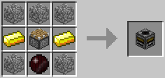

### [ ] #534 Item Detector / アイテム検知器、アイテムディテクター / PR

* 名称: Item Detector / 日本語: アイテム検知器、アイテムディテクター / Origin: `-` / New: `bcn:item_detector`
* レシピ: `Wooden Pressure Plate` + `Pneumatic Tube` x2 + `Brass Ingot` x2 + `Infused Silicon` x2 + `Wooden Planks` x2 -> `Item Detector` x1
* レシピ配置図: `[000]` / `[000]` / `[000]`
* 概要: ◆レッドストーン信号を出力 チューブと組み合わせて使用. 設置時は受取口とプレイヤーが向き合う形で、全6方向を向かせて設置可能. 受取口から入った全アイテムを背面に排出口から吐き出すが、 この際、受け取りアイテム1個につき1/20秒(遅延1相当)のパルス出力を行う. 特徴は通過したオブジェクトのスタック数も読み取る事で、 64個1スタックのアイテムが通過した場合は、64回きっちりパルス出力を行う. その64回の出力を行っている間に別なアイテムが通過していっても、 当然のようにそれも検知&加算、きっちり通過したアイテム数ぶんだけ出力する. ただ、遅延1のパルス出力はあまりにも高速すぎ、 通常マインクラフトのパウダー、トーチ、リピーターでは受け付けきれないので、 このMODの赤合金ワイヤーや絶縁ワイヤーでしか受け取れない.
* 専用GUI: 無
* 実装方法:

### [ ] #535 Retriever / 取寄器、リトリーバー / PR

* 名称: Retriever / 日本語: 取寄器、リトリーバー / Origin: `-` / New: `bcn:retriever`
* レシピ: `Sorted Distributor` + `Leather` + `Brass Ingot` x2 + `Ender Pearl` x2 + `Iron Ingot` x2 + `Electrotine Alloy Ingot` -> `Retriever` x1
* レシピ配置図: `[000]` / `[000]` / `[000]`
* 概要: ◆青電力消費 ◆レッドストーン入力が必要 レッドストーン入力がOFFからONになると、GUIで指定されたアイテムを、 "チューブで接続されていてかつ内部インベントリを持つブロック"のうち最も近いところから チューブを通じてそのアイテムを取寄せ、そのまま搬出口から搬出する. 詳細はインターフェイスの項を参照のこと.
* 専用GUI: 無
* 実装方法:

### [ ] #536 Buffer / 緩衝器、バッファー / PR

* 名称: Buffer / 日本語: 緩衝器、バッファー / Origin: `-` / New: `bcn:buffer`
* レシピ: `Wooden Planks` x4 + `Iron Bars` x4 -> `Buffer` x1
* レシピ配置図: `[000]` / `[000]` / `[000]`
* 概要: 複数種類アイテムを輸送する際の流量差をクッションする装置. 4行5列の内部インベントリと5つの搬入面＆1つの搬出面を持つ. インベントリの列と搬入面が対応していて、5つの搬入面それぞれに対し4スロットまでのアイテムを受け入れる. 1方向からはアイテムスロット4つ分しかアイテムを入れられないことを利用して、アイテム流量を調整できる. これ自体は搬出機能を持たないので搬出器械とセットで使う. 詳細はインターフェイスの項を参照のこと.
* 専用GUI: 無
* 実装方法:

### [ ] #537 Sorting Machine / 分類器、ソーティングマシン / PR

* 名称: Sorting Machine / 日本語: 分類器、ソーティングマシン / Origin: `-` / New: `bcn:sorting_machine`
* レシピ: `Sorted Distributor` + `Iron Ingot` x5 + `Infused Silicon` x2 + `Electrotine Alloy Ingot` -> `Sorting Machine` x1
* レシピ配置図: `[000]` / `[000]` / `[000]`
* 概要: ◆青電力消費 ◆レッドストーン入力が必要 隣接チェストから様々な方式でアイテムを搬出できるマシン. 5つのモードがありそれぞれ異なる動作をする. また、より高機能なフィルターとしての能力ももつ. 詳細はインターフェイスの項を参照のこと.
* 専用GUI: 無
* 実装方法:

### [ ] #538 Manager / 管理器、マネージャー / PR

* 名称: Manager / 日本語: 管理器、マネージャー / Origin: `-` / New: `bcn:manager`
* レシピ: `Regulator` + `Classifier` + `Iron Ingot` x2 + `Infused Silicon` x2 + `Wooden Planks` x2 + `Electrotine Alloy Ingot` -> `Manager` x1
* レシピ配置図: `[000]` / `[000]` / `[000]`
* 概要: ◆青電力消費 ◆レッドストーン信号を出力 接続されたチューブを介してマネージャー同士でネットワークを構築し、隣接チェストのアイテム不足分/余剰分をネットワーク内でやり取りする装置. MOD"Logistics Pipes"並の複雑なアイテム管理が可能.
* 専用GUI: 無
* 実装方法:

### [ ] #539 Sortron / 電子分類器、ソートロン / PR

* 名称: Sortron / 日本語: 電子分類器、ソートロン / Origin: `-` / New: `bcn:sortron`
* レシピ: `Classifier` + `Iron Ingot` x4 + `Infused Silicon` x2 + `Diamond` + `Flat Cable` -> `Sortron` x1
* レシピ配置図: `[000]` / `[000]` / `[000]`
* 概要: ◆青電力消費 ◆コンピュータで制御 コンピュータ制御でアイテム輸送を行う装置. 単体では使用できず、必ずコンピュータと接続し、プログラムで挙動を設定する必要がある. 詳しくはForth言語解説を参照.
* 専用GUI: 無
* 実装方法:

### [ ] #540 Regulator / 調整器、レギュレーター / PR

* 名称: Regulator / 日本語: 調整器、レギュレーター / Origin: `-` / New: `bcn:regulator`
* レシピ: `Item Detector` + `Buffer` x2 + `Brass Ingot` x2 + `Infused Silicon` x2 + `Wooden Planks` x2 -> `Regulator` x1
* レシピ配置図: `[000]` / `[000]` / `[000]`
* 概要: ◆レッドストーン信号を出力 アイテム流量を調整する装置. コストがかなり高いが、その分緩衝器と違い単独で動作し、より高性能. 詳細はインターフェイスの項を参照のこと.
* 専用GUI: 無
* 実装方法:

### [ ] #541 Ejector / 排出器、イジェクター / PR

* 名称: Ejector / 日本語: 排出器、イジェクター / Origin: `-` / New: `bcn:ejector`
* レシピ: `Distributor` + `Buffer` + `Wooden Planks` x4 + `Cobblestone` x2 + `Redstone` -> `Ejector` x1
* レシピ配置図: `[000]` / `[000]` / `[000]`
* 概要: ◆レッドストーン入力が必要 他MODの採掘装置などあたりにブロックを撒き散らすタイプのブロックにRP2のチューブを接続しても上手く輸送されない. そういった装置にこれを隣接させることで、排出されるアイテムを一旦この装置のインベントリに蓄え、 レッドストーン入力がされる度に1つずつ排出面から正しくRP2のチューブのラインに乗せることができる.
* 専用GUI: 無
* 実装方法:

### [ ] #542 Relay / 中継器、リレー / PR

* 名称: Relay / 日本語: 中継器、リレー / Origin: `-` / New: `bcn:relay`
* レシピ: `Distributor` + `Buffer` + `Wooden Planks` x4 + `Cobblestone` x2 + `Infused Silicon` -> `Relay` x1
* レシピ配置図: `[000]` / `[000]` / `[000]`
* 概要: 排出器(Ejector)のほぼ上位互換. インベントリのスロット数に変化はないが、こちらはレッドストーン入力がなくても勝手にチューブで搬送してくれる.
* 専用GUI: 無
* 実装方法:

### [ ] #543 Support Frame / フレーム / PR

* 名称: Support Frame / 日本語: フレーム / Origin: `-` / New: `bcn:support_frame`
* レシピ: `Brass Ingot` + `Stick` x8 -> `Support Frame` x1
* レシピ配置図: `[000]` / `[000]` / `[000]`
* 概要: 下記のモーターによって動かす構造物の骨組みとして使用する. フレームに接しているフレーム、およびブロックを一つの構造物として扱い一緒に動かすことができる. 直接接していないように見えても隣接ブロック内にワイヤーなどが存在していれば接続してしまう. 接触しているブロックを動かしたくない場合、接触する面に手ノコカットしたカバー(1/8板)を取り付けることで接続されなくなる. 同じくパネル(1/4板)を取り付けることでRP2のゲートやワイヤーを貼り付け、動かすことができる. これを利用してレッドストーン配線を保ったまま装置を移動させるようなこともできる. なおモーターの駆動面(矢印の面)や粉砕器の粉砕口、差配器の配置口等の何らかの作用を及ぼす面はカバーを付けずとも接続されない. フレームに接続されたブロックの進行方向に接続されていないブロックがある場合、動かすことができない. 特に地面やモーター用の配線が忘れがちであるので注意.
* 専用GUI: 無
* 実装方法:

### [ ] #544 Frame Motor / モーター / PR

* 名称: Frame Motor / 日本語: モーター / Origin: `projectred_expansion:frame_motor` / New: `bcn:frame_motor`
* レシピ: `Wooden Planks` x2 + `Iron Ingot` x1 + `Redstone` x2 + `Motor` x1 + `Stone` x2 + `Electrotine Alloy Ingot` x1 -> `Frame Motor` x1
* レシピ配置図: `ABA` / `CDC` / `EFE`
* 概要: ◆青電力消費 ◆レッドストーン入力が必要 フレームによって接続された一つの構造物をまるごと移動させる事ができる装置. レッドストーン入力がされる度に1ブロック分ずつ動かす. 黄色い大きな矢印の描いてある面に接しているフレームを矢印の方向に動かす. フレームに接続されたモーターの駆動面はフレームの面として機能し、フレームなどのブロックと接続できる. ドライバーで右クリックすることで矢印の向きを、 Shiftキーを押しながら右クリックすることで装置自体の向きを変更することができる. チェストなど内部インベントリを持つようなブロックも問題なく移動させることができる. 透過部分を持つような一部ブロックは移動中の見た目が木箱のようになるが見た目だけで特に問題はない. 60Vで起動可. 1回起動すると、約0.2V~0.5V消費する.
* 専用GUI: 不明 — フレーム駆動の制御方式
* 実装方法:

### [ ] #545 Tube Frame / チューブ内蔵フレーム / PR

* 名称: Tube Frame / 日本語: チューブ内蔵フレーム / Origin: `-` / New: `bcn:tube_frame`
* レシピ: `Support Frame` + `Tube` -> `Tube Frame` x1
* レシピ配置図: `[000]` / `[000]` / `[000]`
* 概要: 不定形レシピ チューブ内蔵型のフレーム. より省スペース化が可能になった. 穴空きカバーを取り付けることで、隣接ブロックとの結合を防ぎつつチューブとの接続ができる.
* 専用GUI: 無
* 実装方法:

### [ ] #546 Redstone Tube Frame / RSチューブ内蔵フレーム / PR

* 名称: Redstone Tube Frame / 日本語: RSチューブ内蔵フレーム / Origin: `-` / New: `bcn:redstone_tube_frame`
* レシピ: `Support Frame` + `Redstone Tube` / `Tube Frame` + `Redstone` -> `Redstone Tube Frame` x1
* レシピ配置図: `[000]` / `[000]` / `[000]`
* 概要: 不定形レシピ レッドストーンチューブを内蔵したフレーム. また素のフレームは透過ブロックでありレッドストーン信号を介せないので、レッドストーン信号を介せるフレームとしてチューブとは無関係に利用することもできる.
* 専用GUI: 無
* 実装方法:

### [ ] #547 Blulectric Furnace / 青電力かまど / PR

* 名称: Blulectric Furnace / 日本語: 青電力かまど / Origin: `-` / New: `bcn:blulectric_furnace`
* レシピ: `Clay Block` x5 + `Iron Ingot` x2 + `Electrotine Alloy Ingot` -> `Blulectric Furnace` x1
* レシピ配置図: `[000]` / `[000]` / `[000]`
* 概要: ◆青電力消費 青電力で動くかまど. 実質燃料なしで通常かまどの2倍の精錬速度と、そこだけ見れば高性能だが、安定稼動するにはそれなりの供給が必要. また、蓄積された青電力がゲージ全体の5/8(62.5%)以上に達していないと動作できない. 勘違いしやすいが、粘土ブロック5つ必要.
* 専用GUI: 無
* 実装方法:

<!-- 画像なし -->

### [ ] #548 Blulectric Alloy Furnace / 青電力合金かまど / PR

* 名称: Blulectric Alloy Furnace / 日本語: 青電力合金かまど / Origin: `-` / New: `bcn:blulectric_alloy_furnace`
* レシピ: `Bricks` x5 + `Iron Ingot` x2 + `Electrotine Alloy Ingot` -> `Blulectric Alloy Furnace` x1
* レシピ配置図: `[000]` / `[000]` / `[000]`
* 概要: ◆青電力消費 青電力で動く合金かまど. かまどが合金かまどになっただけで、仕様は青電力かまどと同じ.
* 専用GUI: 無
* 実装方法:

### [ ] #549 Charging Bench / チャージングベンチ / PR

* 名称: Charging Bench / 日本語: チャージングベンチ / Origin: `projectred_expansion:charging_bench` / New: `bcn:charging_bench`
* レシピ: `Stone` x2 + `Copper Coil` x1 + `Wooden Planks` x2 + `Battery` x1 + `Iron Ingot` x2 + `Electrotine Alloy Ingot` x1 -> `Charging Bench` x1
* レシピ配置図: `ABA` / `CDC` / `EFE`
* 概要: ◆青電力消費 青電力を消費するツールを充電する事ができる装置. 同時に16個ものツールを充電できるが、pre6時点ではこの装置によって充電できるツールが電動ドライバーしかない.
* 専用GUI: 有 — ツールの充電
* 実装方法:

### [ ] #550 BT Battery / 青電力電池、BTバッテリー / PR

* 名称: BT Battery / 日本語: 青電力電池、BTバッテリー / Origin: `-` / New: `bcn:bt_battery`
* レシピ: `Tin Ingot` + `Copper Ingot` x2 + `Nikolite` x6 -> `BT Battery` x1
* レシピ配置図: `[000]` / `[000]` / `[000]`
* 概要: ◆青電力貯蓄 青電力の電池. 蓄電器から青電力を充電して持ち運んだり、逆に蓄電器に青電力を戻すこともできる. 完全に空の時だけスタック出来る.
* 専用GUI: 無
* 実装方法:

### [ ] #551 BatteryBox / 蓄電器、バッテリーボックス / PR

* 名称: BatteryBox / 日本語: 蓄電器、バッテリーボックス / Origin: `projectred_expansion:battery_box` / New: `bcn:batterybox`
* レシピ: `Battery` x4 + `Wooden Planks` x1 + `Iron Ingot` x3 + `Electrotine Alloy Ingot` x1 -> `BatteryBox` x1
* レシピ配置図: `ABA` / `ACA` / `CDC`
* 概要: ◆青電力貯蓄 発電した青電力を貯めておく蓄電器. BTバッテリーと相互に充電できる. 破壊しアイテム化しても中の蓄電量は保持される. ただし電圧は保持されないので多少のロスが生じる.
* 専用GUI: 無
* 実装方法:

### [ ] #552 Voltmeter / 検流計、ボルトメーター / PR

* 名称: Voltmeter / 日本語: 検流計、ボルトメーター / Origin: `-` / New: `bcn:voltmeter`
* レシピ: `Nikolite` + `Wooden Planks` x5 + `Copper Ingot` x3 -> `Voltmeter` x1
* レシピ配置図: `[000]` / `[000]` / `[000]`
* 概要: GUIを持たない青電力の導体ブロックに対して右クリックで使うと電圧、電流値を調べられる.
* 専用GUI: 無
* 実装方法:

### [ ] #553 Blulectric Transformer / 変圧器、トランスフォーマー / PR

* 名称: Blulectric Transformer / 日本語: 変圧器、トランスフォーマー / Origin: `-` / New: `bcn:blulectric_transformer`
* レシピ: `Iron Ingot` x5 + `Electrotine Alloy Ingot` x2 + `Copper Coil` x2 -> `Blulectric Transformer` x1
* レシピ配置図: `[000]` / `[000]` / `[000]`
* 概要: ◆青電力輸送 より送電ロスの少ない高圧ケーブルで電力輸送するために変圧する装置. これによって通常の青電力ワイヤーと高圧用ワイヤーを接続する. 向きによって高圧サイド、低圧サイドが決まっている.
* 専用GUI: 無
* 実装方法:

### [ ] #554 Solar Panel / ソーラーパネル / PR

* 名称: Solar Panel / 日本語: ソーラーパネル / Origin: `-` / New: `bcn:solar_panel`
* レシピ: `Coal And Charcoal` x3 + `Glass` x3 + `Circuit` x2 + `Generator` x1 -> `Solar Panel` x1
* レシピ配置図: `ABA` / `BAB` / `CDC`
* 概要: ◆青電力生産 太陽光を青電力に変えるパネル. 青電力のメイン生産源. 真上から遮蔽物なしに降り注ぐ太陽光以外の光源では動作しない （ガラス等の透明ブロックは可）ので、夜間は動作させられない. IC2の太陽光発電機同様、1枚1枚の単位時間あたりの生産効率は低いので、 大量の青電力を確保するためには敷地が必要. ちなみに、これ1個作るのにニコライトパウダーが36個も必要.
* 専用GUI: 無
* 実装方法:

### [ ] #555 Thermopile / 温度差発電器、サーモパイル / PR

* 名称: Thermopile / 日本語: 温度差発電器、サーモパイル / Origin: `-` / New: `bcn:thermopile`
* レシピ: `Electrotine Alloy Ingot` x3 + `Iron Ingot` x2 + `Copper Ingot` x4 + `Electro Silicon` x2 -> `Thermopile` x1
* レシピ配置図: `[000]` / `[000]` / `[000]`
* 概要: ◆青電力生産 隣接するブロックとの温度差から青電力を取りだす発電器. 発電力はかなり弱いが、昼夜関係なく発電できる. 隣接する熱源、低温源の種類と数によって発電量が増減する. ただしランダムに熱源の溶岩源が黒曜石化したり氷や雪が溶けて水源化したりする. 熱源になるもの：火、溶岩 低温源になるもの：水、氷、雪
* 専用GUI: 無
* 実装方法:

### [ ] #556 Kinetic Generator / 動力発電機、キネティックジェネレータ / PR

* 名称: Kinetic Generator / 日本語: 動力発電機、キネティックジェネレータ / Origin: `-` / New: `bcn:kinetic_generator`
* レシピ: `Iron Ingot` x6 + `Brass Ingot` + `Blulectric Motor` + `Electrotine Alloy Ingot` -> `Kinetic Generator` x1
* レシピ配置図: `[000]` / `[000]` / `[000]`
* 概要: ◆青電力生産 風力発電機. これだけには役に立たず風力タービンか風車をセットする必要がある. セットする羽根の種類によって設置すべき向きが変わるので注意が必要. 発電効率はそこそこ高めで、雨の日は発電量が増える.
* 専用GUI: 無
* 実装方法:

### [ ] #557 Wooden Wind Turbine / 風力タービン / PR

* 名称: Wooden Wind Turbine / 日本語: 風力タービン / Origin: `-` / New: `bcn:wooden_wind_turbine`
* レシピ: `Sail` x6 + `Iron Block` x1 / `Post` x3 -> `Wooden Wind Turbine` x1
* レシピ配置図: `[000]` / `[000]` / `[000]`
* 概要: 風力発電の羽根その一. 独特の形状をしており、上向きに設置した動力発電機にセットして使う. 発電している間は徐々に耐久値が減っていく. 何らかの手段でブロック状態の羽が破壊されると耐久値0になり消滅する. 7ブロック立方の体積を占有し、上に乗ったりは可能だがラグの関係で正常に移動できなくなるかもしれないので乗らない方がいい.
* 専用GUI: 無
* 実装方法:

### [ ] #558 Wooden Windmill / 風車 / PR

* 名称: Wooden Windmill / 日本語: 風車 / Origin: `-` / New: `bcn:wooden_windmill`
* レシピ: `Sail` x4 + `Iron Block` x1 / `Post` x4 -> `Wooden Windmill` x1
* レシピ配置図: `[000]` / `[000]` / `[000]`
* 概要: 風力発電の羽根そのニ. おなじみの風車. コストが風力タービンより安いだけあって発電効率でやや劣る. 横向きに設置した動力発電機にセットすることで使用する. 高さ13×横13×奥行き1ブロックを占有し、羽が無いように見える空間でも通り抜けできない.
* 専用GUI: 無
* 実装方法:

### [ ] #559 Ruby Ore / ルビー鉱石 / PR

* 名称: Ruby Ore / 日本語: ルビー鉱石 / Origin: `-` / New: `bcn:ruby_ore`
* レシピ: なし
* レシピ配置図: `[000]` / `[000]` / `[000]`
* 概要: y=53以下に、ダイヤと同程度の比率で配置される. 性能やレア度にほとんど違いは無いので、『宝石』というダイヤの3倍の埋蔵量の鉱石と見て差し支えない. pre5からグリーンサファイア(旧称エメラルド）を材料に指定するアイテム（"電動ドライバー"）が追加された.
* 専用GUI: 無
* 実装方法:

### [ ] #560 Sapphire Ore / サファイア鉱石 / PR

* 名称: Sapphire Ore / 日本語: サファイア鉱石 / Origin: `-` / New: `bcn:sapphire_ore`
* レシピ: なし
* レシピ配置図: `[000]` / `[000]` / `[000]`
* 概要: 
* 専用GUI: 無
* 実装方法:

### [ ] #561 Green Sapphire Ore / グリーンサファイア鉱石 / PR

* 名称: Green Sapphire Ore / 日本語: グリーンサファイア鉱石 / Origin: `-` / New: `bcn:green_sapphire_ore`
* レシピ: なし
* レシピ配置図: `[000]` / `[000]` / `[000]`
* 概要: 
* 専用GUI: 無
* 実装方法:

<!-- 画像なし -->

### [ ] #562 Copper Ore / 銅鉱石 / PR

* 名称: Copper Ore / 日本語: 銅鉱石 / Origin: `-` / New: `bcn:copper_ore`
* レシピ: なし
* レシピ配置図: `[000]` / `[000]` / `[000]`
* 概要: y=68以下に、石炭と同程度の比率で配置される.
* 専用GUI: 無
* 実装方法:

<!-- 画像なし -->

### [ ] #563 Tin Ore / 錫鉱石 / PR

* 名称: Tin Ore / 日本語: 錫鉱石 / Origin: `-` / New: `bcn:tin_ore`
* レシピ: なし
* レシピ配置図: `[000]` / `[000]` / `[000]`
* 概要: y=53以下に、鉄よりやや多めの比率で配置される.
* 専用GUI: 無
* 実装方法:

<!-- 画像なし -->

### [ ] #564 Silver Ore / 銀鉱石 / PR

* 名称: Silver Ore / 日本語: 銀鉱石 / Origin: `-` / New: `bcn:silver_ore`
* レシピ: なし
* レシピ配置図: `[000]` / `[000]` / `[000]`
* 概要: y=31以下に、金よりやや多めの比率で配置される. 錫鉱石と非常に見分けがつきにくい.
* 専用GUI: 無
* 実装方法:

<!-- 画像なし -->

### [ ] #565 Nikolite Ore / ニコライト鉱石 / PR

* 名称: Nikolite Ore / 日本語: ニコライト鉱石 / Origin: `-` / New: `bcn:nikolite_ore`
* レシピ: なし
* レシピ配置図: `[000]` / `[000]` / `[000]`
* 概要: y=20以下に、レッドストーンと同程度の比率で配置される. RP2の独自鉱石で、RP2装置類のエネルギーシステム青電力(Blulectricity)の導体として使用される. ダイヤ鉱石と非常に見分けがつきにくい.
* 専用GUI: 無
* 実装方法:

<!-- 画像なし -->

### [ ] #566 Marble / 大理石 / PR

* 名称: Marble / 日本語: 大理石 / Origin: `-` / New: `bcn:marble`
* レシピ: なし
* レシピ配置図: `[000]` / `[000]` / `[000]`
* 概要: y=64以下に、しばしば巨大鉱脈(?)として見つかる石材. 鉱脈の生成率こそ低いのだが、1つの鉱脈の塊がとにかく巨大なので、一度見つけさえすれば粘土や石炭など比較にならないほど大量に手に入る. 建材としての用途以外、今のところ使い道はない.
* 専用GUI: 無
* 実装方法:

<!-- 画像なし -->

### [ ] #567 Marble Brick / 大理石レンガ / PR

* 名称: Marble Brick / 日本語: 大理石レンガ / Origin: `projectred_exploration:marble_brick` / New: `bcn:marble_brick`
* レシピ: `Marble` x4 -> `Marble Brick` x4
* レシピ配置図: `AA` / `AA`
* 概要: 砂岩や石レンガと同じように、大理石を4つ組み合わせて作ったレンガ. 建材や装飾として用いる以外、特に用途はない. RP2で追加される火山の大部分を占める石. 火山は丸ごとこれで構成されているので、見つければ採り放題. ただし建材としての用途以外、今のところ使い道はない. また通常の石(stone)同様、破壊して回収すると丸石(cobble)化してしまう. 直すには通常の丸石同様、かまどでの精錬過程を経る必要あり. プレイヤーにツルハシで回収された際、丸石化してしまった玄武岩. かまどで精錬すればもとの滑らかな玄武岩に戻せる. 建材や装飾として用いる以外、特に用途はない.
* 専用GUI: 無
* 実装方法:

### [ ] #568 Basalt Brick / 玄武岩レンガ / PR

* 名称: Basalt Brick / 日本語: 玄武岩レンガ / Origin: `projectred_exploration:basalt_brick` / New: `bcn:basalt_brick`
* レシピ: `Basalt` x4 -> `Basalt Brick` x4
* レシピ配置図: `AA` / `AA`
* 概要: 砂岩や石レンガと同じように、玄武岩を4つ組み合わせて作ったレンガ. 建材や装飾として用いる以外に特に用途はない. pre6追加レシピ: 玄武岩レンガ4 → サークル玄武岩レンガ4 玄武岩（焼石) → スムース玄武岩レンガ
* 専用GUI: 無
* 実装方法:

### [ ] #569 Nikolite / ニコライトパウダー / PR

* 名称: Nikolite / 日本語: ニコライトパウダー / Origin: `-` / New: `bcn:nikolite`
* レシピ: なし
* レシピ配置図: `[000]` / `[000]` / `[000]`
* 概要: ニコライトの鉱石ブロックを破壊した際、3～5個ドロップする. ダイヤやレッドストーン同様、鉱石ブロックを直接回収する事はできない. レッドストーンと似た見た目だが、地面に撒く事はできず、青電力関連のアイテムの材料として必要になる素材.
* 専用GUI: 無
* 実装方法:

### [ ] #570 Ruby / ルビー / PR

* 名称: Ruby / 日本語: ルビー / Origin: `projectred_core:ruby` / New: `bcn:ruby`
* レシピ: `Ruby Block` x1 -> `Ruby` x9
* レシピ配置図: `[不定形]`
* 概要: それぞれ対応する鉱石ブロックを破壊した際、1つドロップする. ダイヤやレッドストーン同様、鉱石ブロックを直接回収する事はできない. 基本的には各種ツールの材料に使うしか用途がない. グリーンサファイアのみ電動ドライバーの材料として使用する.
* 専用GUI: 無
* 実装方法:

### [ ] #571 Sapphire / サファイア / PR

* 名称: Sapphire / 日本語: サファイア / Origin: `projectred_core:sapphire` / New: `bcn:sapphire`
* レシピ: `Sapphire Block` x1 -> `Sapphire` x9
* レシピ配置図: `[不定形]`
* 概要: 
* 専用GUI: 無
* 実装方法:

### [ ] #572 Green Sapphire / グリーンサファイア / PR

* 名称: Green Sapphire / 日本語: グリーンサファイア / Origin: `-` / New: `bcn:green_sapphire`
* レシピ: なし
* レシピ配置図: `[000]` / `[000]` / `[000]`
* 概要: 
* 専用GUI: 無
* 実装方法:

### [ ] #573 Copper Ingot / 銅インゴット / PR

* 名称: Copper Ingot / 日本語: 銅インゴット / Origin: `-` / New: `bcn:copper_ingot`
* レシピ: `Copper` x1 -> `Copper Ingot` x1
* レシピ配置図: `[不定形]`
* 概要: 銅の鋳塊. かまどで銅鉱石を精錬したもの. 赤合金インゴットやブラスインゴットetc.の材料に使用.
* 専用GUI: 無
* 実装方法:

### [ ] #574 Tin Ingot / 錫インゴット / PR

* 名称: Tin Ingot / 日本語: 錫インゴット / Origin: `projectred_exploration:tin_ingot` / New: `bcn:tin_ingot`
* レシピ: `Tin Block` x1 -> `Tin Ingot` x9
* レシピ配置図: `[不定形]`
* 概要: 錫の鋳塊. かまどで錫鉱石を精錬したもの. ブラスインゴットや錫合板etc.の合金材料として使用.
* 専用GUI: 無
* 実装方法:

### [ ] #575 Silver Ingot / 銀インゴット / PR

* 名称: Silver Ingot / 日本語: 銀インゴット / Origin: `projectred_exploration:silver_ingot` / New: `bcn:silver_ingot`
* レシピ: `Silver Block` x1 -> `Silver Ingot` x9
* レシピ配置図: `[不定形]`
* 概要: 銀の鋳塊. かまどで銀鉱石を精錬したもの. 青合金インゴットetc.の合金材料として使用.
* 専用GUI: 無
* 実装方法:

### [ ] #576 Blue Alloy Ingot / 青合金インゴット / PR

* 名称: Blue Alloy Ingot / 日本語: 青合金インゴット / Origin: `-` / New: `bcn:blue_alloy_ingot`
* レシピ: `Silver Ingot` + `Nikolite` x4 -> `Blue Alloy Ingot` x1
* レシピ配置図: `[000]` / `[000]` / `[000]`
* 概要: ◆合金かまど(Alloy Furnace)で精錬 青電力伝達のための専用導体. レシピに使用するのは銀インゴット
* 専用GUI: 無
* 実装方法:

### [ ] #577 Silicon Boule / 高純度シリコン / PR

* 名称: Silicon Boule / 日本語: 高純度シリコン / Origin: `projectred_core:boule` / New: `bcn:silicon_boule`
* レシピ: `Sand` x8 + `Coal` x8 / `Charcoal` x8 -> `Silicon Boule` x1
* レシピ配置図: `[000]` / `[000]` / `[000]`
* 概要: ◆合金かまど(Alloy Furnace)で精錬 石炭でも木炭でも作成可能 ICチップの素材としてお馴染みのシリコン. 半導体として高い適性を持つ. ちなみに"Boule"とは、棒状に成長させた巨大な単結晶のこと.
* 専用GUI: 無
* 実装方法:

### [ ] #578 Silicon Wafer / シリコンウェハー / PR

* 名称: Silicon Wafer / 日本語: シリコンウェハー / Origin: `-` / New: `bcn:silicon_wafer`
* レシピ: `Diamond Saw` + `Silicon Boule` -> `Silicon Wafer` x1
* レシピ配置図: `[000]` / `[000]` / `[000]`
* 概要: ダイヤノコは耐久値を消費するだけで、素材としては消費されない. ダイヤの手ノコで16枚にスライスされたシリコンウェハー. 実質、砂0.5＋木炭0.5から1枚作れる計算. 鉄や宝石の手ノコではここまで薄く切れないのか、ダイヤノコでしか作れない.
* 専用GUI: 無
* 実装方法:

### [ ] #579 Red-Doped Wafer / レッドウェハー / PR

* 名称: Red-Doped Wafer / 日本語: レッドウェハー / Origin: `-` / New: `bcn:red_doped_wafer`
* レシピ: `Silicon` + `Redstone` x4 -> `Red-Doped Wafer` x1
* レシピ配置図: `[000]` / `[000]` / `[000]`
* 概要: ◆合金かまど(Alloy Furnace)で精錬 赤石を不純物として添加させた半導体基板. 信号(signal)伝達のための装置作成に対し、部品として要求される、らしい. ちなみに"Dope"とは、高純度の半導体に敢えて別の不純物を混ぜ、 それに何かしら固有の特性を持たせる作業のこと.
* 専用GUI: 無
* 実装方法:

### [ ] #580 Blue-Doped Wafer / ブルーウェハー / PR

* 名称: Blue-Doped Wafer / 日本語: ブルーウェハー / Origin: `-` / New: `bcn:blue_doped_wafer`
* レシピ: `Silicon` + `Nikolite` x4 -> `Blue-Doped Wafer` x1
* レシピ配置図: `[000]` / `[000]` / `[000]`
* 概要: ◆合金かまど(Alloy Furnace)で精錬 ニコライトを不純物として添加させた半導体基板. 青電力(Blulectricity)伝達のための装置作成に対し、部品として要求される.
* 専用GUI: 無
* 実装方法:

### [ ] #581 Sickcle / 草刈り鎌 / PR

* 名称: Sickcle / 日本語: 草刈り鎌 / Origin: `-` / New: `bcn:sickcle`
* レシピ: なし
* レシピ配置図: `[000]` / `[000]` / `[000]`
* 概要: 草刈り鎌. 木、石、鉄、金、ダイヤのお馴染み5素材で作成できる他、 下にあるように宝石3種でも作ることが出来る. クワと同じく農具なので、攻撃力は木製もダイヤ製も等しく0.5と素手レベル. 素材により生じる違いは耐久値(使用回数)の差のみ. ただし農具としてはクワなんかよりよっぽど使える優秀な道具である. 対象ブロックを破壊時、そのブロックを中心とした縦5x横5x高1の範囲内にある、 作物(小麦、亜麻、etc)、苗木、雑草、花、キノコも全てまとめて破壊する. 小麦回収の他、草原一面に生い茂った雑草駆除にも活躍する. pre6から木の葉ブロックの範囲破壊にも対応し、対象ブロックを中心に3×3×3を一括破壊する.
* 専用GUI: 無
* 実装方法:

### [ ] #582 Gem Handsaws / 宝石製の手ノコ / PR

* 名称: Gem Handsaws / 日本語: 宝石製の手ノコ / Origin: `-` / New: `bcn:gem_handsaws`
* レシピ: `Stick` x3 + `Iron Ingot` x2 + `Gems` x2 -> `Gem Handsaws` x1
* レシピ配置図: `[000]` / `[000]` / `[000]`
* 概要: 宝石製の手ノコ. 性能は三種全てでどれも同じ(耐久値500、攻撃力＝素手並) "黒曜石"、"高純度シリコン"の2種を除いた、 ダイヤ手ノコがカットできる全てのブロックをカットする事ができる.
* 専用GUI: 無
* 実装方法:

<!-- 画像なし -->

### [ ] #583 Ruby Tools / ルビーツール各種 / PR

* 名称: Ruby Tools / 日本語: ルビーツール各種 / Origin: `-` / New: `bcn:ruby_tools`
* レシピ: なし
* レシピ配置図: `[000]` / `[000]` / `[000]`
* 概要: 宝石製のツール. 基本5種＋草刈り鎌. 性能は三種全てでどれも同じ(耐久値500、攻撃力&採掘速度＝ダイヤ並) ただし破壊可能なブロックは鉄ツールと同等、黒曜石の破壊はできない. また、クワと草刈り鎌だけは、攻撃力は素手と同じ0.5で固定. 宝石はツール以外に使い道が無いため備蓄を特に気にせず使い潰せる.
* 専用GUI: 無
* 実装方法:

### [ ] #584 Sapphire Tools / サファイアツール各種 / PR

* 名称: Sapphire Tools / 日本語: サファイアツール各種 / Origin: `-` / New: `bcn:sapphire_tools`
* レシピ: なし
* レシピ配置図: `[000]` / `[000]` / `[000]`
* 概要: 
* 専用GUI: 無
* 実装方法:

### [ ] #585 Green Sapphire Tools / グリーンサファイアツール各種 / PR

* 名称: Green Sapphire Tools / 日本語: グリーンサファイアツール各種 / Origin: `-` / New: `bcn:green_sapphire_tools`
* レシピ: なし
* レシピ配置図: `[000]` / `[000]` / `[000]`
* 概要: 
* 専用GUI: 無
* 実装方法:

### [ ] #586 Athame / アサメ / PR

* 名称: Athame / 日本語: アサメ / Origin: `projectred_exploration:athame` / New: `bcn:athame`
* レシピ: `Silver Ingot` x1 + `Wooden` x1 -> `Athame` x1
* レシピ配置図: `A` / `B`
* 概要: アサメイ、アセイミナイフなどとも呼ばれる儀礼用のナイフ. エンダーマンに対する強力な武器となり、2回攻撃するだけで倒せる. ただし他のモンスターに対しては素手と同じ攻撃力でしかない. レシピに使用するのは鉄ではなく銀.
* 専用GUI: 無
* 実装方法:

### [ ] #587 Wool Card / 紡毛カード / PR

* 名称: Wool Card / 日本語: 紡毛カード / Origin: `-` / New: `bcn:wool_card`
* レシピ: `Fine Iron Wire` + `Wooden Planks` + `Stick` -> `Wool Card` x1
* レシピ配置図: `[000]` / `[000]` / `[000]`
* 概要: 羊毛と一緒にクラフトすることで耐久値を消費して糸を4つ紡げる. 耐久値は64.
* 専用GUI: 無
* 実装方法:

### [ ] #588 Lamp / LED照明ブロック / PR

* 名称: Lamp / 日本語: LED照明ブロック / Origin: `-` / New: `bcn:lamp`
* レシピ: `LED Powder` x2 + `Glass Pane` x6 + `Redstone` -> `Lamp` x1
* レシピ配置図: `[000]` / `[000]` / `[000]`
* 概要: 発光ダイオードの仕組みを利用した全16色のブロック. 光る色付きガラスといった印象だが、実際には不透明で向こうは透けて見えない. レッドストーン入力されている間は、明かりLv15の照明源として機能、 異なる色を複数を組み合わせて光らせる事で、ネオンアートのような事ができる.
* 専用GUI: 無
* 実装方法:

<!-- 画像なし -->

### [ ] #589 Inverted Lamp / 反転LED照明ブロック / PR

* 名称: Inverted Lamp / 日本語: 反転LED照明ブロック / Origin: `-` / New: `bcn:inverted_lamp`
* レシピ: `LED Powder` x2 + `Glass Pane` x6 + `Redstone Torch` -> `Inverted Lamp` x1
* レシピ配置図: `[000]` / `[000]` / `[000]`
* 概要: 上記のレッドストーン信号によるOn/Offが逆転したバージョン. すなわち素の状態では光りっぱなしで、RS信号を入力している間だけオフになる.
* 専用GUI: 無
* 実装方法:

<!-- 画像なし -->

### [ ] #590 Fixture / LED飾り照明 / PR

* 名称: Fixture / 日本語: LED飾り照明 / Origin: `-` / New: `bcn:fixture`
* レシピ: `LED Powder` x1 + `Glass Pane` x5 + `Stone Wafer` x2 + `Stone Wire` x1 -> `Fixture` x1
* レシピ配置図: `[000]` / `[000]` / `[000]`
* 概要: やや平たい形のLEDランプのバリエーション.
* 専用GUI: 無
* 実装方法:

<!-- 画像なし -->

### [ ] #591 Inverted Fixture / 反転LED飾り照明 / PR

* 名称: Inverted Fixture / 日本語: 反転LED飾り照明 / Origin: `-` / New: `bcn:inverted_fixture`
* レシピ: `LED Powder` x1 + `Glass Pane` x5 + `Stone Wafer` x2 + `Stone Cathode` x1 -> `Inverted Fixture` x1
* レシピ配置図: `[000]` / `[000]` / `[000]`
* 概要: LED飾り照明の反転バージョン.
* 専用GUI: 無
* 実装方法:

<!-- 画像なし -->

### [ ] #592 Cage Lamp / LEDケージ照明 / PR

* 名称: Cage Lamp / 日本語: LEDケージ照明 / Origin: `-` / New: `bcn:cage_lamp`
* レシピ: `LED Powder` x1 + `Stone Wafer` x2 + `Iron Fence` x3 + `Stone Wire` -> `Cage Lamp` x1
* レシピ配置図: `[000]` / `[000]` / `[000]`
* 概要: LEDランプのバリエーション.
* 専用GUI: 無
* 実装方法:

<!-- 画像なし -->

### [ ] #593 Inverted Cage Lamp / 反転LEDケージ照明 / PR

* 名称: Inverted Cage Lamp / 日本語: 反転LEDケージ照明 / Origin: `-` / New: `bcn:inverted_cage_lamp`
* レシピ: `LED Powder` x1 + `Stone Wafer` x2 + `Iron Fence` x3 + `Stone Cathode` -> `Inverted Cage Lamp` x1
* レシピ配置図: `[000]` / `[000]` / `[000]`
* 概要: LEDケージ照明の反転バージョン.
* 専用GUI: 無
* 実装方法:

<!-- 画像なし -->

### [ ] #594 Lantern / LEDランタン / PR

* 名称: Lantern / 日本語: LEDランタン / Origin: `-` / New: `bcn:lantern`
* レシピ: `LED Powder` x1 + `Glass Pane` x2 + `Stone Wafer` x4 + `Redstone` x1 + `Gold Nugget` x1 -> `Lantern` x1
* レシピ配置図: `[000]` / `[000]` / `[000]`
* 概要: LEDランプのバリエーション.
* 専用GUI: 無
* 実装方法:

<!-- 画像なし -->

### [ ] #595 Inverted Lantern / 反転LEDランタン / PR

* 名称: Inverted Lantern / 日本語: 反転LEDランタン / Origin: `-` / New: `bcn:inverted_lantern`
* レシピ: `LED Powder` x1 + `Glass Pane` x2 + `Stone Wafer` x4 + `Redstone Torch` x1 + `Gold Nugget` x1 -> `Inverted Lantern` x1
* レシピ配置図: `[000]` / `[000]` / `[000]`
* 概要: LEDランタンの反転バージョン.
* 専用GUI: 無
* 実装方法:

<!-- 画像なし -->

### [ ] #596 Fallout Light / FO.LED飾り照明 / PR

* 名称: Fallout Light / 日本語: FO.LED飾り照明 / Origin: `-` / New: `bcn:fallout_light`
* レシピ: `LED Powder` x1 + `Iron Bars` x5 + `Gold Nugget` x2 + `Stone Wire` x1 -> `Fallout Light` x1
* レシピ配置図: `[000]` / `[000]` / `[000]`
* 概要: LEDランプのバリエーション. FO.はfalloutの略.
* 専用GUI: 無
* 実装方法:

<!-- 画像なし -->

### [ ] #597 Inverted Fallout Light / 反転FO.LED飾り照明 / PR

* 名称: Inverted Fallout Light / 日本語: 反転FO.LED飾り照明 / Origin: `-` / New: `bcn:inverted_fallout_light`
* レシピ: `LED Powder` x1 + `Iron Bars` x5 + `Gold Nugget` x2 + `Stone Cathode` x1 -> `Inverted Fallout Light` x1
* レシピ配置図: `[000]` / `[000]` / `[000]`
* 概要: FO.LED飾り照明の反転バージョン.
* 専用GUI: 無
* 実装方法:

<!-- 画像なし -->

### [ ] #598 Illumar Button / LED照明ボタン / PR

* 名称: Illumar Button / 日本語: LED照明ボタン / Origin: `-` / New: `bcn:illumar_button`
* レシピ: `LED Powder` x2 + `Stone Button` x1 -> `Illumar Button` x1
* レシピ配置図: `[000]` / `[000]` / `[000]`
* 概要: 押すと光るボタン.
* 専用GUI: 無
* 実装方法:

<!-- 画像なし -->

### [ ] #599 Illumar Feedback Button / FB.LED照明ボタン / PR

* 名称: Illumar Feedback Button / 日本語: FB.LED照明ボタン / Origin: `-` / New: `bcn:illumar_feedback_button`
* レシピ: `Illumar Button` x1 + `Redstone Torch` x1 -> `Illumar Feedback Button` x1
* レシピ配置図: `[000]` / `[000]` / `[000]`
* 概要: 押すと光るボタン. こちらは設置してあるブロックにレッドストーン入力があっても光る. FB.はFeedBackの略.
* 専用GUI: 無
* 実装方法:

<!-- 画像なし -->

### [ ] #600 Deviating Lily Seeds / 百合の花の種 / PR

* 名称: Deviating Lily Seeds / 日本語: 百合の花の種 / Origin: `-` / New: `bcn:deviating_lily_seeds`
* レシピ: なし
* レシピ配置図: `[000]` / `[000]` / `[000]`
* 概要: 
* 専用GUI: 無
* 実装方法:

<!-- 画像なし -->

(163 項目)

## LogisticsPipes (MC1.12.2)

### [ ] #601 Logistics Power Junction / LP変換機 / LP

* 名称: Logistics Power Junction / 日本語: LP変換機 / Origin: `logisticspipes:power_junction` / New: `bcn:logistics_power_junction`
* レシピ: `Chip Basic` x1 + `Redstone` x2 + `Frame` x1 + `Iron Ingot` x2 + `Redstone Block` x1 -> `Logistics Power Junction` x1
* レシピ配置図: `0A0` / `BCB` / `DED`
* 概要: MC1.3.2対応版 以降の必須重要装置. これの併設(＋動力供給)なしではロジパイプが動作しない. BuildCraftなどのMJ、RF、または IndustrialCraft2のEUを、 ロジパイプ稼動用の専用エネルギーLPに変換するコンバーター. 超高圧(2048EU/t)の入力でも爆発しない. また、これ自体が内部に200万LPまで貯蔵できるストレージを持つ. ロジパイプの中でも基本パイプとしか接続できないが、 そのロジパイプネットワークのどこか一箇所に接続されていれば、 そのネットワークに所属する全ロジパイプにLPを供給する. 分断されている場合は、1ネットワーク毎に1台ずつの併設が必要. Dev571より、作成に基本パイプ及び金チップ（歯車）が不要に. 代わりにレッドストーンブロックが必要になった（実質赤石粉が11個必要に）
* 専用GUI: 有 — LP 変換とエネルギー管理
* 実装方法:

### [ ] #602 Logistics RF Power Provider / RF変換機 / LP

* 名称: Logistics RF Power Provider / 日本語: RF変換機 / Origin: `-` / New: `bcn:logistics_rf_power_provider`
* レシピ: `Redstone Block` x1 + `Piston` x1 + `Golden Chipset` x2 + `Iron Chipset` x1 + `Paper` x4 -> `Logistics RF Power Provider` x1
* レシピ配置図: `[000]` / `[000]` / `[000]`
* 概要: ロジパイプを通じてRFを供給するための装置. これ単体では機能せず、RFを要求する機械に隣接したロジパイプに"TE Power Supplier Upgrade"を、 変換器からマシンまでのすべてのロジパイプに"Power Transportation Upgrade"を付ける必要がある.
* 専用GUI: 有 — 給電範囲の設定
* 実装方法:

### [ ] #603 Logistics EU Power Provider / EU変換機 / LP

* 名称: Logistics EU Power Provider / 日本語: EU変換機 / Origin: `-` / New: `bcn:logistics_eu_power_provider`
* レシピ: `Redstone Block` x1 + `Overclocker upgrade` x2 + `Energy storage upgrade` x1 + `Transformer Upgrade` x1 + `Paper` x4 -> `Logistics EU Power Provider` x1
* レシピ配置図: `[000]` / `[000]` / `[000]`
* 概要: ロジパイプを通じてEUを供給するための装置. 機能はRF変換器と同様で供給するエネルギーが異なるだけ.
* 専用GUI: 有 — 給電範囲の設定
* 実装方法:

<!-- 画像なし -->

### [ ] #604 Logistics Crafting Table / ロジスティクス作業台 / LP

* 名称: Logistics Crafting Table / 日本語: ロジスティクス作業台 / Origin: `logisticspipes:crafting_table` / New: `bcn:logistics_crafting_table`
* レシピ: `Crafting Table` x1 + `Wooden Planks` x2 + `Frame` x1 + `Piston` x1 -> `Logistics Crafting Table` x1
* レシピ配置図: `0A0` / `BCB` / `0D0`
* 概要: BC3.6.0以降、スタック不可アイテムを加工パイプで使用する際のほぼ必須装置. 仕様としてはFFMのワークテーブルに近いが、 手動で作成することはできず加工パイプが必要. 内部にレシピを登録して加工パイプを接続することで、 クラフト要求があった場合に材料を搬入、作成して送り出す. 空になったバケツなどは内部に残るので、適切なパイプを使用して搬出すること.
* 専用GUI: 有 — クラフト設定
* 実装方法:

### [ ] #605 Basic Logistics Pipe / 基本パイプ / LP

* 名称: Basic Logistics Pipe / 日本語: 基本パイプ / Origin: `logisticspipes:pipe_basic` / New: `bcn:basic_logistics_pipe`
* レシピ: `Chip Fpga` x1 + `Pipe Transport Basic` x1 -> `Basic Logistics Pipe` x1
* レシピ配置図: `A` / `B`
* 概要: 最も基本的なロジパイプ. 他のロジパイプの素材にもなる. GUIでアイテム指定しておく事でそのアイテムの回収ポイントになり、 隣接して回収物搬入用のインベントリ内包ブロックを設置しておくと、 抽出モジュールの発送物や、加工パイプの余剰物など、 発送側に宛先指定されなかったアイテムの受け皿として機能する.
* 専用GUI: 有 — ロジスティクス設定画面
* 実装方法:

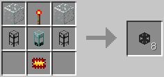

### [ ] #606 Blank module / ブランクモジュール / LP

* 名称: Blank module / 日本語: ブランクモジュール / Origin: `logisticspipes:module_blank` / New: `bcn:blank_module`
* レシピ: `Redstone` x1 + `Paper` x1 + `Nugget Gold` x1 -> `Blank module` x1
* レシピ配置図: `A` / `B` / `C`
* 概要: 各種モジュールの作成における中間素材となる部品. これ自体には何の効果も無い.
* 専用GUI: 有 — ロジスティクスレンチによる設定画面
* 実装方法:

### [ ] #607 Logistics Fuzzy Crafting Table / ファジーロジスティクス作業台 / LP

* 名称: Logistics Fuzzy Crafting Table / 日本語: ファジーロジスティクス作業台 / Origin: `logisticspipes:crafting_table_fuzzy` / New: `bcn:logistics_fuzzy_crafting_table`
* レシピ: `Chip Basic` x1 + `Crafting Table` x1 -> `Logistics Fuzzy Crafting Table` x1
* レシピ配置図: `A` / `B`
* 概要: 鉱石辞書の使用、ダメージ値無視、NBTタグ無視、"Ore"が付くアイテムといった指定ができるようになる. ファジーチップとセットで使用する.
* 専用GUI: 有 — クラフト設定
* 実装方法:

### [ ] #608 Provider Logistics Pipe / 供給パイプ / LP

* 名称: Provider Logistics Pipe / 日本語: 供給パイプ / Origin: `-` / New: `bcn:provider_logistics_pipe`
* レシピ: `Basic Logistics Pipe` x1 + `Glowstone Dust` x1 / `Basic Logistics Pipe` x1 + `Gold Gear` x1 + `Redstone` x1 / `Basic Logistics Pipe` x1 + `Golden Chipset` x1 + `Redstone Torch` x1 -> `Provider Logistics Pipe` x1
* レシピ配置図: `[000]` / `[000]` / `[000]`
* 概要: このパイプに隣接するインベントリ内包ブロックが、加工、加工補佐、 要求、補給パイプからアイテム取寄先として認識される. 逆に言えば、チェストetc.のインベントリ内包ブロックは、 このパイプに隣接していないと内容物がネットワークに登録されない. 内部にアイテム置き場を有する全ブロックが認識対象になる. Dev571にてコストが増加、大量生産には手間がかかるように.
* 専用GUI: 有 — ロジスティクス設定画面
* 実装方法:

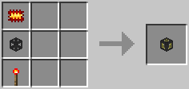

### [ ] #609 Provider Logistics Pipe Mk2 / 供給パイプMk2 / LP

* 名称: Provider Logistics Pipe Mk2 / 日本語: 供給パイプMk2 / Origin: `-` / New: `bcn:provider_logistics_pipe_mk2`
* レシピ: `Provider Logistics Pipe` x1 + `Diamond Chipset` x1 -> `Provider Logistics Pipe Mk2` x1
* レシピ配置図: `[000]` / `[000]` / `[000]`
* 概要: 6tick毎に1回、16個ずつ（秒間50個）の速さでアイテムを発送する. BuildCraft3.2.0以前ではデフォルト設定では無印の供給パイプと性能が変わらず作るだけ無駄だった. ただしBuildCraft3.2.0以前であってもBCのConfigでI:pipes.maxItems=100の値を1000以上に書き換えると、 （6tickに1回、最大16個ずつのアイテムをスタック発送、秒間50個） の高速モードでアイテムを発送するようになる.
* 専用GUI: 有 — ロジスティクス設定画面
* 実装方法:

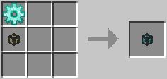

### [ ] #610 Request Logistics Pipe / 要求パイプ / LP

* 名称: Request Logistics Pipe / 日本語: 要求パイプ / Origin: `-` / New: `bcn:request_logistics_pipe`
* レシピ: `Basic Logistics Pipe` x1 + `Golden Chipset` x2 / `Basic Logistics Pipe` x1 + `Golden Chipset` x1 + `Iron Gear` x1 -> `Request Logistics Pipe` x1
* レシピ配置図: `[000]` / `[000]` / `[000]`
* 概要: ネットワーク全体から、アイテムを任意で取り寄せるのに使う. （ただし事前に供給、加工パイプetc.を使っての取寄先の登録が必要） 任意のアイテムを任意の個数、プレイヤーの思い通りに引き出せる一方、 要求の毎にいちいちレンチで右クリックしてGUIを開き、 要求アイテムの種類＆個数を指定しなければならない煩雑さがある.
* 専用GUI: 有 — 要求画面
* 実装方法:

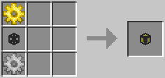

### [ ] #611 Request Logistics Pipe Mk2 / 要求パイプMk2 / LP

* 名称: Request Logistics Pipe Mk2 / 日本語: 要求パイプMk2 / Origin: `-` / New: `bcn:request_logistics_pipe_mk2`
* レシピ: `Request Logistics Pipe` x1 + `Diamond Chipset` x1 / `Request Logistics Pipe` x1 + `Diamond Gear` x1 + `Redstone` x1 -> `Request Logistics Pipe Mk2` x1
* レシピ配置図: `[000]` / `[000]` / `[000]`
* 概要: 上記"要求パイプ"の強化版. GUIを開くのにレンチが要らず、右クリックするだけで開けるようになった. また、後述する"リクエストディスク"の利用も可能となり、 複数アイテムの取り寄せetc.の煩雑な作業を一気に簡略化可能となった. 更にThaumcraft3が導入されている場合、選択したアイテムの相がGUI左上に表示されるようになる. Dev571より、歯車使用レシピでは赤石粉も必要に.
* 専用GUI: 有 — 要求画面
* 実装方法:

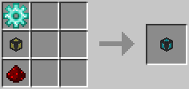

### [ ] #612 Logistics Disk / リクエストディスク / LP

* 名称: Logistics Disk / 日本語: リクエストディスク / Origin: `logisticspipes:disk` / New: `bcn:logistics_disk`
* レシピ: `Iron Ingot` x4 + `Redstone` x4 + `Nugget Gold` x1 -> `Logistics Disk` x1
* レシピ配置図: `ABA` / `BCB` / `ABA`
* 概要: "要求パイプMk2"専用で、無印の要求パイプでは利用できない. よく使うリクエストの内容を登録＆保存しておけるフロッピーディスク. 複数種類＆個数のアイテムをボタン1発でリクエストできる. 保存したディスクを取り出して、他の要求パイプMk2に使い回す事も可能.
* 専用GUI: 無
* 実装方法:

<!-- 画像なし -->

### [ ] #613 Remote Orderer Logistics Pipe / 遠隔要求パイプ / LP

* 名称: Remote Orderer Logistics Pipe / 日本語: 遠隔要求パイプ / Origin: `-` / New: `bcn:remote_orderer_logistics_pipe`
* レシピ: `Basic Logistics Pipe` x1 + `Ender Pearl` x1 / `Basic Logistics Pipe` x1 + `Ender Pearl` x1 + `Redstone` x1 -> `Remote Orderer Logistics Pipe` x1
* レシピ配置図: `[000]` / `[000]` / `[000]`
* 概要: リモートオーダーで右クリックすると、その遠隔要求パイプを記憶する. 記憶済みリモートオーダーで何も無い空間を右クリックすると、 どこからでもその遠隔要求パイプに対して取り寄せ実行命令を出せる. 普通にプレイする範囲ではこれを作る必要も使う出番もない. が、遠隔共有チェスト系のMODと組み合わせると反則的な便利さとなる.
* 専用GUI: 有 — 遠隔発注画面
* 実装方法:

<!-- 画像なし -->

### [ ] #614 Supplier Logistics Pipe / 補給パイプ / LP

* 名称: Supplier Logistics Pipe / 日本語: 補給パイプ / Origin: `-` / New: `bcn:supplier_logistics_pipe`
* レシピ: `Basic Logistics Pipe` x1 + `Lapis Lazuli` x2 -> `Supplier Logistics Pipe` x1
* レシピ配置図: `[000]` / `[000]` / `[000]`
* 概要: GUI内でアイテムとその個数を設定すると、 隣接するインベントリ内包ブロックに対し、指定アイテムが指定個数分、 常にストックされるようなアイテムの自動補給が行われる. が、2つ以上のインベントリに同時に隣接していると正常動作しないので、 必ず"1インベントリに1補給パイプ"の比率で配管する必要がある. 上記の補給パイプの液体版. BCの鉄エンジン、IC2の地熱発電機、FFMのバイオマス発酵槽など、 容器を使った液体投入スロットを持つ装置の隣に設置、 バケツ、ガラス瓶、セル、カン、カプセルを使っての液体自動補給を行う. 補給は、液体が常にバケツ(指定個数)杯以上になるように行われる. BCのビルダー専用の補給パイプ. ロジパイプの中では珍しく、レンチで右クリックした時に開くGUIを持たない. ブループリントを読み込ませたビルダーに隣接させると、 ビルダーが要求するアイテムをネットワーク内から自動で取り寄せる. （要するに加工は行わない） Dev632の時点ではビルダー凍結に伴い?消滅しており、その後ビルダー復帰後も復活していない.
* 専用GUI: 有 — ロジスティクス設定画面
* 実装方法:

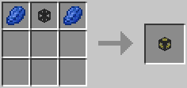

### [ ] #615 Crafting Logistics Pipe / 加工パイプ / LP

* 名称: Crafting Logistics Pipe / 日本語: 加工パイプ / Origin: `-` / New: `bcn:crafting_logistics_pipe`
* レシピ: `Basic Logistics Pipe` x1 + `Glowstone Dust` x2 / `Basic Logistics Pipe` x1 + `Redstone` x1 + `Stone Gear` -> `Crafting Logistics Pipe` x1
* レシピ配置図: `[000]` / `[000]` / `[000]`
* 概要: バニラのかまど、BCの全自動作業台、IC2の粉砕機などに隣接設置. 原材料のみから加工を経つつ、加工後のアイテムを直接取り寄せられる. かまどのように燃料を同時搬入する必要のある装置や、水バケツetc.のスタック不可アイテムを原材料に使った加工を行うには、後述の"加工補佐パイプ"との併用が必須になる. BCの全自動作業台の仕様変更とロジスティクス作業台の登場により、 スタック付加アイテムを原材料に使う場合でも大量発注しない限り 加工補佐パイプは必要なくなった. それでもかまどでの作業などでは加工補佐パイプとの併用を行った方が良いことが多々ある.
* 専用GUI: 有 — クラフト設定
* 実装方法:

<!-- 画像なし -->

### [ ] #616 Crafting Logistics Pipe Mk2 / 加工パイプMk2 / LP

* 名称: Crafting Logistics Pipe Mk2 / 日本語: 加工パイプMk2 / Origin: `-` / New: `bcn:crafting_logistics_pipe_mk2`
* レシピ: `Crafting Logistics Pipe` x1 + `Golden Chipset` x1 / `Crafting Logistics Pipe` x1 + `Gold Gear` x1 + `Redstone` x1 -> `Crafting Logistics Pipe Mk2` x1
* レシピ配置図: `[000]` / `[000]` / `[000]`
* 概要: 上記"加工パイプ"の強化版. 全自動作業台と併用時、 無印の加工パイプが作成されたアイテムを1個ずつ発送するのに対し、 こちらは作成されたアイテムを作成毎にスタックされたまま発送する. 全自動作業台以外には使えない上、正直あまり差を感じられない.
* 専用GUI: 有 — クラフト設定
* 実装方法:

<!-- 画像なし -->

### [ ] #617 Crafting Logistics Pipe Mk3 / 加工パイプMk3 / LP

* 名称: Crafting Logistics Pipe Mk3 / 日本語: 加工パイプMk3 / Origin: `-` / New: `bcn:crafting_logistics_pipe_mk3`
* レシピ: `Crafting Logistics Pipe` x21 + `Nano Hopper` x1 + `Diamond Chipset` x1 + `Iron Ingot` x1 -> `Crafting Logistics Pipe Mk3` x1
* レシピ配置図: `[000]` / `[000]` / `[000]`
* 概要: 32スロット分の隠しインベントリ(視認不可)を内蔵する加工パイプ. そこで一時待機させる事で、かまど等の原料欄が1スロットの装置でも、 1種64個以上が同時に流れ込んだ際のアイテム溢れが起こらなくなる. 継続して加工パイプMk2のスタック単位での搬出機能も持つ.
* 専用GUI: 有 — クラフト設定
* 実装方法:

<!-- 画像なし -->

### [ ] #618 Satellite Logistics Pipe / 加工補佐パイプ / LP

* 名称: Satellite Logistics Pipe / 日本語: 加工補佐パイプ / Origin: `-` / New: `bcn:satellite_logistics_pipe`
* レシピ: `Basic Logistics Pipe` x1 + `Redstone` x2 -> `Satellite Logistics Pipe` x1
* レシピ配置図: `[000]` / `[000]` / `[000]`
* 概要: "加工パイプ"、"加工パイプMk2"の子機として働くパイプ. 子機側で設定したIDを、親機側からも指定してやる事で初めて動作する. 親機にあたる"加工パイプ"へのリクエストが発生した際、指定アイテムを指定個数、連動して隣接するインベントリへと取り寄せる. （全自動作業台が隣接チェストの中身も材料と認識する仕組みを利用） 全自動作業台のリメイクとロジスティクス作業台の追加により必要な場面は減ったが、かまどへの燃料の同時供給や大量精錬時にホッパーへ材料を送り込むなどまだまだ活躍の場はある.
* 専用GUI: 有 — 衛星先設定
* 実装方法:

<!-- 画像なし -->

### [ ] #619 Logistics Liquid Basic Pipe / 液体基本パイプ / LP

* 名称: Logistics Liquid Basic Pipe / 日本語: 液体基本パイプ / Origin: `-` / New: `bcn:logistics_liquid_basic_pipe`
* レシピ: `Basic Logistics Pipe` x1 + `Pipe Sealant` x6 + `Empty Bucket` x2 / `Basic Logistics Pipe` x1 + `Pipe Sealant` x1 + `Empty Bucket` x1 -> `Logistics Liquid Basic Pipe` x1
* レシピ配置図: `[000]` / `[000]` / `[000]`
* 概要: GUIにて液体を指定すると、その液体を回収して隣接する機械、タンクに搬入する液体系の基本パイプ. 内部ストレージは存在しないが、機械、タンクとの間が通常の液体パイプ扱いなのか、1方向につき4杯分まで液体を残留させられる. デフォルトルート的なものは存在せず、指定無しの場合はどの液体も回収しない. 他液体系パイプの材料にもなる. 通常の基本パイプと違い、LP変換機とは接続しない.
* 専用GUI: 有 — ロジスティクス設定画面
* 実装方法:

<!-- 画像なし -->

### [ ] #620 Logistics Liquid Connector Pipe / 液体接続パイプ / LP

* 名称: Logistics Liquid Connector Pipe / 日本語: 液体接続パイプ / Origin: `-` / New: `bcn:logistics_liquid_connector_pipe`
* レシピ: `Golden Fluid Pipe` x1 + `Gold Ingot` x2 + `Redstone Torch` x2 + `Glass` x4 / `Logistics Liquid Basic Pipe` x1 + `Golden Fluid Pipe` x1 + `Gold Ingot` x2 + `Glass` x2 -> `Logistics Liquid Connector Pipe` x1
* レシピ配置図: `[000]` / `[000]` / `[000]`
* 概要: 通常の液体パイプと液体系ロジパイプを接続するためのパイプ. 動作自体は通常の液体パイプと何ら変わりない（アップグレーダーやネットワークモニターも使用不可） 液体系ロジパイプは液体をアイテムとして輸送するため通常パイプ扱いであり、通常の液体パイプとは接続できない. そのため、液体パイプと接続するには液体パイプとも液体系ロジパイプとも接続できるこのパイプが必須となる. ほぼ液体挿入パイプ専用.
* 専用GUI: 有 — ロジスティクス設定画面
* 実装方法:

<!-- 画像なし -->

### [ ] #621 Logistics Liquid Insertion Pipe / 液体挿入パイプ / LP

* 名称: Logistics Liquid Insertion Pipe / 日本語: 液体挿入パイプ / Origin: `-` / New: `bcn:logistics_liquid_insertion_pipe`
* レシピ: `Logistics Liquid Basic Pipe` x1 + `Glass Bottle` x4 -> `Logistics Liquid Insertion Pipe` x1
* レシピ配置図: `[000]` / `[000]` / `[000]`
* 概要: 流れてきた液体をアイテム化して輸送するパイプ. 別方向からの搬入であれば複数の液体を同時に扱えるため、液体管理が容易に. 液体の輸送先がない場合は各方向からの接続パイプ内に液体が残留し、その方向のパイプが破壊された場合は内部に蓄積される（同時に1種類のみ） ほぼ液体接続パイプ必須.
* 専用GUI: 有 — ロジスティクス設定画面
* 実装方法:

<!-- 画像なし -->

### [ ] #622 Logistics Liquid Provider Pipe / 液体供給パイプ / LP

* 名称: Logistics Liquid Provider Pipe / 日本語: 液体供給パイプ / Origin: `-` / New: `bcn:logistics_liquid_provider_pipe`
* レシピ: `Logistics Liquid Basic Pipe` x1 + `Glass Bottle` x1 -> `Logistics Liquid Provider Pipe` x1
* レシピ配置図: `[000]` / `[000]` / `[000]`
* 概要: 供給パイプの液体版. 用途も、リクエストがあった際に隣接する機械、タンクから液体を搬出と通常の供給パイプ同様である.
* 専用GUI: 有 — ロジスティクス設定画面
* 実装方法:

<!-- 画像なし -->

### [ ] #623 Logistics Liquid Request Pipe / 液体要求パイプ / LP

* 名称: Logistics Liquid Request Pipe / 日本語: 液体要求パイプ / Origin: `-` / New: `bcn:logistics_liquid_request_pipe`
* レシピ: `Logistics Liquid Basic Pipe` x1 + `Glass Bottle` x2 -> `Logistics Liquid Request Pipe` x1
* レシピ配置図: `[000]` / `[000]` / `[000]`
* 概要: 要求パイプの液体版. 用途も、隣接する機械、タンクへ液体を取り寄せと通常の要求パイプ同様である. 取り寄せ量は1mbから選択可能で、＋＋（－－）ボタンは1000mb単位の、 ＋＋＋（－－－）ボタンは16000mb（タンク1基分）単位の選択となる.
* 専用GUI: 有 — 要求画面
* 実装方法:

<!-- 画像なし -->

### [ ] #624 Logistics Liquid Extractor Pipe / 液体抽出パイプ / LP

* 名称: Logistics Liquid Extractor Pipe / 日本語: 液体抽出パイプ / Origin: `-` / New: `bcn:logistics_liquid_extractor_pipe`
* レシピ: `Logistics Liquid Insertion Pipe` + `Wooden Fluid Pipe` x1 -> `Logistics Liquid Extractor Pipe` x1
* レシピ配置図: `[000]` / `[000]` / `[000]`
* 概要: 抽出パイプの液体版. 用途も、隣接する機械、タンクから液体を抽出と通常の抽出パイプ同様である.
* 専用GUI: 有 — ロジスティクス設定画面
* 実装方法:

<!-- 画像なし -->

### [ ] #625 Logistics Liquid Satellite Pipe / 液体補佐パイプ / LP

* 名称: Logistics Liquid Satellite Pipe / 日本語: 液体補佐パイプ / Origin: `-` / New: `bcn:logistics_liquid_satellite_pipe`
* レシピ: `Logistics Liquid Basic Pipe` x1 + `Redstone` x2 -> `Logistics Liquid Satellite Pipe` x1
* レシピ配置図: `[000]` / `[000]` / `[000]`
* 概要: 加工補佐パイプの液体版. なのだが、現状SatelliteIDを指定する液体ロジパイプが他に存在しない模様（~~通常の加工パイプとは連携しない~~） 通常の加工パイプ(モジュール)には液体加工補佐チップをつけることで使える.
* 専用GUI: 有 — 衛星先設定
* 実装方法:

<!-- 画像なし -->

### [ ] #626 Logistics Fluid Supplier / 液体補給パイプ / LP

* 名称: Logistics Fluid Supplier / 日本語: 液体補給パイプ / Origin: `-` / New: `bcn:logistics_fluid_supplier`
* レシピ: `Logistics Liquid Basic Pipe` x1 + `Gold Ingot` x2 + `Lapis Lazuli` x2 -> `Logistics Fluid Supplier` x1
* レシピ配置図: `[000]` / `[000]` / `[000]`
* 概要: 補給パイプの液体版. 用途も、隣接する機械、タンクへ指定液体を指定量常に供給と通常の補給パイプ同様である. 複数の機械、タンクに隣接していると正常動作しないのも通常の補給パイプ同様.
* 専用GUI: 有 — ロジスティクス設定画面
* 実装方法:

<!-- 画像なし -->

### [ ] #627 Logistics Chassis Pipe Mk1 / 物流制御パイプ Mk1 / LP

* 名称: Logistics Chassis Pipe Mk1 / 日本語: 物流制御パイプ Mk1 / Origin: `-` / New: `bcn:logistics_chassis_pipe_mk1`
* レシピ: `Basic Logistics Pipe` x1 + `Redstone` x8 / `Redstone Chipset` x3 / `Basic Logistics Pipe` x1 + `Iron Ingot` x2 + `Redstone` x3 / `Redstone Chipset` x1 -> `Logistics Chassis Pipe Mk1` x1
* レシピ配置図: `[000]` / `[000]` / `[000]`
* 概要: 設置後に下に挙げた様々なモジュール(＝ソフトウェア)をセットする事で、 様々な機能を組み合わせつつ複合的に持たせる事ができるが、 これ自体は単なるモジュールの容れ物(＝ハードウェア)に過ぎない. Mk1からMk5まで存在し、 Mk1～4はそれぞれ1～4個のモジュールを同時にセットできる. Mk5のみ8つ同時セットが可能だが、コスト的に使う機会はほぼ無い. Dev571のレシピ変更にて、全体的にコストが低減され作りやすくなった（特にMk5）
* 専用GUI: 有 — モジュール装着スロット
* 実装方法:

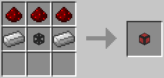

### [ ] #628 Logistics Chassis Pipe Mk2 / 物流制御パイプ Mk2 / LP

* 名称: Logistics Chassis Pipe Mk2 / 日本語: 物流制御パイプ Mk2 / Origin: `-` / New: `bcn:logistics_chassis_pipe_mk2`
* レシピ: `Basic Logistics Pipe` x1 + `Iron Ingot` x8 / `Iron Chipset` x3 / `Basic Logistics Pipe` x1 + `Iron Ingot` x2 + `Iron Ingot` x3 / `Iron Chipset` x1 -> `Logistics Chassis Pipe Mk2` x1
* レシピ配置図: `[000]` / `[000]` / `[000]`
* 概要: 設置後に下に挙げた様々なモジュール(＝ソフトウェア)をセットする事で、 様々な機能を組み合わせつつ複合的に持たせる事ができるが、 これ自体は単なるモジュールの容れ物(＝ハードウェア)に過ぎない. Mk1からMk5まで存在し、 Mk1～4はそれぞれ1～4個のモジュールを同時にセットできる. Mk5のみ8つ同時セットが可能だが、コスト的に使う機会はほぼ無い. Dev571のレシピ変更にて、全体的にコストが低減され作りやすくなった（特にMk5）
* 専用GUI: 有 — モジュール装着スロット
* 実装方法:

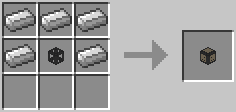

### [ ] #629 Logistics Chassis Pipe Mk3 / 物流制御パイプ Mk3 / LP

* 名称: Logistics Chassis Pipe Mk3 / 日本語: 物流制御パイプ Mk3 / Origin: `-` / New: `bcn:logistics_chassis_pipe_mk3`
* レシピ: `Basic Logistics Pipe` x1 + `Gold Ingot` x8 / `Golden Chipset` x3 / `Basic Logistics Pipe` x1 + `Iron Ingot` x2 + `Iron Ingot` x6 / `Iron Chipset` x2 -> `Logistics Chassis Pipe Mk3` x1
* レシピ配置図: `[000]` / `[000]` / `[000]`
* 概要: 設置後に下に挙げた様々なモジュール(＝ソフトウェア)をセットする事で、 様々な機能を組み合わせつつ複合的に持たせる事ができるが、 これ自体は単なるモジュールの容れ物(＝ハードウェア)に過ぎない. Mk1からMk5まで存在し、 Mk1～4はそれぞれ1～4個のモジュールを同時にセットできる. Mk5のみ8つ同時セットが可能だが、コスト的に使う機会はほぼ無い. Dev571のレシピ変更にて、全体的にコストが低減され作りやすくなった（特にMk5）
* 専用GUI: 有 — モジュール装着スロット
* 実装方法:

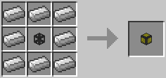

### [ ] #630 Logistics Chassis Pipe Mk4 / 物流制御パイプ Mk4 / LP

* 名称: Logistics Chassis Pipe Mk4 / 日本語: 物流制御パイプ Mk4 / Origin: `-` / New: `bcn:logistics_chassis_pipe_mk4`
* レシピ: `Basic Logistics Pipe` x1 + `Diamond` x8 / `Diamond Chipset` x3 / `Basic Logistics Pipe` x1 + `Iron Ingot` x2 + `Gold Ingot` x3 + `Golden Chipset` x1 -> `Logistics Chassis Pipe Mk4` x1
* レシピ配置図: `[000]` / `[000]` / `[000]`
* 概要: 設置後に下に挙げた様々なモジュール(＝ソフトウェア)をセットする事で、 様々な機能を組み合わせつつ複合的に持たせる事ができるが、 これ自体は単なるモジュールの容れ物(＝ハードウェア)に過ぎない. Mk1からMk5まで存在し、 Mk1～4はそれぞれ1～4個のモジュールを同時にセットできる. Mk5のみ8つ同時セットが可能だが、コスト的に使う機会はほぼ無い. Dev571のレシピ変更にて、全体的にコストが低減され作りやすくなった（特にMk5）
* 専用GUI: 有 — モジュール装着スロット
* 実装方法:

### [ ] #631 Logistics Chassis Pipe Mk5 / 物流制御パイプ Mk5 / LP

* 名称: Logistics Chassis Pipe Mk5 / 日本語: 物流制御パイプ Mk5 / Origin: `-` / New: `bcn:logistics_chassis_pipe_mk5`
* レシピ: `Basic Logistics Pipe` x1 + `Gold Block` x4 + `Diamond Block` x4 / `物流制御パイプMk` x41 + `Diamond Chipset` x1 -> `Logistics Chassis Pipe Mk5` x1
* レシピ配置図: `[000]` / `[000]` / `[000]`
* 概要: 設置後に下に挙げた様々なモジュール(＝ソフトウェア)をセットする事で、 様々な機能を組み合わせつつ複合的に持たせる事ができるが、 これ自体は単なるモジュールの容れ物(＝ハードウェア)に過ぎない. Mk1からMk5まで存在し、 Mk1～4はそれぞれ1～4個のモジュールを同時にセットできる. Mk5のみ8つ同時セットが可能だが、コスト的に使う機会はほぼ無い. Dev571のレシピ変更にて、全体的にコストが低減され作りやすくなった（特にMk5）
* 専用GUI: 有 — モジュール装着スロット
* 実装方法:

### [ ] #632 ItemSink module / 回収モジュール / LP

* 名称: ItemSink module / 日本語: 回収モジュール / Origin: `-` / New: `bcn:itemsink_module`
* レシピ: `Blank module` x1 + `Redstone` x3 + `Green Dye` x2 + `Iron Chipset` x1 / `Blank module` x1 + `Green Dye` x2 + `Iron Chipset` x1 + `Redstone` x2 -> `ItemSink module` x1
* レシピ配置図: `[000]` / `[000]` / `[000]`
* 概要: 基本パイプと同じ作用を持つモジュール. 内部GUIの仕様も同じ. インベントリ満載時の対処能力という点で基本パイプの上な一方、 複数のインベントリと同時に隣接していても 回収物は橙ラベル側にあるインベントリにしか搬入しない.
* 専用GUI: 有 — ロジスティクスレンチによる設定画面
* 実装方法:

### [ ] #633 Polymorphic ItemSink module / 読取回収モジュール / LP

* 名称: Polymorphic ItemSink module / 日本語: 読取回収モジュール / Origin: `-` / New: `bcn:polymorphic_itemsink_module`
* レシピ: `Blank module` x1 + `Redstone` x3 + `Orange Dye` x2 + `Iron Chipset` x1 / `Blank module` x1 + `Orange Dye` x2 + `Iron Chipset` x1 + `Redstone` x2 -> `Polymorphic ItemSink module` x1
* レシピ配置図: `[000]` / `[000]` / `[000]`
* 概要: 回収モジュールとほぼ同じだが、こちらはGUIを持たず、 代わりに隣接ブロック内のインベントリに置かれたアイテムを読み取り、 それらが配管内で目的を見失った場合回収する. 隣接インベントリ内の全アイテムが搬出されると機能を失う性質のため、 供給モジュールの［Leave 1 item per stack］との併用が必須.
* 専用GUI: 有 — ロジスティクスレンチによる設定画面
* 実装方法:

### [ ] #634 Terminus ItemSink module / 終端回収モジュール / LP

* 名称: Terminus ItemSink module / 日本語: 終端回収モジュール / Origin: `-` / New: `bcn:terminus_itemsink_module`
* レシピ: `Blank module` x1 + `Redstone` x3 + `Ink Sac` x1 + `Purple Dye` x1 + `Iron Chipset` x1 / `Blank module` x1 + `Ink Sac` x1 + `Purple Dye` x1 + `Iron Chipset` x1 + `Redstone` x2 -> `Terminus ItemSink module` x1
* レシピ配置図: `[000]` / `[000]` / `[000]`
* 概要: 回収モジュールと同じ仕様＆効果だが、 回収地点としての優先順位が1ランク低い（Default Route設定よりは上） なのでそのアイテムの回収ポイントを複数用意する場合、 距離に関係なくこのモジュールの隣接インベントリを一番最後にできる.
* 専用GUI: 有 — ロジスティクスレンチによる設定画面
* 実装方法:

### [ ] #635 Passive Supplier module / 消極補給モジュール / LP

* 名称: Passive Supplier module / 日本語: 消極補給モジュール / Origin: `-` / New: `bcn:passive_supplier_module`
* レシピ: `Blank module` x1 + `Redstone` x3 + `Red Dye` x4 + `Iron Chipset` x1 / `Blank module` x1 + `Red Dye` x2 + `Iron Chipset` x1 + `Redstone` x2 -> `Passive Supplier module` x1
* レシピ配置図: `[000]` / `[000]` / `[000]`
* 概要: 補給の名こそ冠しているが、性質は回収モジュールに近い. 指定アイテムに関し、発送側に宛先指定されなかったものを回収. （基本パイプや回収モジュールより優先順位が高い） そして回収するのは隣接インベントリ内の指定アイテム総数が 指定個数未満の間だけであり、指定個数以上になると回収しなくなる.
* 専用GUI: 有 — ロジスティクスレンチによる設定画面
* 実装方法:

### [ ] #636 Mod Based ItemSink module / MOD指定回収モジュール / LP

* 名称: Mod Based ItemSink module / 日本語: MOD指定回収モジュール / Origin: `-` / New: `bcn:mod_based_itemsink_module`
* レシピ: `ItemSink module` x1 + `Golden Chipset` x1 -> `Mod Based ItemSink module` x1
* レシピ配置図: `[000]` / `[000]` / `[000]`
* 概要: アイテムを提供しているMOD単位で回収の可否を指定できる. Forgeの導入MOD一覧画面で"X child mods"が0でない場合、最大でその分だけこのモジュールでの設定項目も分割されている. （例えばBCなら、"BuildCraft:（Builders/Energy/Factory/Silicon/Transport）"の5つに分かれている） 最大で9MODまで指定可能.
* 専用GUI: 有 — ロジスティクスレンチによる設定画面
* 実装方法:

### [ ] #637 Enchantment Sink module / エンチャント回収モジュール / LP

* 名称: Enchantment Sink module / 日本語: エンチャント回収モジュール / Origin: `-` / New: `bcn:enchantment_sink_module`
* レシピ: `ItemSink module` x1 + `Enchanted Book` x1 -> `Enchantment Sink module` x1
* レシピ配置図: `[000]` / `[000]` / `[000]`
* 概要: 
* 専用GUI: 有 — ロジスティクスレンチによる設定画面
* 実装方法:

### [ ] #638 Enchantment Sink module Mk2 / エンチャント回収モジュールMk2 / LP

* 名称: Enchantment Sink module Mk2 / 日本語: エンチャント回収モジュールMk2 / Origin: `-` / New: `bcn:enchantment_sink_module_mk2`
* レシピ: `Enchantment Sink module` x1 + `Golden Chipset` x1 / `Gold Gear` x1 -> `Enchantment Sink module Mk2` x1
* レシピ配置図: `[000]` / `[000]` / `[000]`
* 概要: 
* 専用GUI: 有 — ロジスティクスレンチによる設定画面
* 実装方法:

### [ ] #639 Creative Tab Based ItemSink module / クリエイティブタブ指定回収モジュール / LP

* 名称: Creative Tab Based ItemSink module / 日本語: クリエイティブタブ指定回収モジュール / Origin: `-` / New: `bcn:creative_tab_based_itemsink_module`
* レシピ: `OreDict ItemSink module` x1 + `Golden Chipset` x1 / `Gold Gear` x1 -> `Creative Tab Based ItemSink module` x1
* レシピ配置図: `[000]` / `[000]` / `[000]`
* 概要: 
* 専用GUI: 有 — ロジスティクスレンチによる設定画面
* 実装方法:

### [ ] #640 OreDict ItemSink module / 鉱石辞書回収モジュール / LP

* 名称: OreDict ItemSink module / 日本語: 鉱石辞書回収モジュール / Origin: `-` / New: `bcn:oredict_itemsink_module`
* レシピ: `Mod-Based Item Sink Module` x1 + `Book` x1 -> `OreDict ItemSink module` x1
* レシピ配置図: `[000]` / `[000]` / `[000]`
* 概要: 
* 専用GUI: 有 — ロジスティクスレンチによる設定画面
* 実装方法:

### [ ] #641 Provider module / 供給モジュール / LP

* 名称: Provider module / 日本語: 供給モジュール / Origin: `-` / New: `bcn:provider_module`
* レシピ: `Blank module` x1 + `Redstone` x3 + `Lapis Lazuli` x2 + `Golden Chipset` x1 / `Blank module` x1 + `Lapis Lazuli` x2 + `Golden Chipset` x1 + `Redstone` x2 -> `Provider module` x1
* レシピ配置図: `[000]` / `[000]` / `[000]`
* 概要: 供給パイプのモジュール版で、供給パイプの6倍の発送速度. （1tickに1回、1個ずつ発送、秒間20個） が、隣接するインベントリの内容物を全て認識できる供給パイプと違い、 橙ラベル側にあるインベントリ1個の内容物しか認識できない為、 大規模施設においては配管時の建築コストが膨れ上がりがち.
* 専用GUI: 有 — ロジスティクスレンチによる設定画面
* 実装方法:

### [ ] #642 Provider module Mk2 / 供給モジュールMk2 / LP

* 名称: Provider module Mk2 / 日本語: 供給モジュールMk2 / Origin: `-` / New: `bcn:provider_module_mk2`
* レシピ: `Provider module` x1 + `Diamond Chipset` x1 -> `Provider module Mk2` x1
* レシピ配置図: `[000]` / `[000]` / `[000]`
* 概要: 1tick毎に1回、16個ずつ（秒間320個）の発送間隔でアイテムを発送する. BuildCraft3.2.0以前ではデフォルト設定では無印の供給モジュールと同じ性能で、作るだけ無駄だった. ただしBuildCraft3.2.0以前であってもBCのConfigでI:pipes.maxItems=100の値を1000以上に書き換えると、 （1tickに1回、最大16個ずつのアイテムをスタック発送、秒間320個） の高速モードでアイテムを発送するようになる.
* 専用GUI: 有 — ロジスティクスレンチによる設定画面
* 実装方法:

### [ ] #643 Extractor module / 抽出モジュール / LP

* 名称: Extractor module / 日本語: 抽出モジュール / Origin: `-` / New: `bcn:extractor_module`
* レシピ: `Blank module` x1 + `Redstone` x3 + `Lapis Lazuli` x2 + `Iron Chipset` x1 / `Blank module` x1 + `Lapis Lazuli` x2 + `Iron Chipset` x1 + `Redstone` x2 -> `Extractor module` x1
* レシピ配置図: `[000]` / `[000]` / `[000]`
* 概要: 橙ラベル側にある隣接インベントリから一定間隔でアイテムを吸い出す. ただし要求パイプや補給パイプと違って宛先指定機能が無く、 事前に基本パイプや回収モジュールetc.を使って 回収ポイントを用意しておかないと、アイテムが全く出てこない. 搬出面偽装機能も持つ（←かまど等で便利な機能）
* 専用GUI: 有 — ロジスティクスレンチによる設定画面
* 実装方法:

### [ ] #644 Extractor Mk2 module / 抽出モジュールMk2 / LP

* 名称: Extractor Mk2 module / 日本語: 抽出モジュールMk2 / Origin: `-` / New: `bcn:extractor_mk2_module`
* レシピ: `Extractor module` x1 + `Golden Chipset` x1 -> `Extractor Mk2 module` x1
* レシピ配置図: `[000]` / `[000]` / `[000]`
* 概要: 抽出モジュールの強化版. 通常の抽出モジュールが100tickに1回、アイテム1個発送するのに対し、 こちらは20tickに1回、アイテム1個発送と、発送がより迅速化した. 搬出面偽装機能など、速度以外の仕様は無印と同じ.
* 専用GUI: 有 — ロジスティクスレンチによる設定画面
* 実装方法:

<!-- 画像なし -->

### [ ] #645 Extractor Mk3 module / 抽出モジュールMk3 / LP

* 名称: Extractor Mk3 module / 日本語: 抽出モジュールMk3 / Origin: `-` / New: `bcn:extractor_mk3_module`
* レシピ: `Extractor module` x21 + `Diamond Chipset` x1 -> `Extractor Mk3 module` x1
* レシピ配置図: `[000]` / `[000]` / `[000]`
* 概要: 抽出モジュールの更なる強化版. 100tickに1回＆1個ずつの無印、20tickに1回＆1個ずつのMk2に対し、 これは1tickに1回、1スタックずつアイテムを発送する. Mk2に比べるとあまりにも発送処理が高速＆大量すぎて、 アイテムあふれやラインアウトを頻発させやすく、逆に使い辛い. 搬出面偽装機能など、搬出量＆速度以外の仕様は無印と同じ.
* 専用GUI: 有 — ロジスティクスレンチによる設定画面
* 実装方法:

<!-- 画像なし -->

### [ ] #646 Advanced Extractor module / 抽出モジュール改 / LP

* 名称: Advanced Extractor module / 日本語: 抽出モジュール改 / Origin: `-` / New: `bcn:advanced_extractor_module`
* レシピ: `Extractor module` x1 + `Redstone` x1 -> `Advanced Extractor module` x1
* レシピ配置図: `[000]` / `[000]` / `[000]`
* 概要: 抽出モジュールの亜種. 搬出面偽装機能に加えて、Include＆Exclude機能も獲得した. GUIで指定したアイテムだけを発送させたり(Include) 逆に指定したアイテム以外を発送させたりできる(Exclude) 搬出速度は抽出モジュールと同じく、100tickに1回、1個ずつ.
* 専用GUI: 有 — ロジスティクスレンチによる設定画面
* 実装方法:

### [ ] #647 Advanced Extractor Mk2 module / 抽出モジュール改Mk2 / LP

* 名称: Advanced Extractor Mk2 module / 日本語: 抽出モジュール改Mk2 / Origin: `-` / New: `bcn:advanced_extractor_mk2_module`
* レシピ: `Advanced Extractor module` x1 + `Golden Chipset` x1 -> `Advanced Extractor Mk2 module` x1
* レシピ配置図: `[000]` / `[000]` / `[000]`
* 概要: 抽出モジュール改の強化版. 搬出速度が20tickに1回1個ずつになった以外、無印と同じ仕様.
* 専用GUI: 有 — ロジスティクスレンチによる設定画面
* 実装方法:

<!-- 画像なし -->

### [ ] #648 Advanced Extractor Mk3 module / 抽出モジュール改Mk3 / LP

* 名称: Advanced Extractor Mk3 module / 日本語: 抽出モジュール改Mk3 / Origin: `-` / New: `bcn:advanced_extractor_mk3_module`
* レシピ: `Extractor module` x21 + `Diamond Chipset` x1 -> `Advanced Extractor Mk3 module` x1
* レシピ配置図: `[000]` / `[000]` / `[000]`
* 概要: 抽出モジュール改の更なる強化版. 搬出速度が1tickに1回1スタックずつになった以外、Mk1と同じ仕様. あまりにも発送が速すぎて、やはり使い辛い.
* 専用GUI: 有 — ロジスティクスレンチによる設定画面
* 実装方法:

<!-- 画像なし -->

### [ ] #649 QuickSort module / 高速分別モジュール / LP

* 名称: QuickSort module / 日本語: 高速分別モジュール / Origin: `-` / New: `bcn:quicksort_module`
* レシピ: `Blank module` x1 + `Redstone` x3 + `Lapis Lazuli` x2 + `Diamond Chipset` x1 / `Blank module` x1 + `Lapis Lazuli` x2 + `Diamond Chipset` x1 + `Redstone` x2 -> `QuickSort module` x1
* レシピ配置図: `[000]` / `[000]` / `[000]`
* 概要: ネットワーク内に存在する回収系の全パイプ＆モジュールを検索、 回収アイテムが指定されているものを把握した後、 隣接インベントリの内容物をそれに合わせて高速仕分け発送する. （ただしDefault Route指定のは無視する） 64個スタック単位で発送するので迅速な仕分け分別が可能だが、 抽出Mk3程ではないが、あまりにも発送処理が高速＆大量すぎて、 アイテムあふれやラインアウトの原因になりやすい.
* 専用GUI: 有 — ロジスティクスレンチによる設定画面
* 実装方法:

### [ ] #650 Active Supplier module / 積極補給モジュール / LP

* 名称: Active Supplier module / 日本語: 積極補給モジュール / Origin: `-` / New: `bcn:active_supplier_module`
* レシピ: `Passive Supplier module` x1 + `Golden Chipset` x1 + `Redstone` x2 -> `Active Supplier module` x1
* レシピ配置図: `[000]` / `[000]` / `[000]`
* 概要: 
* 専用GUI: 有 — ロジスティクスレンチによる設定画面
* 実装方法:

### [ ] #651 Crafting module / 加工モジュール / LP

* 名称: Crafting module / 日本語: 加工モジュール / Origin: `-` / New: `bcn:crafting_module`
* レシピ: `Blank module` x1 + `Red Dye` x1 + `Lapis Lazuli` x1 + `Iron Chipset` x1 + `Iron Gear` x1 -> `Crafting module` x1
* レシピ配置図: `[000]` / `[000]` / `[000]`
* 概要: 
* 専用GUI: 有 — クラフト設定
* 実装方法:

### [ ] #652 Crafting module Mk2 / 加工モジュールMk2 / LP

* 名称: Crafting module Mk2 / 日本語: 加工モジュールMk2 / Origin: `-` / New: `bcn:crafting_module_mk2`
* レシピ: `Crafting module` x1 + `Golden Chipset` x1 / `Gold Gear` -> `Crafting module Mk2` x1
* レシピ配置図: `[000]` / `[000]` / `[000]`
* 概要: 加工パイプMk2のモジュール版.
* 専用GUI: 有 — クラフト設定
* 実装方法:

### [ ] #653 Crafting module Mk3 / 加工モジュールMk3 / LP

* 名称: Crafting module Mk3 / 日本語: 加工モジュールMk3 / Origin: `-` / New: `bcn:crafting_module_mk3`
* レシピ: `Provider module` x1 + `Diamond Chipset` x1 -> `Crafting module Mk3` x1
* レシピ配置図: `[000]` / `[000]` / `[000]`
* 概要: 加工パイプMk3のモジュール版.
* 専用GUI: 有 — クラフト設定
* 実装方法:

### [ ] #654 Bee Analyzer Logistics Pipe / 蜂鑑定パイプ / LP

* 名称: Bee Analyzer Logistics Pipe / 日本語: 蜂鑑定パイプ / Origin: `-` / New: `bcn:bee_analyzer_logistics_pipe`
* レシピ: `Redstone` x3 + `Propolis` x4 + `Iron Chipset` x1 / `Basic Logistics Pipe` x1 / `Liquid Honey 1500mB` / `MJ` x640 -> `Bee Analyzer Logistics Pipe` x1
* レシピ配置図: `[000]` / `[000]` / `[000]`
* 概要: FFMの蜂限定でだが、回収と抽出、両方の機能を発揮する. 配管内に存在する全ての未鑑定蜂を回収し、隣接インベントリに格納. 更に隣接インベントリ内に鑑定済みの蜂が置かれていて、 かつ配管内にその蜂の回収ポイントがあるなら、5秒に1回1個搬出する. 隣が設置型分析機でなくとも、インベントリならば機能する.
* 専用GUI: 有 — ロジスティクス設定画面
* 実装方法:

<!-- 画像なし -->

### [ ] #655 BeeSink Logistics Pipe / 蜂回収パイプ / LP

* 名称: BeeSink Logistics Pipe / 日本語: 蜂回収パイプ / Origin: `-` / New: `bcn:beesink_logistics_pipe`
* レシピ: `Redstone` x4 + `Propolis` x4 / `Basic Logistics Pipe` x1 / `Liquid Honey 1500mB` / `MJ` x640 -> `BeeSink Logistics Pipe` x1
* レシピ配置図: `[000]` / `[000]` / `[000]`
* 概要: 養蜂パイプのロジスティクス版で、GUIで指定した条件の蜂に関し、 配管内にあるものを回収、隣接インベントリに格納する. 自然にいない蜂は、交配で作り出した後でないと品種指定できない. FFMの養蜂パイプと違い、蜂以外のアイテムは回収指定できない.
* 専用GUI: 有 — ロジスティクス設定画面
* 実装方法:

<!-- 画像なし -->

### [ ] #656 Bee Analyzer module / 蜂鑑定モジュール / LP

* 名称: Bee Analyzer module / 日本語: 蜂鑑定モジュール / Origin: `-` / New: `bcn:bee_analyzer_module`
* レシピ: `Redstone` x3 + `Propolis` x4 + `Iron Chipset` x1 / `Blank module` x1 / `Liquid Honey 1500mB` / `MJ` x640 -> `Bee Analyzer module` x1
* レシピ配置図: `[000]` / `[000]` / `[000]`
* 概要: そのまま蜂鑑定パイプのモジュール版.
* 専用GUI: 有 — ロジスティクスレンチによる設定画面
* 実装方法:

<!-- 画像なし -->

### [ ] #657 BeeSink module / 蜂回収モジュール / LP

* 名称: BeeSink module / 日本語: 蜂回収モジュール / Origin: `-` / New: `bcn:beesink_module`
* レシピ: `Redstone` x4 + `Propolis` x4 / `Blank module` x1 / `Liquid Honey 1500mB` / `MJ` x640 -> `BeeSink module` x1
* レシピ配置図: `[000]` / `[000]` / `[000]`
* 概要: そのまま蜂回収パイプのモジュール版.
* 専用GUI: 有 — ロジスティクスレンチによる設定画面
* 実装方法:

<!-- 画像なし -->

### [ ] #658 Apiary Refiller module / 蜂再補充モジュール / LP

* 名称: Apiary Refiller module / 日本語: 蜂再補充モジュール / Origin: `-` / New: `bcn:apiary_refiller_module`
* レシピ: `Redstone` x2 + `Propolis` x2 + `Pollen` x1 + `Wooden Transport Pipe` x1 / `Blank module` x1 / `Liquid Honey 1500mB` / `MJ` x640 -> `Apiary Refiller module` x1
* レシピ配置図: `[000]` / `[000]` / `[000]`
* 概要: 同一品種を突然変異なしに繰り返し交配し続ける為のモジュールで、 女王蜂が寿命を迎えた後、生まれたDroneとPrincessを1匹ずつ、 養蜂箱の交配用スロットに自動で入れ直すのに使用する……のだが、 v0.6.1preの時点では動作不安定、正常に動作してくれない.
* 専用GUI: 有 — ロジスティクスレンチによる設定画面
* 実装方法:

<!-- 画像なし -->

### [ ] #659 Drone Terminus module / Drone終端モジュール / LP

* 名称: Drone Terminus module / 日本語: Drone終端モジュール / Origin: `-` / New: `bcn:drone_terminus_module`
* レシピ: `Redstone` x3 + `Ink Sac` x2 + `Purple Dye` x2 + `Pollen` x1 / `Blank module` x1 / `Liquid Honey 1500mB` / `MJ` x640 -> `Drone Terminus module` x1
* レシピ配置図: `[000]` / `[000]` / `[000]`
* 概要: Drone蜂専用の終端回収で、PrincessやQueenは回収の対象外. ネットワーク内に回収ポイントが指定されていないDrone蜂全てを、 ［Default Route］設定の回収ポイントよりは高い優先順位で回収. 要するに"その他大勢"の余分なDrone蜂を回収するのに使う.
* 専用GUI: 有 — ロジスティクスレンチによる設定画面
* 実装方法:

### [ ] #660 Electric Manage module / 充電管理モジュール / LP

* 名称: Electric Manage module / 日本語: 充電管理モジュール / Origin: `-` / New: `bcn:electric_manage_module`
* レシピ: `Blank module` x1 + `Redstone` x3 + `Electronic Circuit` x1 + `Battery` x1 + `Golden Chipset` x1 -> `Electric Manage module` x1
* レシピ配置図: `[000]` / `[000]` / `[000]`
* 概要: IC2の充電可能アイテム限定で、補給と回収、及び抽出の機能を発揮する. ［Charge Items］ならGUI内で指定したアイテムに関し、 配管内の充電99%未満のを回収及び5秒に1回補給、100%になったのを5秒に1回搬出する. ［Discharge Items］ならGUI内で指定したアイテムに関し、 配管内の充電1%以上のを回収及び5秒に1回補給、0%になったのを5秒に1回搬出する. 抽出モジュールと違い、搬出面偽装機能はないので設置面に注意. Dev632より、充電管理モジュールと充電緩衝モジュールへのみ搬出するようになった.
* 専用GUI: 有 — ロジスティクスレンチによる設定画面
* 実装方法:

<!-- 画像なし -->

### [ ] #661 Electric Buffer module / 充電緩衝モジュール / LP

* 名称: Electric Buffer module / 日本語: 充電緩衝モジュール / Origin: `-` / New: `bcn:electric_buffer_module`
* レシピ: `Blank module` x1 + `Redstone` x3 + `Advanced Circuit` x2 + `Golden Chipset` x1 -> `Electric Buffer module` x1
* レシピ配置図: `[000]` / `[000]` / `[000]`
* 概要: IC2の充電可能アイテム限定で、回収と供給、両方の機能を発揮する. GUIはなく、充電可能なアイテムなら全てが対象. Dev632より、充電管理モジュールへのみ搬出するようになった.
* 専用GUI: 有 — ロジスティクスレンチによる設定画面
* 実装方法:

<!-- 画像なし -->

### [ ] #662 Thaumic AspectSink module / 相指定回収モジュール / LP

* 名称: Thaumic AspectSink module / 日本語: 相指定回収モジュール / Origin: `-` / New: `bcn:thaumic_aspectsink_module`
* レシピ: `Blank module` x1 + `Redstone` x3 + `Fire Shard` x1 + `Water Shard` x1 + `Wind Shard` x1 + `Earth Shard` x1 + `Iron Chipset` x1 -> `Thaumic AspectSink module` x1
* レシピ配置図: `[000]` / `[000]` / `[000]`
* 概要: 相を指定することで、指定された相のいずれかを1つ以上持つアイテムの回収ポイントとして機能する. 結晶片は左上に水、右上に地、左下に火、右下に風. もしくはこの左右反転の組み合わせでしか作れないので注意. また、使用素材数の関係か歯車を使った素材増加レシピは存在しない. 最大9種類までの相を指定できるが、GUIがアイテムに含まれる相全てを追加するか、相指定をクリアするかのどちらかしかできないため少々扱いづらい.
* 専用GUI: 有 — ロジスティクスレンチによる設定画面
* 実装方法:

<!-- 画像なし -->

### [ ] #663 Logistics Inventory System Connector / コネクタパイプ / LP

* 名称: Logistics Inventory System Connector / 日本語: コネクタパイプ / Origin: `-` / New: `bcn:logistics_inventory_system_connector`
* レシピ: `Basic Logistics Pipe` x1 + `Ender Pearl` x2 / `Basic Logistics Pipe` x1 + `Ender Pearl` x1 + `Redstone` x2 -> `Logistics Inventory System Connector` x1
* レシピ配置図: `[000]` / `[000]` / `[000]`
* 概要: 空間を超えて繋がるEnderStorage系のチェスト追加MOD、 およびチャンクローダー装置の併用を前提とした擬似テレポートパイプ. バニラのエンダーチェストには使用できない. 空間を越えて中身を共有する2個のチェストの双方にこのパイプを接続、 ペアの周波数カードをセットする事で、 その亜空間チェストを一旦中継する事を通して遠くの2点が結ばれる.
* 専用GUI: 有 — ロジスティクス設定画面
* 実装方法:

<!-- 画像なし -->

### [ ] #664 Logistics System Entrance Pipe / 入口パイプ / LP

* 名称: Logistics System Entrance Pipe / 日本語: 入口パイプ / Origin: `-` / New: `bcn:logistics_system_entrance_pipe`
* レシピ: `Provider Logistics Pipe` x1 + `Green Dye` x1 -> `Logistics System Entrance Pipe` x1
* レシピ配置図: `[000]` / `[000]` / `[000]`
* 概要: このパイプ内を通過したアイテムは、 ペアとなる周波数カードがセットされた出口パイプへとオートで送られる. （途中の分岐点にはきちんとロジパイプが使われている必要がある） ただ、他のロジパイプからリクエストを受けて移動中のアイテムや、 既に特定の回収ポイントに向かって移動中のアイテムには効果がなく、 実質木パイプや黒曜石パイプ等からパイプ内に入ってきた、 ロジパイプ外からの侵入アイテムに対してしか効果がなく使いにくい.
* 専用GUI: 有 — ロジスティクス設定画面
* 実装方法:

### [ ] #665 Logistics System Destination Pipe / 出口パイプ / LP

* 名称: Logistics System Destination Pipe / 日本語: 出口パイプ / Origin: `-` / New: `bcn:logistics_system_destination_pipe`
* レシピ: `Provider Logistics Pipe` x1 + `Red Dye` x1 -> `Logistics System Destination Pipe` x1
* レシピ配置図: `[000]` / `[000]` / `[000]`
* 概要: ペアとなる周波数カードがセットされた入口パイプから 送られてきたアイテムにとっての、目的地として作用するパイプ. 上記の入口パイプで述べた性質により、使いにくい.
* 専用GUI: 有 — ロジスティクス設定画面
* 実装方法:

### [ ] #666 Logistics Firewall Pipe / ファイアーウォールパイプ / LP

* 名称: Logistics Firewall Pipe / 日本語: ファイアーウォールパイプ / Origin: `-` / New: `bcn:logistics_firewall_pipe`
* レシピ: `Basic Logistics Pipe` x1 + `Iron Transport Pipe` x3 + `Nether Brick` x4 + `Diamond Chipset` x1 + `Iron Ingot` x1 / `Basic Logistics Pipe` x1 + `Nether Brick` x4 + `Diamond Chipset` x1 + `Iron Ingot` x1 -> `Logistics Firewall Pipe` x1
* レシピ配置図: `[000]` / `[000]` / `[000]`
* 概要: ネットワーク同士を分離したまま、一部要素を共有することができるパイプ. このパイプと繋がっているネットワーク間での、指定アイテムのみの共有、共有禁止の設定が可能な他、 供給、加工、高速分別について共有の可否がそれぞれ設定可能. 以前はLPを別なネットワークへ通すことはなかったが、Dev427よりLPの供給可否も設定できるようになった. これにより、"ネットワークは分割したままLPのみ一括管理"という配管も可能に.
* 専用GUI: 有 — フィルタ設定
* 実装方法:

### [ ] #667 Unrouted Transport Pipe / 不定経路輸送パイプ / LP

* 名称: Unrouted Transport Pipe / 日本語: 不定経路輸送パイプ / Origin: `logisticspipes:pipe_transport_basic` / New: `bcn:unrouted_transport_pipe`
* レシピ: `Iron Ingot` x4 + `Redstone` x2 + `Block Glass` x2 -> `Unrouted Transport Pipe` x8
* レシピ配置図: `ABA` / `C0C` / `ABA`
* 概要: LPを消費してパイプ内のアイテム輸送速度を他のロジパイプと同じ速度に保つパイプ. パイプにのみ接続し、一切のコンテナに接続しない. BCのパイプ同様乱数に基づいた確率によって分岐するため分岐点にも使えない. ただ、コストが安いのでBCのパイプの代わりに利用するとよいかもしれない. 現在、どのバージョンから追加されたのか捜索中.
* 専用GUI: 有 — ロジスティクスレンチによる設定画面
* 実装方法:

### [ ] #668 Soldering Station / 溶接作業台 / LP

* 名称: Soldering Station / 日本語: 溶接作業台 / Origin: `-` / New: `bcn:soldering_station`
* レシピ: `Crafting Table` x1 + `Redstone` x1 + `Iron Ingot` x6 -> `Soldering Station` x1
* レシピ配置図: `[000]` / `[000]` / `[000]`
* 概要: このMODで追加される一部の特殊アイテム作成のための専用作業台. （※本当に一部の特殊かつ変則的なアイテムの作成にしか使用しない） BuildCraftのエンジン動力(MJ)で稼動し、(1.7.10以降は下ページ参照） 加工1回毎に鉄インゴットを1個、燃料代わりに消費する.
* 専用GUI: 有 — 溶接作業台GUI
* 実装方法:

### [ ] #669 Nano Hopper / ナノ漏斗 / LP

* 名称: Nano Hopper / 日本語: ナノ漏斗 / Origin: `-` / New: `bcn:nano_hopper`
* レシピ: `漏斗BC` x8 + `Iron Ingot` x1 / `Hopper` x8 + `Iron Ingot` x1 -> `Nano Hopper` x1
* レシピ配置図: `[000]` / `[000]` / `[000]`
* 概要: 加工パイプMk3の作成に必要となる中間部品. 単体では何にも使えない.
* 専用GUI: 有 — ロジスティクスレンチによる設定画面
* 実装方法:

### [ ] #670 Logistics Item Card / 周波数カード / LP

* 名称: Logistics Item Card / 日本語: 周波数カード / Origin: `-` / New: `bcn:logistics_item_card`
* レシピ: `Blank module` x1 + `Ender Pearl` x4 + `Iron Ingot` x1 / `Blank module` x2 + `Ender Pearl` x1 + `Iron Chipset` x2 + `Iron Ingot` x1 -> `Logistics Item Card` x1
* レシピ配置図: `[000]` / `[000]` / `[000]`
* 概要: コネクタパイプ各種を動作させるのに必要なカード. 加工時に2個スタックされて作成されたもの同士がペアになっており、 リンクさせたいコネクタパイプ2個にそれらをセットする必要がある. 既出の周波数のカードの再作成はできないため、 片方でも無くした場合、ペアごと新しく作り直さなければならなくなる.
* 専用GUI: 有 — ロジスティクス設定画面
* 実装方法:

<!-- 画像なし -->

### [ ] #671 Logistics HUD Bow / 眼鏡のツル / LP

* 名称: Logistics HUD Bow / 日本語: 眼鏡のツル / Origin: `-` / New: `bcn:logistics_hud_bow`
* レシピ: `Diamond` x3 + `Diamond Chipset` x1 + `Iron Ingot` x1 -> `Logistics HUD Bow` x1
* レシピ配置図: `[000]` / `[000]` / `[000]`
* 概要: 
* 専用GUI: 有 — ロジスティクス設定画面
* 実装方法:

<!-- 画像なし -->

### [ ] #672 Logistics HUD Glass / 眼鏡のレンズ / LP

* 名称: Logistics HUD Glass / 日本語: 眼鏡のレンズ / Origin: `-` / New: `bcn:logistics_hud_glass`
* レシピ: `Glass` x1 + `Diamond Chipset` x1 + `Glowstone Dust` x7 + `Iron Ingot` x1 -> `Logistics HUD Glass` x1
* レシピ配置図: `[000]` / `[000]` / `[000]`
* 概要: 
* 専用GUI: 有 — ロジスティクス設定画面
* 実装方法:

<!-- 画像なし -->

### [ ] #673 Logistics HUD Nose / 眼鏡のブリッジ / LP

* 名称: Logistics HUD Nose / 日本語: 眼鏡のブリッジ / Origin: `-` / New: `bcn:logistics_hud_nose`
* レシピ: `Diamond` x2 + `Diamond Chipset` x1 + `Iron Ingot` x1 -> `Logistics HUD Nose` x1
* レシピ配置図: `[000]` / `[000]` / `[000]`
* 概要: 
* 専用GUI: 有 — ロジスティクス設定画面
* 実装方法:

<!-- 画像なし -->

### [ ] #674 Logistics HUD Glasses / ロジスティクス眼鏡 / LP

* 名称: Logistics HUD Glasses / 日本語: ロジスティクス眼鏡 / Origin: `-` / New: `bcn:logistics_hud_glasses`
* レシピ: `Bridge Tube` x1 + `Lens` x2 + `Vines` x2 + `Iron Ingot` x1 -> `Logistics HUD Glasses` x1
* レシピ配置図: `[000]` / `[000]` / `[000]`
* 概要: 
* 専用GUI: 有 — ロジスティクス設定画面
* 実装方法:

<!-- 画像なし -->

### [ ] #675 Logistics Request Table / 要求作業台 / LP

* 名称: Logistics Request Table / 日本語: 要求作業台 / Origin: `logisticspipes:pipe_request_table` / New: `bcn:logistics_request_table`
* レシピ: `Chip Advanced` x1 + `Pipe Request Mk2` x1 + `Frame` x1 + `Pipe Crafting` x1 + `Chest Wood` x1 -> `Logistics Request Table` x1
* レシピ配置図: `0A0` / `BCD` / `0E0`
* 概要: 
* 専用GUI: 有 — 要求画面
* 実装方法:

### [ ] #676 Reset Pipe / パイプの初期化 / LP

* 名称: Reset Pipe / 日本語: パイプの初期化 / Origin: `-` / New: `bcn:reset_pipe`
* レシピ: なし
* レシピ配置図: `[000]` / `[000]` / `[000]`
* 概要: 
* 専用GUI: 有 — ロジスティクスレンチによる設定画面
* 実装方法:

### [ ] #677 Reset Module / モジュールの初期化 / LP

* 名称: Reset Module / 日本語: モジュールの初期化 / Origin: `-` / New: `bcn:reset_module`
* レシピ: なし
* レシピ配置図: `[000]` / `[000]` / `[000]`
* 概要: 全てのモジュールは、再クラフトする事で内部設定を初期化できる. 本来、一度GUI内で設定変更したモジュールは、 取り外しても設定を保持する性質上スタック不能になってしまうが、 こうする事で再びスタック可能な初期状態に戻す事ができる.
* 専用GUI: 有 — ロジスティクスレンチによる設定画面
* 実装方法:

### [ ] #678 Crafting Sign Creator / サインクリエイター / LP

* 名称: Crafting Sign Creator / 日本語: サインクリエイター / Origin: `-` / New: `bcn:crafting_sign_creator`
* レシピ: `Sign` x1 + `Golden Chipset` x2 + `Diamond Chipset` x1 -> `Crafting Sign Creator` x1
* レシピ配置図: `[000]` / `[000]` / `[000]`
* 概要: 他のツールと違って耐久値101、使用回数が有限なのに注意. "加工パイプ"または"加工パイプMk2"の側面をこれで右クリックすると、 作成物の情報が記された木板がパイプ側面に取り付けられる. （＝加工パイプの取り扱いアイテムを外見から可視可能にするのに使う）
* 専用GUI: 有 — クラフト設定
* 実装方法:

<!-- 画像なし -->

### [ ] #679 Remote Orderer / リモートオーダー / LP

* 名称: Remote Orderer / 日本語: リモートオーダー / Origin: `logisticspipes:remote_orderer` / New: `bcn:remote_orderer`
* レシピ: `Chip Advanced` x2 + `Gold Ingot` x1 + `Redstone` x3 + `Block Glass` x1 + `Gem Lapis` x2 -> `Remote Orderer` x1
* レシピ配置図: `ABA` / `CDE` / `CCE`
* 概要: これで各種ロジパイプ(通常パイプは×)を右クリックすると、 要求パイプと同じGUIが出現、その場にアイテムを取り寄せられる. チェストetc.に隣接していない場所でも取り寄せは可能だが、 その場合、送られてきたアイテムはその場にラインアウトする. Dev612より、遠隔要求パイプでの使用にLPが必要となった（距離と同量. 次元を跨ぐ場合は+500）
* 専用GUI: 有 — 遠隔発注画面
* 実装方法:

### [ ] #680 色付き/全16色 / リモートオーダー / LP

* 名称: 色付き/全16色 / 日本語: リモートオーダー / Origin: `-` / New: `bcn:item_3`
* レシピ: `Dye` x1 + `Remote Orderer` x1 -> `色付き` x1
* レシピ配置図: `[000]` / `[000]` / `[000]`
* 概要: 強度7 失敗作
* 専用GUI: 有 — ロジスティクスレンチによる設定画面
* 実装方法:

<!-- 画像なし -->

### [ ] #681 再染色/全16色 / リモートオーダー / LP

* 名称: 再染色/全16色 / 日本語: リモートオーダー / Origin: `-` / New: `bcn:item_4`
* レシピ: `Dye` x1 + `全16色` -> `再染色` x1
* レシピ配置図: `[000]` / `[000]` / `[000]`
* 概要: 強度7 失敗作
* 専用GUI: 有 — ロジスティクスレンチによる設定画面
* 実装方法:

<!-- 画像なし -->

### [ ] #682 Network monitor / ネットワークモニター / LP

* 名称: Network monitor / 日本語: ネットワークモニター / Origin: `-` / New: `bcn:network_monitor`
* レシピ: `Golden Chipset` x1 + `Gold Ingot` x3 -> `Network monitor` x1
* レシピ配置図: `[000]` / `[000]` / `[000]`
* 概要: 手に持ってロジパイプを右クリックすると、 そのロジパイプのデータおよび輸送履歴が書かれたGUIが開く. 何らかの検証目的で統計を取るとかならともかく、 普通にプレイする範囲ではこれを作る必要も使う出番もない. ただし、アップグレーダーの材料でもある.
* 専用GUI: 有 — ロジスティクスレンチによる設定画面
* 実装方法:

### [ ] #683 Upgrade Manager / アップグレーダー / LP

* 名称: Upgrade Manager / 日本語: アップグレーダー / Origin: `-` / New: `bcn:upgrade_manager`
* レシピ: `Network monitor` x1 + `Wrench (BC)` x1 -> `Upgrade Manager` x1
* レシピ配置図: `[000]` / `[000]` / `[000]`
* 概要: ツール. 耐久値∞. スタック可能. これを手に持った状態で各種ロジパイプ(全種)を右クリックすると、 アップグレードチップ着脱用の専用GUIが開く. ただしチップを持ってロジパイプを右クリックする方法でも挿入できる他、ロジパイプを一旦撤去する事でも挿入済みチップの取り外しは可能.
* 専用GUI: 無
* 実装方法:

<!-- 画像なし -->

### [ ] #684 Logistics Pipe Controller / パイプコントローラー / LP

* 名称: Logistics Pipe Controller / 日本語: パイプコントローラー / Origin: `-` / New: `bcn:logistics_pipe_controller`
* レシピ: `Gold Gear` x1 + `Gold Ingot` x3 -> `Logistics Pipe Controller` x1
* レシピ配置図: `[000]` / `[000]` / `[000]`
* 概要: 以前のネットワークモニターとアップグレーダーの機能を併せ持つ.
* 専用GUI: 有 — ロジスティクス設定画面
* 実装方法:

### [ ] #685 Logistic Security Station / セキュリティステーション / LP

* 名称: Logistic Security Station / 日本語: セキュリティステーション / Origin: `-` / New: `bcn:logistic_security_station`
* レシピ: `Basic Logistics Pipe` x1 + `Redstone` x2 + `Iron Ingot` x5 + `Diamond Chipset` x1 -> `Logistic Security Station` x1
* レシピ配置図: `[000]` / `[000]` / `[000]`
* 概要: マルチ用装置. シングルでは特に作る必要性はない. この装置で作成できるセキュリティカードをネットワーク内のいずれかのロジパイプに組み込むことで、他人のロジパイプへのアクセスを制限できる. ただしセキュリティステーション自体は誰でもアクセス、破壊可能で、またロジパイプ以外に対してはネットワーク内でも無力である.
* 専用GUI: 有 — ロジスティクスレンチによる設定画面
* 実装方法:

### [ ] #686 Item Speed Upgrade / 速度加速チップ / LP

* 名称: Item Speed Upgrade / 日本語: 速度加速チップ / Origin: `-` / New: `bcn:item_speed_upgrade`
* レシピ: `Iron Chipset` x1 + `Gold Ingot` x4 + `Paper` x4 -> `Item Speed Upgrade` x1
* レシピ配置図: `[000]` / `[000]` / `[000]`
* 概要: このチップが装着されたロジパイプは、通過アイテムを加速させる. このチップのみ、GUI内において1スロットに16個までスタックして置ける. ただし1個を作成するためのコストが非常に高い割には、 1個あたりの加速力が非常に弱いので、実際には非常に使い所に困る. （DefaultRoute行きのアイテムの場合、12個装着でようやく最高速化） このチップが装着されたロジパイプ(種類問わず)から、 隣接しているインベントリ内包ブロックにアイテム搬入がなされた場合、 必ず指定面から搬入された扱いになる(この場合は上面から) あくまで偽装するのは搬入のみで、搬出偽装効果はない. （というか搬出の偽装の方は抽出モジュールに役割が一任されている） 同上. 接続面が違っていても、必ず"下面から搬入した"事になる. 同上. 接続面が違っていても、必ず"側面(北)から搬入した"事になる. 同上. 接続面が違っていても、必ず"側面(南)から搬入した"事になる. 同上. 接続面が違っていても、必ず"側面(東)から搬入した"事になる. 同上. 接続面が違っていても、必ず"側面(西)から搬入した"事になる.
* 専用GUI: 無
* 実装方法:

<!-- 画像なし -->

### [ ] #687 Sneaky Combination Upgrade / 搬入偽装組み合わせチップ / LP

* 名称: Sneaky Combination Upgrade / 日本語: 搬入偽装組み合わせチップ / Origin: `-` / New: `bcn:sneaky_combination_upgrade`
* レシピ: `Iron Chipset` x1 + `Redstone` x4 + `Paper` x4 -> `Sneaky Combination Upgrade` x1
* レシピ配置図: `[000]` / `[000]` / `[000]`
* 概要: このチップを装着すると、アップグレードGUIに搬入偽装チップ専用のスロットが9つ追加される. このチップが装着されたロジパイプ(種類問わず)は、 自身の真上に存在するブロック or パイプとは一切連結しなくなる. 既に連結済みだった場合は、装着と同時に切断される. 狭いエリアに複雑な配管を密集させたい場合に便利な一方で、 材料コストの観点から大規模な配管に恒常的に使用するのは難しい. 同上. 自身の真下に存在するブロック or パイプと一切連結しなくなる. 同上. 自身の北隣に存在するブロック or パイプと一切連結しなくなる. 同上. 自身の南隣に存在するブロック or パイプと一切連結しなくなる. 同上. 自身の東隣に存在するブロック or パイプと一切連結しなくなる. 同上. 自身の西隣に存在するブロック or パイプと一切連結しなくなる.
* 専用GUI: 無
* 実装方法:

### [ ] #688 Advanced Satellite Upgrade / 発展型加工補佐チップ / LP

* 名称: Advanced Satellite Upgrade / 日本語: 発展型加工補佐チップ / Origin: `-` / New: `bcn:advanced_satellite_upgrade`
* レシピ: `Golden Chipset` x1 + `Iron Ingot` x4 + `Paper` x4 -> `Advanced Satellite Upgrade` x1
* レシピ配置図: `[000]` / `[000]` / `[000]`
* 概要: （Dev430よりレシピ追加） 加工パイプ(またはモジュール)にのみセット可能. 加工パイプGUI内の材料欄で、全ての材料枠に対してSatelliteIDをそれぞれ個別に設定可能になる.
* 専用GUI: 無
* 実装方法:

### [ ] #689 Fluid Crafting Upgrade / 液体加工補佐チップ / LP

* 名称: Fluid Crafting Upgrade / 日本語: 液体加工補佐チップ / Origin: `-` / New: `bcn:fluid_crafting_upgrade`
* レシピ: `Golden Chipset` x1 + `Redstone` x4 + `Glass Bottle` x4 -> `Fluid Crafting Upgrade` x1
* レシピ配置図: `[000]` / `[000]` / `[000]`
* 概要: 
* 専用GUI: 無
* 実装方法:

### [ ] #690 Crafting Byproduct Extracting Upgrade / 加工副産物排出チップ / LP

* 名称: Crafting Byproduct Extracting Upgrade / 日本語: 加工副産物排出チップ / Origin: `-` / New: `bcn:crafting_byproduct_extracting_upgrade`
* レシピ: `Iron Chipset` x1 + `Redstone` x4 + `Wooden Gear` x4 -> `Crafting Byproduct Extracting Upgrade` x1
* レシピ配置図: `[000]` / `[000]` / `[000]`
* 概要: 
* 専用GUI: 無
* 実装方法:

<!-- 画像なし -->

### [ ] #691 Placement Rules Upgrade / 補給配置規則チップ / LP

* 名称: Placement Rules Upgrade / 日本語: 補給配置規則チップ / Origin: `-` / New: `bcn:placement_rules_upgrade`
* レシピ: `Iron Chipset` x1 + `Redstone` x2 + `Iron Ingot` x3 + `Hopper` x1 + `Red Dye` x1 + `Yellow Dye` x1 -> `Placement Rules Upgrade` x1
* レシピ配置図: `[000]` / `[000]` / `[000]`
* 概要: 
* 専用GUI: 無
* 実装方法:

### [ ] #692 Fuzzy Upgrade / ファジーチップ / LP

* 名称: Fuzzy Upgrade / 日本語: ファジーチップ / Origin: `-` / New: `bcn:fuzzy_upgrade`
* レシピ: `Golden Chipset` x1 + `Paper` x4 + `Nether Quartz` x4 -> `Fuzzy Upgrade` x1
* レシピ配置図: `[000]` / `[000]` / `[000]`
* 概要: 
* 専用GUI: 無
* 実装方法:

(92 項目)
