> [ガイド](./GUIDE.md) > [科学技術ガイド](./GUIDE_TECH.md) > 科学技術の物流制御

# 科学技術の物流制御

ゲート、モジュール、制御チップ、物流管理装置.

### Flood Gate / 水門 / BC

* 実装状態: [ ]
* 名称: Flood Gate / 日本語: 水門 / Origin: `buildcraftfactory:flood_gate` / New: `bcn:flood_gate`
* レシピ: `Iron Ingot` x4 + `Iron Gear` x1 + `Iron Bars` x3 + `Tank` x1 -> `Flood Gate` x1
* レシピ配置図: `ABA` / `CDC` / `ACA`
* 概要: 
* 専用GUI: 無 — 動力を繋ぐのみ
* 実装方法: 

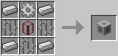

### Gate Copier / ゲートコピー機 / BC

* 実装状態: [ ]
* 名称: Gate Copier / 日本語: ゲートコピー機 / Origin: `-` / New: `bcn:gate_copier`
* レシピ: `Wrench` x1 + `Redstone Chipset` x1 -> `Gate Copier` x1
* レシピ配置図: `[000]` / `[000]` / `[000]`
* 概要: ゲートに右クリックで設定をコピー、Shift+右クリックで貼り付け
* 専用GUI: 有 — ゲート設定の写し
* 実装方法: 

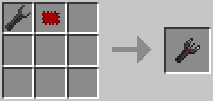

### Gate / 赤石ゲート / BC

* 実装状態: [ ]
* 名称: Gate / 日本語: 赤石ゲート / Origin: `-` / New: `bcn:gate`
* レシピ: `Gate` x1 + `Red Pipe Wire` x1 -> `Gate` x1
* レシピ配置図: `[000]` / `[000]` / `[000]`
* 概要: 特定条件が満たされた場合のトリガー機構として機能する検知ゲート. パイプを設置した後、更にそれに被せるようにして取り付ける. アイテム用、液体用、エネルギー用、全てのパイプに対して取り付け可能. レッドストーン動力のみ扱え、パイプワイヤー信号は扱えない.
* 専用GUI: 有 — トリガーとアクションの設定
* 実装方法: 暫定的に対策するなら↓のように配管するといい。ゲートを使った「マシンのするべき作業が無くなったらレッドストーン入力をOffにしてエンジンを止める」機構の中でも、ワイヤーを使用せずに赤石ゲートだけで作れる最も簡易的なもの。（木パイプがマシン本体に繋がってしまっているが、MJはちゃんと金パイプの迂回路を経由して届く） [engine] / style='vertical-align:MIDDLE;'|赤石チップ1 + 赤ワイヤー1 = 赤石ゲート1100000RF（250秒/青1本）特定条件が満たされた場合のトリガー機構として機能する検知ゲート。パイプを設置した後、更にそれに被せるようにして取り付ける。アイテム用・液体用・エネルギー用、全てのパイプに対し [gate]

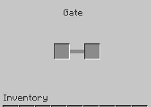

### Iron AND Gate / Iron OR Gate / 鉄ゲート（AND/OR） / BC

* 実装状態: [ ]
* 名称: Iron AND Gate / Iron OR Gate / 日本語: 鉄ゲート（AND/OR） / Origin: `-` / New: `bcn:iron_and_gate`
* レシピ: `Iron Gate` x1 + `Red Pipe Wire` x1 + `Blue Pipe Wire` x1 -> `Iron AND Gate` x1
* レシピ配置図: `[000]` / `[000]` / `[000]`
* 概要: 
* 専用GUI: 有 — トリガーとアクションの設定
* 実装方法: 

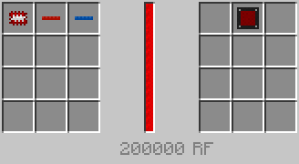

### Gold AND Gate / Gold OR Gate / 金ゲート（AND/OR） / BC

* 実装状態: [ ]
* 名称: Gold AND Gate / Gold OR Gate / 日本語: 金ゲート（AND/OR） / Origin: `-` / New: `bcn:gold_and_gate`
* レシピ: `Golden Gate` x1 + `Red Pipe Wire` x1 + `Blue Pipe Wire` x1 + `Green Pipe Wire` x1 -> `Gold AND Gate` x1
* レシピ配置図: `[000]` / `[000]` / `[000]`
* 概要: 
* 専用GUI: 有 — トリガーとアクションの設定
* 実装方法: 

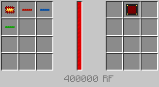

### Diamond AND Gate / Diamond OR Gate / ダイヤゲート（AND/OR） / BC

* 実装状態: [ ]
* 名称: Diamond AND Gate / Diamond OR Gate / 日本語: ダイヤゲート（AND/OR） / Origin: `-` / New: `bcn:diamond_and_gate`
* レシピ: `Diamond Gate` x1 + `Pipe Wires (all colors)` x1 -> `Diamond AND Gate` x1
* レシピ配置図: `[000]` / `[000]` / `[000]`
* 概要: 
* 専用GUI: 有 — トリガーとアクションの設定
* 実装方法: 

### Emerald AND Gate / Emerald OR Gate / エメラルドゲート（AND/OR） / BC

* 実装状態: [ ]
* 名称: Emerald AND Gate / Emerald OR Gate / 日本語: エメラルドゲート（AND/OR） / Origin: `-` / New: `bcn:emerald_and_gate`
* レシピ: `Emerald Gate` x1 + `Pipe Wires (all colors)` x1 -> `Emerald AND Gate` x1
* レシピ配置図: `[000]` / `[000]` / `[000]`
* 概要: 
* 専用GUI: 有 — トリガーとアクションの設定
* 実装方法: 

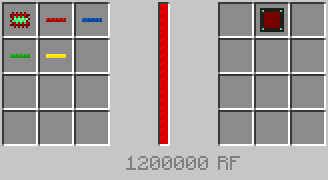

### Quartz AND Gate / Quartz OR Gate / 水晶ゲート（AND/OR） / BC

* 実装状態: [ ]
* 名称: Quartz AND Gate / Quartz OR Gate / 日本語: 水晶ゲート（AND/OR） / Origin: `-` / New: `bcn:quartz_and_gate`
* レシピ: `Quartz Gate` x1 + `Red Pipe Wire` x1 + `Blue Pipe Wire` x1 + `Green Pipe Wire` x1 -> `Quartz AND Gate` x1
* レシピ配置図: `[000]` / `[000]` / `[000]`
* 概要: 
* 専用GUI: 有 — トリガーとアクションの設定
* 実装方法: 

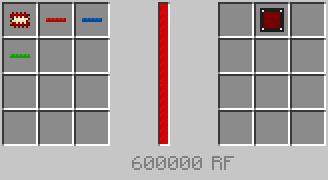

### Clock Timer / クロックタイマー / BC

* 実装状態: [ ]
* 名称: Clock Timer / 日本語: クロックタイマー / Origin: `-` / New: `bcn:clock_timer`
* レシピ: `Clock Timer` x1 + `Quartz Chipset` x1 -> `Clock Timer` x1
* レシピ配置図: `[000]` / `[000]` / `[000]`
* 概要: ゲートの条件設定の追加項目としてタイマーを使うことのできるゲート.
* 専用GUI: 無
* 実装方法: style='vertical-align:MIDDLE;'|・クロックタイマー1 ＝ 各種ゲート1 + 水晶チップ1（25000RF）ゲートの条件設定の追加項目としてタイマーを使うことのできるゲート。 [gate]

<!-- 画像なし -->

### Redstone Fader / レッドストーンフェーダー / BC

* 実装状態: [ ]
* 名称: Redstone Fader / 日本語: レッドストーンフェーダー / Origin: `-` / New: `bcn:redstone_fader`
* レシピ: `Redstone Fader` x1 + `Redstone Comparator` x1 -> `Redstone Fader` x1
* レシピ配置図: `[000]` / `[000]` / `[000]`
* 概要: ゲートの条件設定の追加項目としてレッドストーンの強度を自由に検知、出力が可能になるゲート.
* 専用GUI: 無
* 実装方法: 

<!-- 画像なし -->

### Autarchic Pulsar / オートチックパルサー / BC

* 実装状態: [ ]
* 名称: Autarchic Pulsar / 日本語: オートチックパルサー / Origin: `-` / New: `bcn:autarchic_pulsar`
* レシピ: `Autarchic Pulsar` x1 + `Pulsating Chipset` x1 -> `Autarchic Pulsar` x1
* レシピ配置図: `[000]` / `[000]` / `[000]`
* 概要: ゲートの条件設定の追加項目として木エンジンと同様のパルスを出力できるゲート.
* 専用GUI: 無
* 実装方法: style='vertical-align:MIDDLE;'|・オートチックパルサー1 ＝ 各種ゲート1 + パルサーチップ1（25000RF）ゲートの条件設定の追加項目として木エンジンと同様のパルスを出力できるゲート。 [gate]

<!-- 画像なし -->

### Light Sensor / ライトセンサー / BC

* 実装状態: [ ]
* 名称: Light Sensor / 日本語: ライトセンサー / Origin: `-` / New: `bcn:light_sensor`
* レシピ: `Light Sensor` x1 + `Daylight Sensor` x1 -> `Light Sensor` x1
* レシピ配置図: `[000]` / `[000]` / `[000]`
* 概要: ゲートの条件設定の追加項目として日照センサーが使用できるゲート.
* 専用GUI: 無
* 実装方法: style='vertical-align:MIDDLE;'|・ライトセンサー1 ＝ 各種ゲート1 + 日照センサー1（25000RF）ゲートの条件設定の追加項目として日照センサーが使用できるゲート。 [gate]

<!-- 画像なし -->

### OR Gate / ORゲート / PR

* 実装状態: [ ]
* 名称: OR Gate / 日本語: ORゲート / Origin: `projectred_integration:or_gate` / New: `bcn:or_gate`
* レシピ: `Plate` x4 + `Cathode` x2 + `Conductive Plate` x3 -> `OR Gate` x1
* レシピ配置図: `ABA` / `CBC` / `ACA`
* 概要: 1ブロックでOR回路として機能する集積回路. 3つのinput面と1つのoutput面から構成される. input面のどれか1つに入力があるなら、output面から出力し続ける. 事前にドライバを持ちながらshift+右クリックする事で、特定サイドのinput面を閉じることができる.
* 専用GUI: 無 — ドライバーでワールド内設定
* 実装方法: style='vertical-align:MIDDLE;'|【1】 金のORゲートノーマル液体パイプに装着している。項目1＝鉄エンジンに金オイルが入っている時だけ赤ワイヤー信号を出力する。項目2と項目3は上で挙げた爆発防止機能付きのレッドストーン出力装置で、この金オイル取り寄せ用の機構とは特に関係が無い。 [gate] / 鉄エンジンの爆発が怖いのならば、レバーは撤去、代わりに鉄エンジンの横に鉄のORゲートを取り付け、「隣の鉄エンジンの色が青または緑の時だけレッドストーン出力する」ようにすればよい。 [mach1]

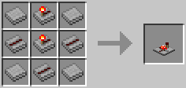

### NOR Gate / NORゲート / PR

* 実装状態: [ ]
* 名称: NOR Gate / 日本語: NORゲート / Origin: `projectred_integration:nor_gate` / New: `bcn:nor_gate`
* レシピ: `Plate` x4 + `Anode` x1 + `Conductive Plate` x3 + `Cathode` x1 -> `NOR Gate` x1
* レシピ配置図: `ABA` / `CDC` / `ACA`
* 概要: 1ブロックでNOR回路として機能する集積回路. 3つのinput面と1つのoutput面から構成される. input面全てに入力が無い間のみ、output面からの出力がONになる. （それ以外の場合は常にOFF） 事前にドライバを持ちながらshift+右クリックする事で、特定サイドのinput面を閉じることができる.
* 専用GUI: 無 — ドライバーでワールド内設定
* 実装方法: 

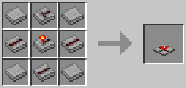

### NOT Gate / NOTゲート / PR

* 実装状態: [ ]
* 名称: NOT Gate / 日本語: NOTゲート / Origin: `projectred_integration:not_gate` / New: `bcn:not_gate`
* レシピ: `Plate` x4 + `Cathode` x3 + `Anode` x1 + `Conductive Plate` x1 -> `NOT Gate` x1
* レシピ配置図: `ABA` / `BCB` / `ADA`
* 概要: 1ブロックでNOT回路として機能する集積回路. 1つのinput面と3つのoutput面から構成される. 上記とは逆に、input面に入力を受けていない間、output面全てから出力し続ける.
* 専用GUI: 無 — ドライバーでワールド内設定
* 実装方法: 

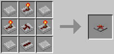

### AND Gate / ANDゲート / PR

* 実装状態: [ ]
* 名称: AND Gate / 日本語: ANDゲート / Origin: `projectred_integration:and_gate` / New: `bcn:and_gate`
* レシピ: `Anode` x2 + `Cathode` x4 + `Plate` x2 + `Conductive Plate` x1 -> `AND Gate` x1
* レシピ配置図: `ABA` / `BBB` / `CDC`
* 概要: 1ブロックでAND回路として機能する集積回路. 3つのinput面と1つのoutput面から構成される. input面全部にレッドストーン入力がある間、output面から出力し続ける. 事前にドライバを持ちながらshift+右クリックする事で、特定サイドのinput面を閉じることができる.
* 専用GUI: 無 — ドライバーでワールド内設定
* 実装方法: style='vertical-align:MIDDLE;'|【２】 鉄のANDゲート木の液体パイプに装着している。項目1＝パイプ内を何も液体が通過しておらず、項目2＝かつ赤ワイヤー信号の出力が途絶えた時のみレッドストーン出力、木エンジンを動かして金オイルを引き出す。 [gate] / style='vertical-align:MIDDLE;'|【1】 金のANDゲート木のエネルギーパイプに装着している。項目1＝赤ワイヤー信号が出力されており、項目2＝かつ鉄エンジン内部に水がある場合のみレッドストーン動力を出力する。両条件のどちらか片方でも満たされていなければエンジン停止。 [gate]

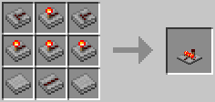

### NAND Gate / NANDゲート / PR

* 実装状態: [ ]
* 名称: NAND Gate / 日本語: NANDゲート / Origin: `projectred_integration:nand_gate` / New: `bcn:nand_gate`
* レシピ: `Anode` x3 + `Cathode` x3 + `Plate` x2 + `Conductive Plate` x1 -> `NAND Gate` x1
* レシピ配置図: `AAA` / `BBB` / `CDC`
* 概要: 1ブロックでNAND回路として機能する集積回路. 3つのinput面と1つのoutput面から構成される. input面全てに入力がある間のみ、output面からの出力がOFFになる. （それ以外の場合は常にON） 事前にドライバを持ちながらshift+右クリックする事で、特定サイドのinput面を閉じることができる.
* 専用GUI: 無 — ドライバーでワールド内設定
* 実装方法: 

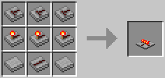

### XOR Gate / XORゲート / PR

* 実装状態: [ ]
* 名称: XOR Gate / 日本語: XORゲート / Origin: `projectred_integration:xor_gate` / New: `bcn:xor_gate`
* レシピ: `Anode` x3 + `Conductive Plate` x3 + `Cathode` x3 -> `XOR Gate` x1
* レシピ配置図: `ABA` / `CAC` / `BCB`
* 概要: 1ブロックでXOR回路として機能する集積回路. 2つのinput面と1つのoutput面から構成される. 2つのinput面の状態が異なる場合のみ、output面からレッドストーン出力する. （ON+OFF、またはOFF+ON）
* 専用GUI: 無 — ドライバーでワールド内設定
* 実装方法: 

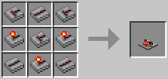

### XNOR Gate / XNORゲート / PR

* 実装状態: [ ]
* 名称: XNOR Gate / 日本語: XNORゲート / Origin: `projectred_integration:xnor_gate` / New: `bcn:xnor_gate`
* レシピ: `Anode` x3 + `Cathode` x4 + `Conductive Plate` x2 -> `XNOR Gate` x1
* レシピ配置図: `ABA` / `BAB` / `CBC`
* 概要: 1ブロックでXNOR回路として機能する集積回路. 2つのinput面と1つのoutput面から構成される. 2つのinput面の状態が同じ場合のみ、output面からレッドストーン出力する. （両方ON、または両方OFF）
* 専用GUI: 無 — ドライバーでワールド内設定
* 実装方法: 

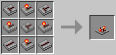

### Buffer Gate / Bufferゲート / PR

* 実装状態: [ ]
* 名称: Buffer Gate / 日本語: Bufferゲート / Origin: `projectred_integration:buffer_gate` / New: `bcn:buffer_gate`
* レシピ: `Anode` x2 + `Cathode` x2 + `Conductive Plate` x3 + `Plate` x2 -> `Buffer Gate` x1
* レシピ配置図: `ABA` / `CBC` / `DCD`
* 概要: 1ブロックでBuffer回路として機能する集積回路. 1つのinput面と3つのoutput面から構成される. input面に入力を受けている間、output面全てからレッドストーン出力する.
* 専用GUI: 無 — ドライバーでワールド内設定
* 実装方法: 

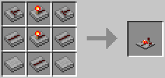

### Light Sensor / 光センサー / PR

* 実装状態: [ ]
* 名称: Light Sensor / 日本語: 光センサー / Origin: `projectred_integration:light_sensor_gate` / New: `bcn:light_sensor`
* レシピ: `Plate` x5 + `Blue Dye` x3 + `Conductive Plate` x1 -> `Light Sensor` x1
* レシピ配置図: `AAA` / `BBB` / `ACA`
* 概要: 光に反応して信号を出力するセンサー回路. ドライバーを持ちスニーク状態で右クリックで反応する光の種類のモード三種類を調節できる. モード赤が太陽などの影響のない松明などによる光レベル(デバッグ画面のbl)、 モード青が逆に松明などに影響されない自然光のみの光レベル(デバッグ画面のsl)、 モード赤青がその両方の光レベル(デバッグ画面のrl)にそれぞれ反応する. 結果は信号の強度により表される. モード赤 信号強度P=17x 自然光を除いた光レベルL Lはデバッグ画面のbl + 1で分かる. モード青 時間による明るさ変化をNとし、 Nは晴天時の昼は15、雨天時の昼は12、雷雨時の昼は10、夜は一律4とする. またこの値は日の入りとともに10秒に1ずつ減り、4となったところで夜になる. 同様に日の出とともに10秒に1ずつ増え、天気に合わせた値となったところで昼となる. また距離減衰Dは通常は最も近い空が見える地点からのX,Z両座標の合計となる. このとき信号強度P=17x (N-D) N - Dはデバッグ画面のslで分かる. 計算が少々面倒であったり、洞窟のような場所であるとDがとても分かりにくいので、デバッグ画面推奨. モード赤青 先述したモード赤とモード青の、信号強度のどちらか強いほうを出力する.
* 専用GUI: 無
* 実装方法: 

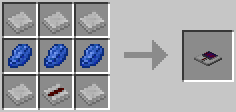

### Logistics Power Junction / LP変換機 / LP

* 実装状態: [ ]
* 名称: Logistics Power Junction / 日本語: LP変換機 / Origin: `logisticspipes:power_junction` / New: `bcn:logistics_power_junction`
* レシピ: `Chip Basic` x1 + `Redstone` x2 + `Frame` x1 + `Iron Ingot` x2 + `Redstone Block` x1 -> `Logistics Power Junction` x1
* レシピ配置図: `0A0` / `BCB` / `DED`
* 概要: MC1.3.2対応版 以降の必須重要装置. これの併設(＋動力供給)なしではロジパイプが動作しない. BuildCraftなどのMJ、RF、または IndustrialCraft2のEUを、 ロジパイプ稼動用の専用エネルギーLPに変換するコンバーター. 超高圧(2048EU/t)の入力でも爆発しない. また、これ自体が内部に200万LPまで貯蔵できるストレージを持つ. ロジパイプの中でも基本パイプとしか接続できないが、 そのロジパイプネットワークのどこか一箇所に接続されていれば、 そのネットワークに所属する全ロジパイプにLPを供給する. 分断されている場合は、1ネットワーク毎に1台ずつの併設が必要. Dev571より、作成に基本パイプ及び金チップ（歯車）が不要に. 代わりにレッドストーンブロックが必要になった（実質赤石粉が11個必要に）
* 専用GUI: 有 — LP 変換とエネルギー管理
* 実装方法: ただし逆に言えば、ロジスティクスパイプとの連結には側面4面全てが使えるという事でもある。回収アイテムを何も指定していない基本パイプを連結に使用すれば、通常アイテムパイプ(丸石パイプが最適)をLP伝導ライン代わりに、どこまでもLP供給を引っ張る事は（理論上）可能。4面全てをフルに使えば、1台のLP変換機で分断された独立ネ [detail]

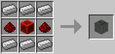

### Logistics RF Power Provider / RF変換機 / LP

* 実装状態: [ ]
* 名称: Logistics RF Power Provider / 日本語: RF変換機 / Origin: `-` / New: `bcn:logistics_rf_power_provider`
* レシピ: `Redstone Block` x1 + `Piston` x1 + `Golden Chipset` x2 + `Iron Chipset` x1 + `Paper` x4 -> `Logistics RF Power Provider` x1
* レシピ配置図: `[000]` / `[000]` / `[000]`
* 概要: ロジパイプを通じてRFを供給するための装置. これ単体では機能せず、RFを要求する機械に隣接したロジパイプに"TE Power Supplier Upgrade"を、 変換器からマシンまでのすべてのロジパイプに"Power Transportation Upgrade"を付ける必要がある.
* 専用GUI: 有 — 給電範囲の設定
* 実装方法: 

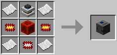

### Logistics EU Power Provider / EU変換機 / LP

* 実装状態: [ ]
* 名称: Logistics EU Power Provider / 日本語: EU変換機 / Origin: `-` / New: `bcn:logistics_eu_power_provider`
* レシピ: `Redstone Block` x1 + `Overclocker upgrade` x2 + `Energy storage upgrade` x1 + `Transformer Upgrade` x1 + `Paper` x4 -> `Logistics EU Power Provider` x1
* レシピ配置図: `[000]` / `[000]` / `[000]`
* 概要: ロジパイプを通じてEUを供給するための装置. 機能はRF変換器と同様で供給するエネルギーが異なるだけ.
* 専用GUI: 有 — 給電範囲の設定
* 実装方法: 

<!-- 画像なし -->

### Logistics Crafting Table / ロジスティクス作業台 / LP

* 実装状態: [ ]
* 名称: Logistics Crafting Table / 日本語: ロジスティクス作業台 / Origin: `logisticspipes:crafting_table` / New: `bcn:logistics_crafting_table`
* レシピ: `Crafting Table` x1 + `Wooden Planks` x2 + `Frame` x1 + `Piston` x1 -> `Logistics Crafting Table` x1
* レシピ配置図: `0A0` / `BCB` / `0D0`
* 概要: BC3.6.0以降、スタック不可アイテムを加工パイプで使用する際のほぼ必須装置. 仕様としてはFFMのワークテーブルに近いが、 手動で作成することはできず加工パイプが必要. 内部にレシピを登録して加工パイプを接続することで、 クラフト要求があった場合に材料を搬入、作成して送り出す. 空になったバケツなどは内部に残るので、適切なパイプを使用して搬出すること.
* 専用GUI: 有 — クラフト設定
* 実装方法: 

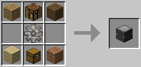

### Blank module / ブランクモジュール / LP

* 実装状態: [ ]
* 名称: Blank module / 日本語: ブランクモジュール / Origin: `logisticspipes:module_blank` / New: `bcn:blank_module`
* レシピ: `Redstone` x1 + `Paper` x1 + `Nugget Gold` x1 -> `Blank module` x1
* レシピ配置図: `A` / `B` / `C`
* 概要: 各種モジュールの作成における中間素材となる部品. これ自体には何の効果も無い.
* 専用GUI: 有 — ロジスティクスレンチによる設定画面
* 実装方法: 

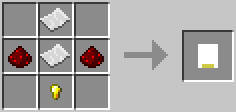

### Logistics Fuzzy Crafting Table / ファジーロジスティクス作業台 / LP

* 実装状態: [ ]
* 名称: Logistics Fuzzy Crafting Table / 日本語: ファジーロジスティクス作業台 / Origin: `logisticspipes:crafting_table_fuzzy` / New: `bcn:logistics_fuzzy_crafting_table`
* レシピ: `Chip Basic` x1 + `Crafting Table` x1 -> `Logistics Fuzzy Crafting Table` x1
* レシピ配置図: `A` / `B`
* 概要: 鉱石辞書の使用、ダメージ値無視、NBTタグ無視、"Ore"が付くアイテムといった指定ができるようになる. ファジーチップとセットで使用する.
* 専用GUI: 有 — クラフト設定
* 実装方法: 

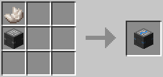

### Logistics Disk / リクエストディスク / LP

* 実装状態: [ ]
* 名称: Logistics Disk / 日本語: リクエストディスク / Origin: `logisticspipes:disk` / New: `bcn:logistics_disk`
* レシピ: `Iron Ingot` x4 + `Redstone` x4 + `Nugget Gold` x1 -> `Logistics Disk` x1
* レシピ配置図: `ABA` / `BCB` / `ABA`
* 概要: "要求パイプMk2"専用で、無印の要求パイプでは利用できない. よく使うリクエストの内容を登録＆保存しておけるフロッピーディスク. 複数種類＆個数のアイテムをボタン1発でリクエストできる. 保存したディスクを取り出して、他の要求パイプMk2に使い回す事も可能.
* 専用GUI: 無
* 実装方法: 

<!-- 画像なし -->

### Logistics Fluid Supplier / 液体補給パイプ / LP

* 実装状態: [ ]
* 名称: Logistics Fluid Supplier / 日本語: 液体補給パイプ / Origin: `-` / New: `bcn:logistics_fluid_supplier`
* レシピ: `Logistics Liquid Basic Pipe` x1 + `Gold Ingot` x2 + `Lapis Lazuli` x2 -> `Logistics Fluid Supplier` x1
* レシピ配置図: `[000]` / `[000]` / `[000]`
* 概要: 補給パイプの液体版. 用途も、隣接する機械、タンクへ指定液体を指定量常に供給と通常の補給パイプ同様である. 複数の機械、タンクに隣接していると正常動作しないのも通常の補給パイプ同様.
* 専用GUI: 有 — ロジスティクス設定画面
* 実装方法: 

<!-- 画像なし -->

### ItemSink module / 回収モジュール / LP

* 実装状態: [ ]
* 名称: ItemSink module / 日本語: 回収モジュール / Origin: `-` / New: `bcn:itemsink_module`
* レシピ: `Blank module` x1 + `Redstone` x3 + `Green Dye` x2 + `Iron Chipset` x1 / `Blank module` x1 + `Green Dye` x2 + `Iron Chipset` x1 + `Redstone` x2 -> `ItemSink module` x1
* レシピ配置図: `[000]` / `[000]` / `[000]`
* 概要: 基本パイプと同じ作用を持つモジュール. 内部GUIの仕様も同じ. インベントリ満載時の対処能力という点で基本パイプの上な一方、 複数のインベントリと同時に隣接していても 回収物は橙ラベル側にあるインベントリにしか搬入しない.
* 専用GUI: 有 — ロジスティクスレンチによる設定画面
* 実装方法: 

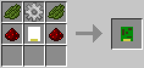

### Polymorphic ItemSink module / 読取回収モジュール / LP

* 実装状態: [ ]
* 名称: Polymorphic ItemSink module / 日本語: 読取回収モジュール / Origin: `-` / New: `bcn:polymorphic_itemsink_module`
* レシピ: `Blank module` x1 + `Redstone` x3 + `Orange Dye` x2 + `Iron Chipset` x1 / `Blank module` x1 + `Orange Dye` x2 + `Iron Chipset` x1 + `Redstone` x2 -> `Polymorphic ItemSink module` x1
* レシピ配置図: `[000]` / `[000]` / `[000]`
* 概要: 回収モジュールとほぼ同じだが、こちらはGUIを持たず、 代わりに隣接ブロック内のインベントリに置かれたアイテムを読み取り、 それらが配管内で目的を見失った場合回収する. 隣接インベントリ内の全アイテムが搬出されると機能を失う性質のため、 供給モジュールの［Leave 1 item per stack］との併用が必須.
* 専用GUI: 有 — ロジスティクスレンチによる設定画面
* 実装方法: 

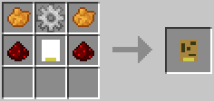

### Terminus ItemSink module / 終端回収モジュール / LP

* 実装状態: [ ]
* 名称: Terminus ItemSink module / 日本語: 終端回収モジュール / Origin: `-` / New: `bcn:terminus_itemsink_module`
* レシピ: `Blank module` x1 + `Redstone` x3 + `Ink Sac` x1 + `Purple Dye` x1 + `Iron Chipset` x1 / `Blank module` x1 + `Ink Sac` x1 + `Purple Dye` x1 + `Iron Chipset` x1 + `Redstone` x2 -> `Terminus ItemSink module` x1
* レシピ配置図: `[000]` / `[000]` / `[000]`
* 概要: 回収モジュールと同じ仕様＆効果だが、 回収地点としての優先順位が1ランク低い（Default Route設定よりは上） なのでそのアイテムの回収ポイントを複数用意する場合、 距離に関係なくこのモジュールの隣接インベントリを一番最後にできる.
* 専用GUI: 有 — ロジスティクスレンチによる設定画面
* 実装方法: 

### Passive Supplier module / 消極補給モジュール / LP

* 実装状態: [ ]
* 名称: Passive Supplier module / 日本語: 消極補給モジュール / Origin: `-` / New: `bcn:passive_supplier_module`
* レシピ: `Blank module` x1 + `Redstone` x3 + `Red Dye` x4 + `Iron Chipset` x1 / `Blank module` x1 + `Red Dye` x2 + `Iron Chipset` x1 + `Redstone` x2 -> `Passive Supplier module` x1
* レシピ配置図: `[000]` / `[000]` / `[000]`
* 概要: 補給の名こそ冠しているが、性質は回収モジュールに近い. 指定アイテムに関し、発送側に宛先指定されなかったものを回収. （基本パイプや回収モジュールより優先順位が高い） そして回収するのは隣接インベントリ内の指定アイテム総数が 指定個数未満の間だけであり、指定個数以上になると回収しなくなる.
* 専用GUI: 有 — ロジスティクスレンチによる設定画面
* 実装方法: 

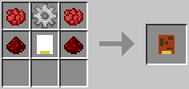

### Mod Based ItemSink module / MOD指定回収モジュール / LP

* 実装状態: [ ]
* 名称: Mod Based ItemSink module / 日本語: MOD指定回収モジュール / Origin: `-` / New: `bcn:mod_based_itemsink_module`
* レシピ: `ItemSink module` x1 + `Golden Chipset` x1 -> `Mod Based ItemSink module` x1
* レシピ配置図: `[000]` / `[000]` / `[000]`
* 概要: アイテムを提供しているMOD単位で回収の可否を指定できる. Forgeの導入MOD一覧画面で"X child mods"が0でない場合、最大でその分だけこのモジュールでの設定項目も分割されている. （例えばBCなら、"BuildCraft:（Builders/Energy/Factory/Silicon/Transport）"の5つに分かれている） 最大で9MODまで指定可能.
* 専用GUI: 有 — ロジスティクスレンチによる設定画面
* 実装方法: 

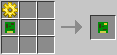

### Enchantment Sink module / エンチャント回収モジュール / LP

* 実装状態: [ ]
* 名称: Enchantment Sink module / 日本語: エンチャント回収モジュール / Origin: `-` / New: `bcn:enchantment_sink_module`
* レシピ: `ItemSink module` x1 + `Enchanted Book` x1 -> `Enchantment Sink module` x1
* レシピ配置図: `[000]` / `[000]` / `[000]`
* 概要: 
* 専用GUI: 有 — ロジスティクスレンチによる設定画面
* 実装方法: 

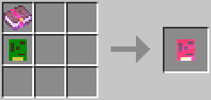

### Enchantment Sink module Mk2 / エンチャント回収モジュールMk2 / LP

* 実装状態: [ ]
* 名称: Enchantment Sink module Mk2 / 日本語: エンチャント回収モジュールMk2 / Origin: `-` / New: `bcn:enchantment_sink_module_mk2`
* レシピ: `Enchantment Sink module` x1 + `Golden Chipset` x1 / `Gold Gear` x1 -> `Enchantment Sink module Mk2` x1
* レシピ配置図: `[000]` / `[000]` / `[000]`
* 概要: 
* 専用GUI: 有 — ロジスティクスレンチによる設定画面
* 実装方法: 

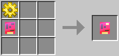

### Creative Tab Based ItemSink module / クリエイティブタブ指定回収モジュール / LP

* 実装状態: [ ]
* 名称: Creative Tab Based ItemSink module / 日本語: クリエイティブタブ指定回収モジュール / Origin: `-` / New: `bcn:creative_tab_based_itemsink_module`
* レシピ: `OreDict ItemSink module` x1 + `Golden Chipset` x1 / `Gold Gear` x1 -> `Creative Tab Based ItemSink module` x1
* レシピ配置図: `[000]` / `[000]` / `[000]`
* 概要: 
* 専用GUI: 有 — ロジスティクスレンチによる設定画面
* 実装方法: 

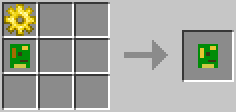

### OreDict ItemSink module / 鉱石辞書回収モジュール / LP

* 実装状態: [ ]
* 名称: OreDict ItemSink module / 日本語: 鉱石辞書回収モジュール / Origin: `-` / New: `bcn:oredict_itemsink_module`
* レシピ: `Mod-Based Item Sink Module` x1 + `Book` x1 -> `OreDict ItemSink module` x1
* レシピ配置図: `[000]` / `[000]` / `[000]`
* 概要: 
* 専用GUI: 有 — ロジスティクスレンチによる設定画面
* 実装方法: 

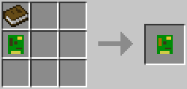

### Provider module / 供給モジュール / LP

* 実装状態: [ ]
* 名称: Provider module / 日本語: 供給モジュール / Origin: `-` / New: `bcn:provider_module`
* レシピ: `Blank module` x1 + `Redstone` x3 + `Lapis Lazuli` x2 + `Golden Chipset` x1 / `Blank module` x1 + `Lapis Lazuli` x2 + `Golden Chipset` x1 + `Redstone` x2 -> `Provider module` x1
* レシピ配置図: `[000]` / `[000]` / `[000]`
* 概要: 供給パイプのモジュール版で、供給パイプの6倍の発送速度. （1tickに1回、1個ずつ発送、秒間20個） が、隣接するインベントリの内容物を全て認識できる供給パイプと違い、 橙ラベル側にあるインベントリ1個の内容物しか認識できない為、 大規模施設においては配管時の建築コストが膨れ上がりがち.
* 専用GUI: 有 — ロジスティクスレンチによる設定画面
* 実装方法: style='background-color:lightblue;'|供給モジュール Mk1 [detail] / style='background-color:lightblue;'|供給モジュール Mk2 [detail]

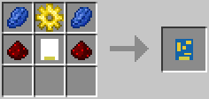

### Provider module Mk2 / 供給モジュールMk2 / LP

* 実装状態: [ ]
* 名称: Provider module Mk2 / 日本語: 供給モジュールMk2 / Origin: `-` / New: `bcn:provider_module_mk2`
* レシピ: `Provider module` x1 + `Diamond Chipset` x1 -> `Provider module Mk2` x1
* レシピ配置図: `[000]` / `[000]` / `[000]`
* 概要: 1tick毎に1回、16個ずつ（秒間320個）の発送間隔でアイテムを発送する. BuildCraft3.2.0以前ではデフォルト設定では無印の供給モジュールと同じ性能で、作るだけ無駄だった. ただしBuildCraft3.2.0以前であってもBCのConfigでI:pipes.maxItems=100の値を1000以上に書き換えると、 （1tickに1回、最大16個ずつのアイテムをスタック発送、秒間320個） の高速モードでアイテムを発送するようになる.
* 専用GUI: 有 — ロジスティクスレンチによる設定画面
* 実装方法: style='vertical-align:MIDDLE;background-color:lightblue;'|供給パイプ供給パイプMk2供給モジュール供給モジュールMk2 [detail] / style='vertical-align:MIDDLE;background-color:lightblue;'|供給モジュールMk2(Provider module Mk2) [detail]

### Extractor module / 抽出モジュール / LP

* 実装状態: [ ]
* 名称: Extractor module / 日本語: 抽出モジュール / Origin: `-` / New: `bcn:extractor_module`
* レシピ: `Blank module` x1 + `Redstone` x3 + `Lapis Lazuli` x2 + `Iron Chipset` x1 / `Blank module` x1 + `Lapis Lazuli` x2 + `Iron Chipset` x1 + `Redstone` x2 -> `Extractor module` x1
* レシピ配置図: `[000]` / `[000]` / `[000]`
* 概要: 橙ラベル側にある隣接インベントリから一定間隔でアイテムを吸い出す. ただし要求パイプや補給パイプと違って宛先指定機能が無く、 事前に基本パイプや回収モジュールetc.を使って 回収ポイントを用意しておかないと、アイテムが全く出てこない. 搬出面偽装機能も持つ（←かまど等で便利な機能）
* 専用GUI: 有 — ロジスティクスレンチによる設定画面
* 実装方法: :抽出モジュールと違い、2枚以上の重複積みは誤作動の原因になる。（＝2枚積んでいるとリクエストされた数の2倍、3枚積んでいると3倍の数を発送してしまう） [detail] / 抽出モジュールMk1(1枚)＝「木パイプ + 青色時の木エンジン」(100tickに1回1個)の搬出間隔とほぼ同じ。 [detail]

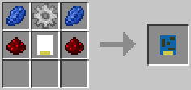

### Extractor Mk2 module / 抽出モジュールMk2 / LP

* 実装状態: [ ]
* 名称: Extractor Mk2 module / 日本語: 抽出モジュールMk2 / Origin: `-` / New: `bcn:extractor_mk2_module`
* レシピ: `Extractor module` x1 + `Golden Chipset` x1 -> `Extractor Mk2 module` x1
* レシピ配置図: `[000]` / `[000]` / `[000]`
* 概要: 抽出モジュールの強化版. 通常の抽出モジュールが100tickに1回、アイテム1個発送するのに対し、 こちらは20tickに1回、アイテム1個発送と、発送がより迅速化した. 搬出面偽装機能など、速度以外の仕様は無印と同じ.
* 専用GUI: 有 — ロジスティクスレンチによる設定画面
* 実装方法: 抽出モジュールMk2(1枚)＝「木パイプ + 橙⇔赤で安定した状態の木エンジン」(20tickに1回1個)の搬出間隔とほぼ同じ。 [detail]

<!-- 画像なし -->

### Extractor Mk3 module / 抽出モジュールMk3 / LP

* 実装状態: [ ]
* 名称: Extractor Mk3 module / 日本語: 抽出モジュールMk3 / Origin: `-` / New: `bcn:extractor_mk3_module`
* レシピ: `Extractor module` x21 + `Diamond Chipset` x1 -> `Extractor Mk3 module` x1
* レシピ配置図: `[000]` / `[000]` / `[000]`
* 概要: 抽出モジュールの更なる強化版. 100tickに1回＆1個ずつの無印、20tickに1回＆1個ずつのMk2に対し、 これは1tickに1回、1スタックずつアイテムを発送する. Mk2に比べるとあまりにも発送処理が高速＆大量すぎて、 アイテムあふれやラインアウトを頻発させやすく、逆に使い辛い. 搬出面偽装機能など、搬出量＆速度以外の仕様は無印と同じ.
* 専用GUI: 有 — ロジスティクスレンチによる設定画面
* 実装方法: 

<!-- 画像なし -->

### Advanced Extractor module / 抽出モジュール改 / LP

* 実装状態: [ ]
* 名称: Advanced Extractor module / 日本語: 抽出モジュール改 / Origin: `-` / New: `bcn:advanced_extractor_module`
* レシピ: `Extractor module` x1 + `Redstone` x1 -> `Advanced Extractor module` x1
* レシピ配置図: `[000]` / `[000]` / `[000]`
* 概要: 抽出モジュールの亜種. 搬出面偽装機能に加えて、Include＆Exclude機能も獲得した. GUIで指定したアイテムだけを発送させたり(Include) 逆に指定したアイテム以外を発送させたりできる(Exclude) 搬出速度は抽出モジュールと同じく、100tickに1回、1個ずつ.
* 専用GUI: 有 — ロジスティクスレンチによる設定画面
* 実装方法: 

### Advanced Extractor Mk2 module / 抽出モジュール改Mk2 / LP

* 実装状態: [ ]
* 名称: Advanced Extractor Mk2 module / 日本語: 抽出モジュール改Mk2 / Origin: `-` / New: `bcn:advanced_extractor_mk2_module`
* レシピ: `Advanced Extractor module` x1 + `Golden Chipset` x1 -> `Advanced Extractor Mk2 module` x1
* レシピ配置図: `[000]` / `[000]` / `[000]`
* 概要: 抽出モジュール改の強化版. 搬出速度が20tickに1回1個ずつになった以外、無印と同じ仕様.
* 専用GUI: 有 — ロジスティクスレンチによる設定画面
* 実装方法: 

<!-- 画像なし -->

### Advanced Extractor Mk3 module / 抽出モジュール改Mk3 / LP

* 実装状態: [ ]
* 名称: Advanced Extractor Mk3 module / 日本語: 抽出モジュール改Mk3 / Origin: `-` / New: `bcn:advanced_extractor_mk3_module`
* レシピ: `Extractor module` x21 + `Diamond Chipset` x1 -> `Advanced Extractor Mk3 module` x1
* レシピ配置図: `[000]` / `[000]` / `[000]`
* 概要: 抽出モジュール改の更なる強化版. 搬出速度が1tickに1回1スタックずつになった以外、Mk1と同じ仕様. あまりにも発送が速すぎて、やはり使い辛い.
* 専用GUI: 有 — ロジスティクスレンチによる設定画面
* 実装方法: 

<!-- 画像なし -->

### QuickSort module / 高速分別モジュール / LP

* 実装状態: [ ]
* 名称: QuickSort module / 日本語: 高速分別モジュール / Origin: `-` / New: `bcn:quicksort_module`
* レシピ: `Blank module` x1 + `Redstone` x3 + `Lapis Lazuli` x2 + `Diamond Chipset` x1 / `Blank module` x1 + `Lapis Lazuli` x2 + `Diamond Chipset` x1 + `Redstone` x2 -> `QuickSort module` x1
* レシピ配置図: `[000]` / `[000]` / `[000]`
* 概要: ネットワーク内に存在する回収系の全パイプ＆モジュールを検索、 回収アイテムが指定されているものを把握した後、 隣接インベントリの内容物をそれに合わせて高速仕分け発送する. （ただしDefault Route指定のは無視する） 64個スタック単位で発送するので迅速な仕分け分別が可能だが、 抽出Mk3程ではないが、あまりにも発送処理が高速＆大量すぎて、 アイテムあふれやラインアウトの原因になりやすい.
* 専用GUI: 有 — ロジスティクスレンチによる設定画面
* 実装方法: 

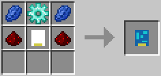

### Active Supplier module / 積極補給モジュール / LP

* 実装状態: [ ]
* 名称: Active Supplier module / 日本語: 積極補給モジュール / Origin: `-` / New: `bcn:active_supplier_module`
* レシピ: `Passive Supplier module` x1 + `Golden Chipset` x1 + `Redstone` x2 -> `Active Supplier module` x1
* レシピ配置図: `[000]` / `[000]` / `[000]`
* 概要: 
* 専用GUI: 有 — ロジスティクスレンチによる設定画面
* 実装方法: 

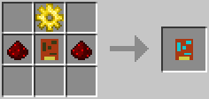

### Crafting module / 加工モジュール / LP

* 実装状態: [ ]
* 名称: Crafting module / 日本語: 加工モジュール / Origin: `-` / New: `bcn:crafting_module`
* レシピ: `Blank module` x1 + `Red Dye` x1 + `Lapis Lazuli` x1 + `Iron Chipset` x1 + `Iron Gear` x1 -> `Crafting module` x1
* レシピ配置図: `[000]` / `[000]` / `[000]`
* 概要: 
* 専用GUI: 有 — クラフト設定
* 実装方法: 

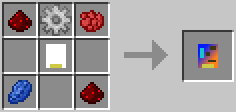

### Crafting module Mk2 / 加工モジュールMk2 / LP

* 実装状態: [ ]
* 名称: Crafting module Mk2 / 日本語: 加工モジュールMk2 / Origin: `-` / New: `bcn:crafting_module_mk2`
* レシピ: `Crafting module` x1 + `Golden Chipset` x1 / `Gold Gear` -> `Crafting module Mk2` x1
* レシピ配置図: `[000]` / `[000]` / `[000]`
* 概要: 加工パイプMk2のモジュール版.
* 専用GUI: 有 — クラフト設定
* 実装方法: 

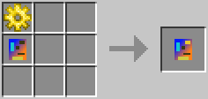

### Crafting module Mk3 / 加工モジュールMk3 / LP

* 実装状態: [ ]
* 名称: Crafting module Mk3 / 日本語: 加工モジュールMk3 / Origin: `-` / New: `bcn:crafting_module_mk3`
* レシピ: `Provider module` x1 + `Diamond Chipset` x1 -> `Crafting module Mk3` x1
* レシピ配置図: `[000]` / `[000]` / `[000]`
* 概要: 加工パイプMk3のモジュール版.
* 専用GUI: 有 — クラフト設定
* 実装方法: 

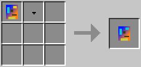

### Bee Analyzer module / 蜂鑑定モジュール / LP

* 実装状態: [ ]
* 名称: Bee Analyzer module / 日本語: 蜂鑑定モジュール / Origin: `-` / New: `bcn:bee_analyzer_module`
* レシピ: `Redstone` x3 + `Propolis` x4 + `Iron Chipset` x1 / `Blank module` x1 / `Liquid Honey 1500mB` / `MJ` x640 -> `Bee Analyzer module` x1
* レシピ配置図: `[000]` / `[000]` / `[000]`
* 概要: そのまま蜂鑑定パイプのモジュール版.
* 専用GUI: 有 — ロジスティクスレンチによる設定画面
* 実装方法: 

<!-- 画像なし -->

### BeeSink module / 蜂回収モジュール / LP

* 実装状態: [ ]
* 名称: BeeSink module / 日本語: 蜂回収モジュール / Origin: `-` / New: `bcn:beesink_module`
* レシピ: `Redstone` x4 + `Propolis` x4 / `Blank module` x1 / `Liquid Honey 1500mB` / `MJ` x640 -> `BeeSink module` x1
* レシピ配置図: `[000]` / `[000]` / `[000]`
* 概要: そのまま蜂回収パイプのモジュール版.
* 専用GUI: 有 — ロジスティクスレンチによる設定画面
* 実装方法: 

<!-- 画像なし -->

### Apiary Refiller module / 蜂再補充モジュール / LP

* 実装状態: [ ]
* 名称: Apiary Refiller module / 日本語: 蜂再補充モジュール / Origin: `-` / New: `bcn:apiary_refiller_module`
* レシピ: `Redstone` x2 + `Propolis` x2 + `Pollen` x1 + `Wooden Transport Pipe` x1 / `Blank module` x1 / `Liquid Honey 1500mB` / `MJ` x640 -> `Apiary Refiller module` x1
* レシピ配置図: `[000]` / `[000]` / `[000]`
* 概要: 同一品種を突然変異なしに繰り返し交配し続ける為のモジュールで、 女王蜂が寿命を迎えた後、生まれたDroneとPrincessを1匹ずつ、 養蜂箱の交配用スロットに自動で入れ直すのに使用する……のだが、 v0.6.1preの時点では動作不安定、正常に動作してくれない.
* 専用GUI: 有 — ロジスティクスレンチによる設定画面
* 実装方法: 

<!-- 画像なし -->

### Drone Terminus module / Drone終端モジュール / LP

* 実装状態: [ ]
* 名称: Drone Terminus module / 日本語: Drone終端モジュール / Origin: `-` / New: `bcn:drone_terminus_module`
* レシピ: `Redstone` x3 + `Ink Sac` x2 + `Purple Dye` x2 + `Pollen` x1 / `Blank module` x1 / `Liquid Honey 1500mB` / `MJ` x640 -> `Drone Terminus module` x1
* レシピ配置図: `[000]` / `[000]` / `[000]`
* 概要: Drone蜂専用の終端回収で、PrincessやQueenは回収の対象外. ネットワーク内に回収ポイントが指定されていないDrone蜂全てを、 ［Default Route］設定の回収ポイントよりは高い優先順位で回収. 要するに"その他大勢"の余分なDrone蜂を回収するのに使う.
* 専用GUI: 有 — ロジスティクスレンチによる設定画面
* 実装方法: 

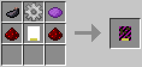

### Electric Manage module / 充電管理モジュール / LP

* 実装状態: [ ]
* 名称: Electric Manage module / 日本語: 充電管理モジュール / Origin: `-` / New: `bcn:electric_manage_module`
* レシピ: `Blank module` x1 + `Redstone` x3 + `Electronic Circuit` x1 + `Battery` x1 + `Golden Chipset` x1 -> `Electric Manage module` x1
* レシピ配置図: `[000]` / `[000]` / `[000]`
* 概要: IC2の充電可能アイテム限定で、補給と回収、及び抽出の機能を発揮する. ［Charge Items］ならGUI内で指定したアイテムに関し、 配管内の充電99%未満のを回収及び5秒に1回補給、100%になったのを5秒に1回搬出する. ［Discharge Items］ならGUI内で指定したアイテムに関し、 配管内の充電1%以上のを回収及び5秒に1回補給、0%になったのを5秒に1回搬出する. 抽出モジュールと違い、搬出面偽装機能はないので設置面に注意. Dev632より、充電管理モジュールと充電緩衝モジュールへのみ搬出するようになった.
* 専用GUI: 有 — ロジスティクスレンチによる設定画面
* 実装方法: ◆［Discharge：No］の充電管理モジュールは、フィルター欄で指定したアイテムに関し、配管内に存在する充電量99%以下のアイテムにとっての回収ポイントとして機能しつつ、隣接コンテナ内にある充電量100%のアイテムは(ネットワーク内に回収ポイントがあるなら)5秒に1回のペースで発送する。MFEやMFSU、Charg [detail]

<!-- 画像なし -->

### Electric Buffer module / 充電緩衝モジュール / LP

* 実装状態: [ ]
* 名称: Electric Buffer module / 日本語: 充電緩衝モジュール / Origin: `-` / New: `bcn:electric_buffer_module`
* レシピ: `Blank module` x1 + `Redstone` x3 + `Advanced Circuit` x2 + `Golden Chipset` x1 -> `Electric Buffer module` x1
* レシピ配置図: `[000]` / `[000]` / `[000]`
* 概要: IC2の充電可能アイテム限定で、回収と供給、両方の機能を発揮する. GUIはなく、充電可能なアイテムなら全てが対象. Dev632より、充電管理モジュールへのみ搬出するようになった.
* 専用GUI: 有 — ロジスティクスレンチによる設定画面
* 実装方法: 

<!-- 画像なし -->

### Thaumic AspectSink module / 相指定回収モジュール / LP

* 実装状態: [ ]
* 名称: Thaumic AspectSink module / 日本語: 相指定回収モジュール / Origin: `-` / New: `bcn:thaumic_aspectsink_module`
* レシピ: `Blank module` x1 + `Redstone` x3 + `Fire Shard` x1 + `Water Shard` x1 + `Wind Shard` x1 + `Earth Shard` x1 + `Iron Chipset` x1 -> `Thaumic AspectSink module` x1
* レシピ配置図: `[000]` / `[000]` / `[000]`
* 概要: 相を指定することで、指定された相のいずれかを1つ以上持つアイテムの回収ポイントとして機能する. 結晶片は左上に水、右上に地、左下に火、右下に風. もしくはこの左右反転の組み合わせでしか作れないので注意. また、使用素材数の関係か歯車を使った素材増加レシピは存在しない. 最大9種類までの相を指定できるが、GUIがアイテムに含まれる相全てを追加するか、相指定をクリアするかのどちらかしかできないため少々扱いづらい.
* 専用GUI: 有 — ロジスティクスレンチによる設定画面
* 実装方法: 

<!-- 画像なし -->

### Logistics Inventory System Connector / コネクタパイプ / LP

* 実装状態: [ ]
* 名称: Logistics Inventory System Connector / 日本語: コネクタパイプ / Origin: `-` / New: `bcn:logistics_inventory_system_connector`
* レシピ: `Basic Logistics Pipe` x1 + `Ender Pearl` x2 / `Basic Logistics Pipe` x1 + `Ender Pearl` x1 + `Redstone` x2 -> `Logistics Inventory System Connector` x1
* レシピ配置図: `[000]` / `[000]` / `[000]`
* 概要: 空間を超えて繋がるEnderStorage系のチェスト追加MOD、 およびチャンクローダー装置の併用を前提とした擬似テレポートパイプ. バニラのエンダーチェストには使用できない. 空間を越えて中身を共有する2個のチェストの双方にこのパイプを接続、 ペアの周波数カードをセットする事で、 その亜空間チェストを一旦中継する事を通して遠くの2点が結ばれる.
* 専用GUI: 有 — ロジスティクス設定画面
* 実装方法: 

<!-- 画像なし -->

### Soldering Station / 溶接作業台 / LP

* 実装状態: [ ]
* 名称: Soldering Station / 日本語: 溶接作業台 / Origin: `-` / New: `bcn:soldering_station`
* レシピ: `Crafting Table` x1 + `Redstone` x1 + `Iron Ingot` x6 -> `Soldering Station` x1
* レシピ配置図: `[000]` / `[000]` / `[000]`
* 概要: このMODで追加される一部の特殊アイテム作成のための専用作業台. （※本当に一部の特殊かつ変則的なアイテムの作成にしか使用しない） BuildCraftのエンジン動力(MJ)で稼動し、(1.7.10以降は下ページ参照） 加工1回毎に鉄インゴットを1個、燃料代わりに消費する.
* 専用GUI: 有 — 溶接作業台GUI
* 実装方法: 

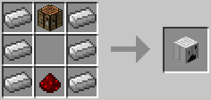

### Nano Hopper / ナノ漏斗 / LP

* 実装状態: [ ]
* 名称: Nano Hopper / 日本語: ナノ漏斗 / Origin: `-` / New: `bcn:nano_hopper`
* レシピ: `漏斗BC` x8 + `Iron Ingot` x1 / `Hopper` x8 + `Iron Ingot` x1 -> `Nano Hopper` x1
* レシピ配置図: `[000]` / `[000]` / `[000]`
* 概要: 加工パイプMk3の作成に必要となる中間部品. 単体では何にも使えない.
* 専用GUI: 有 — ロジスティクスレンチによる設定画面
* 実装方法: 

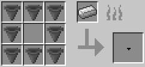

### Logistics Item Card / 周波数カード / LP

* 実装状態: [ ]
* 名称: Logistics Item Card / 日本語: 周波数カード / Origin: `-` / New: `bcn:logistics_item_card`
* レシピ: `Blank module` x1 + `Ender Pearl` x4 + `Iron Ingot` x1 / `Blank module` x2 + `Ender Pearl` x1 + `Iron Chipset` x2 + `Iron Ingot` x1 -> `Logistics Item Card` x1
* レシピ配置図: `[000]` / `[000]` / `[000]`
* 概要: コネクタパイプ各種を動作させるのに必要なカード. 加工時に2個スタックされて作成されたもの同士がペアになっており、 リンクさせたいコネクタパイプ2個にそれらをセットする必要がある. 既出の周波数のカードの再作成はできないため、 片方でも無くした場合、ペアごと新しく作り直さなければならなくなる.
* 専用GUI: 有 — ロジスティクス設定画面
* 実装方法: 

<!-- 画像なし -->

### Logistics HUD Bow / 眼鏡のツル / LP

* 実装状態: [ ]
* 名称: Logistics HUD Bow / 日本語: 眼鏡のツル / Origin: `-` / New: `bcn:logistics_hud_bow`
* レシピ: `Diamond` x3 + `Diamond Chipset` x1 + `Iron Ingot` x1 -> `Logistics HUD Bow` x1
* レシピ配置図: `[000]` / `[000]` / `[000]`
* 概要: 
* 専用GUI: 有 — ロジスティクス設定画面
* 実装方法: 

<!-- 画像なし -->

### Logistics HUD Glass / 眼鏡のレンズ / LP

* 実装状態: [ ]
* 名称: Logistics HUD Glass / 日本語: 眼鏡のレンズ / Origin: `-` / New: `bcn:logistics_hud_glass`
* レシピ: `Glass` x1 + `Diamond Chipset` x1 + `Glowstone Dust` x7 + `Iron Ingot` x1 -> `Logistics HUD Glass` x1
* レシピ配置図: `[000]` / `[000]` / `[000]`
* 概要: 
* 専用GUI: 有 — ロジスティクス設定画面
* 実装方法: 

<!-- 画像なし -->

### Logistics HUD Nose / 眼鏡のブリッジ / LP

* 実装状態: [ ]
* 名称: Logistics HUD Nose / 日本語: 眼鏡のブリッジ / Origin: `-` / New: `bcn:logistics_hud_nose`
* レシピ: `Diamond` x2 + `Diamond Chipset` x1 + `Iron Ingot` x1 -> `Logistics HUD Nose` x1
* レシピ配置図: `[000]` / `[000]` / `[000]`
* 概要: 
* 専用GUI: 有 — ロジスティクス設定画面
* 実装方法: 

<!-- 画像なし -->

### Logistics HUD Glasses / ロジスティクス眼鏡 / LP

* 実装状態: [ ]
* 名称: Logistics HUD Glasses / 日本語: ロジスティクス眼鏡 / Origin: `-` / New: `bcn:logistics_hud_glasses`
* レシピ: `Bridge Tube` x1 + `Lens` x2 + `Vines` x2 + `Iron Ingot` x1 -> `Logistics HUD Glasses` x1
* レシピ配置図: `[000]` / `[000]` / `[000]`
* 概要: 
* 専用GUI: 有 — ロジスティクス設定画面
* 実装方法: 

<!-- 画像なし -->

### Logistics Request Table / 要求作業台 / LP

* 実装状態: [ ]
* 名称: Logistics Request Table / 日本語: 要求作業台 / Origin: `logisticspipes:pipe_request_table` / New: `bcn:logistics_request_table`
* レシピ: `Chip Advanced` x1 + `Pipe Request Mk2` x1 + `Frame` x1 + `Pipe Crafting` x1 + `Chest Wood` x1 -> `Logistics Request Table` x1
* レシピ配置図: `0A0` / `BCD` / `0E0`
* 概要: 
* 専用GUI: 有 — 要求画面
* 実装方法: 

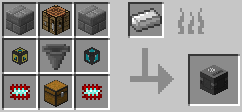

### Reset Module / モジュールの初期化 / LP

* 実装状態: [ ]
* 名称: Reset Module / 日本語: モジュールの初期化 / Origin: `-` / New: `bcn:reset_module`
* レシピ: なし
* レシピ配置図: `[000]` / `[000]` / `[000]`
* 概要: 全てのモジュールは、再クラフトする事で内部設定を初期化できる. 本来、一度GUI内で設定変更したモジュールは、 取り外しても設定を保持する性質上スタック不能になってしまうが、 こうする事で再びスタック可能な初期状態に戻す事ができる.
* 専用GUI: 有 — ロジスティクスレンチによる設定画面
* 実装方法: 

### Crafting Sign Creator / サインクリエイター / LP

* 実装状態: [ ]
* 名称: Crafting Sign Creator / 日本語: サインクリエイター / Origin: `-` / New: `bcn:crafting_sign_creator`
* レシピ: `Sign` x1 + `Golden Chipset` x2 + `Diamond Chipset` x1 -> `Crafting Sign Creator` x1
* レシピ配置図: `[000]` / `[000]` / `[000]`
* 概要: 他のツールと違って耐久値101、使用回数が有限なのに注意. "加工パイプ"または"加工パイプMk2"の側面をこれで右クリックすると、 作成物の情報が記された木板がパイプ側面に取り付けられる. （＝加工パイプの取り扱いアイテムを外見から可視可能にするのに使う）
* 専用GUI: 有 — クラフト設定
* 実装方法: 

<!-- 画像なし -->

### Remote Orderer / リモートオーダー / LP

* 実装状態: [ ]
* 名称: Remote Orderer / 日本語: リモートオーダー / Origin: `logisticspipes:remote_orderer` / New: `bcn:remote_orderer`
* レシピ: `Chip Advanced` x2 + `Gold Ingot` x1 + `Redstone` x3 + `Block Glass` x1 + `Gem Lapis` x2 -> `Remote Orderer` x1
* レシピ配置図: `ABA` / `CDE` / `CCE`
* 概要: これで各種ロジパイプ(通常パイプは×)を右クリックすると、 要求パイプと同じGUIが出現、その場にアイテムを取り寄せられる. チェストetc.に隣接していない場所でも取り寄せは可能だが、 その場合、送られてきたアイテムはその場にラインアウトする. Dev612より、遠隔要求パイプでの使用にLPが必要となった（距離と同量. 次元を跨ぐ場合は+500）
* 専用GUI: 有 — 遠隔発注画面
* 実装方法: 

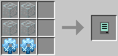

### 色付き/全16色 / リモートオーダー / LP

* 実装状態: [ ]
* 名称: 色付き/全16色 / 日本語: リモートオーダー / Origin: `-` / New: `bcn:item_3`
* レシピ: `Dye` x1 + `Remote Orderer` x1 -> `色付き` x1
* レシピ配置図: `[000]` / `[000]` / `[000]`
* 概要: 強度7 失敗作
* 専用GUI: 有 — ロジスティクスレンチによる設定画面
* 実装方法: 

<!-- 画像なし -->

### 再染色/全16色 / リモートオーダー / LP

* 実装状態: [ ]
* 名称: 再染色/全16色 / 日本語: リモートオーダー / Origin: `-` / New: `bcn:item_4`
* レシピ: `Dye` x1 + `全16色` -> `再染色` x1
* レシピ配置図: `[000]` / `[000]` / `[000]`
* 概要: 強度7 失敗作
* 専用GUI: 有 — ロジスティクスレンチによる設定画面
* 実装方法: 

<!-- 画像なし -->

### Network monitor / ネットワークモニター / LP

* 実装状態: [ ]
* 名称: Network monitor / 日本語: ネットワークモニター / Origin: `-` / New: `bcn:network_monitor`
* レシピ: `Golden Chipset` x1 + `Gold Ingot` x3 -> `Network monitor` x1
* レシピ配置図: `[000]` / `[000]` / `[000]`
* 概要: 手に持ってロジパイプを右クリックすると、 そのロジパイプのデータおよび輸送履歴が書かれたGUIが開く. 何らかの検証目的で統計を取るとかならともかく、 普通にプレイする範囲ではこれを作る必要も使う出番もない. ただし、アップグレーダーの材料でもある.
* 専用GUI: 有 — ロジスティクスレンチによる設定画面
* 実装方法: 

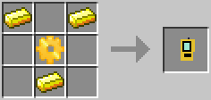

### Upgrade Manager / アップグレーダー / LP

* 実装状態: [ ]
* 名称: Upgrade Manager / 日本語: アップグレーダー / Origin: `-` / New: `bcn:upgrade_manager`
* レシピ: `Network monitor` x1 + `Wrench (BC)` x1 -> `Upgrade Manager` x1
* レシピ配置図: `[000]` / `[000]` / `[000]`
* 概要: ツール. 耐久値∞. スタック可能. これを手に持った状態で各種ロジパイプ(全種)を右クリックすると、 アップグレードチップ着脱用の専用GUIが開く. ただしチップを持ってロジパイプを右クリックする方法でも挿入できる他、ロジパイプを一旦撤去する事でも挿入済みチップの取り外しは可能.
* 専用GUI: 無
* 実装方法: 

<!-- 画像なし -->

### Logistic Security Station / セキュリティステーション / LP

* 実装状態: [ ]
* 名称: Logistic Security Station / 日本語: セキュリティステーション / Origin: `-` / New: `bcn:logistic_security_station`
* レシピ: `Basic Logistics Pipe` x1 + `Redstone` x2 + `Iron Ingot` x5 + `Diamond Chipset` x1 -> `Logistic Security Station` x1
* レシピ配置図: `[000]` / `[000]` / `[000]`
* 概要: マルチ用装置. シングルでは特に作る必要性はない. この装置で作成できるセキュリティカードをネットワーク内のいずれかのロジパイプに組み込むことで、他人のロジパイプへのアクセスを制限できる. ただしセキュリティステーション自体は誰でもアクセス、破壊可能で、またロジパイプ以外に対してはネットワーク内でも無力である.
* 専用GUI: 有 — ロジスティクスレンチによる設定画面
* 実装方法: 

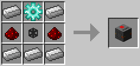

### Item Speed Upgrade / 速度加速チップ / LP

* 実装状態: [ ]
* 名称: Item Speed Upgrade / 日本語: 速度加速チップ / Origin: `-` / New: `bcn:item_speed_upgrade`
* レシピ: `Iron Chipset` x1 + `Gold Ingot` x4 + `Paper` x4 -> `Item Speed Upgrade` x1
* レシピ配置図: `[000]` / `[000]` / `[000]`
* 概要: このチップが装着されたロジパイプは、通過アイテムを加速させる. このチップのみ、GUI内において1スロットに16個までスタックして置ける. ただし1個を作成するためのコストが非常に高い割には、 1個あたりの加速力が非常に弱いので、実際には非常に使い所に困る. （DefaultRoute行きのアイテムの場合、12個装着でようやく最高速化） このチップが装着されたロジパイプ(種類問わず)から、 隣接しているインベントリ内包ブロックにアイテム搬入がなされた場合、 必ず指定面から搬入された扱いになる(この場合は上面から) あくまで偽装するのは搬入のみで、搬出偽装効果はない. （というか搬出の偽装の方は抽出モジュールに役割が一任されている） 同上. 接続面が違っていても、必ず"下面から搬入した"事になる. 同上. 接続面が違っていても、必ず"側面(北)から搬入した"事になる. 同上. 接続面が違っていても、必ず"側面(南)から搬入した"事になる. 同上. 接続面が違っていても、必ず"側面(東)から搬入した"事になる. 同上. 接続面が違っていても、必ず"側面(西)から搬入した"事になる.
* 専用GUI: 無
* 実装方法: 

<!-- 画像なし -->

### Sneaky Combination Upgrade / 搬入偽装組み合わせチップ / LP

* 実装状態: [ ]
* 名称: Sneaky Combination Upgrade / 日本語: 搬入偽装組み合わせチップ / Origin: `-` / New: `bcn:sneaky_combination_upgrade`
* レシピ: `Iron Chipset` x1 + `Redstone` x4 + `Paper` x4 -> `Sneaky Combination Upgrade` x1
* レシピ配置図: `[000]` / `[000]` / `[000]`
* 概要: このチップを装着すると、アップグレードGUIに搬入偽装チップ専用のスロットが9つ追加される. このチップが装着されたロジパイプ(種類問わず)は、 自身の真上に存在するブロック or パイプとは一切連結しなくなる. 既に連結済みだった場合は、装着と同時に切断される. 狭いエリアに複雑な配管を密集させたい場合に便利な一方で、 材料コストの観点から大規模な配管に恒常的に使用するのは難しい. 同上. 自身の真下に存在するブロック or パイプと一切連結しなくなる. 同上. 自身の北隣に存在するブロック or パイプと一切連結しなくなる. 同上. 自身の南隣に存在するブロック or パイプと一切連結しなくなる. 同上. 自身の東隣に存在するブロック or パイプと一切連結しなくなる. 同上. 自身の西隣に存在するブロック or パイプと一切連結しなくなる.
* 専用GUI: 無
* 実装方法: 

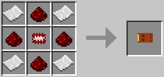

### Advanced Satellite Upgrade / 発展型加工補佐チップ / LP

* 実装状態: [ ]
* 名称: Advanced Satellite Upgrade / 日本語: 発展型加工補佐チップ / Origin: `-` / New: `bcn:advanced_satellite_upgrade`
* レシピ: `Golden Chipset` x1 + `Iron Ingot` x4 + `Paper` x4 -> `Advanced Satellite Upgrade` x1
* レシピ配置図: `[000]` / `[000]` / `[000]`
* 概要: （Dev430よりレシピ追加） 加工パイプ(またはモジュール)にのみセット可能. 加工パイプGUI内の材料欄で、全ての材料枠に対してSatelliteIDをそれぞれ個別に設定可能になる.
* 専用GUI: 無
* 実装方法: 

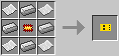

### Fluid Crafting Upgrade / 液体加工補佐チップ / LP

* 実装状態: [ ]
* 名称: Fluid Crafting Upgrade / 日本語: 液体加工補佐チップ / Origin: `-` / New: `bcn:fluid_crafting_upgrade`
* レシピ: `Golden Chipset` x1 + `Redstone` x4 + `Glass Bottle` x4 -> `Fluid Crafting Upgrade` x1
* レシピ配置図: `[000]` / `[000]` / `[000]`
* 概要: 
* 専用GUI: 無
* 実装方法: 

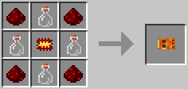

### Crafting Byproduct Extracting Upgrade / 加工副産物排出チップ / LP

* 実装状態: [ ]
* 名称: Crafting Byproduct Extracting Upgrade / 日本語: 加工副産物排出チップ / Origin: `-` / New: `bcn:crafting_byproduct_extracting_upgrade`
* レシピ: `Iron Chipset` x1 + `Redstone` x4 + `Wooden Gear` x4 -> `Crafting Byproduct Extracting Upgrade` x1
* レシピ配置図: `[000]` / `[000]` / `[000]`
* 概要: 
* 専用GUI: 無
* 実装方法: 

<!-- 画像なし -->

### Placement Rules Upgrade / 補給配置規則チップ / LP

* 実装状態: [ ]
* 名称: Placement Rules Upgrade / 日本語: 補給配置規則チップ / Origin: `-` / New: `bcn:placement_rules_upgrade`
* レシピ: `Iron Chipset` x1 + `Redstone` x2 + `Iron Ingot` x3 + `Hopper` x1 + `Red Dye` x1 + `Yellow Dye` x1 -> `Placement Rules Upgrade` x1
* レシピ配置図: `[000]` / `[000]` / `[000]`
* 概要: 
* 専用GUI: 無
* 実装方法: 

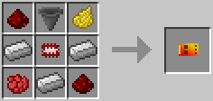

### Fuzzy Upgrade / ファジーチップ / LP

* 実装状態: [ ]
* 名称: Fuzzy Upgrade / 日本語: ファジーチップ / Origin: `-` / New: `bcn:fuzzy_upgrade`
* レシピ: `Golden Chipset` x1 + `Paper` x4 + `Nether Quartz` x4 -> `Fuzzy Upgrade` x1
* レシピ配置図: `[000]` / `[000]` / `[000]`
* 概要: 
* 専用GUI: 無
* 実装方法: 

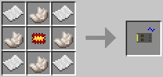
