> [ガイド](./GUIDE.md) > [科学技術ガイド](./GUIDE_TECH.md) > 科学技術の機械

# 科学技術の機械

採掘・加工・建設・液体処理の各種機械と専用装置.

### Chute / 漏斗 / BC

* 実装状態: [ ]
* 名称: Chute / 日本語: 漏斗 / Origin: `buildcraftfactory:chute` / New: `bcn:chute`
* レシピ: `Iron Ingot` x5 + `Chest` x1 + `Stone Gear` x1 -> `Chute` x1
* レシピ配置図: `ABA` / `ACA` / `0A0`
* 概要: 厳密に言えばマシンではなく、アイテム搬送ラインにおける中継装置. 内部に4スロット分のインベントリを持ち、そこにアイテムを入れておくと、 真下のチェスト、かまど、マシンetc.のスロットに空きが出来た場合、 手持ちのアイテムを(上面から)順次そこに補充する.
* 専用GUI: 有 — 緩衝スロット
* 実装方法: チェスト、かまど、全自動作業台、エンジン、各種マシンなど、内部インベントリを持つブロックの真上に設置して使う。真下のブロック内のアイテムスロットに空きがある限り、5tickに1回1個ずつ、アイテムを逐次投入する。（漏斗内におけるアイテム投入の優先順位は、左上→上中央→右上→下中央）かまどetc.の搬入面が複数存在するブ [mach1] / 漏斗への搬入はアイテムパイプで行う他、プレイヤーが手動でアイテムを置く事もできる。1個の漏斗に保留しておけるのは4スタックまでだが、漏斗の上に漏斗を重ねる事もできる。投入速度が完全に同期している関係上、重ねた漏斗の中間部分には（下が詰まっていない限り）1個しかアイテムが滞留しない。 [mach1]

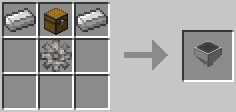

### Auto Workbench / 全自動作業台 / BC

* 実装状態: [ ]
* 名称: Auto Workbench / 日本語: 全自動作業台 / Origin: `-` / New: `bcn:auto_workbench`
* レシピ: `Crafting Table` x1 + `Stone Gear` x2 -> `Auto Workbench` x1
* レシピ配置図: `[000]` / `[000]` / `[000]`
* 概要: 
* 専用GUI: 有 — 見本レシピの登録
* 実装方法: 精密作業台および全自動作業台・改を動作させるのに必要な装置。エンジンやエネルギーパイプからMJ入力を受けるとそれをレーザービームに変換し、対象装置に対して照射する。 [gate] / 基本的な使い方は全自動作業台とほぼ同じだが、従来の見本置き場だけでなく、RedPower2のプロジェクトテーブルやFFMの工作機が持つのと同じ原材料置き場を内包している。また、この見本置き場はアイテム置き場も兼ねる全自動作業台(通常)のと違い、ダイヤパイプやFFMの工作機同様、見本レシピを置く際にアイテムを消費しないよ [gate]

<!-- 画像なし -->

### Mining Well / ボーリングマシン / BC

* 実装状態: [ ]
* 名称: Mining Well / 日本語: ボーリングマシン / Origin: `buildcraftfactory:mining_well` / New: `bcn:mining_well`
* レシピ: `Iron Ingot` x6 + `Redstone` x1 + `Iron Gear` x1 + `Iron Pickaxe` x1 -> `Mining Well` x1
* レシピ配置図: `ABA` / `ACA` / `ADA`
* 概要: 稼動にはエンジン動力が必要. 採掘マシンその1. 直下掘り機. クァーリーのマイナーチェンジ版で、自身の真下1列しか掘れないが、 作りやすく、操作も簡単、取り回しに優れ、低燃費. 初心者がとりあえず触ってBuildCraftに慣れるのに最適なマシンでもある.
* 専用GUI: 無 — エンジン直結で動作
* 実装方法: 稼動直後(ピストンカラー青)時のピストン速度は木エンジンの2倍(2.6秒に1回)。蓄熱により→緑→橙→赤とヒートアップするほど、ピストン速度も→2倍→4倍→8倍と倍々に速くなる。木エンジンと違い、ポンプ以外のマシンに使った場合は「橙⇔赤」まで温まらない。ボーリングマシンやビルダーに対しては緑止まり、フィラーやクァーリー [engine] / ＜作業の進行＞エンジン直付け または エネルギーパイプ によりMJ入力を受けると、25MJ毎にブロックを1つ設置または撤去する。設置に使用するブロックはプレイヤーが自前で用意、建材としてフィラー内に入れておく必要がある。撤去されたブロックはクァーリーやボーリングマシンと違って回収されず、撤去後、即座に消滅してしまう。 [mach2]

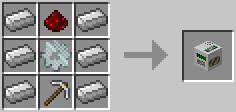

### Quarry / クァーリー / BC

* 実装状態: [ ]
* 名称: Quarry / 日本語: クァーリー / Origin: `buildcraftbuilders:quarry` / New: `bcn:quarry`
* レシピ: `Iron Gear` x3 + `Redstone` x1 + `Gold Gear` x2 + `Diamond Gear` x2 + `Diamond Pickaxe` x1 -> `Quarry` x1
* レシピ配置図: `ABA` / `CAC` / `DED`
* 概要: 稼動にはエンジン動力が必要. 採掘マシンその2. 露天掘り機. ボーリングマシンの強化版で、1列だけでなく広い範囲を採掘できる. ただし作成コストが高い、範囲指定などの要素がある、 低出力エンジンでは動かし辛いなど、初心者にはハードルが高い面もある. またBC7よりデザインが変化. 作業状況に応じたランプが点灯するようになっている.
* 専用GUI: 有 — 採掘範囲と回収物の確認
* 実装方法: ! style='vertical-align:MIDDLE;background-color:lightgray;' rowspan='2'|燃料x1での採掘数(クァーリー) [engine] / 石エンジン …… バランスの取れたエンジン。大抵のマシンを動かせるが、クァーリー・リファイナリー・レーザー等には出力不足。 [engine]

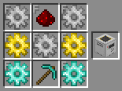

### Tank / 液体タンク / BC

* 実装状態: [ ]
* 名称: Tank / 日本語: 液体タンク / Origin: `buildcraftfactory:tank` / New: `bcn:tank`
* レシピ: `Glass` x8 -> `Tank` x1
* レシピ配置図: `AAA` / `A0A` / `AAA`
* 概要: バケツやポンプで汲んだ液体(水、溶岩、etc.)を溜め込むための液体タンク. これ1ブロックで16ブロック分の液体を貯蓄できる. 撤去しても中身の液体は溢れず、蓄えた液体ごと消滅する. 縦に重ねては結合させられるが、横に並べては連結させられない. 液体用パイプもしくはバケツの手作業で流入、搬出できる.
* 専用GUI: 有 — 貯蔵液体と容量の確認
* 実装方法: 稼動にはレッドストーン入力だけでなく、「溶岩」or「黒オイル」or「金オイル」が燃料として必要(左のゲージ)また、冷却用に「水」の搬入も半必須で(右のゲージ)、無いと長時間稼動させ続けた場合、最終的に必ず爆発する。これらの液体の搬入はバケツでも行えるが、バケツリレーが大変になるため、大抵は「ポンプ」「液体タンク」「液体 [engine] / 例外は液体パイプを使用せず、ポンプに液体タンクや鉄エンジンetc.を直接隣接させたような場合で、この場合はポンプの性能が最大限に引き出され、10MJ/tの入力により1tickに1ブロック分の液体が汲まれる。こうなると水源は縦7x横7x深1でもギリギリ、できれば念を入れて縦9x横9x深1の広さが欲しい。 [engine]

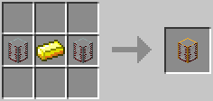

### Pump / ポンプ / BC

* 実装状態: [ ]
* 名称: Pump / 日本語: ポンプ / Origin: `buildcraftfactory:pump` / New: `bcn:pump`
* レシピ: `Iron Ingot` x4 + `Redstone` x1 + `Iron Gear` x1 + `Tank` x2 + `Bucket` x1 -> `Pump` x1
* レシピ配置図: `ABA` / `ACA` / `DED`
* 概要: 稼動にはエンジン動力が必要. 取水装置. 真下に液体がある場所に設置すると、ホースを伸ばして液体を吸引する. 水以外にも、溶岩、黒オイルなどを汲むのにも使え、 汲み取られた液体は隣の液体パイプや液体タンクへ次々搬出される.
* 専用GUI: 有 — 汲み上げと貯蔵の確認
* 実装方法: 必要電力 (最低連続動作量): 200EU(1EU/t) ; 稼動直後(ピストンカラー青)時のピストン速度は木エンジンの2倍(2.6秒に1回)。蓄熱により→緑→橙→赤とヒートアップするほど、ピストン速度も→2倍→4倍→8倍と倍々に速くなる。木エンジンと違い、ポンプ以外のマシンに使った場合は「橙⇔赤」まで温まらない。ボーリングマシンやビルダーに対しては緑止まり、フィラーやクァーリー [engine] / 稼動にはレッドストーン入力だけでなく、「溶岩」or「黒オイル」or「金オイル」が燃料として必要(左のゲージ)また、冷却用に「水」の搬入も半必須で(右のゲージ)、無いと長時間稼動させ続けた場合、最終的に必ず爆発する。これらの液体の搬入はバケツでも行えるが、バケツリレーが大変になるため、大抵は「ポンプ」「液体タンク」「液体 [engine]

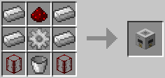

### Refinery / リファイナリー / BC

* 実装状態: [ ]
* 名称: Refinery / 日本語: リファイナリー / Origin: `-` / New: `bcn:refinery`
* レシピ: `Complex Circuit` x1 + `Nether Bricks` x2 + `Alloy Smelter` x1 + `Machine Tank` x2 + `Advanced Machine Block` x1 -> `Refinery` x1
* レシピ配置図: `0A0` / `BCB` / `DED`
* 概要: 稼動にはエンジン動力が必要. "黒オイル"を濾過蒸留して"金オイル"に変換する、オイル精製マシン. v3.2.0から稼動方式が変わってエネルギー減衰が無くなり、 エンジン直付けでも問題なく動かせるようになった.
* 専用GUI: 有 — 精製フィルタとタンク管理
* 実装方法: 石エンジン …… バランスの取れたエンジン。大抵のマシンを動かせるが、クァーリー・リファイナリー・レーザー等には出力不足。 [engine] / ＜バイオエタノールの精製＞ForestryForMinecraftを導入している場合、リファイナリーを使ってもバイオ燃料(緑)からバイオエタノール(橙)を精製する事ができる。これに関しても装置内のGUIの操作は必須でなく、単に液体パイプを使ってバイオ燃料を流し込むか、容器を使ってバイオ燃料を投入するかするだけで普通に液 [mach1]

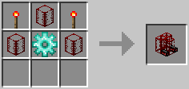

### Land Mark / 青マーカー / BC

* 実装状態: [ ]
* 名称: Land Mark / 日本語: 青マーカー / Origin: `-` / New: `bcn:land_mark`
* レシピ: `Lapis Lazuli` x1 + `Redstone Torch` x1 -> `Land Mark` x1
* レシピ配置図: `[000]` / `[000]` / `[000]`
* 概要: "クァーリー"、"フィラー"、"製図机"の3マシンを設置するに当たり、 その前段階として作業範囲を指定するのに使うマーカーロッド. 2本使って直線範囲、3本使って面範囲、4本使って空間範囲を……と、 こればかりは百聞は一見に如かず、図を見た方が早いので、 詳細解説（青マーカーでの範囲指定）の項目を参照の事. 地味に光度8(レッドストーントーチより1高い)の光を発している.
* 専用GUI: 無
* 実装方法: 青マーカーと同様、2つの緑マーカー同士に赤線が結ばれる限界距離は64x64x64。レッドストーン入力で、指針となる仮の線を出す事も可能。ただし緑マーカー同士の距離が離れるほど、マーカーのサーチに時間が掛かり、赤線が結ばれるのが遅くなる。64マス離れている場合には30秒ほど。上図のように、64x64マス離れている場合は3 [mach2]

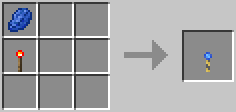

### Filler / フィラー / BC

* 実装状態: [ ]
* 名称: Filler / 日本語: フィラー / Origin: `-` / New: `bcn:filler`
* レシピ: `Crafting Table` x1 + `Ink Sac` x2 + `Land Mark` x1 + `Yellow Dye` x2 + `Gold Gear` x2 + `Chest` x1 -> `Filler` x1
* レシピ配置図: `[000]` / `[000]` / `[000]`
* 概要: 稼動にはエンジン動力が必要. 設置前に青マーカーでの作業範囲の指定が必須. 自動建設マシンその1. 整地マシン. 指定範囲に特定のブロックを敷き詰めたり、逆に全ブロックを撤去したり、 広大な範囲を整地したり、建物の外壁だけを作成したりできる. 1.12.2対応版ではまだ未実装の模様.
* 専用GUI: 有 — 充填パターンの指定
* 実装方法: ! style='vertical-align:MIDDLE;background-color:lightgray;' rowspan='2'|燃料x1での作業数(フィラー) [engine] / 稼動直後(ピストンカラー青)時のピストン速度は木エンジンの2倍(2.6秒に1回)。蓄熱により→緑→橙→赤とヒートアップするほど、ピストン速度も→2倍→4倍→8倍と倍々に速くなる。木エンジンと違い、ポンプ以外のマシンに使った場合は「橙⇔赤」まで温まらない。ボーリングマシンやビルダーに対しては緑止まり、フィラーやクァーリー [engine]

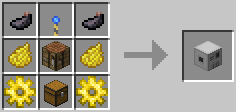

### Architect Table / 製図机 / BC

* 実装状態: [ ]
* 名称: Architect Table / 日本語: 製図机 / Origin: `buildcraftbuilders:architect` / New: `bcn:architect_table`
* レシピ: `Dye Black` x2 + `Marker Volume` x1 + `Dye Yellow` x2 + `Crafting Table` x1 + `Diamond Gear` x2 + `Snapshot` x1 -> `Architect Table` x1
* レシピ配置図: `ABA` / `CDC` / `EFE`
* 概要: 設置前に青マーカーでの作業範囲の指定が必須. 青マーカーでコピーする範囲を指定した後に、隣接させてこの機械を設置、 内部にテンプレートまたはブループリントを置くと、 使った製図の種類に応じて指定空間内におけるブロック情報を記録する. ただしあくまで"記録"だけが担当で、再構築は次の"ビルダー"の仕事.
* 専用GUI: 有 — 範囲設定と製図作成
* 実装方法: 

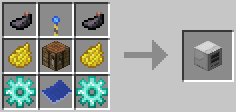

### Electronic Library / 製図棚 / BC

* 実装状態: [ ]
* 名称: Electronic Library / 日本語: 製図棚 / Origin: `-` / New: `bcn:electronic_library`
* レシピ: `Bookshelf` x2 + `Blueprint` x1 + `Iron Ingot` x4 + `Iron Gear` x1 + `Redstone` x1 -> `Electronic Library` x1
* レシピ配置図: `[000]` / `[000]` / `[000]`
* 概要: 作成した製図(黒、青両方)のデータをまとめて保存しておけるアーカイブ. 登録しておけば事故で製図を紛失しても安心、 一度登録したデータは、削除しない限り何度でも再ダウンロード可能. 複数の製図棚が(1ユーザー単位)でデータを共有しているので、 あるWorldの建物を別Worldにコピー、等の芸当も可能(材料は現地負担)
* 専用GUI: 無
* 実装方法: 

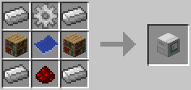

### Builder / ビルダー / BC

* 実装状態: [ ]
* 名称: Builder / 日本語: ビルダー / Origin: `-` / New: `bcn:builder`
* レシピ: `Crafting Table` x1 + `Ink Sac` x2 + `Land Mark` x1 + `Yellow Dye` x2 + `Diamond Gear` x2 + `Chest` x1 -> `Builder` x1
* レシピ配置図: `[000]` / `[000]` / `[000]`
* 概要: 稼動にはエンジン動力が必要. 製図机で"コピー"した構造物を"ペースト"するのに使う建築機械. 青マーカーでの範囲指定は必要なく、 記入済みの製図を内部スロットに置くと、建築予定線が自動展開される. 記録した構造物を垂直または水平に連続作成させたい場合は、 事前に"緑マーカー"で経路設定しておく必要がある. 不具合多発のためVer3.4.2にて機能凍結. その後Ver3.6.0にてレシピ及びクリエイティブタブからも削除された（ブロックとしては未だ存在している） なお、Ver.6.0.0で復活し、問題なく動作する模様.
* 専用GUI: 有 — 製図/テンプレートの指定と素材供給
* 実装方法: 稼動直後(ピストンカラー青)時のピストン速度は木エンジンの2倍(2.6秒に1回)。蓄熱により→緑→橙→赤とヒートアップするほど、ピストン速度も→2倍→4倍→8倍と倍々に速くなる。木エンジンと違い、ポンプ以外のマシンに使った場合は「橙⇔赤」まで温まらない。ボーリングマシンやビルダーに対しては緑止まり、フィラーやクァーリー [engine] / 本来、クァーリー、フィラー、ビルダーの作業が全て終了し、マシンが稼動停止しても、エンジンの方はそれを感知して自動停止したりせず、レッドストーン入力と燃料がある限り延々ピストンし続ける。燃やされた燃料と注がれたMJは全て無駄に空費される。これはそれを阻止するための配置。フィラーの場合は「ON」「OFF」「Loop」の3出 [gate]

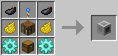

### Path Mark / 緑マーカー / BC

* 実装状態: [ ]
* 名称: Path Mark / 日本語: 緑マーカー / Origin: `-` / New: `bcn:path_mark`
* レシピ: `Green Dye` x1 + `Redstone Torch` x1 -> `Path Mark` x1
* レシピ配置図: `[000]` / `[000]` / `[000]`
* 概要: "ビルダー"でのみ使用する特殊なマーカーロッド. 使い方はほぼ青マーカーと同じだが、 こちらは同じ構造物を金太郎飴のように反復建築するのに使う. 地味に光度8(レッドストーントーチより1高い)の光を発している.
* 専用GUI: 無
* 実装方法: 青マーカーと同様、2つの緑マーカー同士に赤線が結ばれる限界距離は64x64x64。レッドストーン入力で、指針となる仮の線を出す事も可能。ただし緑マーカー同士の距離が離れるほど、マーカーのサーチに時間が掛かり、赤線が結ばれるのが遅くなる。64マス離れている場合には30秒ほど。上図のように、64x64マス離れている場合は3 [mach2]

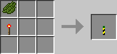

### Construction Mark / 建築マーカー / BC

* 実装状態: [ ]
* 名称: Construction Mark / 日本語: 建築マーカー / Origin: `-` / New: `bcn:construction_mark`
* レシピ: `Gold Gear` x1 + `Redstone Torch` x1 -> `Construction Mark` x1
* レシピ配置図: `[000]` / `[000]` / `[000]`
* 概要: 建築ロボット用のマーカー. このマーカーに対してブループリントを右クリックすると、建築指定範囲が表示され、ロボットが建築を行ってくれる.
* 専用GUI: 無
* 実装方法: 

<!-- 画像なし -->

### Requester / アイテム要求機 / BC

* 実装状態: [ ]
* 名称: Requester / 日本語: アイテム要求機 / Origin: `-` / New: `bcn:requester`
* レシピ: `Iron Ingot` x4 + `Iron Gear` x2 + `Piston` x1 + `Chest` x1 + `Redstone` x1 -> `Requester` x1
* レシピ配置図: `[000]` / `[000]` / `[000]`
* 概要: 
* 専用GUI: 有 — 要求アイテムの指定
* 実装方法: 

<!-- 画像なし -->

### Zone Planner / 範囲指定機 / BC

* 実装状態: [ ]
* 名称: Zone Planner / 日本語: 範囲指定機 / Origin: `-` / New: `bcn:zone_planner`
* レシピ: `Iron Ingot` x4 + `Gold Gear` x2 + `Diamond Gear` x1 + `Map` x1 + `Redstone` x1 -> `Zone Planner` x1
* レシピ配置図: `[000]` / `[000]` / `[000]`
* 概要: 
* 専用GUI: 有 — 範囲のマップ描画
* 実装方法: 

<!-- 画像なし -->

### Assembly Table / 精密作業台 / BC

* 実装状態: [ ]
* 名称: Assembly Table / 日本語: 精密作業台 / Origin: `buildcraftsilicon:assembly_table` / New: `bcn:assembly_table`
* レシピ: `Obsidian` x6 + `Gem Diamond` x1 + `Redstone` x1 + `Diamond Gear` x1 -> `Assembly Table` x1
* レシピ配置図: `ABA` / `ACA` / `ADA`
* 概要: ワイヤー、チップセット、ゲートなどを作成する為の専用作業台. 上記アイテムはこの作業台でしか作成できず、 更にこの作業台自体、レーザーの照射によってしか稼動しない. あらかじめ材料を置き、更にそれを使って何を作るか選択しておかないと、 範囲内にレーザー照射機があっても認識してもらえない点に注意.
* 専用GUI: 有 — レシピ選択と素材投入
* 実装方法: 精密作業台および全自動作業台・改を動作させるのに必要な装置。エンジンやエネルギーパイプからMJ入力を受けるとそれをレーザービームに変換し、対象装置に対して照射する。 [gate] / 動作にはレーザー照射が必要だが、精密作業台同様、完成品の搬出は自動で行われる(木パイプ不要)精密作業台と違って加工1回に必要なエネルギー量は一律500MJで固定であり、最大効率である4MJ/tの青色レーザー1本を照射した場合、作成＆搬出は6.25秒毎に1回のペースで行われる。内部に原材料置き場たるインベントリが内包され [gate]

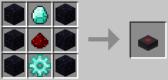

### Advanced Crafting Table / 全自動作業台、改 / BC

* 実装状態: [ ]
* 名称: Advanced Crafting Table / 日本語: 全自動作業台、改 / Origin: `buildcraftsilicon:advanced_crafting_table` / New: `bcn:advanced_crafting_table`
* レシピ: `Obsidian` x6 + `Crafting Table Wood` x1 + `Chest Wood` x1 + `Redstone Chipset` x1 -> `Advanced Crafting Table` x1
* レシピ配置図: `ABA` / `ACA` / `ADA`
* 概要: レーザー照射によってのみ動作する、全自動作業台. "全自動作業台(通常)"、"隣接チェスト"、"搬出用の木パイプ"の3つが 1ブロックに統合されているのと同じ作用を持っているが、 一方で加工1回に必要なエネルギー量は5000RF/tであり、 作成コストも全自動作業台(通常)に比べ遥かに高くなっている. その分レーザーを大量に設置すれば加工は一瞬で終わる.
* 専用GUI: 有 — レシピ登録と素材収納
* 実装方法: 

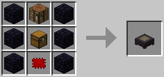

### Integration Table / レーザー合成台 / BC

* 実装状態: [ ]
* 名称: Integration Table / 日本語: レーザー合成台 / Origin: `buildcraftsilicon:integration_table` / New: `bcn:integration_table`
* レシピ: `Obsidian` x6 + `Gold Ingot` x1 + `Redstone Chipset` x1 + `Diamond Gear` x1 -> `Integration Table` x1
* レシピ配置図: `ABA` / `ACA` / `ADA`
* 概要: 精密作業台と似ているが、こちらはゲートやロボットにチップを合成するためだけの作業台.
* 専用GUI: 有 — ゲートへの改造合成
* 実装方法: 

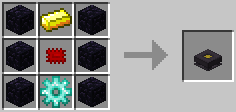

### Charging Table / スタンピングテーブル / BC

* 実装状態: [ ]
* 名称: Charging Table / 日本語: スタンピングテーブル / Origin: `-` / New: `bcn:charging_table`
* レシピ: `Obsidian` x6 + `Crafting Table` x1 + `Redstone Chipset` x1 + `Gold Gear` x1 -> `Charging Table` x1
* レシピ配置図: `[000]` / `[000]` / `[000]`
* 概要: レーザー駆動. ロボット、RFを使うアイテムに充電可能(TEのEnergy Cellで確認）
* 専用GUI: 有 — 対象アイテムの充電
* 実装方法: 

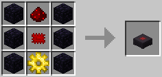

### Robot / ロボット / BC

* 実装状態: [ ]
* 名称: Robot / 日本語: ロボット / Origin: `-` / New: `bcn:robot`
* レシピ: `Iron Ingot` x5 + `Redstone Crystal` x1 + `Diamond Chipset` x2 -> `Robot` x1
* レシピ配置図: `[000]` / `[000]` / `[000]`
* 概要: 中間素材.
* 専用GUI: 無
* 実装方法: style='vertical-align:MIDDLE;'|エメラルドチップ1 + ワイヤー全色1ずつ = エメラルドゲート11200000RF（3000秒/青1本）設定できる条件の数が4個と、ダイヤゲートの半分ではあるが、条件がより細かく設定できるゲート。ロボットの制御にはこれが必須である。 [gate]

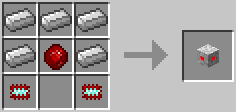

### Docking Station / ドック / BC

* 実装状態: [ ]
* 名称: Docking Station / 日本語: ドック / Origin: `-` / New: `bcn:docking_station`
* レシピ: `Iron Ingot` x3 + `Golden Chipset` -> `Docking Station` x1
* レシピ配置図: `[000]` / `[000]` / `[000]`
* 概要: ロボットとパイプを接続するためのアイテム. レーザー駆動. （白紙の）レッドストーンボードを材料に各種レッドストーンボード作成
* 専用GUI: 無 — ドック経由でロボットへ接続
* 実装方法: 

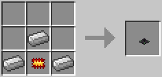

### Charging Table / レーザー充電台 / BC

* 実装状態: [ ]
* 名称: Charging Table / 日本語: レーザー充電台 / Origin: `-` / New: `bcn:charging_table`
* レシピ: `Obsidian` x6 + `Redstone` x1 + `Redstone Chipset` x1 + `Gold Gear` x1 -> `Charging Table` x1
* レシピ配置図: `[000]` / `[000]` / `[000]`
* 概要: レーザー駆動. ロボット、RFを使うアイテムに充電可能(TEのEnergy Cellで確認）
* 専用GUI: 有 — 対象アイテムの充電
* 実装方法: 

### Iron Furnace / 鉄のかまど / IC2

* 実装状態: [ ]
* 名称: Iron Furnace / 日本語: 鉄のかまど / Origin: `ic2:iron_furnace` / New: `bcn:iron_furnace`
* レシピ: `Iron Ingot` x5 + `Furnace` x1 -> `Iron Furnace` x1
* レシピ配置図: `0A0` / `A0A` / `ABA`
* 概要: 
* 専用GUI: 有 — 機械操作画面
* 実装方法: 必要電力 (最低連続動作量): なし

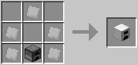

### Electric Furnace / 電気炉 / IC2

* 実装状態: [ ]
* 名称: Electric Furnace / 日本語: 電気炉 / Origin: `ic2:electric_furnace` / New: `bcn:electric_furnace`
* レシピ: `Circuit` x1 + `Redstone` x2 + `Furnace` x1 + `Machine Block` x1 -> `Electric Furnace` x1
* レシピ配置図: `0A0` / `BCB` / `0D0`
* 概要: 序盤に作っておきたい機械の一つ. 電気で動くかまどで精錬速度はさらに1.125倍. リソース不要な発電機と組み合わせれば燃料要らず.
* 専用GUI: 有 — 電気精錬
* 実装方法: 必要電力 (最低連続動作量): 313EU(3EU/t) ; 電気炉、リサイクル装置はオーバークロッカーを1枚使用した方が効率が良くなる。 [machines]

<!-- 画像なし -->

### Induction Furnace / 誘導加熱炉 / IC2

* 実装状態: [ ]
* 名称: Induction Furnace / 日本語: 誘導加熱炉 / Origin: `ic2:induction_furnace` / New: `bcn:induction_furnace`
* レシピ: `Copper Ingot` x7 + `Electric Furnace` x1 + `Advanced Machine Block` x1 -> `Induction Furnace` x1
* レシピ配置図: `AAA` / `ABA` / `ACA`
* 概要: IC2で追加された超高性能炉. 精錬スロットが2つある. 非常にスロースターターで時間が経つと精錬速度がかなり速くなり、同時に効率もあがる. 火を落とすとゆっくり冷えていき、冷えてる状態から暖めるのは時間が掛かる. 一度に大量の精錬がしたい時に非常に役に立つ. また、レッドストーンの動力を入力しておけば1EU/tで空焚きし、炉が温まった状態を作成、維持出来る. 中圧まで対応. アップグレードモジュールはセットできない.
* 専用GUI: 有 — 機械操作画面
* 実装方法: 必要電力 (最低連続動作量): 6000EU(0% heat時) (16EU/t) 208EU(100% heat時) (16 EU/t) ; 誘導加熱炉は非常に精錬が速く、最大速度での精錬を自動化するにはホッパーでは力不足であり、各種MODを用いる必要がある。 [machines]

<!-- 画像なし -->

### Compressor / 圧縮機 / IC2

* 実装状態: [ ]
* 名称: Compressor / 日本語: 圧縮機 / Origin: `ic2:compressor` / New: `bcn:compressor`
* レシピ: `Stone` x6 + `Machine Block` x1 + `Circuit` x1 -> `Compressor` x1
* レシピ配置図: `A0A` / `ABA` / `ACA`
* 概要: 色々な物を圧縮出来る装置. 原発を作るなら必須となる.
* 専用GUI: 有 — 圧縮処理
* 実装方法: 必要電力 (最低連続動作量): 625EU(2EU/t)

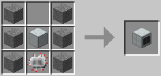

### Extractor / 抽出機 / IC2

* 実装状態: [ ]
* 名称: Extractor / 日本語: 抽出機 / Origin: `ic2:extractor` / New: `bcn:extractor`
* レシピ: `Treetap` x4 + `Machine Block` x1 + `Circuit` x1 -> `Extractor` x1
* レシピ配置図: `ABA` / `ACA`
* 概要: 序盤に作っておきたい機械の一つ. ゴムの木からゴムを抽出する時や燃料セルなどで使う.
* 専用GUI: 有 — 抽出処理
* 実装方法: 必要電力 (最低連続動作量): 313EU(2EU/t)

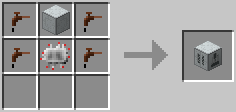

### Macerator / 粉砕機 / IC2

* 実装状態: [ ]
* 名称: Macerator / 日本語: 粉砕機 / Origin: `ic2:macerator` / New: `bcn:macerator`
* レシピ: `Flint` x3 + `Cobblestone` x2 + `Machine Block` x1 + `Circuit` x1 -> `Macerator` x1
* レシピ配置図: `AAA` / `BCB` / `0D0`
* 概要: 序盤に作っておきたい機械の一つ. 鉱物1個を粉末2つに変換する. 粉末は精錬することでインゴットになるので、実質的に鉱物の取得量を二倍に出来る装置. また、インゴットを1つの粉末にすることや、丸石を粉砕機にかけることで砂にすることもできる.
* 専用GUI: 有 — 粉砕処理
* 実装方法: 必要電力 (最低連続動作量): 625EU(2EU/t)

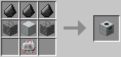

### Miner / 掘削機 / IC2

* 実装状態: [ ]
* 名称: Miner / 日本語: 掘削機 / Origin: `ic2:miner` / New: `bcn:miner`
* レシピ: `Circuit` x2 + `Machine Block` x1 + `Mining Pipe Shaft` x2 -> `Miner` x1
* レシピ配置図: `ABA` / `0C0` / `0C0`
* 概要: ドリル、スキャナ、採掘用パイプを入れると、 直下掘りをしつつ周辺の鉱石も採取する装置. 鉱石部分をくり抜くため真っ暗な空間が多数できてしまう. ドリルを取り出すと自動でパイプを引き上げてくれる. 隣にポンプ装置があると、液体を汲み上げることができる. ドリルやスキャナーは掘削開始前に充電される.
* 専用GUI: 有 — 自動採掘の管理
* 実装方法: 必要電力 (最低連続動作量): 530EU(2-3 EU/t) 960EU(20-24 EU/t)

<!-- 画像なし -->

### Electrolyzer / 電解水精製装置 / IC2

* 実装状態: [ ]
* 名称: Electrolyzer / 日本語: 電解水精製装置 / Origin: `ic2:electrolyzer` / New: `bcn:electrolyzer`
* レシピ: `Copper Insulated Cable Item` x4 + `Circuit` x1 + `Empty Cell` x2 + `Machine Block` x1 -> `Electrolyzer` x1
* レシピ配置図: `A0A` / `ABA` / `CDC`
* 概要: 水セルにEUを充填し、電解水セルに変える装置. 蓄電器の付属装置として入力面に隣接して設置する. 蓄電器の蓄電量が最大容量の30%未満だと放電、75％以上だと充填を開始する. 充填、放電速度は蓄電器の性能により変わる. 水セルは左スロットに、電解水セルは右スロットにセットする事で機能する. セルが大量運搬可能な事を利用し、拠点外での簡易発電施設として運用が可能.
* 専用GUI: 有 — 電気分解
* 実装方法: 必要電力 (最低連続動作量): 15000EU(10EU/t)

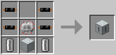

### Pump / ポンプ装置 / IC2

* 実装状態: [ ]
* 名称: Pump / 日本語: ポンプ装置 / Origin: `ic2:pump` / New: `bcn:pump`
* レシピ: `Empty Cell` x4 + `Circuit` x1 + `Machine Block` x1 + `Mining Pipe Shaft` x2 + `Treetap` x1 -> `Pump` x1
* レシピ配置図: `ABA` / `ACA` / `DED`
* 概要: 水や溶岩を汲み取れる装置. セルを入れておくと下にある液体を汲み取る. 隣にチェストがあると、そちらに水の入ったセルを入れる. また、チェスト内に空のバケツがあればそれに汲み取ってくれる. 掘削機と地熱発電機を隣接させると溶岩を汲み上げ自動で燃料の補給も可能 (ポンプに空セルを入れておくことでセルを消費せずに発電機へ溶岩を送り込める) 溶岩源でなく溶岩流でも汲み上げられるので、実質的に永久機関となる. また、チェストと発電機が隣接していた場合は発電機が優先される.
* 専用GUI: 有 — 汲み上げ管理
* 実装方法: 必要電力 (最低連続動作量): 200EU(1EU/t)

<!-- 画像なし -->

### Magnetizer / 磁気発生装置 / IC2

* 実装状態: [ ]
* 名称: Magnetizer / 日本語: 磁気発生装置 / Origin: `ic2:magnetizer` / New: `bcn:magnetizer`
* レシピ: `Redstone` x6 + `Iron Fence` x2 + `Machine Block` x1 -> `Magnetizer` x1
* レシピ配置図: `ABA` / `ACA` / `ABA`
* 概要: 電気を通すと磁力が発生する装置. 装置の真下に鉄の柵を垂直に積み上げてから、クアンタムブーツ、ナノブーツ、スタティックブーツ、 青銅、金、鉄製ブーツ、チェインブーツを装備して触れると高速で上昇可能. ただし最大18ブロックまで.
* 専用GUI: 有
* 実装方法: 必要電力 (最低連続動作量): 2EU/t(使用時のみ消費)

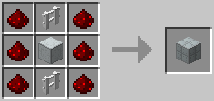

### Recycler / リサイクル装置 / IC2

* 実装状態: [ ]
* 名称: Recycler / 日本語: リサイクル装置 / Origin: `ic2:recycler` / New: `bcn:recycler`
* レシピ: `Glowstone Dust` x1 + `Dirt` x3 + `Compressor` x1 + `Refined Iron Ingot` x2 -> `Recycler` x1
* レシピ配置図: `0A0` / `BCB` / `DBD`
* 概要: 不要物を投入することで、約1/8の確率でスクラップが生成出来る. ただし、棒、板ガラス、雪玉、足場ブロックは投入してもスクラップが生成されない. （v1.71現在） 生成の可否はconfigファイルで設定変更できる.
* 専用GUI: 有 — スクラップ化
* 実装方法: 必要電力 (最低連続動作量): 35EU(1EU/t) ; 電気炉、リサイクル装置はオーバークロッカーを1枚使用した方が効率が良くなる。 [machines]

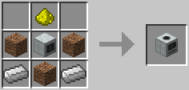

### Canning Machine / 缶詰製造機 / IC2

* 実装状態: [ ]
* 名称: Canning Machine / 日本語: 缶詰製造機 / Origin: `ic2:canner` / New: `bcn:canning_machine`
* レシピ: `Tin Ingot` x7 + `Circuit` x1 + `Stone Canner` x1 -> `Canning Machine` x1
* レシピ配置図: `ABA` / `ACA` / `AAA`
* 概要: 食べ物を缶詰にしたり燃料缶やジェットパックに燃料を注入したり出来る装置. 缶詰を作るにはその食べ物の空腹回復量と同数だけ缶が必要になる. マイナス効果を持つ食べ物を缶詰にした場合、マイナス効果を引き継ぐので注意.
* 専用GUI: 有 — 缶詰/封入処理
* 実装方法: 必要電力 (最低連続動作量): ？EU(1EU/t)

<!-- 画像なし -->

### Mass Fabricator / 物質製造機 / IC2

* 実装状態: [ ]
* 名称: Mass Fabricator / 日本語: 物質製造機 / Origin: `ic2:mass_fabricator` / New: `bcn:mass_fabricator`
* レシピ: `Glowstone Dust` x4 + `Advanced Circuit` x2 + `Stabilized Machine Block` x2 + `Lapatron Crystal` x1 -> `Mass Fabricator` x1
* レシピ配置図: `ABA` / `CDC` / `ABA`
* 概要: 万能の物質マターを精製する装置. 安定した稼働には莫大な電力と大量の素材を必要とする. スクラップやスクラップボックスを素材に使えば必要EUと制作時間を削減できる. レッドストーンの動力が入力されている間は精製を中断する. 超高電圧には耐えられないが作業量自体は電力量に比例する為、高電圧を複数送る事で高効率化が可能.
* 専用GUI: 有 — UU物質生成
* 実装方法: 必要電力 (最低連続動作量): 100万EU(1EU/t)

<!-- 画像なし -->

### Terraformer / テラフォーマー / IC2

* 実装状態: [ ]
* 名称: Terraformer / 日本語: テラフォーマー / Origin: `ic2:terraformer` / New: `bcn:terraformer`
* レシピ: `Glowstone Dust` x4 + `Tfbp` x1 + `Dirt` x3 + `Stabilized Machine Block` x1 -> `Terraformer` x1
* レシピ配置図: `ABA` / `CDC` / `ACA`
* 概要: 環境を変異させる装置. 草原を寒冷地や砂漠地帯に出来たりなど自由自在. 大量のEUと、TFBPという地形情報が記録されたカートリッジを読み込ませる必要がある. 左の表は最低動作電圧で、電圧をあげればあげるほど速度が上がる. 中圧まで対応.
* 専用GUI: 有 — テラフォーム設定
* 実装方法: 必要電力 (最低連続動作量): 寒冷化 4EU/t 砂漠化 4EU/t 平地化 40EU/t 培養 20EU/t 灌漑 8EU/t

<!-- 画像なし -->

### Crop-Matron / 農薬散布機 / IC2

* 実装状態: [ ]
* 名称: Crop-Matron / 日本語: 農薬散布機 / Origin: `ic2:crop_matron` / New: `bcn:crop_matron`
* レシピ: `Circuit` x2 + `Chest` x1 + `Crop Sticks` x5 + `Machine Block` x1 -> `Crop-Matron` x1
* レシピ配置図: `ABA` / `CDC` / `CCC`
* 概要: 
* 専用GUI: 有 — 農薬/肥料の散布管理
* 実装方法: 必要電力 (最低連続動作量): 1EU/t

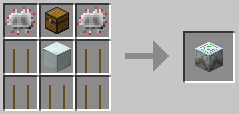

### Scaffold / 足場ブロック / IC2

* 実装状態: [ ]
* 名称: Scaffold / 日本語: 足場ブロック / Origin: `-` / New: `bcn:scaffold`
* レシピ: `Wooden Planks` x3 + `Stick` x3 -> `Scaffold` x1
* レシピ配置図: `[000]` / `[000]` / `[000]`
* 概要: 低コストで作成可能な一時的な足場用ブロック. ただし酒造においては酒樽を設置するための骨組みとして使用する.
* 専用GUI: 無
* 実装方法: :火力発電の燃料ソースに原木を採用する場合、木炭にするよりも足場ブロックにする方が効率が良い。 [machines] / :*足場：原木1個≒足場ブロック14.2個×750EU(木製品)＝10650EU [machines]

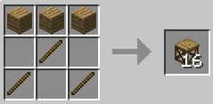

### Iron Scaffold / 鉄製の足場ブロック / IC2

* 実装状態: [ ]
* 名称: Iron Scaffold / 日本語: 鉄製の足場ブロック / Origin: `ic2:scaffold_iron` / New: `bcn:iron_scaffold`
* レシピ: `Refined Iron Ingot` x3 + `Iron Fence` x3 -> `Iron Scaffold` x16
* レシピ配置図: `AAA` / `0B0` / `B0B`
* 概要: 鉄製の強化版足場ブロック. 足場ブロックと同じように使用でき、はじめから左右に5ブロック分までつけることができる. 鉄の柵で強化すると、左右に12ブロック分までつけられるようになる. CFスプレーを使用しても置き換わらない. 支えがなくなるとアイテム化するのは足場ブロックと同じだが、つるはしで壊さないと壊した分の足場1個はアイテム化しないので気を付けよう.
* 専用GUI: 無
* 実装方法: 

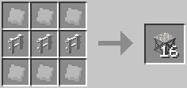

### Teleporter / テレポーター / IC2

* 実装状態: [ ]
* 名称: Teleporter / 日本語: テレポーター / Origin: `ic2:teleporter` / New: `bcn:teleporter`
* レシピ: `Advanced Circuit` x4 + `Frequency Transmitter` x1 + `Glassfiber Cable Item` x2 + `Stabilized Machine Block` x1 + `Diamond` x1 -> `Teleporter` x1
* レシピ配置図: `ABA` / `CDC` / `AEA`
* 概要: 長距離移動に使えるテレポート装置. 使い勝手は悪いが1km以上もの距離を一瞬で移動可能.
* 専用GUI: 有 — テレポート設定
* 実装方法: 

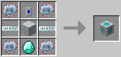

### Personal Safe / 個人チェスト / IC2

* 実装状態: [ ]
* 名称: Personal Safe / 日本語: 個人チェスト / Origin: `-` / New: `bcn:personal_safe`
* レシピ: `Electronic Circuit` x1 + `Machine` x1 + `Chest` x1 -> `Personal Safe` x1
* レシピ配置図: `[000]` / `[000]` / `[000]`
* 概要: マルチ用アイテムで個人専用のチェストになる. 大きさはラージチェストと同じ. 設置した本人と管理者権限を持った人でないと開くことも壊すことも出来ない. 撤去するには中身をすべて取り出し、レンチを使う必要がある.
* 専用GUI: 有 — 個人ロッカー
* 実装方法: 

<!-- 画像なし -->

### Trade-O-Mat / トレード-O-Mat / IC2

* 実装状態: [ ]
* 名称: Trade-O-Mat / 日本語: トレード-O-Mat / Origin: `ic2:trade_o_mat` / New: `bcn:trade_o_mat`
* レシピ: `Redstone` x3 + `Chest` x2 + `Machine Block` x1 -> `Trade-O-Mat` x1
* レシピ配置図: `AAA` / `BCB`
* 概要: マルチ用アイテム. Coinやアイテムを使ってのアイテム取引に使う. 撤去方法は個人チェストと同様. 詳しい使い方は別ページにて. 余談だが名前の由来は恐らくAutomated Tradingだと思われる.
* 専用GUI: 有 — 自動販売設定
* 実装方法: 

<!-- 画像なし -->

### Hazmat Suit / HAZMATスーツ / IC2

* 実装状態: [ ]
* 名称: Hazmat Suit / 日本語: HAZMATスーツ / Origin: `ic2:armor_hazmat_chest` / New: `bcn:hazmat_suit`
* レシピ: `Rubber` x6 + `Orange Dye` x2 -> `Hazmat Suit` x1
* レシピ配置図: `A0A` / `ABA` / `ABA`
* 概要: 危険物取り扱い用の防護服一式(スキューバヘルメット、HAZMATチェストプレート、HAZMATレギンス、ゴムブーツで防護服一式とする) 防護服一式を着ていれば溶岩や原子炉融解時の熱を含む燃焼ダメージと感電ダメージと爆発時のダメージを完全に無効化する. ヘルメット単体には酸素マスクとして機能があり、 圧縮酸素セルを持っていれば水中で酸素マークが残り4つになっても自動で消費して酸素を補充してくれる.
* 専用GUI: 無
* 実装方法: 

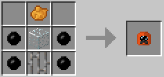

### Treetap / ツリータップ / IC2

* 実装状態: [ ]
* 名称: Treetap / 日本語: ツリータップ / Origin: `ic2:treetap` / New: `bcn:treetap`
* レシピ: `Wooden Planks` x5 -> `Treetap` x1
* レシピ配置図: `0A0` / `AAA` / `A00`
* 概要: ゴムの木から樹液を抽出する道具. ただし酒造においては酒樽から酒を汲む目的で酒樽に取り付ける.
* 専用GUI: 無
* 実装方法: 

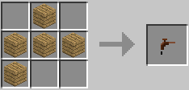

### Electric Treetap / 電動ツリータップ / IC2

* 実装状態: [ ]
* 名称: Electric Treetap / 日本語: 電動ツリータップ / Origin: `ic2:electric_treetap` / New: `bcn:electric_treetap`
* レシピ: `Treetap` x1 + `Circuit` x1 + `RE Battery` x1 -> `Electric Treetap` x1
* レシピ配置図: `00A` / `0B0` / `C00`
* 概要: バッテリー駆動のツリータップ. 充電(1万EU)する事で何度でも使える.
* 専用GUI: 無
* 実装方法: 

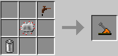

### Booze Barrel / 酒樽 / IC2

* 実装状態: [ ]
* 名称: Booze Barrel / 日本語: 酒樽 / Origin: `-` / New: `bcn:booze_barrel`
* レシピ: `Rubber Log` x1 + `Wooden Planks` x2 -> `Booze Barrel` x1
* レシピ配置図: `[000]` / `[000]` / `[000]`
* 概要: 足場ブロックに被せる形で設置する. 左クリックすると1クリックで足場ブロックから引き剥がせるが、 内容物はアイテム化しても記録されたまま. ただし熟成はマップ上に設置された状態でしか進まない.
* 専用GUI: 無
* 実装方法: 

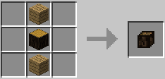

### Hazmat Suit / HAZMATスーツ / IC2

* 実装状態: [ ]
* 名称: Hazmat Suit / 日本語: HAZMATスーツ / Origin: `ic2:armor_hazmat_chest` / New: `bcn:hazmat_suit`
* レシピ: `Rubber` x6 + `Orange Dye` x2 -> `Hazmat Suit` x1
* レシピ配置図: `A0A` / `ABA` / `ABA`
* 概要: 危険物取り扱い用の防護服一式(スキューバヘルメット、HAZMATチェストプレート、HAZMATレギンス、ゴムブーツで防護服一式とする) 防護服一式を着ていれば溶岩や原子炉融解時の熱を含む燃焼ダメージと感電ダメージと爆発時のダメージを完全に無効化する. ヘルメット単体には酸素マスクとして機能があり、 圧縮酸素セルを持っていれば水中で酸素マークが残り4つになっても自動で消費して酸素を補充してくれる.
* 専用GUI: 無
* 実装方法: 

### Treetap / ツリータップ / IC2

* 実装状態: [ ]
* 名称: Treetap / 日本語: ツリータップ / Origin: `ic2:treetap` / New: `bcn:treetap`
* レシピ: `Wooden Planks` x5 -> `Treetap` x1
* レシピ配置図: `0A0` / `AAA` / `A00`
* 概要: ゴムの木から樹液を抽出する道具. ただし酒造においては酒樽から酒を汲む目的で酒樽に取り付ける.
* 専用GUI: 無
* 実装方法: 

### Electric Treetap / 電動ツリータップ / IC2

* 実装状態: [ ]
* 名称: Electric Treetap / 日本語: 電動ツリータップ / Origin: `ic2:electric_treetap` / New: `bcn:electric_treetap`
* レシピ: `Treetap` x1 + `Circuit` x1 + `RE Battery` x1 -> `Electric Treetap` x1
* レシピ配置図: `00A` / `0B0` / `C00`
* 概要: バッテリー駆動のツリータップ. 充電(1万EU)する事で何度でも使える.
* 専用GUI: 無
* 実装方法: 

### Booze Barrel / 酒樽 / IC2

* 実装状態: [ ]
* 名称: Booze Barrel / 日本語: 酒樽 / Origin: `-` / New: `bcn:booze_barrel`
* レシピ: `Rubber Log` x1 + `Wooden Planks` x2 -> `Booze Barrel` x1
* レシピ配置図: `[000]` / `[000]` / `[000]`
* 概要: 足場ブロックに被せる形で設置する. 左クリックすると1クリックで足場ブロックから引き剥がせるが、 内容物はアイテム化しても記録されたまま. ただし熟成はマップ上に設置された状態でしか進まない.
* 専用GUI: 無
* 実装方法: 

### Pumpkin / カボチャ、Tier 1 / IC2

* 実装状態: [ ]
* 名称: Pumpkin / 日本語: カボチャ、Tier 1 / Origin: `-` / New: `bcn:pumpkin`
* レシピ: なし
* レシピ配置図: `[000]` / `[000]` / `[000]`
* 概要: 支柱に植えるには"カボチャ x1"または"種袋(カボチャ) x1"が必要. 明るさLvに関係なく植えられる. 種から完全成育まで約12分、一度収穫してから再収穫まで約6分.
* 専用GUI: 有 — 汲み上げ管理
* 実装方法: 作物名: 、カボチャ 1-3個(期待値1.5個) 、種袋 0-2個(期待値1.0個)

### Cropnalyzer / 作物分析機 / IC2

* 実装状態: [ ]
* 名称: Cropnalyzer / 日本語: 作物分析機 / Origin: `-` / New: `bcn:cropnalyzer`
* レシピ: `Glass` x1 + `Electronic Circuit` x1 + `Redstone` x4 + `Copper Cable` x2 -> `Cropnalyzer` x1
* レシピ配置図: `[000]` / `[000]` / `[000]`
* 概要: 
* 専用GUI: 有 — 作物の鑑定
* 実装方法: 

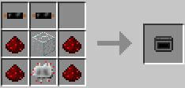

### Crop-Matron / 農薬散布機 / IC2

* 実装状態: [ ]
* 名称: Crop-Matron / 日本語: 農薬散布機 / Origin: `ic2:crop_matron` / New: `bcn:crop_matron`
* レシピ: `Circuit` x2 + `Chest` x1 + `Crop Sticks` x5 + `Machine Block` x1 -> `Crop-Matron` x1
* レシピ配置図: `ABA` / `CDC` / `CCC`
* 概要: 
* 専用GUI: 有 — 農薬/肥料の散布管理
* 実装方法: 必要電力 (最低連続動作量): 1EU/t

### Crop-Matron / 農薬散布機 / IC2

* 実装状態: [ ]
* 名称: Crop-Matron / 日本語: 農薬散布機 / Origin: `ic2:crop_matron` / New: `bcn:crop_matron`
* レシピ: `Circuit` x2 + `Chest` x1 + `Crop Sticks` x5 + `Machine Block` x1 -> `Crop-Matron` x1
* レシピ配置図: `ABA` / `CDC` / `CCC`
* 概要: 
* 専用GUI: 有 — 農薬/肥料の散布管理
* 実装方法: 必要電力 (最低連続動作量): 1EU/t

### Cropnalyzer / 作物分析機 / IC2

* 実装状態: [ ]
* 名称: Cropnalyzer / 日本語: 作物分析機 / Origin: `-` / New: `bcn:cropnalyzer`
* レシピ: `Glass` x1 + `Electronic Circuit` x1 + `Redstone` x4 + `Copper Cable` x2 -> `Cropnalyzer` x1
* レシピ配置図: `[000]` / `[000]` / `[000]`
* 概要: 
* 専用GUI: 有 — 作物の鑑定
* 実装方法: 

### Scaffold / 足場ブロック / IC2

* 実装状態: [ ]
* 名称: Scaffold / 日本語: 足場ブロック / Origin: `-` / New: `bcn:scaffold`
* レシピ: `Wooden Planks` x3 + `Stick` x3 -> `Scaffold` x1
* レシピ配置図: `[000]` / `[000]` / `[000]`
* 概要: 低コストで作成可能な一時的な足場用ブロック. ただし酒造においては酒樽を設置するための骨組みとして使用する.
* 専用GUI: 無
* 実装方法: :火力発電の燃料ソースに原木を採用する場合、木炭にするよりも足場ブロックにする方が効率が良い。 [machines] / :*足場：原木1個≒足場ブロック14.2個×750EU(木製品)＝10650EU [machines]

### Booze Barrel / 酒樽 / IC2

* 実装状態: [ ]
* 名称: Booze Barrel / 日本語: 酒樽 / Origin: `-` / New: `bcn:booze_barrel`
* レシピ: `Rubber Log` x1 + `Wooden Planks` x2 -> `Booze Barrel` x1
* レシピ配置図: `[000]` / `[000]` / `[000]`
* 概要: 足場ブロックに被せる形で設置する. 左クリックすると1クリックで足場ブロックから引き剥がせるが、 内容物はアイテム化しても記録されたまま. ただし熟成はマップ上に設置された状態でしか進まない.
* 専用GUI: 無
* 実装方法: 

### Treetap / ツリータップ / IC2

* 実装状態: [ ]
* 名称: Treetap / 日本語: ツリータップ / Origin: `ic2:treetap` / New: `bcn:treetap`
* レシピ: `Wooden Planks` x5 -> `Treetap` x1
* レシピ配置図: `0A0` / `AAA` / `A00`
* 概要: ゴムの木から樹液を抽出する道具. ただし酒造においては酒樽から酒を汲む目的で酒樽に取り付ける.
* 専用GUI: 無
* 実装方法: 

### Buffer Cell / 連動交差素子 / PR

* 実装状態: [ ]
* 名称: Buffer Cell / 日本語: 連動交差素子 / Origin: `projectred_integration:buffer_cell_gate` / New: `bcn:buffer_cell`
* レシピ: `Plate` x3 + `Wired Plate` x3 + `Platformed Plate` x1 + `Cathode` x2 -> `Buffer Cell` x1
* レシピ配置図: `ABA` / `BCB` / `ADD`
* 概要: 2本のワイヤーを高さを変えずに、混線なしで垂直交差させられる配列素子. 下のラインに動力が通ると、対応して上のラインも同時にONになる. ただし逆に上のラインに動力が通っても、下のラインには一切影響が無い.
* 専用GUI: 無
* 実装方法: 

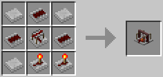

### Deployer / アイテム差配器、デプロイヤー / PR

* 実装状態: [ ]
* 名称: Deployer / 日本語: アイテム差配器、デプロイヤー / Origin: `projectred_expansion:deployer` / New: `bcn:deployer`
* レシピ: `Cobblestones` x6 + `Chest` x1 + `Piston` x1 + `Redstone` x1 -> `Deployer` x1
* レシピ配置図: `ABA` / `ACA` / `ADA`
* 概要: ◆レッドストーン入力が必要 直訳すると"配置器"、"配置するもの"だが、機能は右クリック代行器. 設置時は設置口とプレイヤーが向き合う形で、全6方向を向かせて設置可能. レッドストーン入力がOFFからONに切り替わった時に1回、 内部の収納枠(9スロット)の中にあるアイテムを左上隅のものから優先して、 自身の正面1マスに、使用可能ならば右クリック使用しようとする. 詳細はインターフェイスの項を参照のこと.
* 専用GUI: 有 — 使用動作の設定
* 実装方法: 

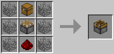

### Item Detector / アイテム検知器、アイテムディテクター / PR

* 実装状態: [ ]
* 名称: Item Detector / 日本語: アイテム検知器、アイテムディテクター / Origin: `-` / New: `bcn:item_detector`
* レシピ: `Wooden Pressure Plate` + `Pneumatic Tube` x2 + `Brass Ingot` x2 + `Infused Silicon` x2 + `Wooden Planks` x2 -> `Item Detector` x1
* レシピ配置図: `[000]` / `[000]` / `[000]`
* 概要: ◆レッドストーン信号を出力 チューブと組み合わせて使用. 設置時は受取口とプレイヤーが向き合う形で、全6方向を向かせて設置可能. 受取口から入った全アイテムを背面に排出口から吐き出すが、 この際、受け取りアイテム1個につき1/20秒(遅延1相当)のパルス出力を行う. 特徴は通過したオブジェクトのスタック数も読み取る事で、 64個1スタックのアイテムが通過した場合は、64回きっちりパルス出力を行う. その64回の出力を行っている間に別なアイテムが通過していっても、 当然のようにそれも検知&加算、きっちり通過したアイテム数ぶんだけ出力する. ただ、遅延1のパルス出力はあまりにも高速すぎ、 通常マインクラフトのパウダー、トーチ、リピーターでは受け付けきれないので、 このMODの赤合金ワイヤーや絶縁ワイヤーでしか受け取れない.
* 専用GUI: 無
* 実装方法: 

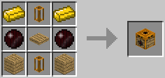

### Buffer / 緩衝器、バッファー / PR

* 実装状態: [ ]
* 名称: Buffer / 日本語: 緩衝器、バッファー / Origin: `-` / New: `bcn:buffer`
* レシピ: `Wooden Planks` x4 + `Iron Bars` x4 -> `Buffer` x1
* レシピ配置図: `[000]` / `[000]` / `[000]`
* 概要: 複数種類アイテムを輸送する際の流量差をクッションする装置. 4行5列の内部インベントリと5つの搬入面＆1つの搬出面を持つ. インベントリの列と搬入面が対応していて、5つの搬入面それぞれに対し4スロットまでのアイテムを受け入れる. 1方向からはアイテムスロット4つ分しかアイテムを入れられないことを利用して、アイテム流量を調整できる. これ自体は搬出機能を持たないので搬出器械とセットで使う. 詳細はインターフェイスの項を参照のこと.
* 専用GUI: 無
* 実装方法: 

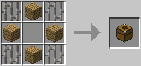

### Frame Motor / モーター / PR

* 実装状態: [ ]
* 名称: Frame Motor / 日本語: モーター / Origin: `projectred_expansion:frame_motor` / New: `bcn:frame_motor`
* レシピ: `Wooden Planks` x2 + `Iron Ingot` x1 + `Redstone` x2 + `Motor` x1 + `Stone` x2 + `Electrotine Alloy Ingot` x1 -> `Frame Motor` x1
* レシピ配置図: `ABA` / `CDC` / `EFE`
* 概要: ◆青電力消費 ◆レッドストーン入力が必要 フレームによって接続された一つの構造物をまるごと移動させる事ができる装置. レッドストーン入力がされる度に1ブロック分ずつ動かす. 黄色い大きな矢印の描いてある面に接しているフレームを矢印の方向に動かす. フレームに接続されたモーターの駆動面はフレームの面として機能し、フレームなどのブロックと接続できる. ドライバーで右クリックすることで矢印の向きを、 Shiftキーを押しながら右クリックすることで装置自体の向きを変更することができる. チェストなど内部インベントリを持つようなブロックも問題なく移動させることができる. 透過部分を持つような一部ブロックは移動中の見た目が木箱のようになるが見た目だけで特に問題はない. 60Vで起動可. 1回起動すると、約0.2V~0.5V消費する.
* 専用GUI: 不明 — フレーム駆動の制御方式
* 実装方法: 

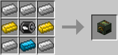

### Charging Bench / チャージングベンチ / PR

* 実装状態: [ ]
* 名称: Charging Bench / 日本語: チャージングベンチ / Origin: `projectred_expansion:charging_bench` / New: `bcn:charging_bench`
* レシピ: `Stone` x2 + `Copper Coil` x1 + `Wooden Planks` x2 + `Battery` x1 + `Iron Ingot` x2 + `Electrotine Alloy Ingot` x1 -> `Charging Bench` x1
* レシピ配置図: `ABA` / `CDC` / `EFE`
* 概要: ◆青電力消費 青電力を消費するツールを充電する事ができる装置. 同時に16個ものツールを充電できるが、pre6時点ではこの装置によって充電できるツールが電動ドライバーしかない.
* 専用GUI: 有 — ツールの充電
* 実装方法: 

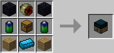
