> [ガイド](./GUIDE.md) > [科学技術ガイド](./GUIDE_TECH.md) > 科学技術の素材・部品

# 科学技術の素材・部品

歯車、チップ、回路、工具、装備、その他の中間素材と消耗品.

### Wrench / レンチ / BC

* 実装状態: [ ]
* 名称: Wrench / 日本語: レンチ / Origin: `buildcraftcore:wrench` / New: `bcn:wrench`
* レシピ: `Iron Ingot` x3 + `Stone Gear` x1 -> `Wrench` x1
* レシピ配置図: `A0A` / `0B0` / `0A0`
* 概要: BuildCraftで追加されるアイテム専用の工具. エンジンの他、製図机、ビルダー、リファイナリーの向き変更に使用する. また、木パイプ、鉄パイプの搬出口切り替えにも使用する. レンチではエンジンやマシンの撤去を行うことが出来ないので注意が必要（撤去はつるはしを用いること） IndustrialCraft2のレンチと違い、マシンの高速撤去能力は無い. BC6.2.0以降、更にエンジンのオーバーヒート解除の役割を担うようになった.
* 専用GUI: 無
* 実装方法: アイテム用の鉄パイプの液体版。設置時に必ずレンチで方向指定する必要があるのも含めて、使い方はアイテム用の鉄パイプとほとんど同じ。ちなみに、液体の流れる速度は水晶と同じ（40mB/tick） [pipe]

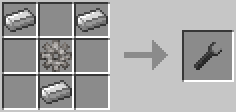

### Wooden Gear / 木の歯車 / BC

* 実装状態: [ ]
* 名称: Wooden Gear / 日本語: 木の歯車 / Origin: `buildcraftcore:gear_wood` / New: `bcn:wooden_gear`
* レシピ: `Stick` x4 -> `Wooden Gear` x1
* レシピ配置図: `0A0` / `A0A` / `0A0`
* 概要: 機械作成用の部品. これ自体には何の効果もない. 石の歯車、木エンジンの作成に使用する.
* 専用GUI: 無
* 実装方法: 

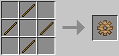

### Stone Gear / 石の歯車 / BC

* 実装状態: [ ]
* 名称: Stone Gear / 日本語: 石の歯車 / Origin: `buildcraftcore:gear_stone` / New: `bcn:stone_gear`
* レシピ: `Cobblestone` x4 + `Wooden Gear` x1 -> `Stone Gear` x1
* レシピ配置図: `0A0` / `ABA` / `0A0`
* 概要: 機械作成用の部品. これ自体には何の効果もない. 石エンジン、レンチ、全自動作業台の作成に使用する.
* 専用GUI: 無
* 実装方法: 

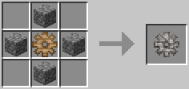

### Iron Gear / 鉄の歯車 / BC

* 実装状態: [ ]
* 名称: Iron Gear / 日本語: 鉄の歯車 / Origin: `buildcraftcore:gear_iron` / New: `bcn:iron_gear`
* レシピ: `Iron Ingot` x4 + `Stone Gear` x1 -> `Iron Gear` x1
* レシピ配置図: `0A0` / `ABA` / `0A0`
* 概要: 機械作成用の部品. これ自体には何の効果もない. ボーリングマシン、クァーリー、鉄エンジンの作成に使用する.
* 専用GUI: 無
* 実装方法: 

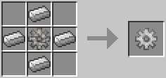

### Gold Gear / 金の歯車 / BC

* 実装状態: [ ]
* 名称: Gold Gear / 日本語: 金の歯車 / Origin: `buildcraftcore:gear_gold` / New: `bcn:gold_gear`
* レシピ: `Gold Ingot` x4 + `Iron Gear` x1 -> `Gold Gear` x1
* レシピ配置図: `0A0` / `ABA` / `0A0`
* 概要: 機械作成用の部品. これ自体には何の効果もない. クァーリー、フィラーの作成に使用する.
* 専用GUI: 無
* 実装方法: 

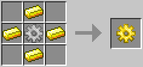

### Diamond Gear / ダイヤの歯車 / BC

* 実装状態: [ ]
* 名称: Diamond Gear / 日本語: ダイヤの歯車 / Origin: `buildcraftcore:gear_diamond` / New: `bcn:diamond_gear`
* レシピ: `Diamond` x4 + `Gold Gear` x1 -> `Diamond Gear` x1
* レシピ配置図: `0A0` / `ABA` / `0A0`
* 概要: 機械作成用の部品. これ自体には何の効果もない. クァーリー、ビルダー、リファイナリー、製図机、精密作業台の作成に使用する.
* 専用GUI: 無
* 実装方法: 

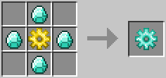

### Paintbrush / 無色の絵筆 / BC

* 実装状態: [ ]
* 名称: Paintbrush / 日本語: 無色の絵筆 / Origin: `-` / New: `bcn:paintbrush`
* レシピ: `Wooden Gear` x1 + `Stick` x1 + `Wool` x1 + `String` x2 -> `Paintbrush` x1
* レシピ配置図: `[000]` / `[000]` / `[000]`
* 概要: これを持って羊毛やパイプに向かって右クリックすることで、 その羊毛やパイプを手に持っている絵筆の色で染めることが出来る. 耐久値は63で、一回使うごとに1消費する. 一回も使用していない(耐久値が最大の)染色済みの絵筆は、他の染料とクラフトしなおすことで、色を変更可能.
* 専用GUI: 無
* 実装方法: 

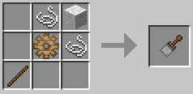

### Paintbrush / 染色済みの絵筆 / BC

* 実装状態: [ ]
* 名称: Paintbrush / 日本語: 染色済みの絵筆 / Origin: `-` / New: `bcn:paintbrush`
* レシピ: `Paintbrush` x1 + `Any Dye` x1 -> `Paintbrush` x1
* レシピ配置図: `[000]` / `[000]` / `[000]`
* 概要: これを持って羊毛やパイプに向かって右クリックすることで、 その羊毛やパイプを手に持っている絵筆の色で染めることが出来る. 耐久値は63で、一回使うごとに1消費する. 一回も使用していない(耐久値が最大の)染色済みの絵筆は、他の染料とクラフトしなおすことで、色を変更可能.
* 専用GUI: 無
* 実装方法: 

### Blueprint / ブループリント / BC

* 実装状態: [ ]
* 名称: Blueprint / 日本語: ブループリント / Origin: `buildcraftbuilders:snapshot#2` / New: `bcn:blueprint`
* レシピ: `Paper` x8 + `Gem Lapis` x1 -> `Blueprint` x1
* レシピ配置図: `AAA` / `ABA` / `AAA`
* 概要: 製図机で使用する未記入状態の製図. テンプレートのパワーアップ版で、指定範囲内のブロック情報を、 "種類"や"向き"、"状態"まで含めて忠実に記憶する.
* 専用GUI: 無
* 実装方法: 更に先程作成したブループリントをビルダーに置くと、読み込んだ製図による建築予定線も追加で展開される。この状態でビルダーにMJを供給、作業を開始させると…… [mach2]

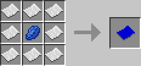

### Map Location / 範囲指定マップ / BC

* 実装状態: [ ]
* 名称: Map Location / 日本語: 範囲指定マップ / Origin: `-` / New: `bcn:map_location`
* レシピ: `Yellow Dye` x1 + `Paper` x8 -> `Map Location` x1
* レシピ配置図: `[000]` / `[000]` / `[000]`
* 概要: 範囲指定機に入れ、ロボットの稼働する範囲などを指定する範囲を記録することができる.
* 専用GUI: 無
* 実装方法: 

<!-- 画像なし -->

### List / リスト / BC

* 実装状態: [ ]
* 名称: List / 日本語: リスト / Origin: `buildcraftcore:list` / New: `bcn:list`
* レシピ: `Paper` x7 + `Redstone` x1 + `Dye` x1 -> `List` x1
* レシピ配置図: `ABA` / `ACA` / `AAA`
* 概要: ダイヤパイプのフィルター機能をより細かく設定するための道具. 右クリックするとGUIが開きアイテムを指定する欄が2段出てくる. 中にあるボタンは指定したアイテム(一番左側のみ)の詳細を指定することができる. P:不明(要検証) T:メタデータを無視するかどうか. M:類似したアイテムの指定.
* 専用GUI: 有 — リスト編集
* 実装方法: 

<!-- 画像なし -->

### Laser / レーザー / BC

* 実装状態: [ ]
* 名称: Laser / 日本語: レーザー / Origin: `buildcraftsilicon:laser` / New: `bcn:laser`
* レシピ: `Redstone` x5 + `Obsidian` x2 + `Gem Diamond` x2 -> `Laser` x1
* レシピ配置図: `AAB` / `ACC` / `AAB`
* 概要: 稼動にはエンジン動力が必要 下記精密作業台を稼動させる為の、専用のレーザー照射装置. リファイナリー同様、エネルギーパイプを使用しないと動作が不安定. レーザーの色は、赤→黄→緑→青の順で、青が最も強力(40RF/t) が、青のレーザーにそれ以上エンジン入力しても効率は上がらないので、 効率を上げたい場合、青色のレーザーを2本、3本と複数用意する事.
* 専用GUI: 無
* 実装方法: 石エンジン …… バランスの取れたエンジン。大抵のマシンを動かせるが、クァーリー・リファイナリー・レーザー等には出力不足。 [engine] / 精密作業台および全自動作業台・改を動作させるのに必要な装置。エンジンやエネルギーパイプからMJ入力を受けるとそれをレーザービームに変換し、対象装置に対して照射する。 [gate]

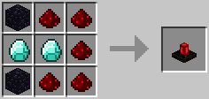

### Redstone Chipset / 赤石チップ / BC

* 実装状態: [ ]
* 名称: Redstone Chipset / 日本語: 赤石チップ / Origin: `buildcraftsilicon:redstone_chipset#0` / New: `bcn:redstone_chipset`
* レシピ: `Redstone Chipset` x1 -> `Redstone Chipset` x1
* レシピ配置図: `[000]` / `[000]` / `[000]`
* 概要: 各ゲートの作成材料となる中間素材. これ単体では何にも使えない.
* 専用GUI: 無
* 実装方法: style='vertical-align:MIDDLE;'|赤石粉1 = 赤石チップ1100000RF（125秒/青1本） [gate] / style='vertical-align:MIDDLE;'|赤石チップ1 + 赤ワイヤー1 = 赤石ゲート1100000RF（250秒/青1本）特定条件が満たされた場合のトリガー機構として機能する検知ゲート。パイプを設置した後、更にそれに被せるようにして取り付ける。アイテム用・液体用・エネルギー用、全てのパイプに対し [gate]

<!-- 画像なし -->

### Iron Chipset / 鉄チップ / BC

* 実装状態: [ ]
* 名称: Iron Chipset / 日本語: 鉄チップ / Origin: `buildcraftsilicon:redstone_chipset#1` / New: `bcn:iron_chipset`
* レシピ: `Iron Chipset` x1 + `Iron Ingot` x1 -> `Iron Chipset` x1
* レシピ配置図: `[000]` / `[000]` / `[000]`
* 概要: 各ゲートの作成材料となる中間素材. これ単体では何にも使えない.
* 専用GUI: 無
* 実装方法: style='vertical-align:MIDDLE;'|赤石粉1 + 鉄インゴット1 = 鉄チップ1200000RF（250秒/青1本） [gate] / style='vertical-align:MIDDLE;'|鉄チップ1 + 赤ワイヤー1 = 鉄ゲート1200000RF（500秒/青1本）設定できる条件の数が2個に増え、それにともなってAND、ORの概念が生まれた鉄製のゲート。レッドストーン動力に加え、赤のパイプワイヤー信号も扱えるようになった。 [gate]

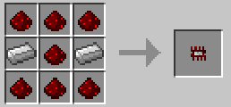

### Golden Chipset / 金チップ / BC

* 実装状態: [ ]
* 名称: Golden Chipset / 日本語: 金チップ / Origin: `buildcraftsilicon:redstone_chipset#2` / New: `bcn:golden_chipset`
* レシピ: `Golden Chipset` x1 + `Gold Ingot` x1 -> `Golden Chipset` x1
* レシピ配置図: `[000]` / `[000]` / `[000]`
* 概要: 各ゲートの作成材料となる中間素材. これ単体では何にも使えない.
* 専用GUI: 無
* 実装方法: style='vertical-align:MIDDLE;'|赤石粉1 + 金インゴット1 = 金チップ1400000RF（500秒/青1本） [gate]

<!-- 画像なし -->

### Diamond Chipset / ダイヤチップ / BC

* 実装状態: [ ]
* 名称: Diamond Chipset / 日本語: ダイヤチップ / Origin: `buildcraftsilicon:redstone_chipset#4` / New: `bcn:diamond_chipset`
* レシピ: `Diamond Chipset` x1 + `Diamond` x1 -> `Diamond Chipset` x1
* レシピ配置図: `[000]` / `[000]` / `[000]`
* 概要: 各ゲートの作成材料となる中間素材. これ単体では何にも使えない.
* 専用GUI: 無
* 実装方法: style='vertical-align:MIDDLE;'|赤石粉1 + ダイヤモンド1 = ダイヤチップ1800000RF（1000秒/青1本） [gate]

<!-- 画像なし -->

### Pulsating Chipset / パルサー / BC

* 実装状態: [ ]
* 名称: Pulsating Chipset / 日本語: パルサー / Origin: `-` / New: `bcn:pulsating_chipset`
* レシピ: `Pulsating Chipset` x2 + `Ender Pearl` x1 -> `Pulsating Chipset` x1
* レシピ配置図: `[000]` / `[000]` / `[000]`
* 概要: 各ゲートの作成材料となる中間素材. これ単体では何にも使えない.
* 専用GUI: 無
* 実装方法: style='vertical-align:MIDDLE;'|赤石粉1 + エンダーパール1 = パルサーチップ2400000RF（500秒/青1本） [gate] / style='vertical-align:MIDDLE;'|・オートチックパルサー1 ＝ 各種ゲート1 + パルサーチップ1（25000RF）ゲートの条件設定の追加項目として木エンジンと同様のパルスを出力できるゲート。 [gate]

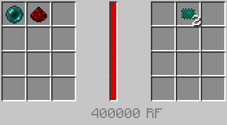

### Quartz Chipset / 水晶チップ / BC

* 実装状態: [ ]
* 名称: Quartz Chipset / 日本語: 水晶チップ / Origin: `buildcraftsilicon:redstone_chipset#3` / New: `bcn:quartz_chipset`
* レシピ: `Quartz Chipset` x1 + `Nether Quartz` x1 -> `Quartz Chipset` x1
* レシピ配置図: `[000]` / `[000]` / `[000]`
* 概要: 各ゲートの作成材料となる中間素材. これ単体では何にも使えない.
* 専用GUI: 無
* 実装方法: style='vertical-align:MIDDLE;'|赤石粉1 + ネザー水晶1 = 水晶チップ1600000RF（750秒/青1本） [gate] / style='vertical-align:MIDDLE;'|水晶チップ1 + 赤ワイヤー1 + 青ワイヤー1 + 緑ワイヤー1 = エメラルドゲート1600000RF（1500秒/青1本）設定できる条件の数が2個と非常に少ないが、エメラルドほどではないものの条件が細かく設定できるゲート。 [gate]

<!-- 画像なし -->

### Redstone Comp Chipset / コンパレータチップ / BC

* 実装状態: [ ]
* 名称: Redstone Comp Chipset / 日本語: コンパレータチップ / Origin: `-` / New: `bcn:redstone_comp_chipset`
* レシピ: `Redstone Comp Chipset` x1 + `Diamond` x1 -> `Redstone Comp Chipset` x1
* レシピ配置図: `[000]` / `[000]` / `[000]`
* 概要: 各ゲートの作成材料となる中間素材. これ単体では何にも使えない.
* 専用GUI: 無
* 実装方法: style='vertical-align:MIDDLE;'|赤石粉1 + レッドストーンコンパレータ1 = コンパレータチップ1600000RF（750秒/青1本） [gate]

<!-- 画像なし -->

### Emerald Chipset / エメラルドチップ / BC

* 実装状態: [ ]
* 名称: Emerald Chipset / 日本語: エメラルドチップ / Origin: `-` / New: `bcn:emerald_chipset`
* レシピ: `Emerald Chipset` x1 + `Emerald` x1 -> `Emerald Chipset` x1
* レシピ配置図: `[000]` / `[000]` / `[000]`
* 概要: 各ゲートの作成材料となる中間素材. これ単体では何にも使えない.
* 専用GUI: 無
* 実装方法: style='vertical-align:MIDDLE;'|赤石粉1 + エメラルド1 = エメラルドチップ11200000RF（1500秒/青1本） [gate] / style='vertical-align:MIDDLE;'|エメラルドチップ1 + ワイヤー全色1ずつ = エメラルドゲート11200000RF（3000秒/青1本）設定できる条件の数が4個と、ダイヤゲートの半分ではあるが、条件がより細かく設定できるゲート。ロボットの制御にはこれが必須である。 [gate]

<!-- 画像なし -->

### Redstone Board / レッドストーンボード / BC

* 実装状態: [ ]
* 名称: Redstone Board / 日本語: レッドストーンボード / Origin: `-` / New: `bcn:redstone_board`
* レシピ: `Redstone` x1 + `Paper` x8 -> `Redstone Board` x1
* レシピ配置図: `[000]` / `[000]` / `[000]`
* 概要: 中間素材. Programming Tableで各種レッドストーンボード作成に使用.
* 専用GUI: 無
* 実装方法: 

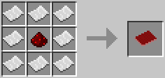

### MFS Unit / MFSユニット / IC2

* 実装状態: [ ]
* 名称: MFS Unit / 日本語: MFSユニット / Origin: `-` / New: `bcn:mfs_unit`
* レシピ: `MFE Unit` x1 + `Lapotron Crystal` x6 + `Advanced Circuit` x1 + `Advanced Machine` x1 -> `MFS Unit` x1
* レシピ配置図: `[000]` / `[000]` / `[000]`
* 概要: 現状で最高の性能を誇る最上級蓄電器. 高圧までの入力に対応している. 出力は高圧なので、変圧機を挟む際は向きに気をつけて設置すること. 爆発した場合、周囲の機械などに甚大な被害を与えかねない.
* 専用GUI: 無
* 実装方法: 蓄電容量: 10,000,000EU

<!-- 画像なし -->

### BatPack / バットパック / IC2

* 実装状態: [ ]
* 名称: BatPack / 日本語: バットパック / Origin: `ic2:batpack` / New: `bcn:batpack`
* レシピ: `RE Battery` x6 + `Circuit` x1 + `Tin Ingot` x1 -> `BatPack` x1
* レシピ配置図: `ABA` / `ACA` / `A0A`
* 概要: 60,000EUほどの電力が保持出来る携帯蓄電器. 充電することで何度でも使える. 胴体に装備して電動工具を使うとバットパックが消費を肩代わりする. 防具としての性能は皆無である.
* 専用GUI: 無
* 実装方法: 

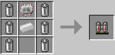

### LapPack / ラップパック / IC2

* 実装状態: [ ]
* 名称: LapPack / 日本語: ラップパック / Origin: `ic2:lappack` / New: `bcn:lappack`
* レシピ: `Lapis Block` x6 + `Advanced Circuit` x1 + `BatPack` x1 -> `LapPack` x1
* レシピ配置図: `ABA` / `ACA` / `A0A`
* 概要: バットパックの上位版で300,000EUほど保持することが可能. MFEもしくはMFSユニットで充電できる.
* 専用GUI: 無
* 実装方法: 

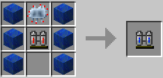

### Luminator / ルミネータ / IC2

* 実装状態: [ ]
* 名称: Luminator / 日本語: ルミネータ / Origin: `ic2:luminator` / New: `bcn:luminator`
* レシピ: `Refined Iron Ingot` x2 + `Copper Insulated Cable Item` x1 + `Glass` x5 + `Tin Cable Item` x1 -> `Luminator` x8
* レシピ配置図: `ABA` / `CDC` / `CCC`
* 概要: 
* 専用GUI: 無
* 実装方法: 

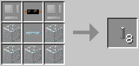

### Machine / マシン / IC2

* 実装状態: [ ]
* 名称: Machine / 日本語: マシン / Origin: `-` / New: `bcn:machine`
* レシピ: `Refined Iron` x8 -> `Machine` x1
* レシピ配置図: `[000]` / `[000]` / `[000]`
* 概要: 機械を作るための基礎素材. 精錬鉄8個に戻せるのでまとめて保管する時にも便利.
* 専用GUI: 無
* 実装方法: 

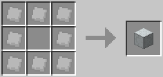

### Advanced Machine / アドバンスドマシン / IC2

* 実装状態: [ ]
* 名称: Advanced Machine / 日本語: アドバンスドマシン / Origin: `-` / New: `bcn:advanced_machine`
* レシピ: `Advanced Alloy` x2 + `Carbon Plate` x2 + `Machine` x1 -> `Advanced Machine` x1
* レシピ配置図: `[000]` / `[000]` / `[000]`
* 概要: 機械を作るための基礎素材. 上位の機械を作る際にはこれが必要となる. 各種インゴットのブロック. クラフトで元のインゴット9個に戻せる.
* 専用GUI: 無
* 実装方法: 

<!-- 画像なし -->

### Construction Foam / 建築用建材 / IC2

* 実装状態: [ ]
* 名称: Construction Foam / 日本語: 建築用建材 / Origin: `-` / New: `bcn:construction_foam`
* レシピ: `Clay Dust` x1 + `Coal Dust` x1 + `Redstone` x1 + `Water Cell` x1 -> `Construction Foam` x1
* レシピ配置図: `[000]` / `[000]` / `[000]`
* 概要: 設置後しばらくすると硬化するセメントのようなブロック. 硬化前は乗ることは出来ない. 砂を持って右クリックすると即座に硬化する. ペインターを使うと硬化したブロックの色を自由に塗り替えることが可能. 頑丈だが破壊した際にアイテムにならない. 圧縮機にかけてCFスプレーで射出させると26倍に増える(ペレット一個で二回射出) しかしシルクタッチで回収できなくなり、石炭の粉とレッドストーンダストは様々なものに使われるため、使用にあたってのコストパフォーマンスは悪い. 送電線を埋め込む場合、この建材には絶縁効果はないため、絶縁していない電線を埋め込むと見えないダメージ床ができてしまうので注意. 壁に埋めると、一見どこに送電線が埋まってるか分からなくなるが、EUメーターの反応で位置を把握する事は可能. 1.2.3対応から硬化するのが早くなった.
* 専用GUI: 無
* 実装方法: 

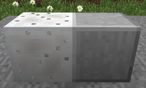

### Nuke / 核爆弾 / IC2

* 実装状態: [ ]
* 名称: Nuke / 日本語: 核爆弾 / Origin: `ic2:nuke` / New: `bcn:nuke`
* レシピ: `Gunpowder` x5 + `Uranium` x4 -> `Nuke` x1
* レシピ配置図: `ABA` / `BAB` / `ABA`
* 概要: 
* 専用GUI: 無
* 実装方法: 

<!-- 画像なし -->

### Iron Fence / 鉄の柵 / IC2

* 実装状態: [ ]
* 名称: Iron Fence / 日本語: 鉄の柵 / Origin: `ic2:iron_fence` / New: `bcn:iron_fence`
* レシピ: `Refined Iron Ingot` x6 -> `Iron Fence` x12
* レシピ配置図: `AAA` / `AAA`
* 概要: 鉄の柵. 縦に積んだものにスニーク状態で掴まると、落下速度が遅くなる.
* 専用GUI: 無
* 実装方法: 

<!-- 画像なし -->

### Reinforced Glass / 強化ガラス / IC2

* 実装状態: [ ]
* 名称: Reinforced Glass / 日本語: 強化ガラス / Origin: `ic2:reinforced_glass` / New: `bcn:reinforced_glass`
* レシピ: `Glass` x7 + `Plate Advanced Alloy` x2 -> `Reinforced Glass` x7
* レシピ配置図: `AAA` / `BAB` / `AAA`
* 概要: 強化ガラス. TNT程度では壊れないが原子炉の融解では壊れる. 融解時には溶岩化せず溶ける.
* 専用GUI: 無
* 実装方法: 

<!-- 画像なし -->

### Reinforced Stone / 強化石材 / IC2

* 実装状態: [ ]
* 名称: Reinforced Stone / 日本語: 強化石材 / Origin: `ic2:reinforced_stone` / New: `bcn:reinforced_stone`
* レシピ: `Stone` x8 + `Plate Advanced Alloy` x1 -> `Reinforced Stone` x8
* レシピ配置図: `AAA` / `ABA` / `AAA`
* 概要: 黒曜石よりも堅い石. 原子炉を建造する際に推奨される建材だがコスト高.
* 専用GUI: 無
* 実装方法: 

<!-- 画像なし -->

### Reinforced Door / 強化ドア / IC2

* 実装状態: [ ]
* 名称: Reinforced Door / 日本語: 強化ドア / Origin: `ic2:reinforced_door` / New: `bcn:reinforced_door`
* レシピ: `Reinforced Stone` x6 -> `Reinforced Door` x1
* レシピ配置図: `AA` / `AA` / `AA`
* 概要: 原子炉用の強化扉.
* 専用GUI: 無
* 実装方法: 

<!-- 画像なし -->

### Coffee Powder / コーヒーの粉 / IC2

* 実装状態: [ ]
* 名称: Coffee Powder / 日本語: コーヒーの粉 / Origin: `ic2:coffee_powder` / New: `bcn:coffee_powder`
* レシピ: `Coffee Beans` x1 -> `Coffee Powder` x1
* レシピ配置図: `[不定形]`
* 概要: コーヒー豆を砕いたもの. コーヒー豆を直接クラフトしても1つ作成できる.
* 専用GUI: 無
* 実装方法: 

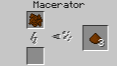

### Grin Powder / グリンパウダー / IC2

* 実装状態: [ ]
* 名称: Grin Powder / 日本語: グリンパウダー / Origin: `-` / New: `bcn:grin_powder`
* レシピ: なし
* レシピ配置図: `[000]` / `[000]` / `[000]`
* 概要: 微弱な毒性を持つ粉. 除草スプレーの材料になる.
* 専用GUI: 無
* 実装方法: 

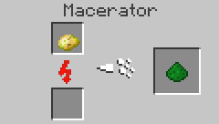

### Raw Carbon Fible / Raw Carbon Mesh / 炭素繊維、炭素メッシュ / IC2

* 実装状態: [ ]
* 名称: Raw Carbon Fible / Raw Carbon Mesh / 日本語: 炭素繊維、炭素メッシュ / Origin: `-` / New: `bcn:raw_carbon_fible`
* レシピ: `炭素繊維石炭の粉` x4 / `炭素メッシュ炭素繊維` x2 -> `Raw Carbon Fible` x1
* レシピ配置図: `[000]` / `[000]` / `[000]`
* 概要: 
* 専用GUI: 無
* 実装方法: 

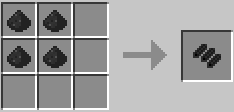

### Diamond / ダイヤモンド / IC2

* 実装状態: [ ]
* 名称: Diamond / 日本語: ダイヤモンド / Origin: `-` / New: `bcn:diamond`
* レシピ: なし
* レシピ配置図: `[000]` / `[000]` / `[000]`
* 概要: 石炭の塊を圧縮して作ったダイヤモンド. 天然ダイヤのように使うことが出来る. 1.6x以前では工業用ダイヤモンド(Industrial Diamond)として普通のダイヤモンドとは別の扱いのダイヤモンドが生成されていた.
* 専用GUI: 無
* 実装方法: 

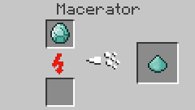

### Plantball / 植物の玉 / IC2

* 実装状態: [ ]
* 名称: Plantball / 日本語: 植物の玉 / Origin: `ic2:plant_ball` / New: `bcn:plantball`
* レシピ: `Saplings` x8 -> `Plantball` x2
* レシピ配置図: `AAA` / `A0A` / `AAA`
* 概要: 植物を丸めた塊. 各種苗木、サトウキビ、種から作れる.
* 専用GUI: 無
* 実装方法: 

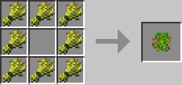

### Compressed Plants / 圧縮した植物の玉 / IC2

* 実装状態: [ ]
* 名称: Compressed Plants / 日本語: 圧縮した植物の玉 / Origin: `-` / New: `bcn:compressed_plants`
* レシピ: なし
* レシピ配置図: `[000]` / `[000]` / `[000]`
* 概要: 植物の塊を圧縮したもの.
* 専用GUI: 無
* 実装方法: 

<!-- 画像なし -->

### Electronic Circuit / 電子回路 / IC2

* 実装状態: [ ]
* 名称: Electronic Circuit / 日本語: 電子回路 / Origin: `ic2:circuit` / New: `bcn:electronic_circuit`
* レシピ: `Copper Insulated Cable Item` x6 + `Redstone` x2 + `Refined Iron Ingot` x1 -> `Electronic Circuit` x1
* レシピ配置図: `ABA` / `ACA` / `ABA`
* 概要: 機械を作るための基礎素材. レシピ素材としてかなり要求頻度が高い.
* 専用GUI: 無
* 実装方法: 

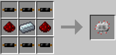

### Advanced Circuit / 発展回路 / IC2

* 実装状態: [ ]
* 名称: Advanced Circuit / 日本語: 発展回路 / Origin: `ic2:advanced_circuit` / New: `bcn:advanced_circuit`
* レシピ: `Redstone` x4 + `Lapis Lazuli` x2 + `Glowstone Dust` x2 + `Circuit` x1 -> `Advanced Circuit` x1
* レシピ配置図: `ABA` / `CDC` / `ABA`
* 概要: 電子回路の上位版でより高度な機械を作るときに使う.
* 専用GUI: 無
* 実装方法: 

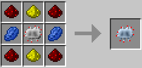

### Scrap / スクラップ / IC2

* 実装状態: [ ]
* 名称: Scrap / 日本語: スクラップ / Origin: `-` / New: `bcn:scrap`
* レシピ: なし
* レシピ配置図: `[000]` / `[000]` / `[000]`
* 概要: リサイクラーから生成したゴミ. スクラップ箱の素材や、物質製造機でマターを作る際の材料に使用する. 地味にかまどや火力発電機の燃料にもなる.
* 専用GUI: 無
* 実装方法: 

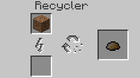

### Scrap Box / スクラップ箱 / IC2

* 実装状態: [ ]
* 名称: Scrap Box / 日本語: スクラップ箱 / Origin: `ic2:scrapbox` / New: `bcn:scrap_box`
* レシピ: `Scrap` x9 -> `Scrap Box` x1
* レシピ配置図: `AAA` / `AAA` / `AAA`
* 概要: スクラップを並べて作ったゴミ箱. 蓋を開けてみると…？ ちなみにスクラップ箱も物質製造機に投入する事ができしっかりスクラップ9個分の働きをする. 取得可能なアイテム
* 専用GUI: 無
* 実装方法: 

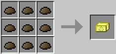

### Matter / マター / IC2

* 実装状態: [ ]
* 名称: Matter / 日本語: マター / Origin: `-` / New: `bcn:matter`
* レシピ: なし
* レシピ配置図: `[000]` / `[000]` / `[000]`
* 概要: 物質製造機で作られる正体不明の物質. 作業台で組み合わせると、様々なアイテムを作り出すことができる. なお、クアンタム防具を全身揃えるにはこれが280個必要. enableSecretRecipeHiding=trueをfalseにしないと、核爆弾と同じくクラフトガイドでレシピが表示されないので、マターを使ったレシピは隠しレシピの様子. マターを使ったレシピ一覧はこちら
* 専用GUI: 有 — 機械操作画面
* 実装方法: 

<!-- 画像なし -->

### BatPack / バットパック / IC2

* 実装状態: [ ]
* 名称: BatPack / 日本語: バットパック / Origin: `ic2:batpack` / New: `bcn:batpack`
* レシピ: `RE Battery` x6 + `Circuit` x1 + `Tin Ingot` x1 -> `BatPack` x1
* レシピ配置図: `ABA` / `ACA` / `A0A`
* 概要: 60,000EUほどの電力が保持出来る携帯蓄電器. 充電することで何度でも使える. 胴体に装備して電動工具を使うとバットパックが消費を肩代わりする. 防具としての性能は皆無である.
* 専用GUI: 無
* 実装方法: 

### LapPack / ラップパック / IC2

* 実装状態: [ ]
* 名称: LapPack / 日本語: ラップパック / Origin: `ic2:lappack` / New: `bcn:lappack`
* レシピ: `Lapis Block` x6 + `Advanced Circuit` x1 + `BatPack` x1 -> `LapPack` x1
* レシピ配置図: `ABA` / `ACA` / `A0A`
* 概要: バットパックの上位版で300,000EUほど保持することが可能. MFEもしくはMFSユニットで充電できる.
* 専用GUI: 無
* 実装方法: 

### CF-Pack / CFパック / IC2

* 実装状態: [ ]
* 名称: CF-Pack / 日本語: CFパック / Origin: `-` / New: `bcn:cf_pack`
* レシピ: `Tin Ingot` x1 + `Electronic Circuit` x1 + `CF Sprayer` x2 + `Fuel Can` x4 -> `CF-Pack` x1
* レシピ配置図: `[000]` / `[000]` / `[000]`
* 概要: 128個のCFペレットを保持しておくことが出来るバックパック. CFスプレーを使うと自動で保持しているCFペレットを消費する. CFペレットを補充するには缶詰製造機を使う.
* 専用GUI: 無
* 実装方法: 

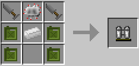

### Jetpack / ジェットパック / IC2

* 実装状態: [ ]
* 名称: Jetpack / 日本語: ジェットパック / Origin: `-` / New: `bcn:jetpack`
* レシピ: `Refined Iron` x4 + `Electronic Circuit` x1 + `Fuel Can` x1 + `Redstone` x2 -> `Jetpack` x1
* レシピ配置図: `[000]` / `[000]` / `[000]`
* 概要: 液体燃料を使った推進装置. 胴体に装備してスペースで飛翔. スペースキーとMキーを押すと滞空モードに切り替わる. 缶詰製造機で燃料を補充すれば何度でも使える. 燃料満タンから90秒間飛行できる.
* 専用GUI: 無
* 実装方法: 

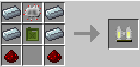

### Electric Jetpack / 電動ジェットパック / IC2

* 実装状態: [ ]
* 名称: Electric Jetpack / 日本語: 電動ジェットパック / Origin: `ic2:jetpack_electric` / New: `bcn:electric_jetpack`
* レシピ: `Electric Jetpack` x1 + `Magnet` x1 + `New Flag Modifier(ic2 Items.jetpack Electric, "special Mode", False).set Uses Input()` x1 + `Recipe Mods.hidden Recipe` x1 -> `Electric Jetpack` x1
* レシピ配置図: `[不定形]`
* 概要: バッテリー駆動のジェットパック. EUを充電することで何度でも使うことが出来る. スペースキーとMキーを押すと滞空モードに切り替わる. 通常のジェットパックより飛行可能な高度が低い. 最大充電(30,000EU)から80秒間飛行できる.
* 専用GUI: 無
* 実装方法: 

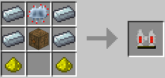

### Composite Vest / コンポジットベスト / IC2

* 実装状態: [ ]
* 名称: Composite Vest / 日本語: コンポジットベスト / Origin: `-` / New: `bcn:composite_vest`
* レシピ: `Leather Chestplate` x1 + `Iron Chestplate` x1 + `Advanced Alloy` x6 -> `Composite Vest` x1
* レシピ配置図: `[000]` / `[000]` / `[000]`
* 概要: 複合素材のアーマーで爆発に対して強い耐性を持つ.
* 専用GUI: 無
* 実装方法: 

<!-- 画像なし -->

### Nano Suits / ナノアーマー / IC2

* 実装状態: [ ]
* 名称: Nano Suits / 日本語: ナノアーマー / Origin: `-` / New: `bcn:nano_suits`
* レシピ: なし
* レシピ配置図: `[000]` / `[000]` / `[000]`
* 概要: バッテリー駆動のアーマーで充電によって耐久値を回復させることができる. ~~ナノアーマー一式(一部クアンタムアーマーでも可)で防具を揃えることで 落下、空腹、燃焼を含むあらゆるダメージを無効化することができるが 下記のクアンタムアーマーとは違いそれ以上の特殊機能は付加されない~~ ブーツにはラバーブーツと軽減方法が違うものの、落下ダメージ軽減がある（ラバーブーツが落下ダメージ大幅減なのに対し、ナノブーツは電力を消費して"落ちても無傷な高さ"を増加させる） 電力消費こそ激しいものの、エンダーパールを投げてもノーダメージ（落下ダメージ扱い） MFEトランスミッタまたはMFSユニットでのみ充電可能. ※ver1.9.7でダメージを無効化できなくなり、ver1.103で電力消耗が激しくなるという弱体化を食らった. が、さすがに電力消費を上げすぎたのかver1.110で多少緩和された.
* 専用GUI: 無
* 実装方法: 

<!-- 画像なし -->

### Quantum Suits / クアンタムアーマー / IC2

* 実装状態: [ ]
* 名称: Quantum Suits / 日本語: クアンタムアーマー / Origin: `-` / New: `bcn:quantum_suits`
* レシピ: なし
* レシピ配置図: `[000]` / `[000]` / `[000]`
* 概要: バッテリー駆動の特殊なアーマーでMFSユニットで充電することで耐久値を回復させることができる. 身体機能の補強効果が付随されており、部位によって異なる恩恵が（電力のある限り）得られる. ヘルメットは毒、ウィザー状態を即座に回復し、酸素ゲージが自動で供給され空腹ゲージが自動で回復する. ｖ1.110からはプレイヤーのインベントリにある食物缶詰を消費して空腹度を回復する仕様に. アーマーは殆どのダメージを耐久値によって肩代わりする. ただしver1.110からは奈落、毒、空腹のダメージは受けるように. また魔法ダメージ（負傷ポーション）や落下ダメージも軽減できない. レギンスはスプリント時の移動速度が3.4倍になる（電力を消費しないが、起動するには電力が残っている必要がある. ） ブーツはCtrlキーを押しながらジャンプすることで、ジャンプ力が約10倍に上昇する. またどんな高所から落ちても落下ダメージを受けない（ただし電力は消費する）
* 専用GUI: 無
* 実装方法: 

<!-- 画像なし -->

### Static Boots / スタティックブーツ / IC2

* 実装状態: [ ]
* 名称: Static Boots / 日本語: スタティックブーツ / Origin: `ic2:static_boots` / New: `bcn:static_boots`
* レシピ: `Iron Boots` x1 + `Wool` x1 + `Copper Insulated Cable Item` x3 -> `Static Boots` x1
* レシピ配置図: `0A0` / `0B0` / `CCC`
* 概要: 足に装備していると、歩いている間1EU/5ブロックのペースで胴装備に充電する. 満足に充電するには相当歩かなくてはならない.
* 専用GUI: 無
* 実装方法: 

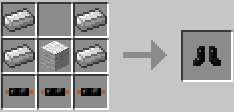

### Chain Saw / チェーンソー / IC2

* 実装状態: [ ]
* 名称: Chain Saw / 日本語: チェーンソー / Origin: `ic2:chainsaw` / New: `bcn:chain_saw`
* レシピ: `Refined Iron Ingot` x5 + `Circuit` x1 + `RE Battery` x1 -> `Chain Saw` x1
* レシピ配置図: `0AA` / `ABA` / `CA0`
* 概要: バッテリー駆動のチェーンソーで原木や木材を最速で破壊できる. 絶対に壊れない代わりに充電(1万EU)が必要. 武器として使っても非常に優秀である. ハサミとしての機能も持っており、羊毛の刈り取りや葉ブロックの取得などができる.
* 専用GUI: 無
* 実装方法: 

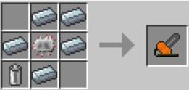

### Mining Drill / 採掘用ドリル / IC2

* 実装状態: [ ]
* 名称: Mining Drill / 日本語: 採掘用ドリル / Origin: `-` / New: `bcn:mining_drill`
* レシピ: `Electronic Circuit` x1 + `Refined Iron` x5 + `RE Battery` x1 -> `Mining Drill` x1
* レシピ配置図: `[000]` / `[000]` / `[000]`
* 概要: バッテリー駆動のドリル. シャベルとつるはしに対応するブロックを破壊可能. 鉄製ツールを上回る性能で、充電すれば何度でも使える. レッドストーン鉱石も高速で破壊できるが、黒曜石は採取できない. 電池が切れても壊れはしないが、効率がかなり落ちる. フルチャージ(1万EU)で200回採掘可能.
* 専用GUI: 無
* 実装方法: 

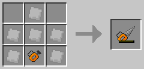

### Diamond Drill / ダイヤモンドドリル / IC2

* 実装状態: [ ]
* 名称: Diamond Drill / 日本語: ダイヤモンドドリル / Origin: `ic2:drill_diamond` / New: `bcn:diamond_drill`
* レシピ: `Diamond` x3 + `Drill` x1 -> `Diamond Drill` x1
* レシピ配置図: `0A0` / `ABA`
* 概要: 採掘用ドリルの上位版. ダイヤ製ツールを凌駕する掘削性能を持つ. 黒曜石すら数秒で破壊できるが、その分エネルギー燃費は低下している. フルチャージ(1万EU)で120回採掘可能.
* 専用GUI: 無
* 実装方法: 

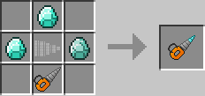

### Electric Hoe / 電動クワ / IC2

* 実装状態: [ ]
* 名称: Electric Hoe / 日本語: 電動クワ / Origin: `ic2:electric_hoe` / New: `bcn:electric_hoe`
* レシピ: `Refined Iron Ingot` x2 + `Circuit` x1 + `RE Battery` x1 -> `Electric Hoe` x1
* レシピ配置図: `AA0` / `0B0` / `0C0`
* 概要: バッテリー駆動のクワ. 充電(1万EU)する事で何度でも使える.
* 専用GUI: 無
* 実装方法: 

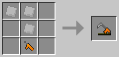

### Wrench / レンチ / IC2

* 実装状態: [ ]
* 名称: Wrench / 日本語: レンチ / Origin: `ic2:wrench` / New: `bcn:wrench`
* レシピ: `Bronze Ingot` x6 -> `Wrench` x1
* レシピ配置図: `A0A` / `AAA` / `0A0`
* 概要: 設置した機械類を右クリックすることで撤去が可能. 一定確率で撤去した機械が壊れてマシンブロック(上位設備ならアドバンスドマシン、発電機なら火力発電機)になる. 充電器の撤去は、出力面を右クリックか、Shift+右ダブルクリック. うまくいかない場合はAltキーを2回押す. 変圧器なら3ドット面. 充電器、変圧器共に、Shift+右シングルクリックをすると、機械の向きを通常と逆に変更できる.
* 専用GUI: 無
* 実装方法: 

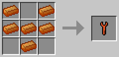

### Electric Wrench / 電動レンチ / IC2

* 実装状態: [ ]
* 名称: Electric Wrench / 日本語: 電動レンチ / Origin: `electricWrench` / New: `bcn:electric_wrench`
* レシピ: `Wrench` x1 + `Circuit` x1 + `RE Battery` x1 -> `Electric Wrench` x1
* レシピ配置図: `00A` / `0B0` / `C00`
* 概要: バッテリー駆動のレンチ. 充電(12000EU)する事で何度でも使える. 充電器の撤去は、出力面を右クリックか、Shift+右ダブルクリック. うまくいかない場合はAltキーを2回押す. 変圧器なら3ドット面. 充電器、変圧器共に、Shift+右シングルクリックをすると、機械の向きを通常と逆に変更できる. ver1.64から大きな電力を消費して機械を確実に撤去できるモードが追加された. 切り替えはMキー+右クリック Lossless wrench mode enable：確実に撤去できるモード Lossless wrench mode disabled：通常モード
* 専用GUI: 無
* 実装方法: 

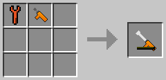

### EU-Reader / EUリーダー / IC2

* 実装状態: [ ]
* 名称: EU-Reader / 日本語: EUリーダー / Origin: `ic2:eu_reader` / New: `bcn:eu_reader`
* レシピ: `Glowstone Dust` x1 + `Copper Insulated Cable Item` x4 + `Circuit` x1 -> `EU-Reader` x1
* レシピ配置図: `0A0` / `BCB` / `B0B`
* 概要: ケーブルに流れるEUの量を測定出来る検流計のようなもの. 同じケーブルに対して2回以上右クリックで使うと前回のクリックから今回のクリックまでの平均EUを求めることができる.
* 専用GUI: 無
* 実装方法: Y167とY183の2つの風力発電機において、それぞれの発電量をEUリーダーで調べてみた。 [machines]

<!-- 画像なし -->

### CF Sprayer / CFスプレー / IC2

* 実装状態: [ ]
* 名称: CF Sprayer / 日本語: CFスプレー / Origin: `-` / New: `bcn:cf_sprayer`
* レシピ: `CF Sprayer` x4 + `Stick` x1 / `補充CFスプレー` x1 + `CF Pellet` x1 / `CF Sprayer` x1 + `CF Pellet` x8 -> `CF Sprayer` x1
* レシピ配置図: `[000]` / `[000]` / `[000]`
* 概要: 右クリックで建築用建材をいくらか設置する. コストパフォーマンスに優れる. 建材のペレットを充填することで繰り返し使うことが出来る. 一度の使用で13ブロック分の建築用建材を射出、射出した方向に建材が広がる. 耐久ゲージが満タンの状態から16回の射出が可能、ペレット一つで二回分回復する. 建材に要求される素材が要求度の高いものばかりなので、建材からペレットを作る過程で26倍の量にはなるが、 使用するにあたっての実際のコストパフォーマンスはかなり悪い. v1.95b 送電線を内包した硬化前の建築用建材がある状態でゲームを終了すると、該当chunkが破壊され再生成されるバグが確認されている. 運が悪いとワールド自体読み込めなくなる.
* 専用GUI: 無
* 実装方法: 

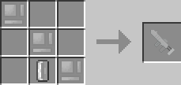

### CF Pellet / CFペレット / IC2

* 実装状態: [ ]
* 名称: CF Pellet / 日本語: CFペレット / Origin: `-` / New: `bcn:cf_pellet`
* レシピ: なし
* レシピ配置図: `[000]` / `[000]` / `[000]`
* 概要: 建設用スプレーの耐久値を回復させるために使うアイテム.
* 専用GUI: 無
* 実装方法: 

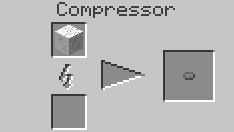

### Inslation Cutter / カッター / IC2

* 実装状態: [ ]
* 名称: Inslation Cutter / 日本語: カッター / Origin: `-` / New: `bcn:inslation_cutter`
* レシピ: `Refined Iron` x3 + `Iron Ingot` x2 -> `Inslation Cutter` x1
* レシピ配置図: `[000]` / `[000]` / `[000]`
* 概要: 電線を覆うゴムの厚さを変える道具. 電線を左クリックで一段階薄くでき、右クリックで手持ちのゴムを1つ消費して一段階厚くする.
* 専用GUI: 無
* 実装方法: 

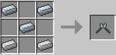

### Dynamite / ダイナマイト / IC2

* 実装状態: [ ]
* 名称: Dynamite / 日本語: ダイナマイト / Origin: `ic2:dynamite` / New: `bcn:dynamite`
* レシピ: `Itnt` x1 + `String` x1 -> `Dynamite` x8
* レシピ配置図: `[不定形]`
* 概要: 3x3x3の小規模な爆発を起こす爆弾. 放り投げたり、地面や壁に設置して起爆する事が可能. 工業用TNTと同じく爆破したブロックを消失させない.
* 専用GUI: 無
* 実装方法: 

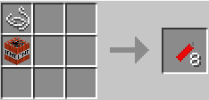

### Sticky Dynamite / 粘着ダイナマイト / IC2

* 実装状態: [ ]
* 名称: Sticky Dynamite / 日本語: 粘着ダイナマイト / Origin: `ic2:sticky_dynamite` / New: `bcn:sticky_dynamite`
* レシピ: `Dynamite` x8 + `Sticky Resin` x1 -> `Sticky Dynamite` x8
* レシピ配置図: `AAA` / `ABA` / `AAA`
* 概要: 壁(ブロックの側面)に張り付くダイナマイト. 放り投げて使う. 時限式.
* 専用GUI: 無
* 実装方法: 

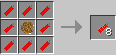

### Dynamite-O-Mote / 遠隔起爆装置 / IC2

* 実装状態: [ ]
* 名称: Dynamite-O-Mote / 日本語: 遠隔起爆装置 / Origin: `ic2:dynamite_remote` / New: `bcn:dynamite_o_mote`
* レシピ: `Copper Insulated Cable Item` x1 + `Tin Ingot` x2 + `Lapis Lazuli` x1 + `Frequency Transmitter` x1 -> `Dynamite-O-Mote` x1
* レシピ配置図: `0A0` / `BCB` / `0D0`
* 概要: ダイナマイトを起爆させるための装置. これを持って起爆させたい設置済みのダイナマイトを右クリック後、 ブロックにカーソルを合わせずにもう一度右クリックすることで起爆できる. これを使って起爆させた場合は、ダイナマイトが落下せず即座に爆発する.
* 専用GUI: 無
* 実装方法: 

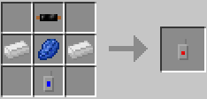

### OD Scanner / ODスキャナー / IC2

* 実装状態: [ ]
* 名称: OD Scanner / 日本語: ODスキャナー / Origin: `ic2:scanner_od` / New: `bcn:od_scanner`
* レシピ: `Glowstone Dust` x1 + `Circuit` x2 + `RE Battery` x1 + `Copper Insulated Cable Item` x3 -> `OD Scanner` x1
* レシピ配置図: `0A0` / `BCB` / `DDD`
* 概要: バッテリー駆動のスキャンツール. 真下に埋蔵されている鉱石の分布を数値で表す. スキャン範囲は上から見てプレイヤを中心とした5x5の正方形の内側で、プレイヤの足元以下の高度にあるブロック全て（つまりプレイヤが立ってる地面に置かれた鉱石まで含む） 範囲内に鉱石ブロックがある比率を0.1%単位で表す. 例えば範囲内の10%が鉱石ならば100、1%が鉱石ならば10と表示される. 鉱石と判定されるのは通常のminecraftに登場する鉱石とICで追加された鉱石. それ以外は石も水も空気も全て非鉱石. ※RedPowerを導入している場合、RedPower側の銅とスズは判定されないので注意.
* 専用GUI: 無
* 実装方法: 

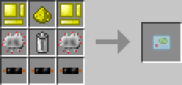

### OV Scanner / OVスキャナー / IC2

* 実装状態: [ ]
* 名称: OV Scanner / 日本語: OVスキャナー / Origin: `ic2:scanner_ov` / New: `bcn:ov_scanner`
* レシピ: `Glowstone Dust` x3 + `Advanced Circuit` x1 + `Bronze Double Insulated Cable Item` x2 + `RE Battery` x1 -> `OV Scanner` x1
* レシピ配置図: `0A0` / `ABA` / `CDC`
* 概要: 
* 専用GUI: 無
* 実装方法: 

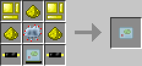

### Mining Laser / 採掘用レーザー / IC2

* 実装状態: [ ]
* 名称: Mining Laser / 日本語: 採掘用レーザー / Origin: `ic2:mining_laser` / New: `bcn:mining_laser`
* レシピ: `Redstone` x1 + `Energy Crystal` x2 + `Plate Advanced Alloy` x4 + `C` x1 -> `Mining Laser` x1
* レシピ配置図: `ABB` / `CCD` / `0CC`
* 概要: バッテリー駆動のレーザーでMキーを押しながら右クリックでモード変更が可能. モードは"採掘、短射程、長射程、水平、過熱、拡散、爆発"の六種類に切り替えられる. MFEトランスミッタまたはMFSユニットでのみ充電(20万EU)可能. LapPackでの電力補充が可能. 過熱モードで精錬可能なブロックを撃つと貫通せずにそのブロックで止まり、精錬先がブロックの場合はそのブロックに置き換わり、アイテムの場合は精錬後のアイテムに置き換わる. ただし原木が木炭になるのは不自然だったのか、原木は対象外となった. MOBにダメージを与えることができ、炎上の効果があり、直線的に飛び、~~何故かエンダーマンが回避できない~~ さすがに爆発以外はテレポートするようになりました. 現在は弓矢ダメージ+炎上効果の模様. なので武器としてもそこそこ優秀. ただし採掘用なだけあって外すと地形をガリガリ抉っていくので、それが気になる人は使いづらいかも.
* 専用GUI: 無
* 実装方法: 

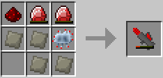

### Tin Can / スズ製の缶 / IC2

* 実装状態: [ ]
* 名称: Tin Can / 日本語: スズ製の缶 / Origin: `ic2:tin_can` / New: `bcn:tin_can`
* レシピ: `Tin Ingot` x1 + `Cutter` x1 -> `Tin Can` x2
* レシピ配置図: `[不定形]`
* 概要: 食べ物を詰めておける錫缶.
* 専用GUI: 無
* 実装方法: 

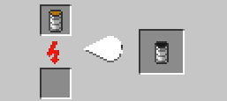

### Food Can / 食物缶詰 / IC2

* 実装状態: [ ]
* 名称: Food Can / 日本語: 食物缶詰 / Origin: `-` / New: `bcn:food_can`
* レシピ: なし
* レシピ配置図: `[000]` / `[000]` / `[000]`
* 概要: 食べ物を詰めた状態の錫缶. 食べるとライフと満腹度が一つ回復する. 中身を食べれば缶はスズ缶として回収できる. 空腹値を直接回復するアイテムなら、何でも食料缶にできる. ポーションやお酒、コーヒーなどは不可. 蜘蛛の目や毒ジャガイモ、ゾンビ肉も食料缶化が可能だが、毒性はそのまま継承されるので注意. (毒ダメージ版と空腹ステータス付与版の二種類の毒性食料缶がある) なお、(バグか仕様かは不明だが)食料缶自体も缶詰処理することが可能であり、 上記の毒性食料缶を(なぜか)正常な食料缶にすることが可能になっている（スズ缶は減るが）
* 専用GUI: 無
* 実装方法: 

<!-- 画像なし -->

### Nano Saber / ナノセイバー / IC2

* 実装状態: [ ]
* 名称: Nano Saber / 日本語: ナノセイバー / Origin: `ic2:nano_saber` / New: `bcn:nano_saber`
* レシピ: `Glowstone Dust` x2 + `Plate Advanced Alloy` x2 + `Carbon Plate` x2 + `Energy Crystal` x1 -> `Nano Saber` x1
* レシピ配置図: `AB0` / `AB0` / `CDC`
* 概要: バッテリー駆動の特殊な剣. 4万EUまで充電でき、右クリックする事でオンオフが切り替えられる. オフの状態では木の剣と同等の攻撃力しかないが、EU消費が0であるため、経験値トラップとの相性が良い. オンの状態では攻撃力10なので、殆どの敵を1～2発で倒せる. またPvP要素として、展開中の電動防具への攻撃は通常ダメージの代わりに大きな電力ダメージを与え、更に電力0になった電動防具を唯一破壊することができる. 展開中は時間と共にバッテリー残量が減るので瞬間的に斬るといった使い方が好ましい. MFEトランスミッタまたはMFSユニットでのみ充電可能.
* 専用GUI: 無
* 実装方法: 

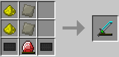

### Painter / ペインター / IC2

* 実装状態: [ ]
* 名称: Painter / 日本語: ペインター / Origin: `ic2:painter` / New: `bcn:painter`
* レシピ: `Wool` x3 + `Iron Ingot` x2 -> `Painter` x1
* レシピ配置図: `0AA` / `0BA` / `B00`
* 概要: 設置した電線や羊毛に色をつける道具. 画像は一例で実際には染料の数だけ色付きペインターが作れる. デフォルトのペインターと染色違う色同士の電線は繋がらなくなるため複雑な配線が可能になる. 例外として無色(黒色)の電線と有色の電線は繋がってしまう. Mキー+右クリックで自動補充モードの切り替えが可能.
* 専用GUI: 無
* 実装方法: 

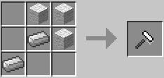

### Frequency Transmitter / 周波数送信機 / IC2

* 実装状態: [ ]
* 名称: Frequency Transmitter / 日本語: 周波数送信機 / Origin: `ic2:frequency_transmitter` / New: `bcn:frequency_transmitter`
* レシピ: `Circuit` x1 + `Copper Insulated Cable Item` x1 -> `Frequency Transmitter` x1
* レシピ配置図: `[不定形]`
* 概要: 自己の周波数の登録や送信が出来る装置でテレポーターなどで使う.
* 専用GUI: 無
* 実装方法: 

<!-- 画像なし -->

### Toolbox / ツールボックス / IC2

* 実装状態: [ ]
* 名称: Toolbox / 日本語: ツールボックス / Origin: `ic2:tool_box` / New: `bcn:toolbox`
* レシピ: `Refined Iron Ingot` x5 + `Chest` x1 -> `Toolbox` x1
* レシピ配置図: `ABA` / `AAA`
* 概要: ツール類の保管箱. 右クリックで使用するとイベントリ内のツールを一括で格納、または取り出す事が出来る.
* 専用GUI: 無
* 実装方法: 

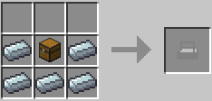

### Stone Mug / マグカップ / IC2

* 実装状態: [ ]
* 名称: Stone Mug / 日本語: マグカップ / Origin: `-` / New: `bcn:stone_mug`
* レシピ: `Stone` x7 -> `Stone Mug` x1
* レシピ配置図: `[000]` / `[000]` / `[000]`
* 概要: スタック不可. 再利用可能. 酒、コーヒーを入れるのに使用する石製のマグカップ.
* 専用GUI: 無
* 実装方法: 

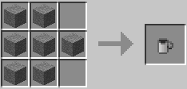

### Empty TFBP / 空のTFBP / IC2

* 実装状態: [ ]
* 名称: Empty TFBP / 日本語: 空のTFBP / Origin: `-` / New: `bcn:empty_tfbp`
* レシピ: `Advanced Circuit` x1 + `Electronic Circuit` x1 + `Redstone` x2 -> `Empty TFBP` x1
* レシピ配置図: `[000]` / `[000]` / `[000]`
* 概要: 何もインプットされていない状態のTFBP. 各TFBPはクラフトし直すことでこの状態に戻せる.
* 専用GUI: 無
* 実装方法: 

### Chilling / 寒冷化 / IC2

* 実装状態: [ ]
* 名称: Chilling / 日本語: 寒冷化 / Origin: `-` / New: `bcn:chilling`
* レシピ: `Empty TFBP` x1 + `Snowball` x4 -> `Chilling` x1
* レシピ配置図: `[000]` / `[000]` / `[000]`
* 概要: 辺りに雪を積もらせ積雪を作り出す. 近くに水源がある場合は水源も凍らせる. 地形条件はないため、ネザー世界などでも降雪状態で雪が積もる.
* 専用GUI: 無
* 実装方法: 

<!-- 画像なし -->

### Desertification / 砂漠化 / IC2

* 実装状態: [ ]
* 名称: Desertification / 日本語: 砂漠化 / Origin: `-` / New: `bcn:desertification`
* レシピ: `Empty TFBP` x1 + `Sand` x4 -> `Desertification` x1
* レシピ配置図: `[000]` / `[000]` / `[000]`
* 概要: 辺りの雪や氷ブロックを溶かし土を砂に変え植物を枯らし砂漠を作り出す.
* 専用GUI: 無
* 実装方法: 

<!-- 画像なし -->

### Flatificator / 平地化 / IC2

* 実装状態: [ ]
* 名称: Flatificator / 日本語: 平地化 / Origin: `-` / New: `bcn:flatificator`
* レシピ: `Empty TFBP` x1 + `Dirt` x4 -> `Flatificator` x1
* レシピ配置図: `[000]` / `[000]` / `[000]`
* 概要: テラフォーマーより低い位置の空白エリアを土で埋め立て、テラフォーマーよりも高い位置に存在する石を除いた天然のブロックを削除する.
* 専用GUI: 無
* 実装方法: 

<!-- 画像なし -->

### Cultivation / 培養 / IC2

* 実装状態: [ ]
* 名称: Cultivation / 日本語: 培養 / Origin: `-` / New: `bcn:cultivation`
* レシピ: `Empty TFBP` x1 + `Seeds` x4 -> `Cultivation` x1
* レシピ配置図: `[000]` / `[000]` / `[000]`
* 概要: 時間をかけて周囲の砂ブロックを草ブロックに変化させる. また、ごく短時間で土ブロックを草ブロックに変化させ、そこに雑草や花、苗木がランダムに生えるようになる. また時々、自動的に耕地に植えられた状態の小麦やかぼちゃの実が発生することも.
* 専用GUI: 無
* 実装方法: 

<!-- 画像なし -->

### Irrigation / 灌漑 / IC2

* 実装状態: [ ]
* 名称: Irrigation / 日本語: 灌漑 / Origin: `-` / New: `bcn:irrigation`
* レシピ: `Empty TFBP` x1 + `Water Bucket` x4 -> `Irrigation` x1
* レシピ配置図: `[000]` / `[000]` / `[000]`
* 概要: 辺りの降雨量が上がり、周囲の砂ブロックを土ブロックに変化させる. また、植物の成長を促進させ、植えたばかりの苗木や小麦などが、一気に収穫可能状態まで成長する. ただし雨乞いツールではないので、実際に雨が降ってきたりするわけではない.
* 専用GUI: 無
* 実装方法: 

<!-- 画像なし -->

### Mushroom / 榎茸 / IC2

* 実装状態: [ ]
* 名称: Mushroom / 日本語: 榎茸 / Origin: `-` / New: `bcn:mushroom`
* レシピ: `Empty TFBP` x1 + `Mushroom` x4 + `Mycelium` x4 -> `Mushroom` x1
* レシピ配置図: `[000]` / `[000]` / `[000]`
* 概要: 辺りを菌糸ブロックやキノコで侵食する. キノコが巨大キノコ化することがある.
* 専用GUI: 無
* 実装方法: 

### Overclocker upgrade / オーバークロッカー / IC2

* 実装状態: [ ]
* 名称: Overclocker upgrade / 日本語: オーバークロッカー / Origin: `ic2:overclocker_upgrade` / New: `bcn:overclocker_upgrade`
* レシピ: `Heat Storage Six` x8 + `Upgrade Base` x1 -> `Overclocker upgrade` x16
* レシピ配置図: `AAA` / `ABA` / `AAA`
* 概要: 機械の稼働速度を向上させるモジュール. 16個ほども重ねると、粉砕機のような仕事の遅い機械でも一瞬で仕事を完了させるようになる優れもの. ただし設置個数に応じて消費電力も増加するため注意が必要. 具体的には設置１つに付き作業時間0.7倍. 消費電力1.6倍. つまり２つ設置すると作業時間は0.7*0.7=0.49倍、消費電力は1.6*1.6=2.56倍となる. （v1.71現在） v1.106では冷却セルを10K冷却セルに置き換えれば製作可能.
* 専用GUI: 無
* 実装方法: 電気炉、リサイクル装置はオーバークロッカーを1枚使用した方が効率が良くなる。 [machines]

### Ejecter Upgrade / イジェクター / IC2

* 実装状態: [ ]
* 名称: Ejecter Upgrade / 日本語: イジェクター / Origin: `-` / New: `bcn:ejecter_upgrade`
* レシピ: `Piston` x2 + `Electronic Circuit` x1 + `Copper Cable` x2 + `Hopper` x1 -> `Ejecter Upgrade` x1
* レシピ配置図: `[000]` / `[000]` / `[000]`
* 概要: 
* 専用GUI: 無
* 実装方法: 

### Jungle Wooden Planks / 木材（ジャングル） / IC2

* 実装状態: [ ]
* 名称: Jungle Wooden Planks / 日本語: 木材（ジャングル） / Origin: `-` / New: `bcn:jungle_wooden_planks`
* レシピ: `Rubber Log` x1 -> `Jungle Wooden Planks` x1
* レシピ配置図: `[000]` / `[000]` / `[000]`
* 概要: ゴムの原木をクラフティングすることでジャングルの木材3つになる. 通常の原木から得られるより個数は1つ少ないので、単純に木材が欲しいなら普通の木を伐採する方がよい.
* 専用GUI: 無
* 実装方法: 

### Jungle Wood / 原木（ジャングル） / IC2

* 実装状態: [ ]
* 名称: Jungle Wood / 日本語: 原木（ジャングル） / Origin: `-` / New: `bcn:jungle_wood`
* レシピ: なし
* レシピ配置図: `[000]` / `[000]` / `[000]`
* 概要: ゴムの原木を精錬することでジャングルの原木になる. こちらは原木になるので得られる個数は通常の原木と変わらないものの、精錬という手間が生じるので、 やはり使う機会は少ない.
* 専用GUI: 無
* 実装方法: 

### Bucket / バケツ / IC2

* 実装状態: [ ]
* 名称: Bucket / 日本語: バケツ / Origin: `minecraft:bucket` / New: `bcn:bucket`
* レシピ: `Tin Ingot` x3 -> `Bucket` x1
* レシピ配置図: `A0A` / `0A0`
* 概要: 通称スズバケツ. 鉄の消費が多いことによる救済措置. RedPower2の合金かまどやUnCraft等の還元系MODを使えば、スズインゴットを鉄インゴットに等価交換することができる.
* 専用GUI: 無
* 実装方法: かまどで燃やせる燃料（溶岩バケツ以外） [machines]

### Rail / 線路 / IC2

* 実装状態: [ ]
* 名称: Rail / 日本語: 線路 / Origin: `minecraft:rail` / New: `bcn:rail`
* レシピ: `Bronze Ingot` x6 + `Stick` x1 -> `Rail` x8
* レシピ配置図: `A0A` / `ABA` / `A0A`
* 概要: 鉄の消費が多いことによる救済措置. ただし、作られる数は半分の8個になる. こちらも還元系MODによって、青銅インゴット12個を鉄インゴット6個に交換することができる.
* 専用GUI: 無
* 実装方法: 

<!-- 画像なし -->

### Piston / ピストン / IC2

* 実装状態: [ ]
* 名称: Piston / 日本語: ピストン / Origin: `minecraft:piston` / New: `bcn:piston`
* レシピ: `Wooden Planks` x3 + `Cobblestone` x4 + `Bronze Ingot` x1 + `Redstone` x1 -> `Piston` x1
* レシピ配置図: `AAA` / `BCB` / `BDB`
* 概要: 鉄の消費が多いことによる救済措置. こちらも還元系MODによって、青銅インゴット1個を鉄インゴット1個に交換することができる.
* 専用GUI: 無
* 実装方法: 

### Sticky piston / 粘着ピストン / IC2

* 実装状態: [ ]
* 名称: Sticky piston / 日本語: 粘着ピストン / Origin: `minecraft:sticky_piston` / New: `bcn:sticky_piston`
* レシピ: `Piston` x1 + `Sticky Resin` x1 + `Recipe Mods.hidden Recipe` x1 -> `Sticky piston` x1
* レシピ配置図: `[不定形]`
* 概要: おそらくスライムが見つからないときの救済措置だったのであろう、スライムボールの変わりに樹液が使えるレシピ. 今では湿地帯バイオームでスライムが沸くようになったので、湿地帯バイオームが見つからないなら使うことになるかもしれない程度.
* 専用GUI: 無
* 実装方法: 

### Torch / 松明 / IC2

* 実装状態: [ ]
* 名称: Torch / 日本語: 松明 / Origin: `minecraft:torch` / New: `bcn:torch`
* レシピ: `Sticky Resin` x1 + `Stick` x1 -> `Torch` x4
* レシピ配置図: `A` / `B`
* 概要: 炭で作ったときと変わりは無い. どっちのほうが楽かは人によるだろう.
* 専用GUI: 無
* 実装方法: 

<!-- 画像なし -->

### Gunpowder / 火薬 / IC2

* 実装状態: [ ]
* 名称: Gunpowder / 日本語: 火薬 / Origin: `minecraft:gunpowder` / New: `bcn:gunpowder`
* レシピ: `Redstone` x5 + `Coal Dust` x4 -> `Gunpowder` x3
* レシピ配置図: `ABA` / `BAB` / `ABA`
* 概要: 火薬の追加レシピ.
* 専用GUI: 無
* 実装方法: 

### Obsidian / 黒曜石 / IC2

* 実装状態: [ ]
* 名称: Obsidian / 日本語: 黒曜石 / Origin: `minecraft:obsidian` / New: `bcn:obsidian`
* レシピ: `Water Cell` x1 + `Magma Block` x1 -> `Obsidian` x1
* レシピ配置図: `[不定形]`
* 概要: 追加レシピ. 1つ作るのに溶岩セルが2つ必要なので、溶岩源に水をかけて作る方が効率はよい. しかし、回収手段がなくても手持ちに加えられる、クラフティングで作成可能（＝BuildCraftの自動作業台等に対応できる）などの利点もある. 粉砕機による追加レシピ. 圧縮機による追加レシピ. 雪玉は圧縮機にポンプ装置を隣接させることでも生成できる.
* 専用GUI: 無
* 実装方法: 

### Copper / Tin / Bornze / 銅、スズ、ブロンズ / IC2

* 実装状態: [ ]
* 名称: Copper / Tin / Bornze / 日本語: 銅、スズ、ブロンズ / Origin: `-` / New: `bcn:copper_2`
* レシピ: なし
* レシピ配置図: `[000]` / `[000]` / `[000]`
* 概要: 新たに追加された鉱石とインゴット. 銅鉱石はY10-70、スズ鉱石はY0-40の高度で見つかる. ブロンズは合金のため、採掘で入手する事は出来ない.
* 専用GUI: 無
* 実装方法: 

### Coffee Powder / コーヒーの粉 / IC2

* 実装状態: [ ]
* 名称: Coffee Powder / 日本語: コーヒーの粉 / Origin: `ic2:coffee_powder` / New: `bcn:coffee_powder`
* レシピ: `Coffee Beans` x1 -> `Coffee Powder` x1
* レシピ配置図: `[不定形]`
* 概要: コーヒー豆を砕いたもの. コーヒー豆を直接クラフトしても1つ作成できる.
* 専用GUI: 無
* 実装方法: 

### Grin Powder / グリンパウダー / IC2

* 実装状態: [ ]
* 名称: Grin Powder / 日本語: グリンパウダー / Origin: `-` / New: `bcn:grin_powder`
* レシピ: なし
* レシピ配置図: `[000]` / `[000]` / `[000]`
* 概要: 微弱な毒性を持つ粉. 除草スプレーの材料になる.
* 専用GUI: 無
* 実装方法: 

### Raw Carbon Fible / Raw Carbon Mesh / 炭素繊維、炭素メッシュ / IC2

* 実装状態: [ ]
* 名称: Raw Carbon Fible / Raw Carbon Mesh / 日本語: 炭素繊維、炭素メッシュ / Origin: `-` / New: `bcn:raw_carbon_fible`
* レシピ: `炭素繊維石炭の粉` x4 / `炭素メッシュ炭素繊維` x2 -> `Raw Carbon Fible` x1
* レシピ配置図: `[000]` / `[000]` / `[000]`
* 概要: 
* 専用GUI: 無
* 実装方法: 

### Diamond / ダイヤモンド / IC2

* 実装状態: [ ]
* 名称: Diamond / 日本語: ダイヤモンド / Origin: `-` / New: `bcn:diamond`
* レシピ: なし
* レシピ配置図: `[000]` / `[000]` / `[000]`
* 概要: 石炭の塊を圧縮して作ったダイヤモンド. 天然ダイヤのように使うことが出来る. 1.6x以前では工業用ダイヤモンド(Industrial Diamond)として普通のダイヤモンドとは別の扱いのダイヤモンドが生成されていた.
* 専用GUI: 無
* 実装方法: 

### Plantball / 植物の玉 / IC2

* 実装状態: [ ]
* 名称: Plantball / 日本語: 植物の玉 / Origin: `ic2:plant_ball` / New: `bcn:plantball`
* レシピ: `Saplings` x8 -> `Plantball` x2
* レシピ配置図: `AAA` / `A0A` / `AAA`
* 概要: 植物を丸めた塊. 各種苗木、サトウキビ、種から作れる.
* 専用GUI: 無
* 実装方法: 

### Compressed Plants / 圧縮した植物の玉 / IC2

* 実装状態: [ ]
* 名称: Compressed Plants / 日本語: 圧縮した植物の玉 / Origin: `-` / New: `bcn:compressed_plants`
* レシピ: なし
* レシピ配置図: `[000]` / `[000]` / `[000]`
* 概要: 植物の塊を圧縮したもの.
* 専用GUI: 無
* 実装方法: 

<!-- 画像なし -->

### Electronic Circuit / 電子回路 / IC2

* 実装状態: [ ]
* 名称: Electronic Circuit / 日本語: 電子回路 / Origin: `ic2:circuit` / New: `bcn:electronic_circuit`
* レシピ: `Copper Insulated Cable Item` x6 + `Redstone` x2 + `Refined Iron Ingot` x1 -> `Electronic Circuit` x1
* レシピ配置図: `ABA` / `ACA` / `ABA`
* 概要: 機械を作るための基礎素材. レシピ素材としてかなり要求頻度が高い.
* 専用GUI: 無
* 実装方法: 

### Advanced Circuit / 発展回路 / IC2

* 実装状態: [ ]
* 名称: Advanced Circuit / 日本語: 発展回路 / Origin: `ic2:advanced_circuit` / New: `bcn:advanced_circuit`
* レシピ: `Redstone` x4 + `Lapis Lazuli` x2 + `Glowstone Dust` x2 + `Circuit` x1 -> `Advanced Circuit` x1
* レシピ配置図: `ABA` / `CDC` / `ABA`
* 概要: 電子回路の上位版でより高度な機械を作るときに使う.
* 専用GUI: 無
* 実装方法: 

### Scrap / スクラップ / IC2

* 実装状態: [ ]
* 名称: Scrap / 日本語: スクラップ / Origin: `-` / New: `bcn:scrap`
* レシピ: なし
* レシピ配置図: `[000]` / `[000]` / `[000]`
* 概要: リサイクラーから生成したゴミ. スクラップ箱の素材や、物質製造機でマターを作る際の材料に使用する. 地味にかまどや火力発電機の燃料にもなる.
* 専用GUI: 無
* 実装方法: 

### Scrap Box / スクラップ箱 / IC2

* 実装状態: [ ]
* 名称: Scrap Box / 日本語: スクラップ箱 / Origin: `ic2:scrapbox` / New: `bcn:scrap_box`
* レシピ: `Scrap` x9 -> `Scrap Box` x1
* レシピ配置図: `AAA` / `AAA` / `AAA`
* 概要: スクラップを並べて作ったゴミ箱. 蓋を開けてみると…？ ちなみにスクラップ箱も物質製造機に投入する事ができしっかりスクラップ9個分の働きをする. 取得可能なアイテム
* 専用GUI: 無
* 実装方法: 

### Matter / マター / IC2

* 実装状態: [ ]
* 名称: Matter / 日本語: マター / Origin: `-` / New: `bcn:matter`
* レシピ: なし
* レシピ配置図: `[000]` / `[000]` / `[000]`
* 概要: 物質製造機で作られる正体不明の物質. 作業台で組み合わせると、様々なアイテムを作り出すことができる. なお、クアンタム防具を全身揃えるにはこれが280個必要. enableSecretRecipeHiding=trueをfalseにしないと、核爆弾と同じくクラフトガイドでレシピが表示されないので、マターを使ったレシピは隠しレシピの様子. マターを使ったレシピ一覧はこちら
* 専用GUI: 有 — 機械操作画面
* 実装方法: 

<!-- 画像なし -->

### BatPack / バットパック / IC2

* 実装状態: [ ]
* 名称: BatPack / 日本語: バットパック / Origin: `ic2:batpack` / New: `bcn:batpack`
* レシピ: `RE Battery` x6 + `Circuit` x1 + `Tin Ingot` x1 -> `BatPack` x1
* レシピ配置図: `ABA` / `ACA` / `A0A`
* 概要: 60,000EUほどの電力が保持出来る携帯蓄電器. 充電することで何度でも使える. 胴体に装備して電動工具を使うとバットパックが消費を肩代わりする. 防具としての性能は皆無である.
* 専用GUI: 無
* 実装方法: 

### LapPack / ラップパック / IC2

* 実装状態: [ ]
* 名称: LapPack / 日本語: ラップパック / Origin: `ic2:lappack` / New: `bcn:lappack`
* レシピ: `Lapis Block` x6 + `Advanced Circuit` x1 + `BatPack` x1 -> `LapPack` x1
* レシピ配置図: `ABA` / `ACA` / `A0A`
* 概要: バットパックの上位版で300,000EUほど保持することが可能. MFEもしくはMFSユニットで充電できる.
* 専用GUI: 無
* 実装方法: 

### CF-Pack / CFパック / IC2

* 実装状態: [ ]
* 名称: CF-Pack / 日本語: CFパック / Origin: `-` / New: `bcn:cf_pack`
* レシピ: `Tin Ingot` x1 + `Electronic Circuit` x1 + `CF Sprayer` x2 + `Fuel Can` x4 -> `CF-Pack` x1
* レシピ配置図: `[000]` / `[000]` / `[000]`
* 概要: 128個のCFペレットを保持しておくことが出来るバックパック. CFスプレーを使うと自動で保持しているCFペレットを消費する. CFペレットを補充するには缶詰製造機を使う.
* 専用GUI: 無
* 実装方法: 

### Jetpack / ジェットパック / IC2

* 実装状態: [ ]
* 名称: Jetpack / 日本語: ジェットパック / Origin: `-` / New: `bcn:jetpack`
* レシピ: `Refined Iron` x4 + `Electronic Circuit` x1 + `Fuel Can` x1 + `Redstone` x2 -> `Jetpack` x1
* レシピ配置図: `[000]` / `[000]` / `[000]`
* 概要: 液体燃料を使った推進装置. 胴体に装備してスペースで飛翔. スペースキーとMキーを押すと滞空モードに切り替わる. 缶詰製造機で燃料を補充すれば何度でも使える. 燃料満タンから90秒間飛行できる.
* 専用GUI: 無
* 実装方法: 

### Electric Jetpack / 電動ジェットパック / IC2

* 実装状態: [ ]
* 名称: Electric Jetpack / 日本語: 電動ジェットパック / Origin: `ic2:jetpack_electric` / New: `bcn:electric_jetpack`
* レシピ: `Electric Jetpack` x1 + `Magnet` x1 + `New Flag Modifier(ic2 Items.jetpack Electric, "special Mode", False).set Uses Input()` x1 + `Recipe Mods.hidden Recipe` x1 -> `Electric Jetpack` x1
* レシピ配置図: `[不定形]`
* 概要: バッテリー駆動のジェットパック. EUを充電することで何度でも使うことが出来る. スペースキーとMキーを押すと滞空モードに切り替わる. 通常のジェットパックより飛行可能な高度が低い. 最大充電(30,000EU)から80秒間飛行できる.
* 専用GUI: 無
* 実装方法: 

### Composite Vest / コンポジットベスト / IC2

* 実装状態: [ ]
* 名称: Composite Vest / 日本語: コンポジットベスト / Origin: `-` / New: `bcn:composite_vest`
* レシピ: `Leather Chestplate` x1 + `Iron Chestplate` x1 + `Advanced Alloy` x6 -> `Composite Vest` x1
* レシピ配置図: `[000]` / `[000]` / `[000]`
* 概要: 複合素材のアーマーで爆発に対して強い耐性を持つ.
* 専用GUI: 無
* 実装方法: 

<!-- 画像なし -->

### Nano Suits / ナノアーマー / IC2

* 実装状態: [ ]
* 名称: Nano Suits / 日本語: ナノアーマー / Origin: `-` / New: `bcn:nano_suits`
* レシピ: なし
* レシピ配置図: `[000]` / `[000]` / `[000]`
* 概要: バッテリー駆動のアーマーで充電によって耐久値を回復させることができる. ~~ナノアーマー一式(一部クアンタムアーマーでも可)で防具を揃えることで 落下、空腹、燃焼を含むあらゆるダメージを無効化することができるが 下記のクアンタムアーマーとは違いそれ以上の特殊機能は付加されない~~ ブーツにはラバーブーツと軽減方法が違うものの、落下ダメージ軽減がある（ラバーブーツが落下ダメージ大幅減なのに対し、ナノブーツは電力を消費して"落ちても無傷な高さ"を増加させる） 電力消費こそ激しいものの、エンダーパールを投げてもノーダメージ（落下ダメージ扱い） MFEトランスミッタまたはMFSユニットでのみ充電可能. ※ver1.9.7でダメージを無効化できなくなり、ver1.103で電力消耗が激しくなるという弱体化を食らった. が、さすがに電力消費を上げすぎたのかver1.110で多少緩和された.
* 専用GUI: 無
* 実装方法: 

<!-- 画像なし -->

### Quantum Suits / クアンタムアーマー / IC2

* 実装状態: [ ]
* 名称: Quantum Suits / 日本語: クアンタムアーマー / Origin: `-` / New: `bcn:quantum_suits`
* レシピ: なし
* レシピ配置図: `[000]` / `[000]` / `[000]`
* 概要: バッテリー駆動の特殊なアーマーでMFSユニットで充電することで耐久値を回復させることができる. 身体機能の補強効果が付随されており、部位によって異なる恩恵が（電力のある限り）得られる. ヘルメットは毒、ウィザー状態を即座に回復し、酸素ゲージが自動で供給され空腹ゲージが自動で回復する. ｖ1.110からはプレイヤーのインベントリにある食物缶詰を消費して空腹度を回復する仕様に. アーマーは殆どのダメージを耐久値によって肩代わりする. ただしver1.110からは奈落、毒、空腹のダメージは受けるように. また魔法ダメージ（負傷ポーション）や落下ダメージも軽減できない. レギンスはスプリント時の移動速度が3.4倍になる（電力を消費しないが、起動するには電力が残っている必要がある. ） ブーツはCtrlキーを押しながらジャンプすることで、ジャンプ力が約10倍に上昇する. またどんな高所から落ちても落下ダメージを受けない（ただし電力は消費する）
* 専用GUI: 無
* 実装方法: 

<!-- 画像なし -->

### Static Boots / スタティックブーツ / IC2

* 実装状態: [ ]
* 名称: Static Boots / 日本語: スタティックブーツ / Origin: `ic2:static_boots` / New: `bcn:static_boots`
* レシピ: `Iron Boots` x1 + `Wool` x1 + `Copper Insulated Cable Item` x3 -> `Static Boots` x1
* レシピ配置図: `0A0` / `0B0` / `CCC`
* 概要: 足に装備していると、歩いている間1EU/5ブロックのペースで胴装備に充電する. 満足に充電するには相当歩かなくてはならない.
* 専用GUI: 無
* 実装方法: 

### Chain Saw / チェーンソー / IC2

* 実装状態: [ ]
* 名称: Chain Saw / 日本語: チェーンソー / Origin: `ic2:chainsaw` / New: `bcn:chain_saw`
* レシピ: `Refined Iron Ingot` x5 + `Circuit` x1 + `RE Battery` x1 -> `Chain Saw` x1
* レシピ配置図: `0AA` / `ABA` / `CA0`
* 概要: バッテリー駆動のチェーンソーで原木や木材を最速で破壊できる. 絶対に壊れない代わりに充電(1万EU)が必要. 武器として使っても非常に優秀である. ハサミとしての機能も持っており、羊毛の刈り取りや葉ブロックの取得などができる.
* 専用GUI: 無
* 実装方法: 

### Mining Drill / 採掘用ドリル / IC2

* 実装状態: [ ]
* 名称: Mining Drill / 日本語: 採掘用ドリル / Origin: `-` / New: `bcn:mining_drill`
* レシピ: `Electronic Circuit` x1 + `Refined Iron` x5 + `RE Battery` x1 -> `Mining Drill` x1
* レシピ配置図: `[000]` / `[000]` / `[000]`
* 概要: バッテリー駆動のドリル. シャベルとつるはしに対応するブロックを破壊可能. 鉄製ツールを上回る性能で、充電すれば何度でも使える. レッドストーン鉱石も高速で破壊できるが、黒曜石は採取できない. 電池が切れても壊れはしないが、効率がかなり落ちる. フルチャージ(1万EU)で200回採掘可能.
* 専用GUI: 無
* 実装方法: 

### Diamond Drill / ダイヤモンドドリル / IC2

* 実装状態: [ ]
* 名称: Diamond Drill / 日本語: ダイヤモンドドリル / Origin: `ic2:drill_diamond` / New: `bcn:diamond_drill`
* レシピ: `Diamond` x3 + `Drill` x1 -> `Diamond Drill` x1
* レシピ配置図: `0A0` / `ABA`
* 概要: 採掘用ドリルの上位版. ダイヤ製ツールを凌駕する掘削性能を持つ. 黒曜石すら数秒で破壊できるが、その分エネルギー燃費は低下している. フルチャージ(1万EU)で120回採掘可能.
* 専用GUI: 無
* 実装方法: 

### Electric Hoe / 電動クワ / IC2

* 実装状態: [ ]
* 名称: Electric Hoe / 日本語: 電動クワ / Origin: `ic2:electric_hoe` / New: `bcn:electric_hoe`
* レシピ: `Refined Iron Ingot` x2 + `Circuit` x1 + `RE Battery` x1 -> `Electric Hoe` x1
* レシピ配置図: `AA0` / `0B0` / `0C0`
* 概要: バッテリー駆動のクワ. 充電(1万EU)する事で何度でも使える.
* 専用GUI: 無
* 実装方法: 

### Wrench / レンチ / IC2

* 実装状態: [ ]
* 名称: Wrench / 日本語: レンチ / Origin: `ic2:wrench` / New: `bcn:wrench`
* レシピ: `Bronze Ingot` x6 -> `Wrench` x1
* レシピ配置図: `A0A` / `AAA` / `0A0`
* 概要: 設置した機械類を右クリックすることで撤去が可能. 一定確率で撤去した機械が壊れてマシンブロック(上位設備ならアドバンスドマシン、発電機なら火力発電機)になる. 充電器の撤去は、出力面を右クリックか、Shift+右ダブルクリック. うまくいかない場合はAltキーを2回押す. 変圧器なら3ドット面. 充電器、変圧器共に、Shift+右シングルクリックをすると、機械の向きを通常と逆に変更できる.
* 専用GUI: 無
* 実装方法: 

### Electric Wrench / 電動レンチ / IC2

* 実装状態: [ ]
* 名称: Electric Wrench / 日本語: 電動レンチ / Origin: `electricWrench` / New: `bcn:electric_wrench`
* レシピ: `Wrench` x1 + `Circuit` x1 + `RE Battery` x1 -> `Electric Wrench` x1
* レシピ配置図: `00A` / `0B0` / `C00`
* 概要: バッテリー駆動のレンチ. 充電(12000EU)する事で何度でも使える. 充電器の撤去は、出力面を右クリックか、Shift+右ダブルクリック. うまくいかない場合はAltキーを2回押す. 変圧器なら3ドット面. 充電器、変圧器共に、Shift+右シングルクリックをすると、機械の向きを通常と逆に変更できる. ver1.64から大きな電力を消費して機械を確実に撤去できるモードが追加された. 切り替えはMキー+右クリック Lossless wrench mode enable：確実に撤去できるモード Lossless wrench mode disabled：通常モード
* 専用GUI: 無
* 実装方法: 

### EU-Reader / EUリーダー / IC2

* 実装状態: [ ]
* 名称: EU-Reader / 日本語: EUリーダー / Origin: `ic2:eu_reader` / New: `bcn:eu_reader`
* レシピ: `Glowstone Dust` x1 + `Copper Insulated Cable Item` x4 + `Circuit` x1 -> `EU-Reader` x1
* レシピ配置図: `0A0` / `BCB` / `B0B`
* 概要: ケーブルに流れるEUの量を測定出来る検流計のようなもの. 同じケーブルに対して2回以上右クリックで使うと前回のクリックから今回のクリックまでの平均EUを求めることができる.
* 専用GUI: 無
* 実装方法: Y167とY183の2つの風力発電機において、それぞれの発電量をEUリーダーで調べてみた。 [machines]

<!-- 画像なし -->

### CF Sprayer / CFスプレー / IC2

* 実装状態: [ ]
* 名称: CF Sprayer / 日本語: CFスプレー / Origin: `-` / New: `bcn:cf_sprayer`
* レシピ: `CF Sprayer` x4 + `Stick` x1 / `補充CFスプレー` x1 + `CF Pellet` x1 / `CF Sprayer` x1 + `CF Pellet` x8 -> `CF Sprayer` x1
* レシピ配置図: `[000]` / `[000]` / `[000]`
* 概要: 右クリックで建築用建材をいくらか設置する. コストパフォーマンスに優れる. 建材のペレットを充填することで繰り返し使うことが出来る. 一度の使用で13ブロック分の建築用建材を射出、射出した方向に建材が広がる. 耐久ゲージが満タンの状態から16回の射出が可能、ペレット一つで二回分回復する. 建材に要求される素材が要求度の高いものばかりなので、建材からペレットを作る過程で26倍の量にはなるが、 使用するにあたっての実際のコストパフォーマンスはかなり悪い. v1.95b 送電線を内包した硬化前の建築用建材がある状態でゲームを終了すると、該当chunkが破壊され再生成されるバグが確認されている. 運が悪いとワールド自体読み込めなくなる.
* 専用GUI: 無
* 実装方法: 

### CF Pellet / CFペレット / IC2

* 実装状態: [ ]
* 名称: CF Pellet / 日本語: CFペレット / Origin: `-` / New: `bcn:cf_pellet`
* レシピ: なし
* レシピ配置図: `[000]` / `[000]` / `[000]`
* 概要: 建設用スプレーの耐久値を回復させるために使うアイテム.
* 専用GUI: 無
* 実装方法: 

### Inslation Cutter / カッター / IC2

* 実装状態: [ ]
* 名称: Inslation Cutter / 日本語: カッター / Origin: `-` / New: `bcn:inslation_cutter`
* レシピ: `Refined Iron` x3 + `Iron Ingot` x2 -> `Inslation Cutter` x1
* レシピ配置図: `[000]` / `[000]` / `[000]`
* 概要: 電線を覆うゴムの厚さを変える道具. 電線を左クリックで一段階薄くでき、右クリックで手持ちのゴムを1つ消費して一段階厚くする.
* 専用GUI: 無
* 実装方法: 

### Dynamite / ダイナマイト / IC2

* 実装状態: [ ]
* 名称: Dynamite / 日本語: ダイナマイト / Origin: `ic2:dynamite` / New: `bcn:dynamite`
* レシピ: `Itnt` x1 + `String` x1 -> `Dynamite` x8
* レシピ配置図: `[不定形]`
* 概要: 3x3x3の小規模な爆発を起こす爆弾. 放り投げたり、地面や壁に設置して起爆する事が可能. 工業用TNTと同じく爆破したブロックを消失させない.
* 専用GUI: 無
* 実装方法: 

### Sticky Dynamite / 粘着ダイナマイト / IC2

* 実装状態: [ ]
* 名称: Sticky Dynamite / 日本語: 粘着ダイナマイト / Origin: `ic2:sticky_dynamite` / New: `bcn:sticky_dynamite`
* レシピ: `Dynamite` x8 + `Sticky Resin` x1 -> `Sticky Dynamite` x8
* レシピ配置図: `AAA` / `ABA` / `AAA`
* 概要: 壁(ブロックの側面)に張り付くダイナマイト. 放り投げて使う. 時限式.
* 専用GUI: 無
* 実装方法: 

### Dynamite-O-Mote / 遠隔起爆装置 / IC2

* 実装状態: [ ]
* 名称: Dynamite-O-Mote / 日本語: 遠隔起爆装置 / Origin: `ic2:dynamite_remote` / New: `bcn:dynamite_o_mote`
* レシピ: `Copper Insulated Cable Item` x1 + `Tin Ingot` x2 + `Lapis Lazuli` x1 + `Frequency Transmitter` x1 -> `Dynamite-O-Mote` x1
* レシピ配置図: `0A0` / `BCB` / `0D0`
* 概要: ダイナマイトを起爆させるための装置. これを持って起爆させたい設置済みのダイナマイトを右クリック後、 ブロックにカーソルを合わせずにもう一度右クリックすることで起爆できる. これを使って起爆させた場合は、ダイナマイトが落下せず即座に爆発する.
* 専用GUI: 無
* 実装方法: 

### OD Scanner / ODスキャナー / IC2

* 実装状態: [ ]
* 名称: OD Scanner / 日本語: ODスキャナー / Origin: `ic2:scanner_od` / New: `bcn:od_scanner`
* レシピ: `Glowstone Dust` x1 + `Circuit` x2 + `RE Battery` x1 + `Copper Insulated Cable Item` x3 -> `OD Scanner` x1
* レシピ配置図: `0A0` / `BCB` / `DDD`
* 概要: バッテリー駆動のスキャンツール. 真下に埋蔵されている鉱石の分布を数値で表す. スキャン範囲は上から見てプレイヤを中心とした5x5の正方形の内側で、プレイヤの足元以下の高度にあるブロック全て（つまりプレイヤが立ってる地面に置かれた鉱石まで含む） 範囲内に鉱石ブロックがある比率を0.1%単位で表す. 例えば範囲内の10%が鉱石ならば100、1%が鉱石ならば10と表示される. 鉱石と判定されるのは通常のminecraftに登場する鉱石とICで追加された鉱石. それ以外は石も水も空気も全て非鉱石. ※RedPowerを導入している場合、RedPower側の銅とスズは判定されないので注意.
* 専用GUI: 無
* 実装方法: 

### OV Scanner / OVスキャナー / IC2

* 実装状態: [ ]
* 名称: OV Scanner / 日本語: OVスキャナー / Origin: `ic2:scanner_ov` / New: `bcn:ov_scanner`
* レシピ: `Glowstone Dust` x3 + `Advanced Circuit` x1 + `Bronze Double Insulated Cable Item` x2 + `RE Battery` x1 -> `OV Scanner` x1
* レシピ配置図: `0A0` / `ABA` / `CDC`
* 概要: 
* 専用GUI: 無
* 実装方法: 

### Mining Laser / 採掘用レーザー / IC2

* 実装状態: [ ]
* 名称: Mining Laser / 日本語: 採掘用レーザー / Origin: `ic2:mining_laser` / New: `bcn:mining_laser`
* レシピ: `Redstone` x1 + `Energy Crystal` x2 + `Plate Advanced Alloy` x4 + `C` x1 -> `Mining Laser` x1
* レシピ配置図: `ABB` / `CCD` / `0CC`
* 概要: バッテリー駆動のレーザーでMキーを押しながら右クリックでモード変更が可能. モードは"採掘、短射程、長射程、水平、過熱、拡散、爆発"の六種類に切り替えられる. MFEトランスミッタまたはMFSユニットでのみ充電(20万EU)可能. LapPackでの電力補充が可能. 過熱モードで精錬可能なブロックを撃つと貫通せずにそのブロックで止まり、精錬先がブロックの場合はそのブロックに置き換わり、アイテムの場合は精錬後のアイテムに置き換わる. ただし原木が木炭になるのは不自然だったのか、原木は対象外となった. MOBにダメージを与えることができ、炎上の効果があり、直線的に飛び、~~何故かエンダーマンが回避できない~~ さすがに爆発以外はテレポートするようになりました. 現在は弓矢ダメージ+炎上効果の模様. なので武器としてもそこそこ優秀. ただし採掘用なだけあって外すと地形をガリガリ抉っていくので、それが気になる人は使いづらいかも.
* 専用GUI: 無
* 実装方法: 

### Tin Can / スズ製の缶 / IC2

* 実装状態: [ ]
* 名称: Tin Can / 日本語: スズ製の缶 / Origin: `ic2:tin_can` / New: `bcn:tin_can`
* レシピ: `Tin Ingot` x1 + `Cutter` x1 -> `Tin Can` x2
* レシピ配置図: `[不定形]`
* 概要: 食べ物を詰めておける錫缶.
* 専用GUI: 無
* 実装方法: 

### Food Can / 食物缶詰 / IC2

* 実装状態: [ ]
* 名称: Food Can / 日本語: 食物缶詰 / Origin: `-` / New: `bcn:food_can`
* レシピ: なし
* レシピ配置図: `[000]` / `[000]` / `[000]`
* 概要: 食べ物を詰めた状態の錫缶. 食べるとライフと満腹度が一つ回復する. 中身を食べれば缶はスズ缶として回収できる. 空腹値を直接回復するアイテムなら、何でも食料缶にできる. ポーションやお酒、コーヒーなどは不可. 蜘蛛の目や毒ジャガイモ、ゾンビ肉も食料缶化が可能だが、毒性はそのまま継承されるので注意. (毒ダメージ版と空腹ステータス付与版の二種類の毒性食料缶がある) なお、(バグか仕様かは不明だが)食料缶自体も缶詰処理することが可能であり、 上記の毒性食料缶を(なぜか)正常な食料缶にすることが可能になっている（スズ缶は減るが）
* 専用GUI: 無
* 実装方法: 

<!-- 画像なし -->

### Nano Saber / ナノセイバー / IC2

* 実装状態: [ ]
* 名称: Nano Saber / 日本語: ナノセイバー / Origin: `ic2:nano_saber` / New: `bcn:nano_saber`
* レシピ: `Glowstone Dust` x2 + `Plate Advanced Alloy` x2 + `Carbon Plate` x2 + `Energy Crystal` x1 -> `Nano Saber` x1
* レシピ配置図: `AB0` / `AB0` / `CDC`
* 概要: バッテリー駆動の特殊な剣. 4万EUまで充電でき、右クリックする事でオンオフが切り替えられる. オフの状態では木の剣と同等の攻撃力しかないが、EU消費が0であるため、経験値トラップとの相性が良い. オンの状態では攻撃力10なので、殆どの敵を1～2発で倒せる. またPvP要素として、展開中の電動防具への攻撃は通常ダメージの代わりに大きな電力ダメージを与え、更に電力0になった電動防具を唯一破壊することができる. 展開中は時間と共にバッテリー残量が減るので瞬間的に斬るといった使い方が好ましい. MFEトランスミッタまたはMFSユニットでのみ充電可能.
* 専用GUI: 無
* 実装方法: 

### Painter / ペインター / IC2

* 実装状態: [ ]
* 名称: Painter / 日本語: ペインター / Origin: `ic2:painter` / New: `bcn:painter`
* レシピ: `Wool` x3 + `Iron Ingot` x2 -> `Painter` x1
* レシピ配置図: `0AA` / `0BA` / `B00`
* 概要: 設置した電線や羊毛に色をつける道具. 画像は一例で実際には染料の数だけ色付きペインターが作れる. デフォルトのペインターと染色違う色同士の電線は繋がらなくなるため複雑な配線が可能になる. 例外として無色(黒色)の電線と有色の電線は繋がってしまう. Mキー+右クリックで自動補充モードの切り替えが可能.
* 専用GUI: 無
* 実装方法: 

### Frequency Transmitter / 周波数送信機 / IC2

* 実装状態: [ ]
* 名称: Frequency Transmitter / 日本語: 周波数送信機 / Origin: `ic2:frequency_transmitter` / New: `bcn:frequency_transmitter`
* レシピ: `Circuit` x1 + `Copper Insulated Cable Item` x1 -> `Frequency Transmitter` x1
* レシピ配置図: `[不定形]`
* 概要: 自己の周波数の登録や送信が出来る装置でテレポーターなどで使う.
* 専用GUI: 無
* 実装方法: 

<!-- 画像なし -->

### Toolbox / ツールボックス / IC2

* 実装状態: [ ]
* 名称: Toolbox / 日本語: ツールボックス / Origin: `ic2:tool_box` / New: `bcn:toolbox`
* レシピ: `Refined Iron Ingot` x5 + `Chest` x1 -> `Toolbox` x1
* レシピ配置図: `ABA` / `AAA`
* 概要: ツール類の保管箱. 右クリックで使用するとイベントリ内のツールを一括で格納、または取り出す事が出来る.
* 専用GUI: 無
* 実装方法: 

### Stone Mug / マグカップ / IC2

* 実装状態: [ ]
* 名称: Stone Mug / 日本語: マグカップ / Origin: `-` / New: `bcn:stone_mug`
* レシピ: `Stone` x7 -> `Stone Mug` x1
* レシピ配置図: `[000]` / `[000]` / `[000]`
* 概要: スタック不可. 再利用可能. 酒、コーヒーを入れるのに使用する石製のマグカップ.
* 専用GUI: 無
* 実装方法: 

### Empty TFBP / 空のTFBP / IC2

* 実装状態: [ ]
* 名称: Empty TFBP / 日本語: 空のTFBP / Origin: `-` / New: `bcn:empty_tfbp`
* レシピ: `Advanced Circuit` x1 + `Electronic Circuit` x1 + `Redstone` x2 -> `Empty TFBP` x1
* レシピ配置図: `[000]` / `[000]` / `[000]`
* 概要: 何もインプットされていない状態のTFBP. 各TFBPはクラフトし直すことでこの状態に戻せる.
* 専用GUI: 無
* 実装方法: 

### Chilling / 寒冷化 / IC2

* 実装状態: [ ]
* 名称: Chilling / 日本語: 寒冷化 / Origin: `-` / New: `bcn:chilling`
* レシピ: `Empty TFBP` x1 + `Snowball` x4 -> `Chilling` x1
* レシピ配置図: `[000]` / `[000]` / `[000]`
* 概要: 辺りに雪を積もらせ積雪を作り出す. 近くに水源がある場合は水源も凍らせる. 地形条件はないため、ネザー世界などでも降雪状態で雪が積もる.
* 専用GUI: 無
* 実装方法: 

<!-- 画像なし -->

### Desertification / 砂漠化 / IC2

* 実装状態: [ ]
* 名称: Desertification / 日本語: 砂漠化 / Origin: `-` / New: `bcn:desertification`
* レシピ: `Empty TFBP` x1 + `Sand` x4 -> `Desertification` x1
* レシピ配置図: `[000]` / `[000]` / `[000]`
* 概要: 辺りの雪や氷ブロックを溶かし土を砂に変え植物を枯らし砂漠を作り出す.
* 専用GUI: 無
* 実装方法: 

<!-- 画像なし -->

### Flatificator / 平地化 / IC2

* 実装状態: [ ]
* 名称: Flatificator / 日本語: 平地化 / Origin: `-` / New: `bcn:flatificator`
* レシピ: `Empty TFBP` x1 + `Dirt` x4 -> `Flatificator` x1
* レシピ配置図: `[000]` / `[000]` / `[000]`
* 概要: テラフォーマーより低い位置の空白エリアを土で埋め立て、テラフォーマーよりも高い位置に存在する石を除いた天然のブロックを削除する.
* 専用GUI: 無
* 実装方法: 

<!-- 画像なし -->

### Cultivation / 培養 / IC2

* 実装状態: [ ]
* 名称: Cultivation / 日本語: 培養 / Origin: `-` / New: `bcn:cultivation`
* レシピ: `Empty TFBP` x1 + `Seeds` x4 -> `Cultivation` x1
* レシピ配置図: `[000]` / `[000]` / `[000]`
* 概要: 時間をかけて周囲の砂ブロックを草ブロックに変化させる. また、ごく短時間で土ブロックを草ブロックに変化させ、そこに雑草や花、苗木がランダムに生えるようになる. また時々、自動的に耕地に植えられた状態の小麦やかぼちゃの実が発生することも.
* 専用GUI: 無
* 実装方法: 

<!-- 画像なし -->

### Irrigation / 灌漑 / IC2

* 実装状態: [ ]
* 名称: Irrigation / 日本語: 灌漑 / Origin: `-` / New: `bcn:irrigation`
* レシピ: `Empty TFBP` x1 + `Water Bucket` x4 -> `Irrigation` x1
* レシピ配置図: `[000]` / `[000]` / `[000]`
* 概要: 辺りの降雨量が上がり、周囲の砂ブロックを土ブロックに変化させる. また、植物の成長を促進させ、植えたばかりの苗木や小麦などが、一気に収穫可能状態まで成長する. ただし雨乞いツールではないので、実際に雨が降ってきたりするわけではない.
* 専用GUI: 無
* 実装方法: 

<!-- 画像なし -->

### Mushroom / 榎茸 / IC2

* 実装状態: [ ]
* 名称: Mushroom / 日本語: 榎茸 / Origin: `-` / New: `bcn:mushroom`
* レシピ: `Empty TFBP` x1 + `Mushroom` x4 + `Mycelium` x4 -> `Mushroom` x1
* レシピ配置図: `[000]` / `[000]` / `[000]`
* 概要: 辺りを菌糸ブロックやキノコで侵食する. キノコが巨大キノコ化することがある.
* 専用GUI: 無
* 実装方法: 

### Overclocker upgrade / オーバークロッカー / IC2

* 実装状態: [ ]
* 名称: Overclocker upgrade / 日本語: オーバークロッカー / Origin: `ic2:overclocker_upgrade` / New: `bcn:overclocker_upgrade`
* レシピ: `Heat Storage Six` x8 + `Upgrade Base` x1 -> `Overclocker upgrade` x16
* レシピ配置図: `AAA` / `ABA` / `AAA`
* 概要: 機械の稼働速度を向上させるモジュール. 16個ほども重ねると、粉砕機のような仕事の遅い機械でも一瞬で仕事を完了させるようになる優れもの. ただし設置個数に応じて消費電力も増加するため注意が必要. 具体的には設置１つに付き作業時間0.7倍. 消費電力1.6倍. つまり２つ設置すると作業時間は0.7*0.7=0.49倍、消費電力は1.6*1.6=2.56倍となる. （v1.71現在） v1.106では冷却セルを10K冷却セルに置き換えれば製作可能.
* 専用GUI: 無
* 実装方法: 電気炉、リサイクル装置はオーバークロッカーを1枚使用した方が効率が良くなる。 [machines]

### Ejecter Upgrade / イジェクター / IC2

* 実装状態: [ ]
* 名称: Ejecter Upgrade / 日本語: イジェクター / Origin: `-` / New: `bcn:ejecter_upgrade`
* レシピ: `Piston` x2 + `Electronic Circuit` x1 + `Copper Cable` x2 + `Hopper` x1 -> `Ejecter Upgrade` x1
* レシピ配置図: `[000]` / `[000]` / `[000]`
* 概要: 
* 専用GUI: 無
* 実装方法: 

### Jungle Wooden Planks / 木材（ジャングル） / IC2

* 実装状態: [ ]
* 名称: Jungle Wooden Planks / 日本語: 木材（ジャングル） / Origin: `-` / New: `bcn:jungle_wooden_planks`
* レシピ: `Rubber Log` x1 -> `Jungle Wooden Planks` x1
* レシピ配置図: `[000]` / `[000]` / `[000]`
* 概要: ゴムの原木をクラフティングすることでジャングルの木材3つになる. 通常の原木から得られるより個数は1つ少ないので、単純に木材が欲しいなら普通の木を伐採する方がよい.
* 専用GUI: 無
* 実装方法: 

### Jungle Wood / 原木（ジャングル） / IC2

* 実装状態: [ ]
* 名称: Jungle Wood / 日本語: 原木（ジャングル） / Origin: `-` / New: `bcn:jungle_wood`
* レシピ: なし
* レシピ配置図: `[000]` / `[000]` / `[000]`
* 概要: ゴムの原木を精錬することでジャングルの原木になる. こちらは原木になるので得られる個数は通常の原木と変わらないものの、精錬という手間が生じるので、 やはり使う機会は少ない.
* 専用GUI: 無
* 実装方法: 

### Bucket / バケツ / IC2

* 実装状態: [ ]
* 名称: Bucket / 日本語: バケツ / Origin: `minecraft:bucket` / New: `bcn:bucket`
* レシピ: `Tin Ingot` x3 -> `Bucket` x1
* レシピ配置図: `A0A` / `0A0`
* 概要: 通称スズバケツ. 鉄の消費が多いことによる救済措置. RedPower2の合金かまどやUnCraft等の還元系MODを使えば、スズインゴットを鉄インゴットに等価交換することができる.
* 専用GUI: 無
* 実装方法: かまどで燃やせる燃料（溶岩バケツ以外） [machines]

### Rail / 線路 / IC2

* 実装状態: [ ]
* 名称: Rail / 日本語: 線路 / Origin: `minecraft:rail` / New: `bcn:rail`
* レシピ: `Bronze Ingot` x6 + `Stick` x1 -> `Rail` x8
* レシピ配置図: `A0A` / `ABA` / `A0A`
* 概要: 鉄の消費が多いことによる救済措置. ただし、作られる数は半分の8個になる. こちらも還元系MODによって、青銅インゴット12個を鉄インゴット6個に交換することができる.
* 専用GUI: 無
* 実装方法: 

<!-- 画像なし -->

### Piston / ピストン / IC2

* 実装状態: [ ]
* 名称: Piston / 日本語: ピストン / Origin: `minecraft:piston` / New: `bcn:piston`
* レシピ: `Wooden Planks` x3 + `Cobblestone` x4 + `Bronze Ingot` x1 + `Redstone` x1 -> `Piston` x1
* レシピ配置図: `AAA` / `BCB` / `BDB`
* 概要: 鉄の消費が多いことによる救済措置. こちらも還元系MODによって、青銅インゴット1個を鉄インゴット1個に交換することができる.
* 専用GUI: 無
* 実装方法: 

### Sticky piston / 粘着ピストン / IC2

* 実装状態: [ ]
* 名称: Sticky piston / 日本語: 粘着ピストン / Origin: `minecraft:sticky_piston` / New: `bcn:sticky_piston`
* レシピ: `Piston` x1 + `Sticky Resin` x1 + `Recipe Mods.hidden Recipe` x1 -> `Sticky piston` x1
* レシピ配置図: `[不定形]`
* 概要: おそらくスライムが見つからないときの救済措置だったのであろう、スライムボールの変わりに樹液が使えるレシピ. 今では湿地帯バイオームでスライムが沸くようになったので、湿地帯バイオームが見つからないなら使うことになるかもしれない程度.
* 専用GUI: 無
* 実装方法: 

### Torch / 松明 / IC2

* 実装状態: [ ]
* 名称: Torch / 日本語: 松明 / Origin: `minecraft:torch` / New: `bcn:torch`
* レシピ: `Sticky Resin` x1 + `Stick` x1 -> `Torch` x4
* レシピ配置図: `A` / `B`
* 概要: 炭で作ったときと変わりは無い. どっちのほうが楽かは人によるだろう.
* 専用GUI: 無
* 実装方法: 

<!-- 画像なし -->

### Gunpowder / 火薬 / IC2

* 実装状態: [ ]
* 名称: Gunpowder / 日本語: 火薬 / Origin: `minecraft:gunpowder` / New: `bcn:gunpowder`
* レシピ: `Redstone` x5 + `Coal Dust` x4 -> `Gunpowder` x3
* レシピ配置図: `ABA` / `BAB` / `ABA`
* 概要: 火薬の追加レシピ.
* 専用GUI: 無
* 実装方法: 

### Obsidian / 黒曜石 / IC2

* 実装状態: [ ]
* 名称: Obsidian / 日本語: 黒曜石 / Origin: `minecraft:obsidian` / New: `bcn:obsidian`
* レシピ: `Water Cell` x1 + `Magma Block` x1 -> `Obsidian` x1
* レシピ配置図: `[不定形]`
* 概要: 追加レシピ. 1つ作るのに溶岩セルが2つ必要なので、溶岩源に水をかけて作る方が効率はよい. しかし、回収手段がなくても手持ちに加えられる、クラフティングで作成可能（＝BuildCraftの自動作業台等に対応できる）などの利点もある. 粉砕機による追加レシピ. 圧縮機による追加レシピ. 雪玉は圧縮機にポンプ装置を隣接させることでも生成できる.
* 専用GUI: 無
* 実装方法: 

### Weed / 雑草、Tier 0 / IC2

* 実装状態: [ ]
* 名称: Weed / 日本語: 雑草、Tier 0 / Origin: `-` / New: `bcn:weed`
* レシピ: なし
* レシピ配置図: `[000]` / `[000]` / `[000]`
* 概要: 何も植えられていない状態の支柱に勝手に生えてくる. 東西南北の隣接4マスに何か作物を植えられた支柱がある場合、 一定確率でそれを侵蝕破壊、同じ雑草に変えてしまう. また、隣接4マスの土台が土または栄養たっぷりの農地であった場合、 それらを上面にTallGrassの生えた草ブロックに変えてしまう.
* 専用GUI: 無
* 実装方法: 作物名: なし

### Wheat / 小麦、Tier 1 / IC2

* 実装状態: [ ]
* 名称: Wheat / 日本語: 小麦、Tier 1 / Origin: `-` / New: `bcn:wheat`
* レシピ: なし
* レシピ配置図: `[000]` / `[000]` / `[000]`
* 概要: 支柱に植えるには"小麦の種 x1"または"種袋(小麦) x1"が必要. 明るさLvが9以上でないと種を蒔けない＆育たない. 種から完全成育まで約16分、一度収穫してから再収穫まで約13分.
* 専用GUI: 無
* 実装方法: 作物名: 、小麦 0-3個(期待値1.5個) 、種袋 0-2個(期待値1.0個)

### Melon / スイカ、Tier 2 / IC2

* 実装状態: [ ]
* 名称: Melon / 日本語: スイカ、Tier 2 / Origin: `-` / New: `bcn:melon`
* レシピ: なし
* レシピ配置図: `[000]` / `[000]` / `[000]`
* 概要: 支柱に植えるには"スイカ x1"または"種袋(スイカ) x1"が必要. 明るさLvに関係なく植えられる. 種から完全成育まで約16分、一度収穫してから再収穫まで約8分.
* 専用GUI: 無
* 実装方法: 作物名: 、スライススイカ 1-6個(期待値3.5個) 、スイカ 0-1個(期待値0.5個) 、種袋 0-2個(期待値1.0個)

### Cocoa / カカオ豆、Tier 3 / IC2

* 実装状態: [ ]
* 名称: Cocoa / 日本語: カカオ豆、Tier 3 / Origin: `-` / New: `bcn:cocoa`
* レシピ: 栄養が豊富な支柱にしか植えられない.
* レシピ配置図: `[000]` / `[000]` / `[000]`
* 概要: 耕地の真下3マス全てが土ブロックだと肥料なしに蒔ける（栄養ボーナスのある沼地なら1ブロックでOK） 種から完全成育まで約16分、一度収穫してから再収穫まで約8分.
* 専用GUI: 無
* 実装方法: 作物名: 、カカオ豆 0-2個(期待値1.0個) 、種袋 0-2個(期待値1.0個)

### Sugar Canes / サトウキビ、Tier 2 / IC2

* 実装状態: [ ]
* 名称: Sugar Canes / 日本語: サトウキビ、Tier 2 / Origin: `-` / New: `bcn:sugar_canes`
* レシピ: なし
* レシピ配置図: `[000]` / `[000]` / `[000]`
* 概要: 支柱に植えるには"サトウキビ x1"または"種袋(アシ) x1"が必要. 明るさLvに関係なく植えられる. 種から完全成長まで約4分、収穫から再収穫まで約4分.
* 専用GUI: 無
* 実装方法: 作物名: 、サトウキビ 0-6個(期待値3.0個) 、種袋 0-2個(期待値1.0個)

<!-- 画像なし -->

### Rose / 赤の花、Tier 2 / IC2

* 実装状態: [ ]
* 名称: Rose / 日本語: 赤の花、Tier 2 / Origin: `ic2:rose` / New: `bcn:rose`
* レシピ: `Color Maps.cfoam Blocks.get Block(dye Color.green)` x1 + `Color Maps.cfoam Blocks.get Block(dye Color.pink)` x1 -> `Rose` x1
* レシピ配置図: `[不定形]`
* 概要: 支柱に植えるには"赤の花 x4"または"種袋(バラ) x1"が必要. 花の所持数が3以下では植えられない. 花を使って植えた場合、最初から完全に育ちきった状態で植えられる. 明るさLvが12以上でないと種を蒔けない＆育たない. 種から完全成育まで約16分、一度収穫してから再収穫まで約8分.
* 専用GUI: 無
* 実装方法: 作物名: 、赤の染料 1-4個(期待値1.5個) 、種袋 0-2個(期待値1.0個)

<!-- 画像なし -->

### Flower / 黄の花、Tier 2 / IC2

* 実装状態: [ ]
* 名称: Flower / 日本語: 黄の花、Tier 2 / Origin: `-` / New: `bcn:flower`
* レシピ: なし
* レシピ配置図: `[000]` / `[000]` / `[000]`
* 概要: 支柱に植えるには"黄の花 x4"または"種袋(タンポポ) x1"が必要. 花の所持数が3以下では植えられない. 花を使って植えた場合、最初から完全に育ちきった状態で植えられる. 明るさLvが12以上でないと種を蒔けない＆育たない. 種から完全成育まで約16分、一度収穫してから再収穫まで約8分.
* 専用GUI: 無
* 実装方法: 作物名: 、黄の染料 1-4個(期待値1.5個) 、種袋 0-2個(期待値1.0個)

<!-- 画像なし -->

### Nether Wart / ネザーウォート、Tier 5 / IC2

* 実装状態: [ ]
* 名称: Nether Wart / 日本語: ネザーウォート、Tier 5 / Origin: `-` / New: `bcn:nether_wart`
* レシピ: v1.90から追加
* レシピ配置図: `[000]` / `[000]` / `[000]`
* 概要: 支柱に植えるには"ネザーウォート x1"または"種袋 x1"が必要. 地上でも明るさLvに関係なく植えられる. 種から完全成長まで約30分、一度収穫してから再収穫まで約30分.
* 専用GUI: 無
* 実装方法: 作物名: 、ネザーウォート 1-6個(期待値3.5個) 、種袋 0-2個(期待値1.0個)

### Fertilizer / 肥料 / IC2

* 実装状態: [ ]
* 名称: Fertilizer / 日本語: 肥料 / Origin: `ic2:fertilizer` / New: `bcn:fertilizer`
* レシピ: `Scrap` x1 + `Fertilizer` x1 -> `Fertilizer` x2
* レシピ配置図: `[不定形]`
* 概要: または肥料1 + スクラップ2 → 2個 土壌の栄養分を増やす事で支柱作物の成長を促進する. 骨粉のような即効性はない. 64個スタックできるが、1個が1回分相当.
* 専用GUI: 無
* 実装方法: スペック: 234px]]

### Grin Powder / グリンパウダー / IC2

* 実装状態: [ ]
* 名称: Grin Powder / 日本語: グリンパウダー / Origin: `-` / New: `bcn:grin_powder`
* レシピ: クモの目を粉砕機にかける
* レシピ配置図: `[000]` / `[000]` / `[000]`
* 概要: 微弱な毒性を持つ粉. 除草スプレーの材料になる.
* 専用GUI: 無
* 実装方法: 

### Weed-EX / 除草スプレー / IC2

* 実装状態: [ ]
* 名称: Weed-EX / 日本語: 除草スプレー / Origin: `ic2:weedex` / New: `bcn:weed_ex`
* レシピ: `Redstone` x1 + `Grin Powder` x1 + `Empty Cell` x1 -> `Weed-EX` x1
* レシピ配置図: `A` / `B` / `C`
* 概要: 雑草対策のスプレー. Cropに雑草が生えないようにする. スタック不可だが、耐久度があり1個が64回使える.
* 専用GUI: 無
* 実装方法: 

### Stone Mug / マグカップ / IC2

* 実装状態: [ ]
* 名称: Stone Mug / 日本語: マグカップ / Origin: `-` / New: `bcn:stone_mug`
* レシピ: `Stone` x7 -> `Stone Mug` x1
* レシピ配置図: `[000]` / `[000]` / `[000]`
* 概要: スタック不可. 再利用可能. 酒、コーヒーを入れるのに使用する石製のマグカップ.
* 専用GUI: 無
* 実装方法: 

### Rum / ラム、未発酵 / IC2

* 実装状態: [ ]
* 名称: Rum / 日本語: ラム、未発酵 / Origin: `-` / New: `bcn:rum`
* レシピ: 以下の中からランダムで1つの効果が発生.
* レシピ配置図: `[000]` / `[000]` / `[000]`
* 概要: 、1杯目 耐火(*) + 全耐性(1) (+30秒) 、2杯目 耐火(*) + 全耐性(2) + 盲目(*) (+30秒) 、3杯目 耐火(*) + 全耐性(3) + 盲目(*) + 吐き気(*) (+30秒) 4杯目以降は時間延長のみ(最大150秒まで) 効果はポーションで得られるものと同じ. 炎、溶岩、雷、ブレイズの弾に対して無敵になる. 防具でも軽減できないあらゆる種類のダメージを(Lv*20)%軽減する. Lv5で100%に到達し完全無敵になるが、ラム酒を飲んで得られるのはLv3まで. エンチャントのProtectionと違って軽減量のブレ幅が無い. 視界の見通しが全く利かなくなる. 具体的には真っ黒なFogが立ち込め、描画範囲がTinyの1/10にまで低下する. 視界が激しくグニャグニャ歪む. 3D酔い注意. テラウォートでのピンポイント解除が可能.
* 専用GUI: 無
* 実装方法: 

<!-- 画像なし -->

### Rum / ラム、20分以上熟成 / IC2

* 実装状態: [ ]
* 名称: Rum / 日本語: ラム、20分以上熟成 / Origin: `-` / New: `bcn:rum`
* レシピ: なし
* レシピ配置図: `[000]` / `[000]` / `[000]`
* 概要: 、1杯目 耐火(*) + 全耐性(1) (+30秒) 、2杯目 耐火(*) + 全耐性(2) + 盲目(*) (+30秒) 、3杯目 耐火(*) + 全耐性(3) + 盲目(*) + 吐き気(*) (+30秒) 4杯目以降は時間延長のみ(最大150秒まで) 効果はポーションで得られるものと同じ. 炎、溶岩、雷、ブレイズの弾に対して無敵になる. 防具でも軽減できないあらゆる種類のダメージを(Lv*20)%軽減する. Lv5で100%に到達し完全無敵になるが、ラム酒を飲んで得られるのはLv3まで. エンチャントのProtectionと違って軽減量のブレ幅が無い. 視界の見通しが全く利かなくなる. 具体的には真っ黒なFogが立ち込め、描画範囲がTinyの1/10にまで低下する. 視界が激しくグニャグニャ歪む. 3D酔い注意. テラウォートでのピンポイント解除が可能.
* 専用GUI: 無
* 実装方法: 

<!-- 画像なし -->

### Black Stuff / 暗黒物質X / IC2

* 実装状態: [ ]
* 名称: Black Stuff / 日本語: 暗黒物質X / Origin: `-` / New: `bcn:black_stuff`
* レシピ: 失敗作. 以下の中からランダムで1つの効果が発生.
* レシピ配置図: `[000]` / `[000]` / `[000]`
* 概要: 、負傷(2) (即時) AP貫通ダメージ6.0 、負傷(4) (即時) AP貫通ダメージ12.0 、盲目(*) (2:00) 周囲が暗闇に包まれる 、吐き気(*) (1:00) 視界が歪む 、毒(1) (2:00) 1.25秒毎に0.5ダメージ 、毒(3) (0:10) 0.60秒毎に0.5ダメージ
* 専用GUI: 無
* 実装方法: 

<!-- 画像なし -->

### Brew / 仕込液 / IC2

* 実装状態: [ ]
* 名称: Brew / 日本語: 仕込液 / Origin: `-` / New: `bcn:brew`
* レシピ: なし
* レシピ配置図: `[000]` / `[000]` / `[000]`
* 概要: 原料投入から0～20分寝かせた麦酒.
* 専用GUI: 無
* 実装方法: 

### Youngster / 若い酒 / IC2

* 実装状態: [ ]
* 名称: Youngster / 日本語: 若い酒 / Origin: `-` / New: `bcn:youngster`
* レシピ: なし
* レシピ配置図: `[000]` / `[000]` / `[000]`
* 概要: 原料投入から20～80分寝かせた麦酒.
* 専用GUI: 無
* 実装方法: 

<!-- 画像なし -->

### Beer / ビール / IC2

* 実装状態: [ ]
* 名称: Beer / 日本語: ビール / Origin: `-` / New: `bcn:beer`
* レシピ: なし
* レシピ配置図: `[000]` / `[000]` / `[000]`
* 概要: 原料投入から80～260分寝かせた麦酒.
* 専用GUI: 無
* 実装方法: 

### Ale / エール / IC2

* 実装状態: [ ]
* 名称: Ale / 日本語: エール / Origin: `-` / New: `bcn:ale`
* レシピ: なし
* レシピ配置図: `[000]` / `[000]` / `[000]`
* 概要: 原料投入から260～560分以上寝かせた麦酒.
* 専用GUI: 無
* 実装方法: 

<!-- 画像なし -->

### Dragonblood / 竜血酒 / IC2

* 実装状態: [ ]
* 名称: Dragonblood / 日本語: 竜血酒 / Origin: `-` / New: `bcn:dragonblood`
* レシピ: なし
* レシピ配置図: `[000]` / `[000]` / `[000]`
* 概要: 原料投入から560分以上寝かせた極上の麦酒. 酒樽に入っている間は問題無いが、マグカップに汲んだ状態のものは、 再ログインするとアルコール分が揮発、全効力を喪失してしまう.
* 専用GUI: 無
* 実装方法: 

### Watery / 水っぽい / IC2

* 実装状態: [ ]
* 名称: Watery / 日本語: 水っぽい / Origin: `-` / New: `bcn:watery`
* レシピ: なし
* レシピ配置図: `[000]` / `[000]` / `[000]`
* 概要: 
* 専用GUI: 無
* 実装方法: 

<!-- 画像なし -->

### Lite / 薄い / IC2

* 実装状態: [ ]
* 名称: Lite / 日本語: 薄い / Origin: `-` / New: `bcn:lite`
* レシピ: なし
* レシピ配置図: `[000]` / `[000]` / `[000]`
* 概要: 
* 専用GUI: 無
* 実装方法: 

<!-- 画像なし -->

### Strong / 強めの / IC2

* 実装状態: [ ]
* 名称: Strong / 日本語: 強めの / Origin: `-` / New: `bcn:strong`
* レシピ: なし
* レシピ配置図: `[000]` / `[000]` / `[000]`
* 概要: 
* 専用GUI: 無
* 実装方法: 

<!-- 画像なし -->

### Thick / 濃厚な / IC2

* 実装状態: [ ]
* 名称: Thick / 日本語: 濃厚な / Origin: `-` / New: `bcn:thick`
* レシピ: なし
* レシピ配置図: `[000]` / `[000]` / `[000]`
* 概要: 
* 専用GUI: 無
* 実装方法: 

<!-- 画像なし -->

### Stodge / 特濃の / IC2

* 実装状態: [ ]
* 名称: Stodge / 日本語: 特濃の / Origin: `-` / New: `bcn:stodge`
* レシピ: なし
* レシピ配置図: `[000]` / `[000]` / `[000]`
* 概要: 
* 専用GUI: 無
* 実装方法: 

<!-- 画像なし -->

### Soup / スープ / IC2

* 実装状態: [ ]
* 名称: Soup / 日本語: スープ / Origin: `-` / New: `bcn:soup`
* レシピ: なし
* レシピ配置図: `[000]` / `[000]` / `[000]`
* 概要: 
* 専用GUI: 無
* 実装方法: 

<!-- 画像なし -->

### Alcfree / ノンアルコール / IC2

* 実装状態: [ ]
* 名称: Alcfree / 日本語: ノンアルコール / Origin: `-` / New: `bcn:alcfree`
* レシピ: なし
* レシピ配置図: `[000]` / `[000]` / `[000]`
* 概要: 
* 専用GUI: 無
* 実装方法: 

<!-- 画像なし -->

### White / ホワイト / IC2

* 実装状態: [ ]
* 名称: White / 日本語: ホワイト / Origin: `-` / New: `bcn:white`
* レシピ: なし
* レシピ配置図: `[000]` / `[000]` / `[000]`
* 概要: 
* 専用GUI: 無
* 実装方法: 

<!-- 画像なし -->

### Dark / ダーク / IC2

* 実装状態: [ ]
* 名称: Dark / 日本語: ダーク / Origin: `-` / New: `bcn:dark`
* レシピ: なし
* レシピ配置図: `[000]` / `[000]` / `[000]`
* 概要: 
* 専用GUI: 無
* 実装方法: 

<!-- 画像なし -->

### Full / フル / IC2

* 実装状態: [ ]
* 名称: Full / 日本語: フル / Origin: `-` / New: `bcn:full`
* レシピ: なし
* レシピ配置図: `[000]` / `[000]` / `[000]`
* 概要: 
* 専用GUI: 無
* 実装方法: 

<!-- 画像なし -->

### Black / ブラック / IC2

* 実装状態: [ ]
* 名称: Black / 日本語: ブラック / Origin: `-` / New: `bcn:black`
* レシピ: なし
* レシピ配置図: `[000]` / `[000]` / `[000]`
* 概要: 
* 専用GUI: 無
* 実装方法: 

### Cold Coffee / コールドコーヒー / IC2

* 実装状態: [ ]
* 名称: Cold Coffee / 日本語: コールドコーヒー / Origin: `-` / New: `bcn:cold_coffee`
* レシピ: なし
* レシピ配置図: `[000]` / `[000]` / `[000]`
* 概要: 、1杯目 採掘速度上昇(1) + 移動速度上昇(1) (+15秒) 、2杯目 採掘速度上昇(2) + 移動速度上昇(2) (+60秒) 3杯目以降は時間延長のみ
* 専用GUI: 無
* 実装方法: 

### Dark Coffee / ブラックホットコーヒー / IC2

* 実装状態: [ ]
* 名称: Dark Coffee / 日本語: ブラックホットコーヒー / Origin: `-` / New: `bcn:dark_coffee`
* レシピ: なし
* レシピ配置図: `[000]` / `[000]` / `[000]`
* 概要: 、1杯目 採掘速度上昇(1) + 移動速度上昇(1) (+15秒) 、2杯目 採掘速度上昇(2) + 移動速度上昇(2) (+60秒) 、3杯目 採掘速度上昇(3) + 移動速度上昇(3) (+60秒) 、4杯目 採掘速度上昇(4) + 移動速度上昇(4) (+60秒) + 吐き気10秒 、5杯目 採掘速度上昇(5) + 移動速度上昇(5) (+60秒) + 吐き気20秒 + 負傷(2) 、6杯目 採掘速度上昇(6) + 移動速度上昇(6) (+60秒) + 吐き気20秒 + 負傷(4) 7杯目以降は時間延長のみ
* 専用GUI: 無
* 実装方法: 

### Coffee / ホットコーヒー / IC2

* 実装状態: [ ]
* 名称: Coffee / 日本語: ホットコーヒー / Origin: `-` / New: `bcn:coffee`
* レシピ: なし
* レシピ配置図: `[000]` / `[000]` / `[000]`
* 概要: 、1杯目 採掘速度上昇(1) + 移動速度上昇(1) (+15秒) 、2杯目 採掘速度上昇(2) + 移動速度上昇(2) (+60秒) 、3杯目 採掘速度上昇(3) + 移動速度上昇(3) (+60秒) 、4杯目 採掘速度上昇(4) + 移動速度上昇(4) (+60秒) 、5杯目 採掘速度上昇(5) + 移動速度上昇(5) (+60秒) 、6杯目 採掘速度上昇(6) + 移動速度上昇(6) (+60秒) + 吐き気10秒 、7杯目 採掘速度上昇(7) + 移動速度上昇(7) (+60秒) + 吐き気20秒 + 負傷(2) 、8杯目 採掘速度上昇(8) + 移動速度上昇(8) (+60秒) + 吐き気20秒 + 負傷(2) 9杯目以降は時間延長のみ プレイヤーの歩く＆走る速度が(Lv*20)%上昇する. Lv2までしかないポーションと違って、こちらはLv8まで存在するが、 Lv5以上では、Minecraftの仕様によりLvを示すローマ数字が表示されない. ブロックの採掘スピードが(Lv*20)%上昇する. Lv5以上では、Minecraftの仕様によりLvを示すローマ数字が表示されない. 視界が激しくグニャグニャ歪む. 3D酔い注意. テラウォートでのピンポイント解除が可能.
* 専用GUI: 無
* 実装方法: 

### Stone Wafer / ストーンウェハー / PR

* 実装状態: [ ]
* 名称: Stone Wafer / 日本語: ストーンウェハー / Origin: `-` / New: `bcn:stone_wafer`
* レシピ: なし
* レシピ配置図: `[000]` / `[000]` / `[000]`
* 概要: 各種レッドストーン集積回路の土台となる薄い石の板. 中間素材. 本来集積回路の基板にはシリコンウェハーが使われるのが常で、 本MOD内にもシリコンウェハーというアイテムが存在するが、作りやすさのためなのか石で代用.
* 専用GUI: 無
* 実装方法: 

### Stone Bundle / ケーブル束基板 / PR

* 実装状態: [ ]
* 名称: Stone Bundle / 日本語: ケーブル束基板 / Origin: `-` / New: `bcn:stone_bundle`
* レシピ: `染色` + `Stone Wafer` -> `Stone Bundle` x1
* レシピ配置図: `[000]` / `[000]` / `[000]`
* 概要: 中間素材. ケーブル束からの情報入出力を行う回路に使用する. こちらもBaseのみでは作成不可.
* 専用GUI: 無
* 実装方法: 

### Stone Anode / 陽極基板 / PR

* 実装状態: [ ]
* 名称: Stone Anode / 日本語: 陽極基板 / Origin: `-` / New: `bcn:stone_anode`
* レシピ: `Redstone` x4 + `Stone Wafer` x3 -> `Stone Anode` x1
* レシピ配置図: `[000]` / `[000]` / `[000]`
* 概要: 各種レッドストーン集積回路を作成する為の部品. 中間素材. 集積回路内では単にレシーバー(受信機)としても使用される.
* 専用GUI: 無
* 実装方法: 

### Stone Cathode / 陰極基板 / PR

* 実装状態: [ ]
* 名称: Stone Cathode / 日本語: 陰極基板 / Origin: `-` / New: `bcn:stone_cathode`
* レシピ: `Redstone Torch` + `Stone Wafer` -> `Stone Cathode` x1
* レシピ配置図: `[000]` / `[000]` / `[000]`
* 概要: 各種レッドストーン集積回路を作成する為の部品. 中間素材. 集積回路内では単にインバーター(反転送信器)としても使用される.
* 専用GUI: 無
* 実装方法: 

### Pointer / 指針基板 / PR

* 実装状態: [ ]
* 名称: Pointer / 日本語: 指針基板 / Origin: `projectred_core:pointer` / New: `bcn:pointer`
* レシピ: `Stone` x1 + `Redstone Torch` x1 + `Plate` x1 -> `Pointer` x1
* レシピ配置図: `A` / `B` / `C`
* 概要: 各種レッドストーン集積回路を作成する為の部品. 中間素材. 可変可能な速度で回転、タイマー回路やシーケンス回路に必要となる.
* 専用GUI: 無
* 実装方法: 

### Motor / モーター / PR

* 実装状態: [ ]
* 名称: Motor / 日本語: モーター / Origin: `projectred_core:motor` / New: `bcn:motor`
* レシピ: `Iron Ingot` x1 + `Stone` x2 + `Copper Coil` x2 + `Redstone` x2 -> `Motor` x1
* レシピ配置図: `0A0` / `BCB` / `DCD`
* 概要: Baseのみでは銅がないため作成不可.
* 専用GUI: 無
* 実装方法: 

### Woven Cloth / 帆布 / PR

* 実装状態: [ ]
* 名称: Woven Cloth / 日本語: 帆布 / Origin: `projectred_core:woven_cloth` / New: `bcn:woven_cloth`
* レシピ: `Strings` x8 + `Wooden` x1 -> `Woven Cloth` x1
* レシピ配置図: `AAA` / `ABA` / `AAA`
* 概要: 帆の作成に使用. 恐らく-帆は帆の誤植.
* 専用GUI: 無
* 実装方法: 

### Sail / 帆 / PR

* 実装状態: [ ]
* 名称: Sail / 日本語: 帆 / Origin: `projectred_core:sail` / New: `bcn:sail`
* レシピ: `Woven Cloth` x6 -> `Sail` x1
* レシピ配置図: `AA` / `AA` / `AA`
* 概要: 
* 専用GUI: 無
* 実装方法: 

### Red Iron Compound / 赤合金化合物 / PR

* 実装状態: [ ]
* 名称: Red Iron Compound / 日本語: 赤合金化合物 / Origin: `projectred_core:red_iron_comp` / New: `bcn:red_iron_compound`
* レシピ: `Redstone` x8 + `Iron Ingot` x1 -> `Red Iron Compound` x1
* レシピ配置図: `AAA` / `ABA` / `AAA`
* 概要: 鉄にレッドストーンを化合したもの. これを精錬することで赤合金インゴットを作成できる.
* 専用GUI: 無
* 実装方法: 

### Electotine Iron Compound / 青合金化合物 / PR

* 実装状態: [ ]
* 名称: Electotine Iron Compound / 日本語: 青合金化合物 / Origin: `-` / New: `bcn:electotine_iron_compound`
* レシピ: `Nikolite` x8 + `Iron Ingot` x1 -> `Electotine Iron Compound` x1
* レシピ配置図: `[000]` / `[000]` / `[000]`
* 概要: 鉄にニコライトを化合したもの. こちらも様々な用途に使用される.
* 専用GUI: 無
* 実装方法: 

### Screw Driver / ドライバー / PR

* 実装状態: [ ]
* 名称: Screw Driver / 日本語: ドライバー / Origin: `projectred_core:screwdriver` / New: `bcn:screw_driver`
* レシピ: `Iron Ingot` x3 + `Blue Dye` x2 -> `Screw Driver` x1
* レシピ配置図: `A00` / `0AB` / `0BA`
* 概要: おなじみの工具. 既に設置済みな集積回路の向きを変えたり、 各集積回路のInput面を閉じるために使用. （pr6時点ではShift＋右クリック） 地味に石の剣と同程度の攻撃力を持ち、緊急時には武器としても使える.
* 専用GUI: 無
* 実装方法: 

### Multimeter / 検流計 / PR

* 実装状態: [ ]
* 名称: Multimeter / 日本語: 検流計 / Origin: `projectred_core:multimeter` / New: `bcn:multimeter`
* レシピ: `Red Alloy Ingot` x2 + `Black Dye` x2 + `Green Dye` x1 + `Red Dye` x2 + `Glowstone Dust` x1 -> `Multimeter` x1
* レシピ配置図: `A0A` / `BCD` / `BED`
* 概要: ワイヤーの信号強度やケーブル束の詳細などを把握できる機械.
* 専用GUI: 無
* 実装方法: 

### Stone Rod / 石の棒 / PR

* 実装状態: [ ]
* 名称: Stone Rod / 日本語: 石の棒 / Origin: `-` / New: `bcn:stone_rod`
* レシピ: `Stone` x2 -> `Stone Rod` x1
* レシピ配置図: `[000]` / `[000]` / `[000]`
* 概要: ノコの材料となる.
* 専用GUI: 無
* 実装方法: 

### Stone Saw / 石ノコ / PR

* 実装状態: [ ]
* 名称: Stone Saw / 日本語: 石ノコ / Origin: `-` / New: `bcn:stone_saw`
* レシピ: `Stick` x2 + `Stone Rod` x3 + `Flint` x1 -> `Stone Saw` x1
* レシピ配置図: `[000]` / `[000]` / `[000]`
* 概要: ブロックのカットに使用する石製の手ノコ. 耐久値513. クラフトワークの材料に使っても無くならないが、使う毎に耐久値が1減少する. 木材や羊毛といった、石製ツールで破壊可能な一部のブロックしかカットできない.
* 専用GUI: 無
* 実装方法: 

### Iron Saw / 鉄ノコ / PR

* 実装状態: [ ]
* 名称: Iron Saw / 日本語: 鉄ノコ / Origin: `-` / New: `bcn:iron_saw`
* レシピ: `Stick` x2 + `Stone Rod` x3 + `Iron Ingot` x1 -> `Iron Saw` x1
* レシピ配置図: `[000]` / `[000]` / `[000]`
* 概要: ブロックのカットに使用する鉄製の手ノコ. 耐久値1025. クラフトワークの材料に使っても無くならないが、使う毎に耐久値が1減少する. 鉄製ツールで破壊可能なブロックがカットできる.
* 専用GUI: 無
* 実装方法: 

### Diamond Saw / ダイヤノコ / PR

* 実装状態: [ ]
* 名称: Diamond Saw / 日本語: ダイヤノコ / Origin: `-` / New: `bcn:diamond_saw`
* レシピ: `Stick` x2 + `Stone Rod` x3 + `Diamond` x1 -> `Diamond Saw` x1
* レシピ配置図: `[000]` / `[000]` / `[000]`
* 概要: ブロックのカットに使用するダイヤ製の手ノコ. 耐久値2049. クラフトワークの材料に使っても無くならないが、使う毎に耐久値が1減少する. 黒曜石も含め、ほとんどのブロックをカットできる.
* 専用GUI: 無
* 実装方法: 

### Hollow Cover / Hollow Panel / Hollow Slab / 穴空き板 / PR

* 実装状態: [ ]
* 名称: Hollow Cover / Hollow Panel / Hollow Slab / 日本語: 穴空き板 / Origin: `-` / New: `bcn:hollow_cover`
* レシピ: なし
* レシピ配置図: `[000]` / `[000]` / `[000]`
* 概要: 
* 専用GUI: 無
* 実装方法: 

<!-- 画像なし -->

### 再染色 / 絶縁ワイヤー / PR

* 実装状態: [ ]
* 名称: 再染色 / 日本語: 絶縁ワイヤー / Origin: `-` / New: `bcn:item`
* レシピ: なし
* レシピ配置図: `[000]` / `[000]` / `[000]`
* 概要: 全17色のケーブル束(無色を含む)と、各色の染料を組み合わせると、 無色のケーブル束を染色、 または、既に染色したケーブルを別な色へと塗り直せる. なお、全16色が作成可能で、(無色を除く) 全16色の絶縁ワイヤーと同様、同色のケーブル束としか連結しないが、 例外的に無色のケーブル束とであれば、全ての色が連結する. ジャケットケーブルの材料には使えず、ジャケットケーブルとも連結しない. それ以外の性質はケーブル束(無色)と同じ.
* 専用GUI: 無
* 実装方法: 

<!-- 画像なし -->

### 染色 / ケーブル束 / PR

* 実装状態: [ ]
* 名称: 染色 / 日本語: ケーブル束 / Origin: `-` / New: `bcn:item_2`
* レシピ: なし
* レシピ配置図: `[000]` / `[000]` / `[000]`
* 概要: 全17色のケーブル束(無色を含む)と、各色の染料を組み合わせると、 無色のケーブル束を染色、 または、既に染色したケーブルを別な色へと塗り直せる. なお、全16色が作成可能で、(無色を除く) 全16色の絶縁ワイヤーと同様、同色のケーブル束としか連結しないが、 例外的に無色のケーブル束とであれば、全ての色が連結する. ジャケットケーブルの材料には使えず、ジャケットケーブルとも連結しない. それ以外の性質はケーブル束(無色)と同じ.
* 専用GUI: 無
* 実装方法: 

<!-- 画像なし -->

### Multiplexer / マルチプレクサ回路 / PR

* 実装状態: [ ]
* 名称: Multiplexer / 日本語: マルチプレクサ回路 / Origin: `projectred_integration:multiplexer_gate` / New: `bcn:multiplexer`
* レシピ: `Anode` x3 + `Cathode` x4 + `Plate` x1 + `Conductive Plate` x1 -> `Multiplexer` x1
* レシピ配置図: `ABA` / `BCB` / `ABD`
* 概要: 1ブロックでマルチプレクサ回路として機能する集積回路. input面x3(向かって左、右、奥)とoutput面x1(向かって手前)で構成される. 奥がOFFの時左のON/OFFの状態、 奥がONの時右のON/OFFの状態をそのまま出力する.
* 専用GUI: 無
* 実装方法: 

### Pulse Former / パルス回路 / PR

* 実装状態: [ ]
* 名称: Pulse Former / 日本語: パルス回路 / Origin: `projectred_integration:pulse_gate` / New: `bcn:pulse_former`
* レシピ: `Anode` x3 + `Cathode` x3 + `Conductive Plate` x2 + `Plate` x1 -> `Pulse Former` x1
* レシピ配置図: `ABA` / `BAB` / `CCD`
* 概要: 1ブロックでパルス回路として機能する集積回路. input面x1とoutput面x1だけで構成される. ON入力を受け取った際に、一瞬(1tick)だけレッドストーン動力を出力する. 出力時間は1tickで固定、任意に変更する事は出来ない.
* 専用GUI: 無
* 実装方法: 

### Repeater / リピーター回路 / PR

* 実装状態: [ ]
* 名称: Repeater / 日本語: リピーター回路 / Origin: `projectred_integration:repeater_gate` / New: `bcn:repeater`
* レシピ: `Plate` x4 + `Cathode` x2 + `Anode` x2 + `Conductive Plate` x1 -> `Repeater` x1
* レシピ配置図: `ABC` / `CBA` / `ADA`
* 概要: デフォルトのレッドストーンリピーターの強化版. 右クリックにより全9段階での伝達遅延が設定できる. (0.1/0.2/0.3/0.4/0.8/1.6/3.2/6.4/12.8秒) pre6からバニラのリピーター同様にロック機能が追加された.
* 専用GUI: 無
* 実装方法: 

### Randomizer / 乱数回路 / PR

* 実装状態: [ ]
* 名称: Randomizer / 日本語: 乱数回路 / Origin: `projectred_integration:randomizer_gate` / New: `bcn:randomizer`
* レシピ: `Plate` x2 + `Energized Silicon Chip` x3 + `Conductive Plate` x4 -> `Randomizer` x1
* レシピ配置図: `ABA` / `CCC` / `BCB`
* 概要: ランダムな信号を発生させる回路. input面1つとoutput面3つをもつ. input面に入力がある間、output面からランダムな間隔で信号を出力する. 3つのoutputはすべてバラバラに点滅する.
* 専用GUI: 無
* 実装方法: 

### RS Latch / RS NOR Latch回路 / PR

* 実装状態: [ ]
* 名称: RS Latch / 日本語: RS NOR Latch回路 / Origin: `projectred_integration:sr_latch_gate` / New: `bcn:rs_latch`
* レシピ: `Anode` x2 + `Cathode` x2 + `Conductive Plate` x4 + `Plate` x1 -> `RS Latch` x1
* レシピ配置図: `ABC` / `CDC` / `CBA`
* 概要: 1ブロックでラッチ回路(RS NOR)として機能する集積回路. input面x2(向かって左右)とoutput面x2(向かって前後)で構成される. それぞれのinputは時計回り90度側のoutputに対応. 双方のinput面ともに一瞬でもON入力を受け取ると、以後それを保持し続ける. (動力供給を停止したりスイッチを戻しても、出力しっ放し) ドライバのshift+右クリックで左右反転、さらに右クリックでinput側からの出力を遮断できる. ただし両方のinput面に同時にON入力が供給された瞬間が一瞬でもあると、 状態保持は一度リセットされ、改めて入力の有無が判定される.
* 専用GUI: 無
* 実装方法: 

### Toggle Latch / Toggle Latch回路 / PR

* 実装状態: [ ]
* 名称: Toggle Latch / 日本語: Toggle Latch回路 / Origin: `projectred_integration:toggle_latch_gate` / New: `bcn:toggle_latch`
* レシピ: `Cathode` x2 + `Plate` x4 + `Conductive Plate` x2 + `Lever` x1 -> `Toggle Latch` x1
* レシピ配置図: `ABB` / `CDC` / `ABB`
* 概要: 1ブロックでラッチ回路(Toggle)として機能する集積回路. input面x2(向かって左右)とoutput面x2(向かって前後)で構成される. output面のどちらか片方から常にレッドストーン動力を出力している状態. input面からON入力を受け取った際に、これがもう片方に切り替わる. (プレイヤーが直接右クリックする事でも切り替え可能) output面x2からの出力を両方同時にOFF、または両方同時にONにはできない.
* 専用GUI: 無
* 実装方法: 

### Transparent Latch / D Latch回路 / PR

* 実装状態: [ ]
* 名称: Transparent Latch / 日本語: D Latch回路 / Origin: `projectred_integration:transparent_latch_gate` / New: `bcn:transparent_latch`
* レシピ: `Anode` x1 + `Cathode` x5 + `Conductive Plate` x2 + `Plate` x1 -> `Transparent Latch` x1
* レシピ配置図: `ABC` / `BBB` / `BCD`
* 概要: input面A(手前)、input面B(左)、output面(右、奥)をもつ. input面AがONのときはinput面Bからの入力をそのまま出力する. input面Aがオフの時は、input面Aがオフになった瞬間の出力を保持する. Aがオフの間はBからの入力はoutputに影響しない.
* 専用GUI: 無
* 実装方法: 

### Rain Sensor / 雨センサー / PR

* 実装状態: [ ]
* 名称: Rain Sensor / 日本語: 雨センサー / Origin: `projectred_integration:rain_sensor_gate` / New: `bcn:rain_sensor`
* レシピ: `Plate` x5 + `Slimeballs` x3 + `Conductive Plate` x1 -> `Rain Sensor` x1
* レシピ配置図: `AAA` / `BBB` / `ACA`
* 概要: 雨に反応して信号を出力するセンサー回路. 雨が降っている間は最大強度で出力する.
* 専用GUI: 無
* 実装方法: 

### Redstone Timer / タイマー回路 / PR

* 実装状態: [ ]
* 名称: Redstone Timer / 日本語: タイマー回路 / Origin: `-` / New: `bcn:redstone_timer`
* レシピ: `Pointer` + `Stone Cathode` + `Stone Anode` x2 + `Stone Wire` x3 + `Stone Wafer` x2 -> `Redstone Timer` x1
* レシピ配置図: `[000]` / `[000]` / `[000]`
* 概要: 1ブロックでタイマー回路として機能する集積回路. input面x1、output面x1、両方に使える面x2、で構成される. 入力を受けていない間、一定間隔でレッドストーン動力をクロック出力し続ける. （出力間隔は右クリックで任意に設定可能） input面のどれか1つから入力がある間は、一時停止し続ける.
* 専用GUI: 無
* 実装方法: 木パイプまたは黒曜石パイプで1個だけアイテムを送り込んだ後、入り口を破壊して輪を環状に閉じる事でループ。「アイテムがパイプを通過中(Items Traversing)」に「レッドストーン出力」の設定でもって、擬似的なタイマー回路を作りだす。 [gate] / しかしこれを使えば、比較的簡単に秒～分単位のタイマー回路を作る事ができる。 [gate]

<!-- 画像なし -->

### Redstone Sequencer / シーケンス回路 / PR

* 実装状態: [ ]
* 名称: Redstone Sequencer / 日本語: シーケンス回路 / Origin: `-` / New: `bcn:redstone_sequencer`
* レシピ: `Pointer` + `Stone Cathode` x4 + `Stone Wafer` x4 -> `Redstone Sequencer` x1
* レシピ配置図: `[000]` / `[000]` / `[000]`
* 概要: 1ブロックでシーケンス回路として機能する集積回路. input面は持たず、四方全てがoutput面. 設置されると一定間隔で四方に時計回りでクロック出力する（ドライバで反時計回りも可） （出力間隔は右クリックで任意に設定可能） 常時ON状態であり、他からの入力などでOFF状態にはできない.
* 専用GUI: 無
* 実装方法: 

<!-- 画像なし -->

### Counter / カウンタ回路 / PR

* 実装状態: [ ]
* 名称: Counter / 日本語: カウンタ回路 / Origin: `projectred_integration:counter_gate` / New: `bcn:counter`
* レシピ: `Plate` x4 + `Cathode` x2 + `Conductive Plate` x2 + `Pointer` x1 -> `Counter` x1
* レシピ配置図: `ABA` / `CCD` / `ABA`
* 概要: 1ブロックでカウンタ回路として機能する集積回路. input面x2(向かって左右)とoutput面x2(向かって前後)で構成される. レッドストーン入力された回数(OFF→ONになったのを1回と計算)をカウントし、 それが規定数に到達したらレッドストーン動力を出力する. （これらのカウント計測は右クリックにより開く設定画面で任意に変更可能） ちなみに、片方のoutputはカウント数0(デフォルト)の時に. もう片方のoutputはカウント数が設定された回数に到達した時にONになる.
* 専用GUI: 無
* 実装方法: 

### State Cell / State Cell回路 / PR

* 実装状態: [ ]
* 名称: State Cell / 日本語: State Cell回路 / Origin: `projectred_integration:state_cell_gate` / New: `bcn:state_cell`
* レシピ: `Plate` x3 + `Anode` x1 + `Cathode` x1 + `Conductive Plate` x2 + `Silicon Chip` x1 + `Pointer` x1 -> `State Cell` x1
* レシピ配置図: `ABC` / `DEF` / `ADA`
* 概要: input面（左）、output面A（奥）、output面B（右）、制御面（手前）をもつ. 入力がONになるとAにONを出力し、回路のポインターがAの方向にセットされる. 入力がOFFになるとポインターがBの方向へ回転し始め、一定時間（任意に設定可能）後にBの方向を向くと Bにパルス出力すると同時にAがOFFになり、ポインターがAの方向に戻る. 制御面に入力がある間はポインターがAの方向に固定される.
* 専用GUI: 無
* 実装方法: 

### Synchronizer / 同期回路 / PR

* 実装状態: [ ]
* 名称: Synchronizer / 日本語: 同期回路 / Origin: `projectred_integration:synchronizer_gate` / New: `bcn:synchronizer`
* レシピ: `Conductive Plate` x5 + `Cathode` x1 + `Silicon Chip` x2 + `Anode` x1 -> `Synchronizer` x1
* レシピ配置図: `ABA` / `CDC` / `AAA`
* 概要: 左右にinput面2つ、奥にoutput面1つ、手前に制御面1つをもつ. 入力があるとそれを回路に記憶し、両方に1回以上入力があるとパルスを出力した後回路をリセットする. 制御面に入力すると回路を強制リセットする.
* 専用GUI: 無
* 実装方法: 

### Bus Transceiver / トランシーババス / PR

* 実装状態: [ ]
* 名称: Bus Transceiver / 日本語: トランシーババス / Origin: `projectred_integration:bus_transceiver_gate` / New: `bcn:bus_transceiver`
* レシピ: `Bundled Plate` x6 + `Silicon Chip` x2 + `Plate` x1 -> `Bus Transceiver` x1
* レシピ配置図: `AAA` / `BCB` / `AAA`
* 概要: 信号の通過する方向を制御する回路. 2つのメイン信号面（手前、奥）と、2つの制御信号面（左右）をもつ. 制御信号面に信号を入力している間だけ、その制御面からみて左のメイン面から右のメイン面へ信号が通過できる. 制御信号が入力されていないときは2つのメイン面はどちら向きにも信号が通過できない. また、両方の制御面に信号が入力されている場合、 ONを入力するとそれを回路自体に保持し、両方のメイン面へ出力する. メイン信号面は絶縁ケーブルかケーブル束、制御信号面はケーブル（絶縁、非絶縁両方）とのみ接続する. 各メイン信号面の入出力状況は回路上の16ドットのディスプレイに表示されている.
* 専用GUI: 無
* 実装方法: 

### Comparator / コンパレータ回路 / PR

* 実装状態: [ ]
* 名称: Comparator / 日本語: コンパレータ回路 / Origin: `projectred_integration:comparator_gate` / New: `bcn:comparator`
* レシピ: `Conductive Plate` x4 + `Cathode` x1 + `Nether Quartz` x2 + `Plate` x2 -> `Comparator` x1
* レシピ配置図: `ABA` / `CAC` / `DAD`
* 概要: バニラのコンパレータとほぼ同じ働きを持つ回路. 2つの入力面（左右）と、出力面（奥）をもつ. バニラと違い、壁や天井におけるという点で便利. 詳しい解説はレッドストーンを参照.
* 専用GUI: 無
* 実装方法: 

### Bus Randomizer / 乱数バス / PR

* 実装状態: [ ]
* 名称: Bus Randomizer / 日本語: 乱数バス / Origin: `projectred_integration:bus_randomizer_gate` / New: `bcn:bus_randomizer`
* レシピ: `Bundled Plate` x6 + `Conductive Plate` x2 + `Energized Silicon Chip` x1 -> `Bus Randomizer` x1
* レシピ配置図: `AAA` / `BCB` / `AAA`
* 概要: ケーブル束内の各色のケーブルにそれぞれランダムに出力をする回路. 3つの入力面（左右、手前）と、出力面（奥）をもつ. 左右の入力面から入力している間、奥の面から出力する. 二つのモードがあり、ドライバーで切り替えられる. 手前の入力面から入力があると、その色のみでランダム出力をする. 、排他モード 出力可能な色のうち、常にどれか一色のみがランダムに選択される. どの色も出力されない時間はない. 、非排他モード 出力可能な色のうち、どの色も半分の確率でONになる. こちらはどの色も出力されない時もある.
* 専用GUI: 無
* 実装方法: 

### Bus Converter / コンバータバス / PR

* 実装状態: [ ]
* 名称: Bus Converter / 日本語: コンバータバス / Origin: `projectred_integration:bus_converter_gate` / New: `bcn:bus_converter`
* レシピ: `Plate` x4 + `Bundled Plate` x1 + `Conductive Plate` x3 + `Silicon Chip` x1 -> `Bus Converter` x1
* レシピ配置図: `ABA` / `CDC` / `ACA`
* 概要: バニラのレッドストーンの強度をケーブル束の各色の出力に変換する回路. 2つの入力面（手前、奥）と、4つの出力面（手前、左右、奥）をもつ. 各モードの入力面に入力がある間、左右に出力をする. 二つのモードがあり、ドライバーで切り替えられる. 、アナログ/デジタルモード 手前が入力面、奥が出力面になる. 手前から入ってきたバニラのレッドストーンの入力強度(0～15)をレベルに対応した色に出力する. 対応した色は0から順に、 白色、オレンジ色、赤紫、空色、黄色、黄緑色、桃色、灰色、薄灰色、水色、紫色、青色、茶色、緑色、赤色、黒色. 、デジタル/アナログモード 上のモードと逆の動作をする. 奥が入力面、手前が出力面となり、入力された色のうち最大となる強度でバニラのレッドストーンに出力する. ※奥がケーブル束側. 手前はその反対. デフォルトではアナログ/デジタルモード.
* 専用GUI: 無
* 実装方法: 

### Bus Input Panel / 挿入パネルバス / PR

* 実装状態: [ ]
* 名称: Bus Input Panel / 日本語: 挿入パネルバス / Origin: `projectred_integration:bus_input_panel_gate` / New: `bcn:bus_input_panel`
* レシピ: `Bundled Plate` x7 + `Conductive Plate` x1 + `Illumars` x1 -> `Bus Input Panel` x1
* レシピ配置図: `ABA` / `ACA` / `AAA`
* 概要: プレイヤーが任意に入力できるいわゆるキーボードのような回路. 入力面（奥）と、出力面（手前）をもつ. 並んでいる16個の色のボタンを押すとボタンが光り、その色の出力がONになる. もう一度押すと光が消え、OFFになる. 奥の入力面から入力があると、全ての出力とボタンがリセットされる.
* 専用GUI: 無
* 実装方法: 

### Null Cell / 交差素子 / PR

* 実装状態: [ ]
* 名称: Null Cell / 日本語: 交差素子 / Origin: `projectred_integration:null_cell_gate` / New: `bcn:null_cell`
* レシピ: `Plate` x4 + `Wired Plate` x4 + `Platformed Plate` x1 -> `Null Cell` x1
* レシピ配置図: `ABA` / `BCB` / `ABA`
* 概要: 2本のワイヤーを高さを変えずに、混線なしで垂直交差させられる配列素子. 下記の2つの素子と違って、余計な機能は一切ついていない.
* 専用GUI: 無
* 実装方法: 

### Invert Cell / 反転交差素子 / PR

* 実装状態: [ ]
* 名称: Invert Cell / 日本語: 反転交差素子 / Origin: `projectred_integration:invert_cell_gate` / New: `bcn:invert_cell`
* レシピ: `Plate` x4 + `Wired Plate` x3 + `Platformed Plate` x1 + `Cathode` x1 -> `Invert Cell` x1
* レシピ配置図: `ABA` / `BCB` / `ADA`
* 概要: 2本のワイヤーを高さを変えずに、混線なしで垂直交差させられる配列素子. 仕込まれたトーチにより上のラインがデフォルトでON状態になっており、 下のラインに動力が通るとそれにより反転してOFFになる. （逆に言えば、下のラインに動力が通らない限りは決してOFF状態にならない）
* 専用GUI: 無
* 実装方法: 

### AND Cell / AND素子 / PR

* 実装状態: [ ]
* 名称: AND Cell / 日本語: AND素子 / Origin: `projectred_integration:and_cell_gate` / New: `bcn:and_cell`
* レシピ: `Cathode` x3 + `Conductive Plate` x2 + `Wired Plate` x2 + `Platformed Plate` x1 + `Plate` x1 -> `AND Cell` x1
* レシピ配置図: `ABA` / `CDC` / `EBA`
* 概要: 2本のワイヤーを高さを変えずに、混線なしで垂直交差させられる配列素子. 下のライン(手前から)に動力が通り、かつ上のラインにも動力が通っている場合、下のライン(奥)がONになる. ANDゲートとの違いは、左右がつながっている点.
* 専用GUI: 無
* 実装方法: 

### Stacking Latch / データ素子 / PR

* 実装状態: [ ]
* 名称: Stacking Latch / 日本語: データ素子 / Origin: `-` / New: `bcn:stacking_latch`
* レシピ: `Stone Redwire` x2 + `Stone Wafer` x3 + `Stone Cathode` x4 -> `Stacking Latch` x1
* レシピ配置図: `[000]` / `[000]` / `[000]`
* 概要: 2本のワイヤーを高さを変えずに、混線なしで垂直交差させられる配列素子. 上のラインは左右どちらからでも入力できるが、下のラインは手前からしか入力できない. 上のラインに動力が通っている場合、下のラインはそのまま通る. 上のラインに動力が通っていない時は、上がOFFになった瞬間の入力を保存して出力し続ける.
* 専用GUI: 無
* 実装方法: 

<!-- 画像なし -->

### Sonic Screwdriver / 電動ドライバー / PR

* 実装状態: [ ]
* 名称: Sonic Screwdriver / 日本語: 電動ドライバー / Origin: `-` / New: `bcn:sonic_screwdriver`
* レシピ: `Green Sapphire` + `Brass Ingot` + `Blulectric Battery` -> `Sonic Screwdriver` x1
* レシピ配置図: `[000]` / `[000]` / `[000]`
* 概要: 電池で充電して繰り返し使用できるドライバー. ホットバーに置いて充電済み電池を右クリック使用することで充電できる. レシピはグリーンサファイヤ限定.
* 専用GUI: 無
* 実装方法: 

### Wooden Sail / 帆 / PR

* 実装状態: [ ]
* 名称: Wooden Sail / 日本語: 帆 / Origin: `-` / New: `bcn:wooden_sail`
* レシピ: `Woven Cloth` x6 + `Stick` x2 + `Wood Block` -> `Wooden Sail` x1
* レシピ配置図: `[000]` / `[000]` / `[000]`
* 概要: 風力発電の羽根の中間素材.
* 専用GUI: 無
* 実装方法: 

### Block Breaker / ブロック粉砕器、ブロックブレイカー / PR

* 実装状態: [ ]
* 名称: Block Breaker / 日本語: ブロック粉砕器、ブロックブレイカー / Origin: `projectred_expansion:block_breaker` / New: `bcn:block_breaker`
* レシピ: `Cobblestones` x6 + `Iron Pickaxe` x1 + `Piston` x1 + `Redstone` x1 -> `Block Breaker` x1
* レシピ配置図: `ABA` / `ACA` / `ADA`
* 概要: ◆レッドストーン入力が必要 "ブロック粉砕器"もとい、プレイヤー左クリック代行器. 設置時は粉砕口とプレイヤーが向き合う形で、全6方向を向かせて設置可能. レッドストーン入力がOFFからONに切り替わった時に1回、 正面1マスにあるブロックを、プレイヤーによる破壊と同じ処理で粉砕&回収する. 岩盤以外の全ブロックを回収できるが、ガラスや本棚は例によって消滅. 詳細はインターフェイスの項を参照のこと.
* 専用GUI: 無
* 実装方法: 

### Igniter / 着火装置、イグナイター / PR

* 実装状態: [ ]
* 名称: Igniter / 日本語: 着火装置、イグナイター / Origin: `-` / New: `bcn:igniter`
* レシピ: `Item Allocator` + `Flint and Steel` + `Netherrack` x2 + `Cobblestone` x4 + `Redstone` -> `Igniter` x1
* レシピ配置図: `[000]` / `[000]` / `[000]`
* 概要: ◆レッドストーン入力が必要 レッドストーン入力がOFFからONになったのを感知すると、向いている方向の隣接1マスに火を発生させる. ONからOFFになったのを感知するとその火を消す. 上を向いている場合はネザーラック同様に雨が降っても火が消えない. ネザーポータルも作成できるが、実は消すことも出来る.
* 専用GUI: 無
* 実装方法: 

### Pneumatic Tube / 気送管、ニューマティックチューブ / PR

* 実装状態: [ ]
* 名称: Pneumatic Tube / 日本語: 気送管、ニューマティックチューブ / Origin: `projectred_expansion:pneumatic_tube` / New: `bcn:pneumatic_tube`
* レシピ: `Copper Ingot` x6 + `Glass Panes` x3 -> `Pneumatic Tube` x8
* レシピ配置図: `ABA` / `ABA` / `ABA`
* 概要: 圧縮空気により、ドロップ状態のアイテムを輸送するエアチューブ. 作者自身、BuildCraftのパイプのアナザーとして作ったと明言しており、 オブジェクトを輸送するなどの基本方針は酷似しているが、 輸送スピードや分岐の仕組みなどが異なり、毛色の違うものとなっている. 基本的に配送器or選別配送器と併せて使用する. 特性の詳細な解説に関してはテクニック＆Tipsにて.
* 専用GUI: 無
* 実装方法: 

### Restriction Tube / 制限チューブ、リストリクションチューブ / PR

* 実装状態: [ ]
* 名称: Restriction Tube / 日本語: 制限チューブ、リストリクションチューブ / Origin: `-` / New: `bcn:restriction_tube`
* レシピ: `Pneumatic Tube` + `Iron Ingot` -> `Restriction Tube` x1
* レシピ配置図: `[000]` / `[000]` / `[000]`
* 概要: 不定形レシピ 特殊チューブ. 通常チューブの代わりにこれを使うと、そこを通る輸送経路の優先順位が下がる. 制限チューブを含むルートは"制限チューブを含まないルートのうち最も遠いルート"よりも優先順位が低くなる. 制限チューブを含むルート同士では通常通り近い方が優先される.
* 専用GUI: 無
* 実装方法: 

### Transposer / 配送器、トランスポーザー / PR

* 実装状態: [ ]
* 名称: Transposer / 日本語: 配送器、トランスポーザー / Origin: `projectred_expansion:transposer` / New: `bcn:transposer`
* レシピ: `Wooden Planks` x3 + `Cobblestones` x4 + `Piston` x1 + `Redstone` x1 -> `Transposer` x1
* レシピ配置図: `AAA` / `BCB` / `BDB`
* 概要: 配送器(フィルター機能なし) 設置時は受取口とプレイヤーが向き合う形で、全6方向を向かせて設置可能. 下記の選別配送器(Filter)の完全下位互換で、 右クリック時のGUIを持たず、フィルター機能を持たないことと1つずつしか出せないこと以外は同一の性能. ただしこちらの方が作成コストが格安で、手軽に量産しやすい. また、アイテムを吸える. 詳細はインターフェイスの項を参照のこと.
* 専用GUI: 無
* 実装方法: 

### Retriever / 取寄器、リトリーバー / PR

* 実装状態: [ ]
* 名称: Retriever / 日本語: 取寄器、リトリーバー / Origin: `-` / New: `bcn:retriever`
* レシピ: `Sorted Distributor` + `Leather` + `Brass Ingot` x2 + `Ender Pearl` x2 + `Iron Ingot` x2 + `Electrotine Alloy Ingot` -> `Retriever` x1
* レシピ配置図: `[000]` / `[000]` / `[000]`
* 概要: ◆青電力消費 ◆レッドストーン入力が必要 レッドストーン入力がOFFからONになると、GUIで指定されたアイテムを、 "チューブで接続されていてかつ内部インベントリを持つブロック"のうち最も近いところから チューブを通じてそのアイテムを取寄せ、そのまま搬出口から搬出する. 詳細はインターフェイスの項を参照のこと.
* 専用GUI: 無
* 実装方法: 

### Sorting Machine / 分類器、ソーティングマシン / PR

* 実装状態: [ ]
* 名称: Sorting Machine / 日本語: 分類器、ソーティングマシン / Origin: `-` / New: `bcn:sorting_machine`
* レシピ: `Sorted Distributor` + `Iron Ingot` x5 + `Infused Silicon` x2 + `Electrotine Alloy Ingot` -> `Sorting Machine` x1
* レシピ配置図: `[000]` / `[000]` / `[000]`
* 概要: ◆青電力消費 ◆レッドストーン入力が必要 隣接チェストから様々な方式でアイテムを搬出できるマシン. 5つのモードがありそれぞれ異なる動作をする. また、より高機能なフィルターとしての能力ももつ. 詳細はインターフェイスの項を参照のこと.
* 専用GUI: 無
* 実装方法: 

### Manager / 管理器、マネージャー / PR

* 実装状態: [ ]
* 名称: Manager / 日本語: 管理器、マネージャー / Origin: `-` / New: `bcn:manager`
* レシピ: `Regulator` + `Classifier` + `Iron Ingot` x2 + `Infused Silicon` x2 + `Wooden Planks` x2 + `Electrotine Alloy Ingot` -> `Manager` x1
* レシピ配置図: `[000]` / `[000]` / `[000]`
* 概要: ◆青電力消費 ◆レッドストーン信号を出力 接続されたチューブを介してマネージャー同士でネットワークを構築し、隣接チェストのアイテム不足分/余剰分をネットワーク内でやり取りする装置. MOD"Logistics Pipes"並の複雑なアイテム管理が可能.
* 専用GUI: 無
* 実装方法: 

### Sortron / 電子分類器、ソートロン / PR

* 実装状態: [ ]
* 名称: Sortron / 日本語: 電子分類器、ソートロン / Origin: `-` / New: `bcn:sortron`
* レシピ: `Classifier` + `Iron Ingot` x4 + `Infused Silicon` x2 + `Diamond` + `Flat Cable` -> `Sortron` x1
* レシピ配置図: `[000]` / `[000]` / `[000]`
* 概要: ◆青電力消費 ◆コンピュータで制御 コンピュータ制御でアイテム輸送を行う装置. 単体では使用できず、必ずコンピュータと接続し、プログラムで挙動を設定する必要がある. 詳しくはForth言語解説を参照.
* 専用GUI: 無
* 実装方法: 

### Regulator / 調整器、レギュレーター / PR

* 実装状態: [ ]
* 名称: Regulator / 日本語: 調整器、レギュレーター / Origin: `-` / New: `bcn:regulator`
* レシピ: `Item Detector` + `Buffer` x2 + `Brass Ingot` x2 + `Infused Silicon` x2 + `Wooden Planks` x2 -> `Regulator` x1
* レシピ配置図: `[000]` / `[000]` / `[000]`
* 概要: ◆レッドストーン信号を出力 アイテム流量を調整する装置. コストがかなり高いが、その分緩衝器と違い単独で動作し、より高性能. 詳細はインターフェイスの項を参照のこと.
* 専用GUI: 無
* 実装方法: 

### Ejector / 排出器、イジェクター / PR

* 実装状態: [ ]
* 名称: Ejector / 日本語: 排出器、イジェクター / Origin: `-` / New: `bcn:ejector`
* レシピ: `Distributor` + `Buffer` + `Wooden Planks` x4 + `Cobblestone` x2 + `Redstone` -> `Ejector` x1
* レシピ配置図: `[000]` / `[000]` / `[000]`
* 概要: ◆レッドストーン入力が必要 他MODの採掘装置などあたりにブロックを撒き散らすタイプのブロックにRP2のチューブを接続しても上手く輸送されない. そういった装置にこれを隣接させることで、排出されるアイテムを一旦この装置のインベントリに蓄え、 レッドストーン入力がされる度に1つずつ排出面から正しくRP2のチューブのラインに乗せることができる.
* 専用GUI: 無
* 実装方法: 

### Relay / 中継器、リレー / PR

* 実装状態: [ ]
* 名称: Relay / 日本語: 中継器、リレー / Origin: `-` / New: `bcn:relay`
* レシピ: `Distributor` + `Buffer` + `Wooden Planks` x4 + `Cobblestone` x2 + `Infused Silicon` -> `Relay` x1
* レシピ配置図: `[000]` / `[000]` / `[000]`
* 概要: 排出器(Ejector)のほぼ上位互換. インベントリのスロット数に変化はないが、こちらはレッドストーン入力がなくても勝手にチューブで搬送してくれる.
* 専用GUI: 無
* 実装方法: 

### Support Frame / フレーム / PR

* 実装状態: [ ]
* 名称: Support Frame / 日本語: フレーム / Origin: `-` / New: `bcn:support_frame`
* レシピ: `Brass Ingot` + `Stick` x8 -> `Support Frame` x1
* レシピ配置図: `[000]` / `[000]` / `[000]`
* 概要: 下記のモーターによって動かす構造物の骨組みとして使用する. フレームに接しているフレーム、およびブロックを一つの構造物として扱い一緒に動かすことができる. 直接接していないように見えても隣接ブロック内にワイヤーなどが存在していれば接続してしまう. 接触しているブロックを動かしたくない場合、接触する面に手ノコカットしたカバー(1/8板)を取り付けることで接続されなくなる. 同じくパネル(1/4板)を取り付けることでRP2のゲートやワイヤーを貼り付け、動かすことができる. これを利用してレッドストーン配線を保ったまま装置を移動させるようなこともできる. なおモーターの駆動面(矢印の面)や粉砕器の粉砕口、差配器の配置口等の何らかの作用を及ぼす面はカバーを付けずとも接続されない. フレームに接続されたブロックの進行方向に接続されていないブロックがある場合、動かすことができない. 特に地面やモーター用の配線が忘れがちであるので注意.
* 専用GUI: 無
* 実装方法: エンジン直付け または エネルギーパイプ によりMJ入力を受けると、25MJ溜まる毎にそれを消費して、まず建設予定線で囲われた範囲内にある余計なブロックを全て除去する。全ての障害物を除去し終わった後は、同様に建設予定線で囲われた範囲の外枠に鉄骨フレームを建 [mach1]

### Tube Frame / チューブ内蔵フレーム / PR

* 実装状態: [ ]
* 名称: Tube Frame / 日本語: チューブ内蔵フレーム / Origin: `-` / New: `bcn:tube_frame`
* レシピ: `Support Frame` + `Tube` -> `Tube Frame` x1
* レシピ配置図: `[000]` / `[000]` / `[000]`
* 概要: 不定形レシピ チューブ内蔵型のフレーム. より省スペース化が可能になった. 穴空きカバーを取り付けることで、隣接ブロックとの結合を防ぎつつチューブとの接続ができる.
* 専用GUI: 無
* 実装方法: 

### Redstone Tube Frame / RSチューブ内蔵フレーム / PR

* 実装状態: [ ]
* 名称: Redstone Tube Frame / 日本語: RSチューブ内蔵フレーム / Origin: `-` / New: `bcn:redstone_tube_frame`
* レシピ: `Support Frame` + `Redstone Tube` / `Tube Frame` + `Redstone` -> `Redstone Tube Frame` x1
* レシピ配置図: `[000]` / `[000]` / `[000]`
* 概要: 不定形レシピ レッドストーンチューブを内蔵したフレーム. また素のフレームは透過ブロックでありレッドストーン信号を介せないので、レッドストーン信号を介せるフレームとしてチューブとは無関係に利用することもできる.
* 専用GUI: 無
* 実装方法: 

### Voltmeter / 検流計、ボルトメーター / PR

* 実装状態: [ ]
* 名称: Voltmeter / 日本語: 検流計、ボルトメーター / Origin: `-` / New: `bcn:voltmeter`
* レシピ: `Nikolite` + `Wooden Planks` x5 + `Copper Ingot` x3 -> `Voltmeter` x1
* レシピ配置図: `[000]` / `[000]` / `[000]`
* 概要: GUIを持たない青電力の導体ブロックに対して右クリックで使うと電圧、電流値を調べられる.
* 専用GUI: 無
* 実装方法: 

### Wooden Wind Turbine / 風力タービン / PR

* 実装状態: [ ]
* 名称: Wooden Wind Turbine / 日本語: 風力タービン / Origin: `-` / New: `bcn:wooden_wind_turbine`
* レシピ: `Sail` x6 + `Iron Block` x1 / `Post` x3 -> `Wooden Wind Turbine` x1
* レシピ配置図: `[000]` / `[000]` / `[000]`
* 概要: 風力発電の羽根その一. 独特の形状をしており、上向きに設置した動力発電機にセットして使う. 発電している間は徐々に耐久値が減っていく. 何らかの手段でブロック状態の羽が破壊されると耐久値0になり消滅する. 7ブロック立方の体積を占有し、上に乗ったりは可能だがラグの関係で正常に移動できなくなるかもしれないので乗らない方がいい.
* 専用GUI: 無
* 実装方法: 

### Red-Doped Wafer / レッドウェハー / PR

* 実装状態: [ ]
* 名称: Red-Doped Wafer / 日本語: レッドウェハー / Origin: `-` / New: `bcn:red_doped_wafer`
* レシピ: `Silicon` + `Redstone` x4 -> `Red-Doped Wafer` x1
* レシピ配置図: `[000]` / `[000]` / `[000]`
* 概要: ◆合金かまど(Alloy Furnace)で精錬 赤石を不純物として添加させた半導体基板. 信号(signal)伝達のための装置作成に対し、部品として要求される、らしい. ちなみに"Dope"とは、高純度の半導体に敢えて別の不純物を混ぜ、 それに何かしら固有の特性を持たせる作業のこと.
* 専用GUI: 無
* 実装方法: 

### Blue-Doped Wafer / ブルーウェハー / PR

* 実装状態: [ ]
* 名称: Blue-Doped Wafer / 日本語: ブルーウェハー / Origin: `-` / New: `bcn:blue_doped_wafer`
* レシピ: `Silicon` + `Nikolite` x4 -> `Blue-Doped Wafer` x1
* レシピ配置図: `[000]` / `[000]` / `[000]`
* 概要: ◆合金かまど(Alloy Furnace)で精錬 ニコライトを不純物として添加させた半導体基板. 青電力(Blulectricity)伝達のための装置作成に対し、部品として要求される.
* 専用GUI: 無
* 実装方法: 

### Sickcle / 草刈り鎌 / PR

* 実装状態: [ ]
* 名称: Sickcle / 日本語: 草刈り鎌 / Origin: `-` / New: `bcn:sickcle`
* レシピ: なし
* レシピ配置図: `[000]` / `[000]` / `[000]`
* 概要: 草刈り鎌. 木、石、鉄、金、ダイヤのお馴染み5素材で作成できる他、 下にあるように宝石3種でも作ることが出来る. クワと同じく農具なので、攻撃力は木製もダイヤ製も等しく0.5と素手レベル. 素材により生じる違いは耐久値(使用回数)の差のみ. ただし農具としてはクワなんかよりよっぽど使える優秀な道具である. 対象ブロックを破壊時、そのブロックを中心とした縦5x横5x高1の範囲内にある、 作物(小麦、亜麻、etc)、苗木、雑草、花、キノコも全てまとめて破壊する. 小麦回収の他、草原一面に生い茂った雑草駆除にも活躍する. pre6から木の葉ブロックの範囲破壊にも対応し、対象ブロックを中心に3×3×3を一括破壊する.
* 専用GUI: 無
* 実装方法: 

### Athame / アサメ / PR

* 実装状態: [ ]
* 名称: Athame / 日本語: アサメ / Origin: `projectred_exploration:athame` / New: `bcn:athame`
* レシピ: `Silver Ingot` x1 + `Wooden` x1 -> `Athame` x1
* レシピ配置図: `A` / `B`
* 概要: アサメイ、アセイミナイフなどとも呼ばれる儀礼用のナイフ. エンダーマンに対する強力な武器となり、2回攻撃するだけで倒せる. ただし他のモンスターに対しては素手と同じ攻撃力でしかない. レシピに使用するのは鉄ではなく銀.
* 専用GUI: 無
* 実装方法: 

### Wool Card / 紡毛カード / PR

* 実装状態: [ ]
* 名称: Wool Card / 日本語: 紡毛カード / Origin: `-` / New: `bcn:wool_card`
* レシピ: `Fine Iron Wire` + `Wooden Planks` + `Stick` -> `Wool Card` x1
* レシピ配置図: `[000]` / `[000]` / `[000]`
* 概要: 羊毛と一緒にクラフトすることで耐久値を消費して糸を4つ紡げる. 耐久値は64.
* 専用GUI: 無
* 実装方法: 

### Lamp / LED照明ブロック / PR

* 実装状態: [ ]
* 名称: Lamp / 日本語: LED照明ブロック / Origin: `-` / New: `bcn:lamp`
* レシピ: `LED Powder` x2 + `Glass Pane` x6 + `Redstone` -> `Lamp` x1
* レシピ配置図: `[000]` / `[000]` / `[000]`
* 概要: 発光ダイオードの仕組みを利用した全16色のブロック. 光る色付きガラスといった印象だが、実際には不透明で向こうは透けて見えない. レッドストーン入力されている間は、明かりLv15の照明源として機能、 異なる色を複数を組み合わせて光らせる事で、ネオンアートのような事ができる.
* 専用GUI: 無
* 実装方法: 

<!-- 画像なし -->

### Inverted Lamp / 反転LED照明ブロック / PR

* 実装状態: [ ]
* 名称: Inverted Lamp / 日本語: 反転LED照明ブロック / Origin: `-` / New: `bcn:inverted_lamp`
* レシピ: `LED Powder` x2 + `Glass Pane` x6 + `Redstone Torch` -> `Inverted Lamp` x1
* レシピ配置図: `[000]` / `[000]` / `[000]`
* 概要: 上記のレッドストーン信号によるOn/Offが逆転したバージョン. すなわち素の状態では光りっぱなしで、RS信号を入力している間だけオフになる.
* 専用GUI: 無
* 実装方法: 

<!-- 画像なし -->

### Fixture / LED飾り照明 / PR

* 実装状態: [ ]
* 名称: Fixture / 日本語: LED飾り照明 / Origin: `-` / New: `bcn:fixture`
* レシピ: `LED Powder` x1 + `Glass Pane` x5 + `Stone Wafer` x2 + `Stone Wire` x1 -> `Fixture` x1
* レシピ配置図: `[000]` / `[000]` / `[000]`
* 概要: やや平たい形のLEDランプのバリエーション.
* 専用GUI: 無
* 実装方法: 

<!-- 画像なし -->

### Inverted Fixture / 反転LED飾り照明 / PR

* 実装状態: [ ]
* 名称: Inverted Fixture / 日本語: 反転LED飾り照明 / Origin: `-` / New: `bcn:inverted_fixture`
* レシピ: `LED Powder` x1 + `Glass Pane` x5 + `Stone Wafer` x2 + `Stone Cathode` x1 -> `Inverted Fixture` x1
* レシピ配置図: `[000]` / `[000]` / `[000]`
* 概要: LED飾り照明の反転バージョン.
* 専用GUI: 無
* 実装方法: 

<!-- 画像なし -->

### Cage Lamp / LEDケージ照明 / PR

* 実装状態: [ ]
* 名称: Cage Lamp / 日本語: LEDケージ照明 / Origin: `-` / New: `bcn:cage_lamp`
* レシピ: `LED Powder` x1 + `Stone Wafer` x2 + `Iron Fence` x3 + `Stone Wire` -> `Cage Lamp` x1
* レシピ配置図: `[000]` / `[000]` / `[000]`
* 概要: LEDランプのバリエーション.
* 専用GUI: 無
* 実装方法: 

<!-- 画像なし -->

### Inverted Cage Lamp / 反転LEDケージ照明 / PR

* 実装状態: [ ]
* 名称: Inverted Cage Lamp / 日本語: 反転LEDケージ照明 / Origin: `-` / New: `bcn:inverted_cage_lamp`
* レシピ: `LED Powder` x1 + `Stone Wafer` x2 + `Iron Fence` x3 + `Stone Cathode` -> `Inverted Cage Lamp` x1
* レシピ配置図: `[000]` / `[000]` / `[000]`
* 概要: LEDケージ照明の反転バージョン.
* 専用GUI: 無
* 実装方法: 

<!-- 画像なし -->

### Lantern / LEDランタン / PR

* 実装状態: [ ]
* 名称: Lantern / 日本語: LEDランタン / Origin: `-` / New: `bcn:lantern`
* レシピ: `LED Powder` x1 + `Glass Pane` x2 + `Stone Wafer` x4 + `Redstone` x1 + `Gold Nugget` x1 -> `Lantern` x1
* レシピ配置図: `[000]` / `[000]` / `[000]`
* 概要: LEDランプのバリエーション.
* 専用GUI: 無
* 実装方法: 

<!-- 画像なし -->

### Inverted Lantern / 反転LEDランタン / PR

* 実装状態: [ ]
* 名称: Inverted Lantern / 日本語: 反転LEDランタン / Origin: `-` / New: `bcn:inverted_lantern`
* レシピ: `LED Powder` x1 + `Glass Pane` x2 + `Stone Wafer` x4 + `Redstone Torch` x1 + `Gold Nugget` x1 -> `Inverted Lantern` x1
* レシピ配置図: `[000]` / `[000]` / `[000]`
* 概要: LEDランタンの反転バージョン.
* 専用GUI: 無
* 実装方法: 

<!-- 画像なし -->

### Fallout Light / FO.LED飾り照明 / PR

* 実装状態: [ ]
* 名称: Fallout Light / 日本語: FO.LED飾り照明 / Origin: `-` / New: `bcn:fallout_light`
* レシピ: `LED Powder` x1 + `Iron Bars` x5 + `Gold Nugget` x2 + `Stone Wire` x1 -> `Fallout Light` x1
* レシピ配置図: `[000]` / `[000]` / `[000]`
* 概要: LEDランプのバリエーション. FO.はfalloutの略.
* 専用GUI: 無
* 実装方法: 

<!-- 画像なし -->

### Inverted Fallout Light / 反転FO.LED飾り照明 / PR

* 実装状態: [ ]
* 名称: Inverted Fallout Light / 日本語: 反転FO.LED飾り照明 / Origin: `-` / New: `bcn:inverted_fallout_light`
* レシピ: `LED Powder` x1 + `Iron Bars` x5 + `Gold Nugget` x2 + `Stone Cathode` x1 -> `Inverted Fallout Light` x1
* レシピ配置図: `[000]` / `[000]` / `[000]`
* 概要: FO.LED飾り照明の反転バージョン.
* 専用GUI: 無
* 実装方法: 

<!-- 画像なし -->

### Illumar Button / LED照明ボタン / PR

* 実装状態: [ ]
* 名称: Illumar Button / 日本語: LED照明ボタン / Origin: `-` / New: `bcn:illumar_button`
* レシピ: `LED Powder` x2 + `Stone Button` x1 -> `Illumar Button` x1
* レシピ配置図: `[000]` / `[000]` / `[000]`
* 概要: 押すと光るボタン.
* 専用GUI: 無
* 実装方法: 

<!-- 画像なし -->

### Illumar Feedback Button / FB.LED照明ボタン / PR

* 実装状態: [ ]
* 名称: Illumar Feedback Button / 日本語: FB.LED照明ボタン / Origin: `-` / New: `bcn:illumar_feedback_button`
* レシピ: `Illumar Button` x1 + `Redstone Torch` x1 -> `Illumar Feedback Button` x1
* レシピ配置図: `[000]` / `[000]` / `[000]`
* 概要: 押すと光るボタン. こちらは設置してあるブロックにレッドストーン入力があっても光る. FB.はFeedBackの略.
* 専用GUI: 無
* 実装方法: 

<!-- 画像なし -->

### Deviating Lily Seeds / 百合の花の種 / PR

* 実装状態: [ ]
* 名称: Deviating Lily Seeds / 日本語: 百合の花の種 / Origin: `-` / New: `bcn:deviating_lily_seeds`
* レシピ: なし
* レシピ配置図: `[000]` / `[000]` / `[000]`
* 概要: 
* 専用GUI: 無
* 実装方法: 

<!-- 画像なし -->
