> [ガイド](./GUIDE.md) > [科学技術ガイド](./GUIDE_TECH.md) > 科学技術の追加資源

# 科学技術の追加資源

BCN で追加される鉱石、鉱石粉、インゴット、オイルなどの資源.

### Oil / 黒オイル / BC

* 実装状態: [ ]
* 名称: Oil / 日本語: 黒オイル / Origin: `-` / New: `bcn:oil`
* レシピ: なし
* レシピ配置図: `[000]` / `[000]` / `[000]`
* 概要: 
* 専用GUI: 無
* 実装方法: 生成条件: 油溜まり=脈14×3個/一様8〜56(砂漠・海洋のみ) + 同1個/-32〜56(全域). 地表油田=砂漠1/200・海洋1/250, 砂漠油湖=1/80 ; 稼動にはレッドストーン入力だけでなく、「溶岩」or「黒オイル」or「金オイル」が燃料として必要(左のゲージ)また、冷却用に「水」の搬入も半必須で(右のゲージ)、無いと長時間稼動させ続けた場合、最終的に必ず爆発する。これらの液体の搬入はバケツでも行えるが、バケツリレーが大変になるため、大抵は「ポンプ」「液体タンク」「液体 [engine] / 黒オイルを燃料に使った場合、出力(MJ/t)は石エンジンの3倍で、バケツ1杯分が1050秒燃焼。出力×燃焼時間で見た場合、総合的にはバケツ1杯分で石エンジン(木炭1個)の39.375倍の仕事をする計算。廃熱の発生は多く、冷却水が枯渇してから爆発まで約14分ほどしかない。 [engine]

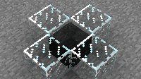

### Oil Bucket / 黒オイルバケツ / BC

* 実装状態: [ ]
* 名称: Oil Bucket / 日本語: 黒オイルバケツ / Origin: `-` / New: `bcn:oil_bucket`
* レシピ: なし
* レシピ配置図: `[000]` / `[000]` / `[000]`
* 概要: 
* 専用GUI: 無
* 実装方法: 生成条件: 油溜まり=脈14×3個/一様8〜56(砂漠・海洋のみ) + 同1個/-32〜56(全域). 地表油田=砂漠1/200・海洋1/250, 砂漠油湖=1/80

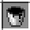

### Fuel Bucket / 金オイルバケツ / BC

* 実装状態: [ ]
* 名称: Fuel Bucket / 日本語: 金オイルバケツ / Origin: `-` / New: `bcn:fuel_bucket`
* レシピ: なし
* レシピ配置図: `[000]` / `[000]` / `[000]`
* 概要: 
* 専用GUI: 無
* 実装方法: リファイナリーでの精製生成物

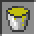

### Template / テンプレート / BC

* 実装状態: [ ]
* 名称: Template / 日本語: テンプレート / Origin: `buildcraftbuilders:snapshot#0` / New: `bcn:template`
* レシピ: `Paper` x8 + `Dye Black` x1 -> `Template` x1
* レシピ配置図: `AAA` / `ABA` / `AAA`
* 概要: 下記の製図机で使用する未記入状態の製図. 指定範囲内のブロック情報を0(＝ある)か1(=ない)かだけで記録する. 個々のブロックの種類までは記憶できない代わりに、 記録した再現する時はプレイヤーが任意の建材を使用できる. 1種類のブロックを使った単純な構造物を反復作成する場合に向く.
* 専用GUI: 無
* 実装方法: 

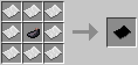

### Redstone Crystal / レッドストーンクリスタル / BC

* 実装状態: [ ]
* 名称: Redstone Crystal / 日本語: レッドストーンクリスタル / Origin: `-` / New: `bcn:redstone_crystal`
* レシピ: `Redstone Block` x1 -> `Redstone Crystal` x1
* レシピ配置図: `[000]` / `[000]` / `[000]`
* 概要: 中間素材. 精密作業台で作成.
* 専用GUI: 無
* 実装方法: 

<!-- 画像なし -->

### Energy Crystal / エナジークリスタル / IC2

* 実装状態: [ ]
* 名称: Energy Crystal / 日本語: エナジークリスタル / Origin: `ic2:energy_crystal` / New: `bcn:energy_crystal`
* レシピ: `Redstone` x8 + `Diamond` x1 -> `Energy Crystal` x1
* レシピ配置図: `AAA` / `ABA` / `AAA`
* 概要: 絶縁性のダイヤモンドに半導性を付与し蓄電可能にしたもの. 10万EUほど保持が可能でMFEトランスミッタおよびMFSユニットで充電、放電が可能. 機械装置では、誘導加熱炉でのみ使用可能.
* 専用GUI: 無
* 実装方法: 

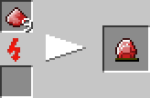

### Lapotron Crystal / ラポトロンクリスタル / IC2

* 実装状態: [ ]
* 名称: Lapotron Crystal / 日本語: ラポトロンクリスタル / Origin: `ic2:lapatron_crystal` / New: `bcn:lapotron_crystal`
* レシピ: `Lapis Lazuli` x6 + `Circuit` x2 + `Energy Crystal` x1 -> `Lapotron Crystal` x1
* レシピ配置図: `ABA` / `ACA` / `ABA`
* 概要: エナジークリスタルの上位版で100万EUほど保持が可能. MFSユニットでのみ充電、放電が可能.
* 専用GUI: 無
* 実装方法: 

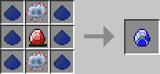

### Tesla Coil / テスラコイル / IC2

* 実装状態: [ ]
* 名称: Tesla Coil / 日本語: テスラコイル / Origin: `ic2:tesla_coil` / New: `bcn:tesla_coil`
* レシピ: `Redstone` x5 + `MV Transformer` x1 + `Refined Iron Ingot` x2 + `Circuit` x1 -> `Tesla Coil` x1
* レシピ配置図: `AAA` / `ABA` / `CDC`
* 概要: 攻撃型の防衛装置. 内部に10000EUのストレージを持ち、 蓄電量に応じたダメージを範囲内のキャラクター全てに与える（分散なし） 建造物やドロップアイテムにまったく被害を出さすに敵を始末出来る. が、いかなるキャラクターでも射程内ならダメージを受けるため扱いには注意が必要. 防具で軽減できるとはいえ、最大電力ではハート12.5個分もの威力になるため即死しかねない. 中電圧まで対応. 攻撃範囲はコイルを中心に９×９×９. １回の放電で全電力を消費する. レッドストーン入力が必要で、入力されている間は2秒毎に（最低稼働電力が溜まっていれば）放電を行う.
* 専用GUI: 無
* 実装方法: 生成条件: 油溜まり=脈14×3個/一様8〜56(砂漠・海洋のみ) + 同1個/-32〜56(全域). 地表油田=砂漠1/200・海洋1/250, 砂漠油湖=1/80

<!-- 画像なし -->

### IndustrialTNT / 工業用TNT / IC2

* 実装状態: [ ]
* 名称: IndustrialTNT / 日本語: 工業用TNT / Origin: `ic2:itnt` / New: `bcn:industrialtnt`
* レシピ: `Flint` x6 + `Tnt` x3 -> `IndustrialTNT` x4
* レシピ配置図: `ABA` / `ABA` / `ABA`
* 概要: 名前の通り爆破採掘用のTNTで、爆破した範囲のブロックを消失させること無くアイテム化できる（範囲内に落ちていたアイテムは消滅する） 火薬量が調整されており、通常TNTより少し爆発範囲が小さい. 素手では回収できず、着火してしまうので要注意. 現在、後者のレシピで作ろうとすると遠隔起爆装置ができます.
* 専用GUI: 無
* 実装方法: 

<!-- 画像なし -->

### Rubber Sheet / ラバーシート / IC2

* 実装状態: [ ]
* 名称: Rubber Sheet / 日本語: ラバーシート / Origin: `ic2:rubber_sheet` / New: `bcn:rubber_sheet`
* レシピ: `Rubber` x6 -> `Rubber Sheet` x3
* レシピ配置図: `AAA` / `AAA`
* 概要: ラバートランポリンとも. 組み合わせるとトランポリンのようになる. 左右にシートの支えとなる適当なブロックを設置しシートの下部を空白にする事で機能する. なおトランポリンは一定の高さまでのダメージを軽減する効果がある.
* 専用GUI: 無
* 実装方法: 

<!-- 画像なし -->

### Refined Iron / 精錬鉄 / IC2

* 実装状態: [ ]
* 名称: Refined Iron / 日本語: 精錬鉄 / Origin: `-` / New: `bcn:refined_iron`
* レシピ: なし
* レシピ配置図: `[000]` / `[000]` / `[000]`
* 概要: 鉄インゴットを更に精錬するとことで精製出来る上質な鉄. IC2ではこれを主体として機械や道具を作ることになる. 粉砕すると普通の鉄の粉になるので、普通の鉄に戻すことが可能.
* 専用GUI: 無
* 実装方法: 

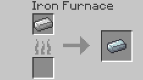

### Mixed Metal Ingot / 合金インゴット / IC2

* 実装状態: [ ]
* 名称: Mixed Metal Ingot / 日本語: 合金インゴット / Origin: `ic2:ingot_advanced_alloy` / New: `bcn:mixed_metal_ingot`
* レシピ: `Refined Iron Ingot` x3 + `Bronze Ingot` x3 + `Aluminium` x3 -> `Mixed Metal Ingot` x2
* レシピ配置図: `AAA` / `BBB` / `CCC`
* 概要: 三種類の金属を組み合わせて作れる. このままでは何にも使えない. なお、中段は銅ではなくブロンズなので注意.
* 専用GUI: 無
* 実装方法: 

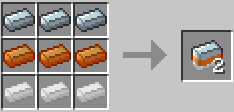

### Advanced Alloy / 合金板 / IC2

* 実装状態: [ ]
* 名称: Advanced Alloy / 日本語: 合金板 / Origin: `-` / New: `bcn:advanced_alloy`
* レシピ: なし
* レシピ配置図: `[000]` / `[000]` / `[000]`
* 概要: 上の合金インゴットを圧縮機にかけたもの.
* 専用GUI: 無
* 実装方法: 

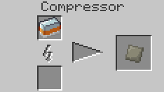

### Dense Copper Plate / 銅板 / IC2

* 実装状態: [ ]
* 名称: Dense Copper Plate / 日本語: 銅板 / Origin: `-` / New: `bcn:dense_copper_plate`
* レシピ: `Copper Ingot` x8 -> `Dense Copper Plate` x1
* レシピ配置図: `[000]` / `[000]` / `[000]`
* 概要: 銅インゴット8枚を圧縮機にかけると出来る中間素材.
* 専用GUI: 無
* 実装方法: 

<!-- 画像なし -->

### Iridium Ore / イリジウム鉱石 / IC2

* 実装状態: [ ]
* 名称: Iridium Ore / 日本語: イリジウム鉱石 / Origin: `-` / New: `bcn:iridium_ore`
* レシピ: `Iridium Ore` x4 + `Advanced Alloy` x4 + `Diamond` x1 -> `Iridium Ore` x1
* レシピ配置図: `[000]` / `[000]` / `[000]`
* 概要: マターを組み合わせることでイリジウム鉱石が製作可能. イリジウム鉱石を組み合わせることでイリジウム板が製作可能.
* 専用GUI: 無
* 実装方法: 

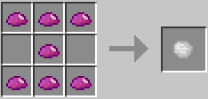

### Iridium Plate / イリジウムプレート / IC2

* 実装状態: [ ]
* 名称: Iridium Plate / 日本語: イリジウムプレート / Origin: `ic2:plate_iridium` / New: `bcn:iridium_plate`
* レシピ: `Iridium Ore` x4 + `Plate Advanced Alloy` x4 + `Diamond` x1 -> `Iridium Plate` x1
* レシピ配置図: `ABA` / `BCB` / `ABA`
* 概要: マターを組み合わせることでイリジウム鉱石が製作可能. イリジウム鉱石を組み合わせることでイリジウム板が製作可能. 銅、錫、金、鉄などの鉱石を粉砕機で砕いたもの. 鉱石一つに対し二つ作られ、粉一つ精錬することでインゴット一つになる. つまり、実質2倍の鉱石を入手出来る. インゴットは鉱石同様に粉砕することで粉一つに戻すことができる.
* 専用GUI: 無
* 実装方法: 

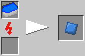

### Small Pile of Iron Dust / 小さな鉄の粉 / IC2

* 実装状態: [ ]
* 名称: Small Pile of Iron Dust / 日本語: 小さな鉄の粉 / Origin: `-` / New: `bcn:small_pile_of_iron_dust`
* レシピ: `Small Pile of Iron Dust` x5 + `Tin Dust` x4 / `Copper Dust` x4 + `スズの粉5 鉄の粉小さな鉄の粉` x2 -> `Small Pile of Iron Dust` x1
* レシピ配置図: `[000]` / `[000]` / `[000]`
* 概要: 鉄の粉を別の方法で作るためのレシピ. 2つ組み合わせることで鉄の粉になる.
* 専用GUI: 無
* 実装方法: 

<!-- 画像なし -->

### Coal Dust / 石炭の粉 / IC2

* 実装状態: [ ]
* 名称: Coal Dust / 日本語: 石炭の粉 / Origin: `-` / New: `bcn:coal_dust`
* レシピ: なし
* レシピ配置図: `[000]` / `[000]` / `[000]`
* 概要: 石炭を粉砕機で砕いたもの. 木炭で作ることは出来ない.
* 専用GUI: 無
* 実装方法: 

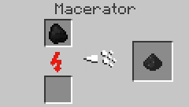

### Bronze Dust / ブロンズの粉 / IC2

* 実装状態: [ ]
* 名称: Bronze Dust / 日本語: ブロンズの粉 / Origin: `ic2:dust_bronze` / New: `bcn:bronze_dust`
* レシピ: `Bronze Dust Block` x1 -> `Bronze Dust` x9
* レシピ配置図: `[不定形]`
* 概要: 銅の粉とスズの粉を混ぜたもの. 精錬することでインゴットになる.
* 専用GUI: 無
* 実装方法: 

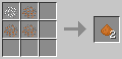

### Clay Dust / 粘土の粉 / IC2

* 実装状態: [ ]
* 名称: Clay Dust / 日本語: 粘土の粉 / Origin: `-` / New: `bcn:clay_dust`
* レシピ: なし
* レシピ配置図: `[000]` / `[000]` / `[000]`
* 概要: 粘土を粉砕機で砕いたもの.
* 専用GUI: 無
* 実装方法: 

<!-- 画像なし -->

### Carbon Plate / カーボンプレート / IC2

* 実装状態: [ ]
* 名称: Carbon Plate / 日本語: カーボンプレート / Origin: `-` / New: `bcn:carbon_plate`
* レシピ: なし
* レシピ配置図: `[000]` / `[000]` / `[000]`
* 概要: ナノスーツなどの材料になる.
* 専用GUI: 無
* 実装方法: 

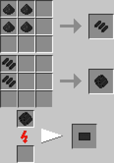

### Coal Ball / 石炭の玉 / IC2

* 実装状態: [ ]
* 名称: Coal Ball / 日本語: 石炭の玉 / Origin: `ic2:coal_ball` / New: `bcn:coal_ball`
* レシピ: `Coal Dust` x8 + `Flint` x1 -> `Coal Ball` x1
* レシピ配置図: `AAA` / `ABA` / `AAA`
* 概要: 石炭の粉(石炭粉末)とフリントをかけあわせたもの. このままでは使えない.
* 専用GUI: 無
* 実装方法: 

<!-- 画像なし -->

### Compressed Coal Ball / 圧縮した石炭玉 / IC2

* 実装状態: [ ]
* 名称: Compressed Coal Ball / 日本語: 圧縮した石炭玉 / Origin: `-` / New: `bcn:compressed_coal_ball`
* レシピ: なし
* レシピ配置図: `[000]` / `[000]` / `[000]`
* 概要: 石炭の玉を圧縮したもの.
* 専用GUI: 無
* 実装方法: 

<!-- 画像なし -->

### Coal Chunk / 石炭の塊 / IC2

* 実装状態: [ ]
* 名称: Coal Chunk / 日本語: 石炭の塊 / Origin: `ic2:coal_chunk` / New: `bcn:coal_chunk`
* レシピ: `Bio Chunk` x1 -> `Coal Chunk` x1
* レシピ配置図: `[不定形]`
* 概要: 石炭の塊.
* 専用GUI: 無
* 実装方法: 

<!-- 画像なし -->

### Hydrated Coal Dust / 液状化石炭 / IC2

* 実装状態: [ ]
* 名称: Hydrated Coal Dust / 日本語: 液状化石炭 / Origin: `ic2:dust_hydrated_coal` / New: `bcn:hydrated_coal_dust`
* レシピ: `Coal Dust` x8 + `Water` x1 -> `Hydrated Coal Dust` x8
* レシピ配置図: `AAA` / `ABA` / `AAA`
* 概要: 石炭の粉と水を混ぜたもの. 精錬すると石炭の粉に戻る.
* 専用GUI: 無
* 実装方法: 

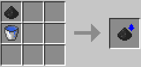

### H.Coal / 圧縮した液化石炭 / IC2

* 実装状態: [ ]
* 名称: H.Coal / 日本語: 圧縮した液化石炭 / Origin: `-` / New: `bcn:h_coal`
* レシピ: なし
* レシピ配置図: `[000]` / `[000]` / `[000]`
* 概要: 液状化石炭を圧縮したもの.
* 専用GUI: 無
* 実装方法: 

<!-- 画像なし -->

### Fuel Can / 空の燃料缶 / IC2

* 実装状態: [ ]
* 名称: Fuel Can / 日本語: 空の燃料缶 / Origin: `ic2:fuel_can` / New: `bcn:fuel_can`
* レシピ: `Tin Ingot` x7 -> `Fuel Can` x1
* レシピ配置図: `0AA` / `A0A` / `AAA`
* 概要: 燃料が詰まっていない状態の燃料缶.
* 専用GUI: 無
* 実装方法: 

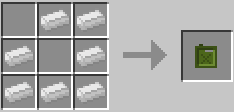

### Fuel Can_Filled / 燃料缶 / IC2

* 実装状態: [ ]
* 名称: Fuel Can_Filled / 日本語: 燃料缶 / Origin: `-` / New: `bcn:fuel_can_filled`
* レシピ: なし
* レシピ配置図: `[000]` / `[000]` / `[000]`
* 概要: 燃料を詰めた状態の燃料缶で鉄のかまどや火力発電の燃料に使う. 缶詰製造機を使うことで燃料を補充出来る. 燃料を詰め込むにはバイオ燃料セルもしくは石炭燃料セルが6個必要.
* 専用GUI: 無
* 実装方法: 

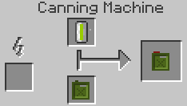

### Rubbertree Wood / ゴムの木 / IC2

* 実装状態: [ ]
* 名称: Rubbertree Wood / 日本語: ゴムの木 / Origin: `-` / New: `bcn:rubbertree_wood`
* レシピ: なし
* レシピ配置図: `[000]` / `[000]` / `[000]`
* 概要: ゴムの木は湿地帯のバイオームに多く見られ、寒冷地では群生量が少ない. ゴムの木の葉を壊すとゴムの木の苗木が手に入る. ゴムの木を伐採、もしくは樹液が出ている部分にツリータップを使うと樹液が手に入る. 樹液を採取した後、時間が経つと再び採取できるようになる. 樹液が復活する前に再度ツリータップを使っても樹液が追加で手に入る可能性があるが、穴が潰れて樹液が出てこなくなる可能性もあるので注意. 樹液は粘着ピストンや松明のレシピ代わりとして使うことも出来る. また、ブロックの上に配置することができ、その上を歩くと移動速度が遅くなり、ジャンプも低くなる. ゴムの木の原木は、作業台で加工するとジャングルの木からできるものと同じ木材が3個に、 精錬するとジャングルの木の原木になる.
* 専用GUI: 無
* 実装方法: 

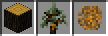

### Rubber / ゴム / IC2

* 実装状態: [ ]
* 名称: Rubber / 日本語: ゴム / Origin: `ic2:rubber` / New: `bcn:rubber`
* レシピ: `Sticky Resin` x1 -> `Rubber` x1
* レシピ配置図: `[不定形]`
* 概要: ゴムの木から得られる素材を加工したもので主に各種ケーブルを作るときに使う. 樹液→精錬：1個 樹液→抽出機：3個 ゴムの原木→抽出機：1個 ゴムの苗木→抽出機：1個
* 専用GUI: 無
* 実装方法: 

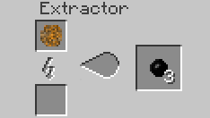

### Rubber Boots / ゴムブーツ / IC2

* 実装状態: [ ]
* 名称: Rubber Boots / 日本語: ゴムブーツ / Origin: `ic2:armor_hazmat_boots` / New: `bcn:rubber_boots`
* レシピ: `Rubber` x6 + `Wool` x1 -> `Rubber Boots` x1
* レシピ配置図: `A0A` / `A0A` / `ABA`
* 概要: ゴム製のブーツで着地ダメージを大幅に軽減する. 羊毛とゴムを組み合わせることで作れる. 羊毛の色は何色でも構わない.
* 専用GUI: 無
* 実装方法: 

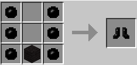

### Bronze Armor / ブロンズアーマー / IC2

* 実装状態: [ ]
* 名称: Bronze Armor / 日本語: ブロンズアーマー / Origin: `-` / New: `bcn:bronze_armor`
* レシピ: なし
* レシピ配置図: `[000]` / `[000]` / `[000]`
* 概要: 青銅製のアーマー. 耐久値が鉄製のものより1.25倍ほど多い.
* 専用GUI: 無
* 実装方法: 

<!-- 画像なし -->

### Bronze Tools / ブロンズ製工具 / IC2

* 実装状態: [ ]
* 名称: Bronze Tools / 日本語: ブロンズ製工具 / Origin: `-` / New: `bcn:bronze_tools`
* レシピ: なし
* レシピ配置図: `[000]` / `[000]` / `[000]`
* 概要: ブロンズ製のツール. 掘る性能は鉄製ツールと同等. 耐久度は鉄製ツールの1.25倍. 鉄の消費が多いことによる救済措置.
* 専用GUI: 無
* 実装方法: 

<!-- 画像なし -->

### Industrial Credit / コイン / IC2

* 実装状態: [ ]
* 名称: Industrial Credit / 日本語: コイン / Origin: `ic2:coin` / New: `bcn:industrial_credit`
* レシピ: `Coin 8x` x1 -> `Industrial Credit` x8
* レシピ配置図: `[不定形]`
* 概要: 工業貨幣、つまりはお金である. SMPでトレード-O-Matと組み合わせて使うと良い. 9枚組み合わせる事で精製鉄1個に戻すことも可能.
* 専用GUI: 無
* 実装方法: 

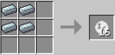

### GrowStone Dusts / グロウストーンの粉 / IC2

* 実装状態: [ ]
* 名称: GrowStone Dusts / 日本語: グロウストーンの粉 / Origin: `-` / New: `bcn:growstone_dusts`
* レシピ: `Redstone` x5 + `Gold Dust` x4 -> `GrowStone Dusts` x1
* レシピ配置図: `[000]` / `[000]` / `[000]`
* 概要: グロウストーンの粉の追加レシピ.
* 専用GUI: 無
* 実装方法: 

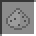

### Refined Iron / 精錬鉄 / IC2

* 実装状態: [ ]
* 名称: Refined Iron / 日本語: 精錬鉄 / Origin: `-` / New: `bcn:refined_iron`
* レシピ: なし
* レシピ配置図: `[000]` / `[000]` / `[000]`
* 概要: 鉄インゴットを更に精錬するとことで精製出来る上質な鉄. IC2ではこれを主体として機械や道具を作ることになる. 粉砕すると普通の鉄の粉になるので、普通の鉄に戻すことが可能.
* 専用GUI: 無
* 実装方法: 

### Mixed Metal Ingot / 合金インゴット / IC2

* 実装状態: [ ]
* 名称: Mixed Metal Ingot / 日本語: 合金インゴット / Origin: `ic2:ingot_advanced_alloy` / New: `bcn:mixed_metal_ingot`
* レシピ: `Refined Iron Ingot` x3 + `Bronze Ingot` x3 + `Aluminium` x3 -> `Mixed Metal Ingot` x2
* レシピ配置図: `AAA` / `BBB` / `CCC`
* 概要: 三種類の金属を組み合わせて作れる. このままでは何にも使えない. なお、中段は銅ではなくブロンズなので注意.
* 専用GUI: 無
* 実装方法: 

### Advanced Alloy / 合金板 / IC2

* 実装状態: [ ]
* 名称: Advanced Alloy / 日本語: 合金板 / Origin: `-` / New: `bcn:advanced_alloy`
* レシピ: なし
* レシピ配置図: `[000]` / `[000]` / `[000]`
* 概要: 上の合金インゴットを圧縮機にかけたもの.
* 専用GUI: 無
* 実装方法: 

### Dense Copper Plate / 銅板 / IC2

* 実装状態: [ ]
* 名称: Dense Copper Plate / 日本語: 銅板 / Origin: `-` / New: `bcn:dense_copper_plate`
* レシピ: `Copper Ingot` x8 -> `Dense Copper Plate` x1
* レシピ配置図: `[000]` / `[000]` / `[000]`
* 概要: 銅インゴット8枚を圧縮機にかけると出来る中間素材.
* 専用GUI: 無
* 実装方法: 

<!-- 画像なし -->

### Iridium Plate / イリジウム鉱石、イリジウムプレート / IC2

* 実装状態: [ ]
* 名称: Iridium Plate / 日本語: イリジウム鉱石、イリジウムプレート / Origin: `ic2:plate_iridium` / New: `bcn:iridium_plate`
* レシピ: `Iridium Ore` x4 + `Plate Advanced Alloy` x4 + `Diamond` x1 -> `Iridium Plate` x1
* レシピ配置図: `ABA` / `BCB` / `ABA`
* 概要: マターを組み合わせることでイリジウム鉱石が製作可能. イリジウム鉱石を組み合わせることでイリジウム板が製作可能. 銅、錫、金、鉄などの鉱石を粉砕機で砕いたもの. 鉱石一つに対し二つ作られ、粉一つ精錬することでインゴット一つになる. つまり、実質2倍の鉱石を入手出来る. インゴットは鉱石同様に粉砕することで粉一つに戻すことができる.
* 専用GUI: 無
* 実装方法: 

### Small Pile of Iron Dust / 小さな鉄の粉 / IC2

* 実装状態: [ ]
* 名称: Small Pile of Iron Dust / 日本語: 小さな鉄の粉 / Origin: `-` / New: `bcn:small_pile_of_iron_dust`
* レシピ: `Small Pile of Iron Dust` x5 + `Tin Dust` x4 / `Copper Dust` x4 + `Tin Dust` x5 / `鉄の粉小さな鉄の粉` x2 -> `Small Pile of Iron Dust` x1
* レシピ配置図: `[000]` / `[000]` / `[000]`
* 概要: 鉄の粉を別の方法で作るためのレシピ. 2つ組み合わせることで鉄の粉になる.
* 専用GUI: 無
* 実装方法: 

<!-- 画像なし -->

### Coal Dust / 石炭の粉 / IC2

* 実装状態: [ ]
* 名称: Coal Dust / 日本語: 石炭の粉 / Origin: `-` / New: `bcn:coal_dust`
* レシピ: なし
* レシピ配置図: `[000]` / `[000]` / `[000]`
* 概要: 石炭を粉砕機で砕いたもの. 木炭で作ることは出来ない.
* 専用GUI: 無
* 実装方法: 

### Bronze Dusts / ブロンズの粉 / IC2

* 実装状態: [ ]
* 名称: Bronze Dusts / 日本語: ブロンズの粉 / Origin: `-` / New: `bcn:bronze_dusts`
* レシピ: `Copper Dust` x3 + `Tin Dust` x1 -> `Bronze Dusts` x1
* レシピ配置図: `[000]` / `[000]` / `[000]`
* 概要: 銅の粉とスズの粉を混ぜたもの. 精錬することでインゴットになる.
* 専用GUI: 無
* 実装方法: 

### Clay Dust / 粘土の粉 / IC2

* 実装状態: [ ]
* 名称: Clay Dust / 日本語: 粘土の粉 / Origin: `-` / New: `bcn:clay_dust`
* レシピ: なし
* レシピ配置図: `[000]` / `[000]` / `[000]`
* 概要: 粘土を粉砕機で砕いたもの.
* 専用GUI: 無
* 実装方法: 

<!-- 画像なし -->

### Carbon Plate / カーボンプレート / IC2

* 実装状態: [ ]
* 名称: Carbon Plate / 日本語: カーボンプレート / Origin: `-` / New: `bcn:carbon_plate`
* レシピ: なし
* レシピ配置図: `[000]` / `[000]` / `[000]`
* 概要: ナノスーツなどの材料になる.
* 専用GUI: 無
* 実装方法: 

### Coal Ball / 石炭の玉 / IC2

* 実装状態: [ ]
* 名称: Coal Ball / 日本語: 石炭の玉 / Origin: `ic2:coal_ball` / New: `bcn:coal_ball`
* レシピ: `Coal Dust` x8 + `Flint` x1 -> `Coal Ball` x1
* レシピ配置図: `AAA` / `ABA` / `AAA`
* 概要: 石炭の粉(石炭粉末)とフリントをかけあわせたもの. このままでは使えない.
* 専用GUI: 無
* 実装方法: 

<!-- 画像なし -->

### Compressed Coal Ball / 圧縮した石炭玉 / IC2

* 実装状態: [ ]
* 名称: Compressed Coal Ball / 日本語: 圧縮した石炭玉 / Origin: `-` / New: `bcn:compressed_coal_ball`
* レシピ: なし
* レシピ配置図: `[000]` / `[000]` / `[000]`
* 概要: 石炭の玉を圧縮したもの.
* 専用GUI: 無
* 実装方法: 

<!-- 画像なし -->

### Coal Chunk / 石炭の塊 / IC2

* 実装状態: [ ]
* 名称: Coal Chunk / 日本語: 石炭の塊 / Origin: `ic2:coal_chunk` / New: `bcn:coal_chunk`
* レシピ: `Bio Chunk` x1 -> `Coal Chunk` x1
* レシピ配置図: `[不定形]`
* 概要: 石炭の塊.
* 専用GUI: 無
* 実装方法: 

<!-- 画像なし -->

### Hydrated Coal Dust / 液状化石炭 / IC2

* 実装状態: [ ]
* 名称: Hydrated Coal Dust / 日本語: 液状化石炭 / Origin: `ic2:dust_hydrated_coal` / New: `bcn:hydrated_coal_dust`
* レシピ: `Coal Dust` x8 + `Water` x1 -> `Hydrated Coal Dust` x8
* レシピ配置図: `AAA` / `ABA` / `AAA`
* 概要: 石炭の粉と水を混ぜたもの. 精錬すると石炭の粉に戻る.
* 専用GUI: 無
* 実装方法: 

### H.Coal / 圧縮した液化石炭 / IC2

* 実装状態: [ ]
* 名称: H.Coal / 日本語: 圧縮した液化石炭 / Origin: `-` / New: `bcn:h_coal`
* レシピ: なし
* レシピ配置図: `[000]` / `[000]` / `[000]`
* 概要: 液状化石炭を圧縮したもの.
* 専用GUI: 無
* 実装方法: 

<!-- 画像なし -->

### Fuel Can / 空の燃料缶 / IC2

* 実装状態: [ ]
* 名称: Fuel Can / 日本語: 空の燃料缶 / Origin: `ic2:fuel_can` / New: `bcn:fuel_can`
* レシピ: `Tin Ingot` x7 -> `Fuel Can` x1
* レシピ配置図: `0AA` / `A0A` / `AAA`
* 概要: 燃料が詰まっていない状態の燃料缶.
* 専用GUI: 無
* 実装方法: 

### Fuel Can_Filled / 燃料缶 / IC2

* 実装状態: [ ]
* 名称: Fuel Can_Filled / 日本語: 燃料缶 / Origin: `-` / New: `bcn:fuel_can_filled`
* レシピ: なし
* レシピ配置図: `[000]` / `[000]` / `[000]`
* 概要: 燃料を詰めた状態の燃料缶で鉄のかまどや火力発電の燃料に使う. 缶詰製造機を使うことで燃料を補充出来る. 燃料を詰め込むにはバイオ燃料セルもしくは石炭燃料セルが6個必要.
* 専用GUI: 無
* 実装方法: 

### Rubbertree Wood / ゴムの木 / IC2

* 実装状態: [ ]
* 名称: Rubbertree Wood / 日本語: ゴムの木 / Origin: `-` / New: `bcn:rubbertree_wood`
* レシピ: なし
* レシピ配置図: `[000]` / `[000]` / `[000]`
* 概要: ゴムの木は湿地帯のバイオームに多く見られ、寒冷地では群生量が少ない. ゴムの木の葉を壊すとゴムの木の苗木が手に入る. ゴムの木を伐採、もしくは樹液が出ている部分にツリータップを使うと樹液が手に入る. 樹液を採取した後、時間が経つと再び採取できるようになる. 樹液が復活する前に再度ツリータップを使っても樹液が追加で手に入る可能性があるが、穴が潰れて樹液が出てこなくなる可能性もあるので注意. 樹液は粘着ピストンや松明のレシピ代わりとして使うことも出来る. また、ブロックの上に配置することができ、その上を歩くと移動速度が遅くなり、ジャンプも低くなる. ゴムの木の原木は、作業台で加工するとジャングルの木からできるものと同じ木材が3個に、 精錬するとジャングルの木の原木になる.
* 専用GUI: 無
* 実装方法: 

### Rubber / ゴム / IC2

* 実装状態: [ ]
* 名称: Rubber / 日本語: ゴム / Origin: `ic2:rubber` / New: `bcn:rubber`
* レシピ: `Sticky Resin` x1 -> `Rubber` x1
* レシピ配置図: `[不定形]`
* 概要: ゴムの木から得られる素材を加工したもので主に各種ケーブルを作るときに使う. 樹液→精錬：1個 樹液→抽出機：3個 ゴムの原木→抽出機：1個 ゴムの苗木→抽出機：1個
* 専用GUI: 無
* 実装方法: 

### Rubber Boots / ゴムブーツ / IC2

* 実装状態: [ ]
* 名称: Rubber Boots / 日本語: ゴムブーツ / Origin: `ic2:armor_hazmat_boots` / New: `bcn:rubber_boots`
* レシピ: `Rubber` x6 + `Wool` x1 -> `Rubber Boots` x1
* レシピ配置図: `A0A` / `A0A` / `ABA`
* 概要: ゴム製のブーツで着地ダメージを大幅に軽減する. 羊毛とゴムを組み合わせることで作れる. 羊毛の色は何色でも構わない.
* 専用GUI: 無
* 実装方法: 

### Bronze Armor / ブロンズアーマー / IC2

* 実装状態: [ ]
* 名称: Bronze Armor / 日本語: ブロンズアーマー / Origin: `-` / New: `bcn:bronze_armor`
* レシピ: なし
* レシピ配置図: `[000]` / `[000]` / `[000]`
* 概要: 青銅製のアーマー. 耐久値が鉄製のものより1.25倍ほど多い.
* 専用GUI: 無
* 実装方法: 

<!-- 画像なし -->

### Bronze Tools / ブロンズ製工具 / IC2

* 実装状態: [ ]
* 名称: Bronze Tools / 日本語: ブロンズ製工具 / Origin: `-` / New: `bcn:bronze_tools`
* レシピ: なし
* レシピ配置図: `[000]` / `[000]` / `[000]`
* 概要: ブロンズ製のツール. 掘る性能は鉄製ツールと同等. 耐久度は鉄製ツールの1.25倍. 鉄の消費が多いことによる救済措置.
* 専用GUI: 無
* 実装方法: 

<!-- 画像なし -->

### Industrial Credit / コイン / IC2

* 実装状態: [ ]
* 名称: Industrial Credit / 日本語: コイン / Origin: `ic2:coin` / New: `bcn:industrial_credit`
* レシピ: `Coin 8x` x1 -> `Industrial Credit` x8
* レシピ配置図: `[不定形]`
* 概要: 工業貨幣、つまりはお金である. SMPでトレード-O-Matと組み合わせて使うと良い. 9枚組み合わせる事で精製鉄1個に戻すことも可能.
* 専用GUI: 無
* 実装方法: 

### GrowStone Dusts / グロウストーンの粉 / IC2

* 実装状態: [ ]
* 名称: GrowStone Dusts / 日本語: グロウストーンの粉 / Origin: `-` / New: `bcn:growstone_dusts`
* レシピ: `Redstone` x5 + `Gold Dust` x4 -> `GrowStone Dusts` x1
* レシピ配置図: `[000]` / `[000]` / `[000]`
* 概要: グロウストーンの粉の追加レシピ.
* 専用GUI: 無
* 実装方法: 

### Silicon Chip / シリコンチップ基板 / PR

* 実装状態: [ ]
* 名称: Silicon Chip / 日本語: シリコンチップ基板 / Origin: `projectred_core:silicon_chip` / New: `bcn:silicon_chip`
* レシピ: `Infused Silicon` x1 + `Plate` x3 -> `Silicon Chip` x1
* レシピ配置図: `0A0` / `BBB`
* 概要: 中間素材.
* 専用GUI: 無
* 実装方法: 

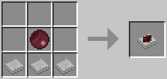

### Energized Silicon Chip / 不純物入りシリコンチップ基板 / PR

* 実装状態: [ ]
* 名称: Energized Silicon Chip / 日本語: 不純物入りシリコンチップ基板 / Origin: `projectred_core:energized_silicon_chip` / New: `bcn:energized_silicon_chip`
* レシピ: `Energized Silicon` x1 + `Plate` x3 -> `Energized Silicon Chip` x1
* レシピ配置図: `0A0` / `BBB`
* 概要: 中間素材.
* 専用GUI: 無
* 実装方法: 

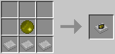

### Plate Assembly / アセンブリ基板 / PR

* 実装状態: [ ]
* 名称: Plate Assembly / 日本語: アセンブリ基板 / Origin: `-` / New: `bcn:plate_assembly`
* レシピ: `Stone Wafer` x3 + `Stick` x2 + `Stone Redwire` x2 -> `Plate Assembly` x1
* レシピ配置図: `[000]` / `[000]` / `[000]`
* 概要: 中間素材. 二枚のワイヤー基盤を仕込んで、小さな櫓状に組み上げた装置. 配列素子の作成に使用する.
* 専用GUI: 無
* 実装方法: 

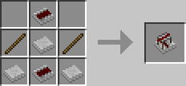

### Red Alloy Ingot / 赤合金インゴット / PR

* 実装状態: [ ]
* 名称: Red Alloy Ingot / 日本語: 赤合金インゴット / Origin: `projectred_core:red_ingot` / New: `bcn:red_alloy_ingot`
* レシピ: 赤鉄化合物を精錬
* レシピ配置図: `[000]` / `[000]` / `[000]`
* 概要: レッドストーンを添加し合金化した金属. これを材料にして作られる各種ワイヤーは、 レッドストーンパウダーの実に16倍(256マス)という脅威の伝達距離を誇る. 銅インゴットからも作成可能.
* 専用GUI: 無
* 実装方法: 

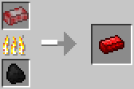

### Silicon Boule / 高純度シリコン / PR

* 実装状態: [ ]
* 名称: Silicon Boule / 日本語: 高純度シリコン / Origin: `projectred_core:boule` / New: `bcn:silicon_boule`
* レシピ: 砂石炭化合物を精錬
* レシピ配置図: `[000]` / `[000]` / `[000]`
* 概要: ◆合金かまど(Alloy Furnace)で精錬 石炭でも木炭でも作成可能 ICチップの素材としてお馴染みのシリコン. 半導体として高い適性を持つ. ちなみに"Boule"とは、棒状に成長させた巨大な単結晶のこと.
* 専用GUI: 無
* 実装方法: 

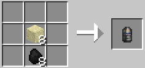

### Silicon / シリコンウェハー / PR

* 実装状態: [ ]
* 名称: Silicon / 日本語: シリコンウェハー / Origin: `projectred_core:silicon` / New: `bcn:silicon`
* レシピ: `Diamond Saw` x1 + `Boule` x1 -> `Silicon` x8
* レシピ配置図: `A` / `B`
* 概要: 分かりやすく言えばシリコンの薄切り. 様々な用途に使用される.
* 専用GUI: 無
* 実装方法: 

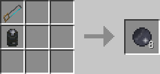

### Infused Silicon / レッドウェハー / PR

* 実装状態: [ ]
* 名称: Infused Silicon / 日本語: レッドウェハー / Origin: `projectred_core:infused_silicon` / New: `bcn:infused_silicon`
* レシピ: レッドシリコン化合物を製錬
* レシピ配置図: `[000]` / `[000]` / `[000]`
* 概要: レッドストーンとシリコンの化合物. こちらも様々な用途に使用される.
* 専用GUI: 無
* 実装方法: 

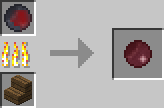

### Energized Silicon / 不純物入りシリコンウェハー / PR

* 実装状態: [ ]
* 名称: Energized Silicon / 日本語: 不純物入りシリコンウェハー / Origin: `projectred_core:energized_silicon` / New: `bcn:energized_silicon`
* レシピ: 不純物シリコン化合物を製錬
* レシピ配置図: `[000]` / `[000]` / `[000]`
* 概要: シリコンに不純物を混ぜたもの. こちらも様々な用途に使用される.
* 専用GUI: 無
* 実装方法: 

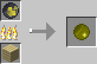

### Copper Coil / 銅製のコイル / PR

* 実装状態: [ ]
* 名称: Copper Coil / 日本語: 銅製のコイル / Origin: `projectred_core:copper_coil` / New: `bcn:copper_coil`
* レシピ: `Copper Ingot` x1 + `Draw Plate` x1 -> `Copper Coil` x1
* レシピ配置図: `AB`
* 概要: 中間素材. 下の青電力モーターの作成に必要.
* 専用GUI: 無
* 実装方法: 生成条件: 油溜まり=脈14×3個/一様8〜56(砂漠・海洋のみ) + 同1個/-32〜56(全域). 地表油田=砂漠1/200・海洋1/250, 砂漠油湖=1/80

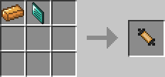

### Iron Coil / 鉄製のコイル / PR

* 実装状態: [ ]
* 名称: Iron Coil / 日本語: 鉄製のコイル / Origin: `projectred_core:iron_coil` / New: `bcn:iron_coil`
* レシピ: `Iron Ingot` x1 + `Draw Plate` x1 -> `Iron Coil` x1
* レシピ配置図: `AB`
* 概要: Baseのみでも作成可能だが使い道がない. 絞り板は素材として消費しない. いくつかのアイテムの作成に必要.
* 専用GUI: 無
* 実装方法: 生成条件: 油溜まり=脈14×3個/一様8〜56(砂漠・海洋のみ) + 同1個/-32〜56(全域). 地表油田=砂漠1/200・海洋1/250, 砂漠油湖=1/80

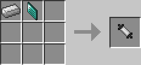

### Gold Coil / 金製のコイル / PR

* 実装状態: [ ]
* 名称: Gold Coil / 日本語: 金製のコイル / Origin: `projectred_core:gold_coil` / New: `bcn:gold_coil`
* レシピ: `Gold` x1 + `Draw Plate` x1 -> `Gold Coil` x1
* レシピ配置図: `AB`
* 概要: Baseのみでも作成可能だが使い道がない. 絞り板は素材として消費しない. いくつかのアイテムの作成に必要.
* 専用GUI: 無
* 実装方法: 生成条件: 油溜まり=脈14×3個/一様8〜56(砂漠・海洋のみ) + 同1個/-32〜56(全域). 地表油田=砂漠1/200・海洋1/250, 砂漠油湖=1/80

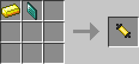

### Ruby / ルビー / PR

* 実装状態: [ ]
* 名称: Ruby / 日本語: ルビー / Origin: `projectred_core:ruby` / New: `bcn:ruby`
* レシピ: `Ruby Block` x1 -> `Ruby` x9
* レシピ配置図: `[不定形]`
* 概要: それぞれ対応する鉱石ブロックを破壊した際、1つドロップする. ダイヤやレッドストーン同様、鉱石ブロックを直接回収する事はできない. 基本的には各種ツールの材料に使うしか用途がない. グリーンサファイアのみ電動ドライバーの材料として使用する.
* 専用GUI: 無
* 実装方法: 

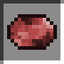

### Sapphire / サファイヤ / PR

* 実装状態: [ ]
* 名称: Sapphire / 日本語: サファイヤ / Origin: `projectred_core:sapphire` / New: `bcn:sapphire`
* レシピ: `Sapphire Block` x1 -> `Sapphire` x9
* レシピ配置図: `[不定形]`
* 概要: 
* 専用GUI: 無
* 実装方法: 

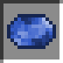

### Peridot / ペリドット / PR

* 実装状態: [ ]
* 名称: Peridot / 日本語: ペリドット / Origin: `projectred_core:peridot` / New: `bcn:peridot`
* レシピ: `Peridot Block` x1 -> `Peridot` x9
* レシピ配置図: `[不定形]`
* 概要: 【Base】のみでは使い道なし.
* 専用GUI: 無
* 実装方法: 

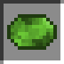

### Sandy Coal Compound / 砂石炭化合物 / PR

* 実装状態: [ ]
* 名称: Sandy Coal Compound / 日本語: 砂石炭化合物 / Origin: `-` / New: `bcn:sandy_coal_compound`
* レシピ: `Coal Block` x1 + `Sand` / `Red Sand` x8 -> `Sandy Coal Compound` x1
* レシピ配置図: `[000]` / `[000]` / `[000]`
* 概要: 砂に石炭を化合したもの. これを精錬することで高純度シリコンを作成できる.
* 専用GUI: 無
* 実装方法: 

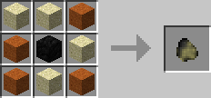

### Red Silicon Compound / レッドシリコン化合物 / PR

* 実装状態: [ ]
* 名称: Red Silicon Compound / 日本語: レッドシリコン化合物 / Origin: `projectred_core:red_silicon_comp` / New: `bcn:red_silicon_compound`
* レシピ: `Redstone` x8 + `Silicon` x1 -> `Red Silicon Compound` x1
* レシピ配置図: `AAA` / `ABA` / `AAA`
* 概要: シリコンにレッドストーンを化合したもの. これを精錬することでレッドウェハーを作成できる.
* 専用GUI: 無
* 実装方法: 

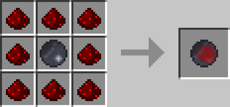

### Glowing Silicon Compound / 不純物シリコン化合物 / PR

* 実装状態: [ ]
* 名称: Glowing Silicon Compound / 日本語: 不純物シリコン化合物 / Origin: `projectred_core:glow_silicon_comp` / New: `bcn:glowing_silicon_compound`
* レシピ: `Glowstone Dust` x8 + `Silicon` x1 -> `Glowing Silicon Compound` x1
* レシピ配置図: `AAA` / `ABA` / `AAA`
* 概要: シリコンにグロウストーンを化合したもの. これを精錬することで不純物入りシリコンウェハーを作成できる.
* 専用GUI: 無
* 実装方法: 

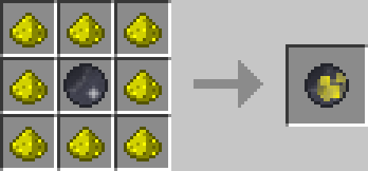

### Electrotine Alloy Ingot / 青合金インゴット / PR

* 実装状態: [ ]
* 名称: Electrotine Alloy Ingot / 日本語: 青合金インゴット / Origin: `projectred_core:electrotine_ingot` / New: `bcn:electrotine_alloy_ingot`
* レシピ: 青合金化合物を製錬
* レシピ配置図: `[000]` / `[000]` / `[000]`
* 概要: ニコライトと鉄の化合物. こちらも様々な用途に使用される.
* 専用GUI: 無
* 実装方法: 

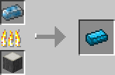

### Electrotine Silicon Compound / ブルーシリコン化合物 / PR

* 実装状態: [ ]
* 名称: Electrotine Silicon Compound / 日本語: ブルーシリコン化合物 / Origin: `projectred_core:electrotine_silicon_comp` / New: `bcn:electrotine_silicon_compound`
* レシピ: `Electrotine` x8 + `Silicon` x1 -> `Electrotine Silicon Compound` x1
* レシピ配置図: `AAA` / `ABA` / `AAA`
* 概要: シリコンにニコライトを化合したもの. これを精錬することでブルーウェハーを作成できる.
* 専用GUI: 無
* 実装方法: 

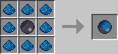

### Electro Silicon / ブルーウェハー / PR

* 実装状態: [ ]
* 名称: Electro Silicon / 日本語: ブルーウェハー / Origin: `-` / New: `bcn:electro_silicon`
* レシピ: ブルーシリコン化合物を製錬
* レシピ配置図: `[000]` / `[000]` / `[000]`
* 概要: ニコライトとシリコンの化合物. こちらも様々な用途に使用される.
* 専用GUI: 無
* 実装方法: 

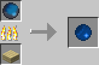

### Draw Plate / 絞り板 / PR

* 実装状態: [ ]
* 名称: Draw Plate / 日本語: 絞り板 / Origin: `projectred_core:draw_plate` / New: `bcn:draw_plate`
* レシピ: `Iron Block` x4 + `Diamond Block` x1 -> `Draw Plate` x1
* レシピ配置図: `0A0` / `ABA` / `0A0`
* 概要: コイルの作成に使用.
* 専用GUI: 無
* 実装方法: 

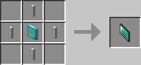

### Diamond Drawplate / 絞り板 / PR

* 実装状態: [ ]
* 名称: Diamond Drawplate / 日本語: 絞り板 / Origin: `-` / New: `bcn:diamond_drawplate`
* レシピ: `1` / `Diamond Block` x4 + `1` / `*` x1 / `Iron Block` x4 -> `Diamond Drawplate` x1
* レシピ配置図: `[000]` / `[000]` / `[000]`
* 概要: 中間素材. 銅を引き絞って導線に加工するもの. 【Digital】の手ノコと同じように、1回クラフティングに使用するごとに耐久値が1減る. 耐久値は1281. 1つ作るのにもダイヤが9個要るので地味にコストが高い. Pre5からは分割ダイヤブロックを元のダイヤに変換できるようになった.
* 専用GUI: 無
* 実装方法: 

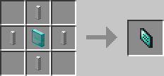

### Copper Coil / 銅線コイル / PR

* 実装状態: [ ]
* 名称: Copper Coil / 日本語: 銅線コイル / Origin: `projectred_core:copper_coil` / New: `bcn:copper_coil`
* レシピ: `Copper Ingot` x1 + `Draw Plate` x1 -> `Copper Coil` x1
* レシピ配置図: `AB`
* 概要: 中間素材. 下の青電力モーターの作成に必要.
* 専用GUI: 無
* 実装方法: 生成条件: 油溜まり=脈14×3個/一様8〜56(砂漠・海洋のみ) + 同1個/-32〜56(全域). 地表油田=砂漠1/200・海洋1/250, 砂漠油湖=1/80

### Ruby Ore / ルビー鉱石 / PR

* 実装状態: [ ]
* 名称: Ruby Ore / 日本語: ルビー鉱石 / Origin: `-` / New: `bcn:ruby_ore`
* レシピ: なし
* レシピ配置図: `[000]` / `[000]` / `[000]`
* 概要: y=53以下に、ダイヤと同程度の比率で配置される. 性能やレア度にほとんど違いは無いので、『宝石』というダイヤの3倍の埋蔵量の鉱石と見て差し支えない. pre5からグリーンサファイア(旧称エメラルド）を材料に指定するアイテム（"電動ドライバー"）が追加された.
* 専用GUI: 無
* 実装方法: 生成条件: 脈サイズ=8, 回数/チャンク=1, 高度分布=台形 -80〜80

### Sapphire Ore / サファイア鉱石 / PR

* 実装状態: [ ]
* 名称: Sapphire Ore / 日本語: サファイア鉱石 / Origin: `-` / New: `bcn:sapphire_ore`
* レシピ: なし
* レシピ配置図: `[000]` / `[000]` / `[000]`
* 概要: 
* 専用GUI: 無
* 実装方法: 生成条件: 脈サイズ=8, 回数/チャンク=1, 高度分布=台形 -80〜80

### Green Sapphire Ore / グリーンサファイア鉱石 / PR

* 実装状態: [ ]
* 名称: Green Sapphire Ore / 日本語: グリーンサファイア鉱石 / Origin: `-` / New: `bcn:green_sapphire_ore`
* レシピ: なし
* レシピ配置図: `[000]` / `[000]` / `[000]`
* 概要: 
* 専用GUI: 無
* 実装方法: 生成条件: 脈サイズ=8, 回数/チャンク=1, 高度分布=台形 -80〜80

<!-- 画像なし -->

### Copper Ore / 銅鉱石 / PR

* 実装状態: [ ]
* 名称: Copper Ore / 日本語: 銅鉱石 / Origin: `-` / New: `bcn:copper_ore`
* レシピ: なし
* レシピ配置図: `[000]` / `[000]` / `[000]`
* 概要: y=68以下に、石炭と同程度の比率で配置される.
* 専用GUI: 無
* 実装方法: 生成条件: 脈サイズ=9, 回数/チャンク=8, 高度分布=台形 0〜64

<!-- 画像なし -->

### Tin Ore / 錫鉱石 / PR

* 実装状態: [ ]
* 名称: Tin Ore / 日本語: 錫鉱石 / Origin: `-` / New: `bcn:tin_ore`
* レシピ: なし
* レシピ配置図: `[000]` / `[000]` / `[000]`
* 概要: y=53以下に、鉄よりやや多めの比率で配置される.
* 専用GUI: 無
* 実装方法: 生成条件: 脈サイズ=8, 回数/チャンク=8, 高度分布=台形 -24〜56

<!-- 画像なし -->

### Silver Ore / 銀鉱石 / PR

* 実装状態: [ ]
* 名称: Silver Ore / 日本語: 銀鉱石 / Origin: `-` / New: `bcn:silver_ore`
* レシピ: なし
* レシピ配置図: `[000]` / `[000]` / `[000]`
* 概要: y=31以下に、金よりやや多めの比率で配置される. 錫鉱石と非常に見分けがつきにくい.
* 専用GUI: 無
* 実装方法: 生成条件: 脈サイズ=9, 回数/チャンク=6, 高度分布=台形 -64〜32

<!-- 画像なし -->

### Nikolite Ore / ニコライト鉱石 / PR

* 実装状態: [ ]
* 名称: Nikolite Ore / 日本語: ニコライト鉱石 / Origin: `-` / New: `bcn:nikolite_ore`
* レシピ: なし
* レシピ配置図: `[000]` / `[000]` / `[000]`
* 概要: y=20以下に、レッドストーンと同程度の比率で配置される. RP2の独自鉱石で、RP2装置類のエネルギーシステム青電力(Blulectricity)の導体として使用される. ダイヤ鉱石と非常に見分けがつきにくい.
* 専用GUI: 無
* 実装方法: 

<!-- 画像なし -->

### Marble / 大理石 / PR

* 実装状態: [ ]
* 名称: Marble / 日本語: 大理石 / Origin: `-` / New: `bcn:marble`
* レシピ: なし
* レシピ配置図: `[000]` / `[000]` / `[000]`
* 概要: y=64以下に、しばしば巨大鉱脈(?)として見つかる石材. 鉱脈の生成率こそ低いのだが、1つの鉱脈の塊がとにかく巨大なので、一度見つけさえすれば粘土や石炭など比較にならないほど大量に手に入る. 建材としての用途以外、今のところ使い道はない.
* 専用GUI: 無
* 実装方法: 生成条件: 脈サイズ=64, 回数/チャンク=1, 高度分布=一様 -64〜64

<!-- 画像なし -->

### Marble Brick / 大理石レンガ / PR

* 実装状態: [ ]
* 名称: Marble Brick / 日本語: 大理石レンガ / Origin: `projectred_exploration:marble_brick` / New: `bcn:marble_brick`
* レシピ: `Marble` x4 -> `Marble Brick` x4
* レシピ配置図: `AA` / `AA`
* 概要: 砂岩や石レンガと同じように、大理石を4つ組み合わせて作ったレンガ. 建材や装飾として用いる以外、特に用途はない. RP2で追加される火山の大部分を占める石. 火山は丸ごとこれで構成されているので、見つければ採り放題. ただし建材としての用途以外、今のところ使い道はない. また通常の石(stone)同様、破壊して回収すると丸石(cobble)化してしまう. 直すには通常の丸石同様、かまどでの精錬過程を経る必要あり. プレイヤーにツルハシで回収された際、丸石化してしまった玄武岩. かまどで精錬すればもとの滑らかな玄武岩に戻せる. 建材や装飾として用いる以外、特に用途はない.
* 専用GUI: 無
* 実装方法: 生成条件: 脈サイズ=64, 回数/チャンク=1, 高度分布=一様 -64〜64

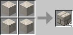

### Basalt Brick / 玄武岩レンガ / PR

* 実装状態: [ ]
* 名称: Basalt Brick / 日本語: 玄武岩レンガ / Origin: `projectred_exploration:basalt_brick` / New: `bcn:basalt_brick`
* レシピ: `Basalt` x4 -> `Basalt Brick` x4
* レシピ配置図: `AA` / `AA`
* 概要: 砂岩や石レンガと同じように、玄武岩を4つ組み合わせて作ったレンガ. 建材や装飾として用いる以外に特に用途はない. pre6追加レシピ: 玄武岩レンガ4 → サークル玄武岩レンガ4 玄武岩（焼石) → スムース玄武岩レンガ
* 専用GUI: 無
* 実装方法: 

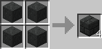

### Nikolite / ニコライトパウダー / PR

* 実装状態: [ ]
* 名称: Nikolite / 日本語: ニコライトパウダー / Origin: `-` / New: `bcn:nikolite`
* レシピ: なし
* レシピ配置図: `[000]` / `[000]` / `[000]`
* 概要: ニコライトの鉱石ブロックを破壊した際、3～5個ドロップする. ダイヤやレッドストーン同様、鉱石ブロックを直接回収する事はできない. レッドストーンと似た見た目だが、地面に撒く事はできず、青電力関連のアイテムの材料として必要になる素材.
* 専用GUI: 無
* 実装方法: 

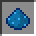

### Ruby / ルビー / PR

* 実装状態: [ ]
* 名称: Ruby / 日本語: ルビー / Origin: `projectred_core:ruby` / New: `bcn:ruby`
* レシピ: `Ruby Block` x1 -> `Ruby` x9
* レシピ配置図: `[不定形]`
* 概要: それぞれ対応する鉱石ブロックを破壊した際、1つドロップする. ダイヤやレッドストーン同様、鉱石ブロックを直接回収する事はできない. 基本的には各種ツールの材料に使うしか用途がない. グリーンサファイアのみ電動ドライバーの材料として使用する.
* 専用GUI: 無
* 実装方法: 

### Sapphire / サファイア / PR

* 実装状態: [ ]
* 名称: Sapphire / 日本語: サファイア / Origin: `projectred_core:sapphire` / New: `bcn:sapphire`
* レシピ: `Sapphire Block` x1 -> `Sapphire` x9
* レシピ配置図: `[不定形]`
* 概要: 
* 専用GUI: 無
* 実装方法: 

### Green Sapphire / グリーンサファイア / PR

* 実装状態: [ ]
* 名称: Green Sapphire / 日本語: グリーンサファイア / Origin: `-` / New: `bcn:green_sapphire`
* レシピ: なし
* レシピ配置図: `[000]` / `[000]` / `[000]`
* 概要: 
* 専用GUI: 無
* 実装方法: 

### Copper Ingot / 銅インゴット / PR

* 実装状態: [ ]
* 名称: Copper Ingot / 日本語: 銅インゴット / Origin: `-` / New: `bcn:copper_ingot`
* レシピ: `Copper` x1 -> `Copper Ingot` x1
* レシピ配置図: `[不定形]`
* 概要: 銅の鋳塊. かまどで銅鉱石を精錬したもの. 赤合金インゴットやブラスインゴットetc.の材料に使用.
* 専用GUI: 無
* 実装方法: 

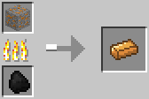

### Tin Ingot / 錫インゴット / PR

* 実装状態: [ ]
* 名称: Tin Ingot / 日本語: 錫インゴット / Origin: `projectred_exploration:tin_ingot` / New: `bcn:tin_ingot`
* レシピ: `Tin Block` x1 -> `Tin Ingot` x9
* レシピ配置図: `[不定形]`
* 概要: 錫の鋳塊. かまどで錫鉱石を精錬したもの. ブラスインゴットや錫合板etc.の合金材料として使用.
* 専用GUI: 無
* 実装方法: 

### Silver Ingot / 銀インゴット / PR

* 実装状態: [ ]
* 名称: Silver Ingot / 日本語: 銀インゴット / Origin: `projectred_exploration:silver_ingot` / New: `bcn:silver_ingot`
* レシピ: `Silver Block` x1 -> `Silver Ingot` x9
* レシピ配置図: `[不定形]`
* 概要: 銀の鋳塊. かまどで銀鉱石を精錬したもの. 青合金インゴットetc.の合金材料として使用.
* 専用GUI: 無
* 実装方法: 

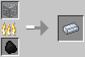

### Blue Alloy Ingot / 青合金インゴット / PR

* 実装状態: [ ]
* 名称: Blue Alloy Ingot / 日本語: 青合金インゴット / Origin: `-` / New: `bcn:blue_alloy_ingot`
* レシピ: `Silver Ingot` + `Nikolite` x4 -> `Blue Alloy Ingot` x1
* レシピ配置図: `[000]` / `[000]` / `[000]`
* 概要: ◆合金かまど(Alloy Furnace)で精錬 青電力伝達のための専用導体. レシピに使用するのは銀インゴット
* 専用GUI: 無
* 実装方法: 

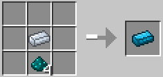

### Silicon Boule / 高純度シリコン / PR

* 実装状態: [ ]
* 名称: Silicon Boule / 日本語: 高純度シリコン / Origin: `projectred_core:boule` / New: `bcn:silicon_boule`
* レシピ: `Sand` x8 + `Coal` x8 / `Charcoal` x8 -> `Silicon Boule` x1
* レシピ配置図: `[000]` / `[000]` / `[000]`
* 概要: ◆合金かまど(Alloy Furnace)で精錬 石炭でも木炭でも作成可能 ICチップの素材としてお馴染みのシリコン. 半導体として高い適性を持つ. ちなみに"Boule"とは、棒状に成長させた巨大な単結晶のこと.
* 専用GUI: 無
* 実装方法: 

### Silicon Wafer / シリコンウェハー / PR

* 実装状態: [ ]
* 名称: Silicon Wafer / 日本語: シリコンウェハー / Origin: `-` / New: `bcn:silicon_wafer`
* レシピ: `Diamond Saw` + `Silicon Boule` -> `Silicon Wafer` x1
* レシピ配置図: `[000]` / `[000]` / `[000]`
* 概要: ダイヤノコは耐久値を消費するだけで、素材としては消費されない. ダイヤの手ノコで16枚にスライスされたシリコンウェハー. 実質、砂0.5＋木炭0.5から1枚作れる計算. 鉄や宝石の手ノコではここまで薄く切れないのか、ダイヤノコでしか作れない.
* 専用GUI: 無
* 実装方法: 

### Gem Handsaws / 宝石製の手ノコ / PR

* 実装状態: [ ]
* 名称: Gem Handsaws / 日本語: 宝石製の手ノコ / Origin: `-` / New: `bcn:gem_handsaws`
* レシピ: `Stick` x3 + `Iron Ingot` x2 + `Gems` x2 -> `Gem Handsaws` x1
* レシピ配置図: `[000]` / `[000]` / `[000]`
* 概要: 宝石製の手ノコ. 性能は三種全てでどれも同じ(耐久値500、攻撃力＝素手並) "黒曜石"、"高純度シリコン"の2種を除いた、 ダイヤ手ノコがカットできる全てのブロックをカットする事ができる.
* 専用GUI: 無
* 実装方法: 

<!-- 画像なし -->

### Ruby Tools / ルビーツール各種 / PR

* 実装状態: [ ]
* 名称: Ruby Tools / 日本語: ルビーツール各種 / Origin: `-` / New: `bcn:ruby_tools`
* レシピ: なし
* レシピ配置図: `[000]` / `[000]` / `[000]`
* 概要: 宝石製のツール. 基本5種＋草刈り鎌. 性能は三種全てでどれも同じ(耐久値500、攻撃力&採掘速度＝ダイヤ並) ただし破壊可能なブロックは鉄ツールと同等、黒曜石の破壊はできない. また、クワと草刈り鎌だけは、攻撃力は素手と同じ0.5で固定. 宝石はツール以外に使い道が無いため備蓄を特に気にせず使い潰せる.
* 専用GUI: 無
* 実装方法: 

### Sapphire Tools / サファイアツール各種 / PR

* 実装状態: [ ]
* 名称: Sapphire Tools / 日本語: サファイアツール各種 / Origin: `-` / New: `bcn:sapphire_tools`
* レシピ: なし
* レシピ配置図: `[000]` / `[000]` / `[000]`
* 概要: 
* 専用GUI: 無
* 実装方法: 

### Green Sapphire Tools / グリーンサファイアツール各種 / PR

* 実装状態: [ ]
* 名称: Green Sapphire Tools / 日本語: グリーンサファイアツール各種 / Origin: `-` / New: `bcn:green_sapphire_tools`
* レシピ: なし
* レシピ配置図: `[000]` / `[000]` / `[000]`
* 概要: 
* 専用GUI: 無
* 実装方法: 

